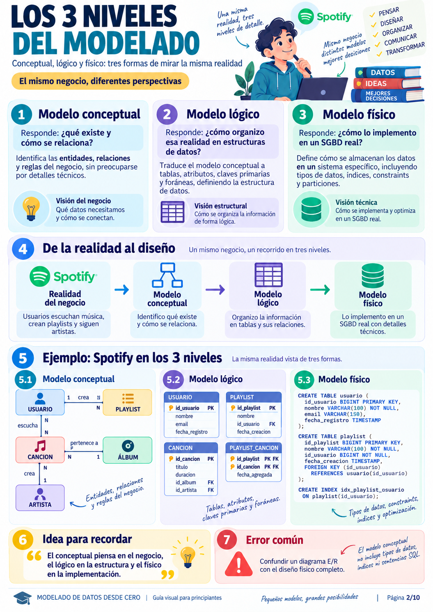
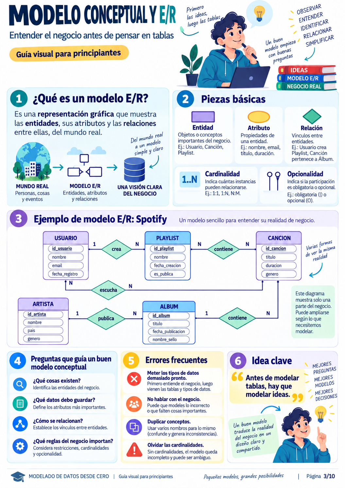
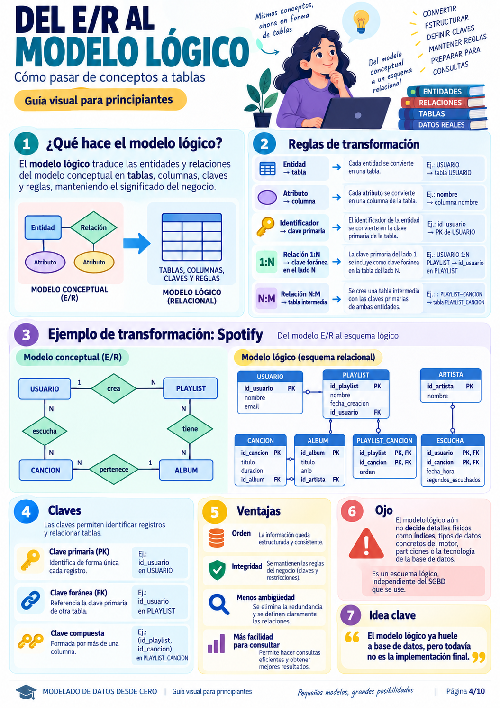
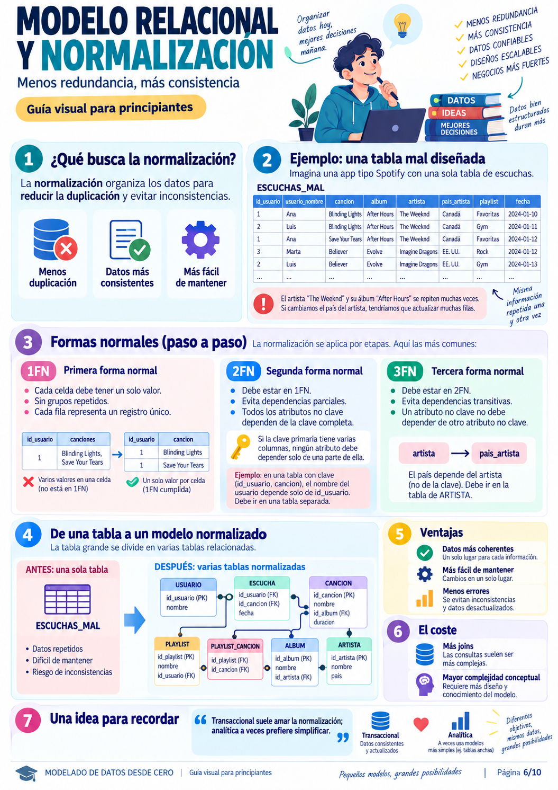
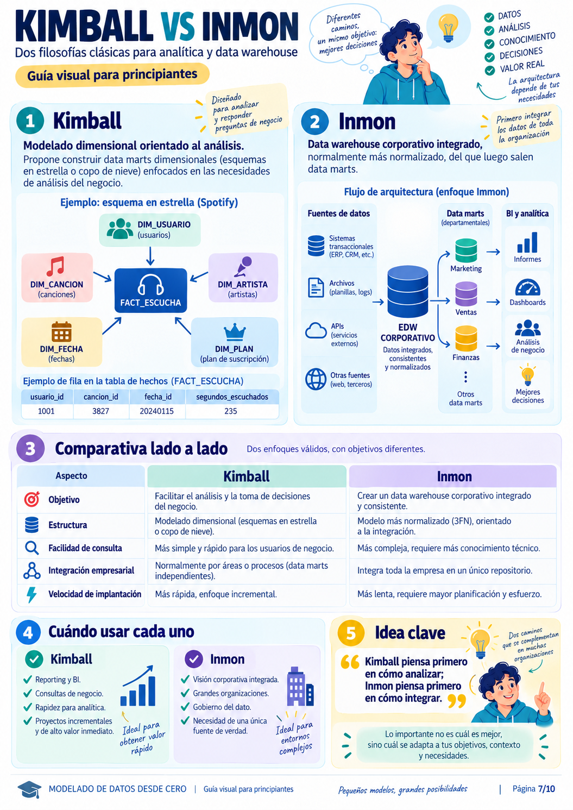
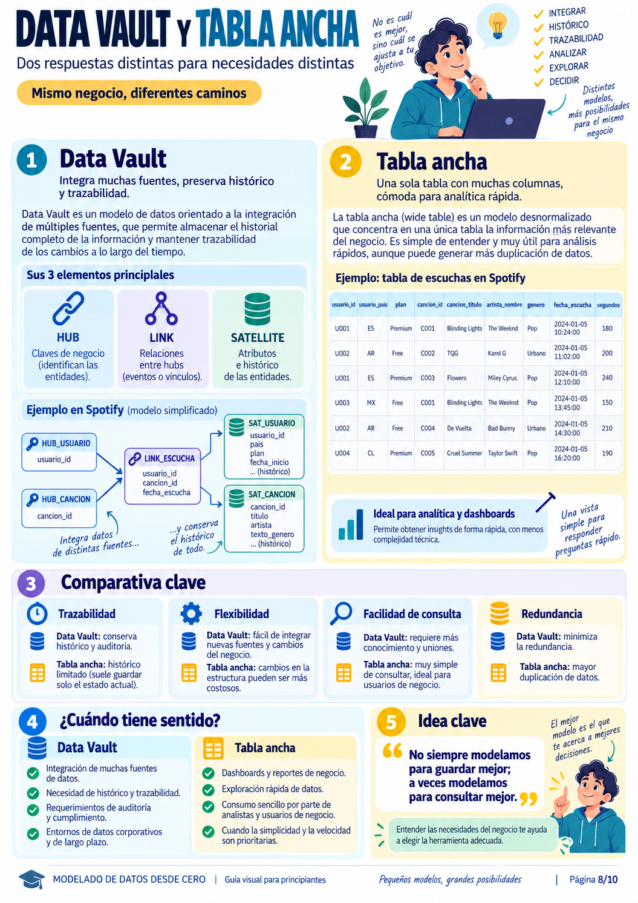
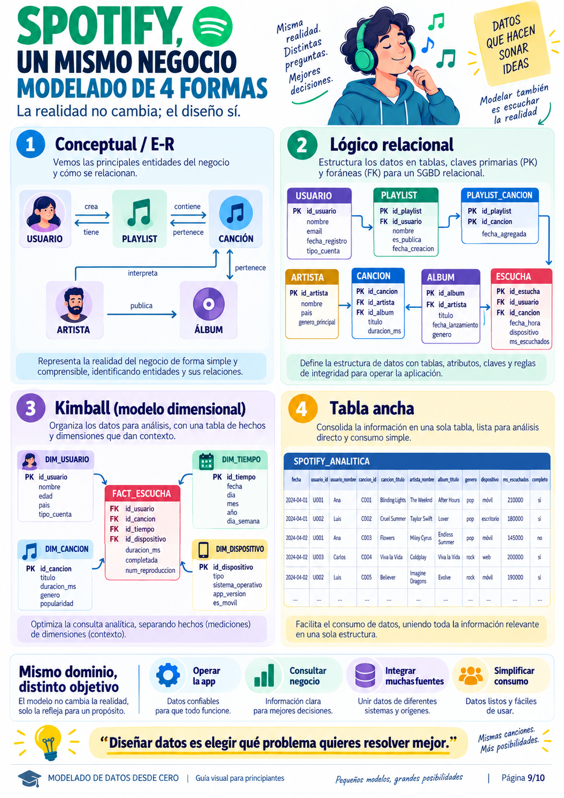

# 🏛️ Modelado de Datos: Del Diagrama E/R al Diseño Físico y Normalización (1NF, 2NF, 3NF)

> **Objetivo del Capítulo:**  
> Aprender a transformar la realidad de cualquier negocio en un modelo de datos estructurado, consistente y libre de anomalías. A través de **10 infografías especializadas**, recorreremos los **3 niveles del modelado** (Conceptual, Lógico y Físico), la teoría y práctica rigurosa de la **Normalización (1NF, 2NF y 3NF)** con sus pros y contras, y las **4 formas de modelar un mismo negocio** (**Relacional 3FN, Dimensional Kimball, Data Vault y Tabla Ancha**).  
> 
> Incluye un **laboratorio ejecutable en Python y SQLite** ([`laboratorio_modelado_normalizacion.py`](./laboratorio_modelado_normalizacion.py)) para reproducir en vivo las anomalías de diseño y su solución paso a paso.

---

## 🗺️ Mapa de Ruta del Modelado de Datos

```
                            EL CICLO VITAL DEL MODELADO
 ┌──────────────────────────────────────────────────────────────────────────────────┐
 │ 1. LOS TRES NIVELES DEL DISEÑO                                                   │
 │    • Módulo 1: Qué es Modelar Datos (De la Realidad al Uso Real)                 │
 │    • Módulo 2: Los 3 Niveles: Conceptual, Lógico y Físico (Caso Spotify)         │
 │    • Módulo 3: El Modelo Conceptual y Diagrama E/R (Entidades, Rombos y Líneas)  │
 │    • Módulo 4: Reglas de Transformación del E/R al Modelo Lógico Relacional      │
 │    • Módulo 5: El Modelo Físico en SQL (Tipos, Constraints, Índices y Particiones)│
 ├──────────────────────────────────────────────────────────────────────────────────┤
 │ 2. EL CORAZÓN DE LA CONSISTENCIA: NORMALIZACIÓN                                  │
 │    • Módulo 6: Las 3 Anomalías Mortales y el Paso a Paso: 1NF -> 2NF -> 3NF     │
 │    • Pros y Contras del Diseño Normalizado vs Desnormalizado                     │
 ├──────────────────────────────────────────────────────────────────────────────────┤
 │ 3. PARADIGMAS ANALÍTICOS Y MODELADOS ALTERNATIVOS                                │
 │    • Módulo 7: Kimball (Esquema en Estrella) vs Inmon (EDW Corporativo 3NF)      │
 │    • Módulo 8: Data Vault (Hubs, Links, Satellites) vs Tabla Ancha (OBT)        │
 │    • Módulo 9: Un Mismo Negocio (Spotify) Modelado de 4 Formas Distintas         │
 ├──────────────────────────────────────────────────────────────────────────────────┤
 │ 4. SÍNTESIS Y LABORATORIO EN CÓDIGO                                              │
 │    • Módulo 10: El Arte del Modelador: Checklist, Señales de Éxito y Errores     │
 │    • Laboratorio Práctico Reproducible (`laboratorio_modelado_normalizacion.py`) │
 └──────────────────────────────────────────────────────────────────────────────────┘
```

---

## 📑 Módulo 1: Modelado de Datos Desde Cero (La Gran Idea)


### 1.1. ¿Qué es modelar datos?
Modelar datos no es escribir sentencias `CREATE TABLE` apresuradamente. **Es representar la realidad de un negocio** para almacenar, relacionar y explotar la información de forma confiable.

### 1.2. La Gran Cadena de Valor del Modelado:
```
  [Problema Negocio] ──> [Modelo Conceptual] ──> [Modelo Lógico] ──> [Modelo Físico] ──> [Uso Real]
  "Queremos entender     Identifica entidades    Estructura tablas,     Tipos en Postgres,   Consultas,
   la música que          y relaciones sin        claves primarias       índices y particio-  reportes y
   escuchan los users"    tecnología.             y foráneas.            nes de almacenamiento. ML.
```

> 👁️ **Ojo con esto (Sabiduría de Modelado):**  
> *"No existe un único modelo perfecto: el mejor diseño depende estrictamente del uso principal que se le dará a los datos (operacional diario, analítica histórica o procesamiento en tiempo real)."*

---

## 📑 Módulo 2: Los Tres Niveles del Modelado



Una de las confusiones más graves de los desarrolladores noveles es mezclar los tipos de datos de SQL con las reglas de negocio. Para evitarlo, la ingeniería de software divide el diseño en **3 niveles independientes**:

| Nivel | Pregunta a la que Responde | ¿A quién va dirigido? | ¿Qué incluye? | ¿Qué NO incluye? |
| :--- | :--- | :--- | :--- | :--- |
| **1. Conceptual** | *¿Qué conceptos existen en la realidad y cómo se conectan?* | Directores de negocio, usuarios, analistas. | Entidades (Usuario, Canción), Relaciones (Escucha, Crea), Cardinalidad (1:N, N:M). | Sin tipos de datos, sin claves foráneas, sin sintaxis SQL. |
| **2. Lógico** | *¿Cómo organizo esa realidad en estructuras de datos abstractas?* | Arquitectos de datos, ingenieros de software. | Tablas, columnas, claves primarias (PK), claves foráneas (FK), tablas intermedias. | Independiente del motor (no importa si es PostgreSQL, MySQL u Oracle). |
| **3. Físico** | *¿Cómo lo implemento de forma óptima en un SGBD concreto?* | Administradores de BD (DBA), ingenieros de datos. | Tipos de datos nativos (`BIGSERIAL`, `VARCHAR(255)`), constraints (`CHECK`), índices B-Tree, particiones de disco. | Es 100% específico del motor de base de datos elegido. |

> 👁️ **Ojo con esto (Sabiduría de Modelado):**  
> *"El modelo conceptual piensa en el negocio; el lógico piensa en la estructura y las relaciones; el físico piensa en el rendimiento del hardware y la optimización en disco."*

---

## 📑 Módulo 3: El Modelo Conceptual y Diagrama Entidad-Relación (E/R)



El **Diagrama Entidad-Relación (E/R)** inventado por Peter Chen en 1976 es la herramienta visual estándar para capturar las reglas del negocio:

```
                               ELEMENTOS DEL DIAGRAMA E/R
      ┌────────────────┐             ◇ Relación               ( Atributo )
      │    ENTIDAD     │       Vínculo entre entidades.   Propiedad descriptiva.
      │ (Cosa/Concepto)│     Ej: "Usuario CREA Playlist"  Ej: "nombre", "precio"
      └────────────────┘
```

### Cardinalidades Fundamentales:
1. **Uno a Uno ($1:1$):** Cada usuario tiene un único perfil privado de facturación.
2. **Uno a Muchos ($1:N$):** Un artista publica muchos álbumes; cada álbum pertenece a un solo artista.
3. **Muchos a Muchos ($N:M$):** Una playlist contiene muchas canciones; una canción está presente en muchas playlists.

### Opcionalidad / Participación:
* **Obligatoria ($1$):** Una canción no puede existir en el catálogo sin pertenecer a un álbum.
* **Opcional ($0$):** Un usuario puede registrarse hoy y no haber creado ninguna playlist todavía.

> 👁️ **Ojo con esto (Sabiduría de Modelado):**  
> *"Antes de abrir un editor SQL para crear tablas, dibuja las ideas. Si un modelo conceptual no está claro entre el negocio y los ingenieros, ningún código SQL resolverá los malentendidos posteriores."*

---

## 📑 Módulo 4: Del Diagrama E/R al Modelo Lógico Relacional



Existen **reglas matemáticas de derivación** exactas para convertir un diagrama E/R en un esquema de tablas relacionales:

```
                    REGLAS DE TRANSFORMACIÓN AL MODELO LÓGICO
 ┌───────────────────────────┬────────────────────────────────────────────────────────┐
 │ Elemento Conceptual (E/R) │ Transformación al Modelo Lógico Relacional             │
 ├───────────────────────────┼────────────────────────────────────────────────────────┤
 │ Entidad                   │ Se convierte en una **Tabla**.                         │
 │ Atributo                  │ Se convierte en una **Columna** de la tabla.           │
 │ Identificador Único       │ Se convierte en la **Clave Primaria (PK)**.            │
 │ Relación 1:N              │ La PK del lado '1' viaja como **Clave Foránea (FK)**   │
 │                           │ a la tabla del lado 'N'.                               │
 │ Relación N:M              │ Se crea una **Tabla Intermedia / Asociativa** cuya PK  │
 │                           │ compuesta está formada por las FKs de ambas tablas.    │
 └───────────────────────────┴────────────────────────────────────────────────────────┘
```

### El Caso Spotify: Resolución de la relación $N:M$ entre `PLAYLIST` y `CANCION`:
Una playlist tiene muchas canciones y una canción está en muchas playlists. En el modelo relacional **es imposible meter un array de canciones dentro de una celda de playlist**. Por tanto, se crea la tabla intermedia `PLAYLIST_CANCION`:

```sql
-- Tabla Intermedia Asociativa para resolver la relación N:M
CREATE TABLE playlist_cancion (
    id_playlist INT REFERENCES playlist(id_playlist),
    id_cancion INT REFERENCES cancion(id_cancion),
    fecha_agregada TIMESTAMP DEFAULT CURRENT_TIMESTAMP,
    orden INT NOT NULL,
    PRIMARY KEY (id_playlist, id_cancion) -- Clave Primaria Compuesta
);
```

> 👁️ **Ojo con esto (Sabiduría de Modelado):**  
> *"La tabla intermedia no solo almacena las dos claves foráneas; es el lugar natural donde residen los atributos propios de la relación (por ejemplo: la 'fecha en que se agregó la canción a la lista' o el 'orden de reproducción')."*

---

## 📑 Módulo 5: El Modelo Físico en SQL Real


En el modelo físico tomamos las decisiones que afectan directamente al **rendimiento en disco, consumo de memoria y concurrencia**:

### 1. Tipos de Datos Precisos
* `INT` (4 bytes, hasta 2.000 millones) vs `BIGINT` (8 bytes, indispensable para IDs de reproducciones masivas en Spotify).
* `VARCHAR(100)` (cadena de longitud variable) vs `TEXT` (sin límite arbitrario).
* `TIMESTAMP WITH TIME ZONE` (fechas con huso horario para aplicaciones internacionales).

### 2. Restricciones de Integridad en el Motor
```sql
CREATE TABLE canciones (
    id_cancion BIGSERIAL PRIMARY KEY,
    titulo VARCHAR(200) NOT NULL,
    duracion_seg INTEGER NOT NULL CHECK (duracion_seg > 0), -- Evita canciones de duración negativa
    id_album BIGINT NOT NULL REFERENCES albumes(id_album) ON DELETE CASCADE
);
```

### 3. Índices Estratégicos (`CREATE INDEX`)
En bases de datos relacionales, **las claves foráneas NO se indexan automáticamente**. Si no creas un índice sobre `id_album`, cada vez que Spotify consulte *"canciones del álbum X"*, la base de datos tendrá que escanear la tabla entera de 100 millones de canciones:
```sql
CREATE INDEX idx_canciones_album ON canciones(id_album);
```

> 👁️ **Ojo con esto (Sabiduría de Modelado):**  
> *"Diseñar físicamente es gestionar un trade-off permanente: añadir índices acelera drásticamente las consultas (`SELECT`), pero penaliza la velocidad de inserción y actualización (`INSERT`/`UPDATE`), ya que el motor debe reescribir el árbol B-Tree del índice en cada escritura."*

---

## 📑 Módulo 6: El Núcleo Teórico: Las Formas Normales (1NF, 2NF, 3NF)



La **Normalización** es el proceso formal de organizar las columnas y tablas para eliminar la redundancia de datos y prevenir las **3 anomalías destructivas**.

### ⚠️ El Ejemplo de la Pesadilla: La Tabla Desnormalizada `ESCUCHAS_CAOTICAS`

Imagina que un desarrollador novato crea una sola tabla plana para almacenar todo:

| id_usuario | usuario_nombre | canciones | album | artista | pais_artista | fecha |
| :---: | :--- | :--- | :--- | :--- | :--- | :---: |
| **1** | Ana | Blinding Lights, Save Your Tears | After Hours | The Weeknd | Canadá | 2026-01-10 |
| **2** | Luis | Believer | Evolve | Imagine Dragons | EE. UU. | 2026-01-12 |
| **1** | Ana | In Your Eyes | After Hours | The Weeknd | Canadá | 2026-01-15 |

---

### 🚨 Las 3 Anomalías Mortales de un Mal Diseño:

1. **Anomalía de Inserción (*Insertion Anomaly*):**  
   ¿Podemos dar de alta a una nueva artista emergente (*"Rosalía"*, de España) si aún ningún usuario ha escuchado su música?  
   **No podemos.** Para insertarla en esta tabla tendríamos que inventar un usuario fantasma o rellenar con `NULL` el usuario y la fecha.
2. **Anomalía de Actualización (*Update Anomaly*):**  
   El artista *"The Weeknd"* y su país *"Canadá"* están repetidos en miles de filas. Si su país estuviera mal escrito y actualizamos solo una fila, la base de datos contendrá información contradictoria (¿The Weeknd es de Canadá o de Estados Unidos?).
3. **Anomalía de Borrado (*Deletion Anomaly*):**  
   Si Luis (usuario 2) decide darse de baja de la aplicación y borramos su fila, **borramos accidentalmente la única constancia de que el grupo *"Imagine Dragons"* y su álbum *"Evolve"* existen en la plataforma**.

---

### 🪜 El Proceso de Normalización Paso a Paso

```
                          LA ESCALERA DE LA NORMALIZACIÓN
      ┌─────────────────────────────────────────────────────────────────┐
      │ 3NF: Cumple 2NF + Sin dependencias transitivas (A -> B -> C)     │
      ├─────────────────────────────────────────────────────────────────┤
      │ 2NF: Cumple 1NF + Dependencia funcional total de la PK completa │
      ├─────────────────────────────────────────────────────────────────┤
      │ 1NF: Atomicidad total (1 valor por celda, sin listas repetidas) │
      └─────────────────────────────────────────────────────────────────┘
```

#### Paso 1: Primera Forma Normal (1NF) — "La Regla de la Atomicidad"
* **Condición:**  
  1. Cada columna debe contener un **único valor atómico** (prohibido guardar listas separadas por comas o JSONs anidados).
  2. No debe haber grupos repetitivos de columnas (`telefono1`, `telefono2`).
  3. Cada fila debe identificarse mediante una **clave primaria única**.
* **Corrección:** Desdoblamos la celda de Ana en dos filas separadas:

| id_escucha (PK) | id_usuario | usuario_nombre | cancion | album | artista | pais_artista | fecha |
| :---: | :---: | :--- | :--- | :--- | :--- | :--- | :---: |
| **1** | 1 | Ana | Blinding Lights | After Hours | The Weeknd | Canadá | 2026-01-10 |
| **2** | 1 | Ana | Save Your Tears | After Hours | The Weeknd | Canadá | 2026-01-10 |

---

#### Paso 2: Segunda Forma Normal (2NF) — "Dependencia Funcional Completa"
* **Condición:**  
  1. Debe estar en 1NF.
  2. **Ningún atributo no clave debe depender de una parte de la clave primaria** (aplica cuando la clave primaria es compuesta por varias columnas).
* **El Problema:** Si la clave fuera `(id_usuario, id_cancion)`, el `usuario_nombre` depende **únicamente** de `id_usuario`, no de la canción que escucha.
* **Corrección:** Se extrae el usuario a su propia tabla independiente:
  * Tabla `USUARIOS (id_usuario [PK], nombre)`
  * Tabla `ESCUCHAS (id_escucha [PK], id_usuario [FK], cancion, album, artista, pais, fecha)`

---

#### Paso 3: Tercera Forma Normal (3NF) — "Cero Dependencias Transitivas"
* **La Regla de Oro de Bill Kent:**  
  > *"Cada atributo no clave debe depender de la clave primaria, de toda la clave primaria y de nada más que de la clave primaria (so help me Codd)."*
* **El Problema en 2NF:** Existe una dependencia transitiva:
  $$\text{id\_escucha} \longrightarrow \text{artista} \longrightarrow \text{pais\_artista}$$
  El país no depende del evento de la escucha; **depende del artista**. El álbum no depende de la escucha; **depende del artista**.
* **Corrección Definitiva a 3NF:** Separamos en entidades puras:
  1. `ARTISTAS (id_artista [PK], nombre, pais)`
  2. `ALBUMES (id_album [PK], id_artista [FK], titulo, anio)`
  3. `CANCIONES (id_cancion [PK], id_album [FK], titulo, duracion_seg)`
  4. `USUARIOS (id_usuario [PK], nombre)`
  5. `ESCUCHAS (id_escucha [PK], id_usuario [FK], id_cancion [FK], fecha)`

---

### ⚖️ Pros y Contras del Diseño Normalizado (3NF)

| Aspecto | Modelo Normalizado (3NF) | Modelo Desnormalizado / Tabla Plana |
| :--- | :--- | :--- |
| **Redundancia** | **Cero duplicación:** Cada dato existe exactamente en un único lugar. | **Alta duplicación:** Nombres de artistas y canciones repetidos millones de veces. |
| **Consistencia** | **Máxima:** Modificar el país de un artista requiere actualizar 1 sola fila en `artistas`. | **Peligrosa:** Exige actualizar millones de filas con riesgo de desincronización. |
| **Espacio en Disco** | **Mínimo:** Usa IDs numéricos compactos (`BIGINT`) como claves foráneas. | **Elevado:** Almacena cadenas de texto repetitivas en cada registro. |
| **Velocidad de Escritura (OLTP)** | **Ultrarrápida:** Inserciones y actualizaciones atómicas sin bloqueos masivos. | **Lenta:** Actualizaciones complejas que afectan a grandes bloques de filas. |
| **Velocidad de Lectura (OLAP)** | **Más lenta:** Para generar un informe analítico se necesitan **4 o 5 `JOIN`s**. | **Ultrarrápida:** Cero `JOIN`s; un simple escaneo directo devuelve el reporte. |

> 👁️ **Ojo con esto (Sabiduría de Modelado):**  
> *"Las bases de datos transaccionales (OLTP, como la app móvil de Spotify) aman la normalización en 3NF porque asegura transacciones seguras y sin inconsistencias. Las bases de datos analíticas (OLAP, como BigQuery o ClickHouse) prefieren la desnormalización para evitar el coste computacional de los JOINs."*

---

## 📑 Módulo 7: Kimball vs Inmon (Las Dos Filosofías Analíticas)



Cuando abandonamos el mundo transaccional y diseñamos un **Data Warehouse corporativo**, surgen dos grandes escuelas de pensamiento:

```
          ENFOQUE INMON (Top-Down)                 ENFOQUE KIMBALL (Bottom-Up)
          ┌───────────────────────┐                 ┌───────────────────────┐
          │  Sistemas Operativos  │                 │  Sistemas Operativos  │
          └───────────┬───────────┘                 └───────────┬───────────┘
                      ▼                                         ▼
          ┌───────────────────────┐                 ┌───────────────────────┐
          │  EDW Corporativo 3NF  │                 │ Datamarts Kimball     │
          │  (Gran Almacén Único) │                 │ (Esquemas en Estrella)│
          └───────────┬───────────┘                 └───────────┬───────────┘
                      ▼                                         ▼
          ┌───────────────────────┐                 ┌───────────────────────┐
          │ Datamarts Específicos │                 │   Consumo BI Directo  │
          └───────────────────────┘                 └───────────────────────┘
```

1. **Enfoque Ralph Kimball (Modelado Dimensional):**
   * Diseña pensando en **preguntas de negocio concretas**.
   * Crea **Esquemas en Estrella** con Tablas de Hechos (`fact_escucha`) y Tablas de Dimensiones (`dim_usuario`, `dim_cancion`, `dim_tiempo`).
   * Rápido de implementar, ágil e intuitivo para analistas de negocio.
2. **Enfoque Bill Inmon (Factoría Corporativa de Información):**
   * Diseña primero un gran repositorio central **totalmente normalizado en 3NF**.
   * Desde ese núcleo central normalizado se desprenden los Datamarts para cada departamento.
   * Muy riguroso y consistente para corporaciones multinacionales, pero de implantación más lenta y costosa.

> 👁️ **Ojo con esto (Sabiduría de Modelado):**  
> *"Kimball piensa primero en cómo analizar los datos de forma rápida; Inmon piensa primero en cómo integrar toda la empresa bajo una única verdad corporativa."*

---

## 📑 Módulo 8: Data Vault y Tabla Ancha (*Wide Table*)



Dos respuestas diametralmente opuestas para escenarios modernos:

### 1. Data Vault (Diseñado para Integrar Cientos de Fuentes con Trazabilidad Total)
Se basa en 3 tipos de entidades:
* **HUBS (Claves de Negocio):** Contienen únicamente las claves de negocio inmutables (ej. `id_usuario`).
* **LINKS (Relaciones):** Registran las conexiones entre Hubs (ej. qué usuario escuchó qué canción).
* **SATELLITES (Atributos e Histórico):** Guardan los atributos descriptivos junto con marcas de tiempo (*timestamps*) para auditar cómo cambia cada dato a lo largo de los años.

### 2. Tabla Ancha (*Wide Table* / One Big Table - OBT)
* Es el extremo opuesto: **una sola tabla con 50 o 100 columnas completamente desnormalizada**.
* En bases de datos columnares modernas (ClickHouse, BigQuery, Snowflake), las tablas anchas ofrecen rendimientos de consulta asombrosos porque el motor no sufre computando `JOIN`s en memoria distribuida.

---

## 📑 Módulo 9: Spotify Modelado de 4 Formas Distintas



Una de las mayores lecciones de la ingeniería de datos: **la realidad del negocio es exactamente la misma; lo que cambia es el objetivo del modelo**:

```
                       UN MISMO NEGOCIO, CUATRO ARQUITECTURAS
 ┌─────────────────────────────┬────────────────────────────────────────────────────────┐
 │ Arquitectura                │ ¿Para qué se utiliza en Spotify?                       │
 ├─────────────────────────────┼────────────────────────────────────────────────────────┤
 │ **1. Conceptual E/R**       │ Para que producto, diseño y negocio alineen conceptos. │
 │ **2. Relacional 3FN**       │ Para la app móvil: transacciones ACID, crear playlists │
 │                             │ y editar perfiles sin inconsistencias.                 │
 │ **3. Dimensional Kimball**  │ Para el Data Warehouse de analítica de marketing,      │
 │                             │ cálculo de royalties a discográficas y reportes BI.    │
 │ **4. Tabla Ancha (OBT)**    │ Para alimentar el dashboard de 'Spotify Wrapped'       │
 │                             │ o modelos de Machine Learning en milisegundos.         │
 └─────────────────────────────┴────────────────────────────────────────────────────────┘
```

> 👁️ **Ojo con esto (Sabiduría de Modelado):**  
> *"Diseñar datos es elegir qué problema quieres resolver mejor: operar la aplicación sin errores (3NF), analizar métricas de negocio con claridad (Kimball) o procesar analítica masiva sin latencia (Tabla Ancha)."*

---

## 📑 Módulo 10: El Arte del Modelador (Checklist y Buenas Prácticas)


### El Checklist Definitivo Antes de Aprobar un Diseño:
- [ ] ¿Qué preguntas de negocio debe responder este modelo?
- [ ] ¿Quién lo va a consultar y con qué frecuencia?
- [ ] ¿Es un sistema donde predomina la escritura (OLTP) o la lectura (OLAP)?
- [ ] ¿Necesitamos auditoría histórica de cómo cambian los valores en el tiempo?
- [ ] ¿Se han definido claves primarias y foráneas explícitas para proteger la integridad?
- [ ] ¿Hemos evaluado el coste de los `JOIN`s en caso de que la tabla alcance 100 millones de registros?

---

## 🧪 Práctica de Laboratorio en Código: [`laboratorio_modelado_normalizacion.py`](./laboratorio_modelado_normalizacion.py)

Para experimentar en primera persona con la teoría de este capítulo, ejecuta el script adjunto:

```bash
cd "Databases_Intro/1. Fundamentals/2. Modelado"
python3 laboratorio_modelado_normalizacion.py
```

### Lo que verás en vivo durante la ejecución:
1. **Paso 1:** Se crea la tabla desnormalizada `escuchas_caoticas` y se provocan en tiempo real la **anomalía de actualización** (The Weeknd con dos países a la vez) y la **anomalía de borrado** (se elimina un usuario y se pierde la existencia de Imagine Dragons).
2. **Paso 2:** Se aplica el algoritmo de normalización:
   * **1NF:** Desdoble de celdas con listas y creación de clave primaria.
   * **2NF:** Separación de la entidad `USUARIOS` para eliminar dependencias parciales.
   * **3NF:** Separación de `ARTISTAS`, `ALBUMES`, `CANCIONES`, `USUARIOS` y `ESCUCHAS`, eliminando dependencias transitivas.
3. **Paso 3:** Se instancian en la misma base de datos la versión **Dimensional Kimball** (`fact_escuchas` + dimensiones) y la versión **Tabla Ancha** (*Wide Table*).

---

## 💡 Ejercicio Propuesto para el Alumno (Reto Práctico)

Abre [`laboratorio_modelado_normalizacion.py`](./laboratorio_modelado_normalizacion.py) o tu consola SQLite y resuelve este reto de diseño:

1. **Añadir la Entidad `DISCOGRAFICA`:**  
   * En la actualidad, el álbum tiene el atributo `nombre_sello` o discográfica.
   * Si la discográfica tiene atributos propios (`pais_sede`, `anio_fundacion`), ¿dónde debe residir para no violar la **3NF**?
   * Escribe la sentencia `CREATE TABLE discograficas` y ajusta la clave foránea en `albumes`.
2. **Reflexión Crítica:**  
   * Si tuvieras que diseñar el motor de recomendaciones en tiempo real de Spotify que sugiere la siguiente canción al instante, ¿consultarías el modelo normalizado de 5 tablas con 4 `JOIN`s o una tabla ancha precalculada en memoria caché tipo Redis/ClickHouse? Justifica tu respuesta con lo aprendido en el **Módulo 6 y 9**.
