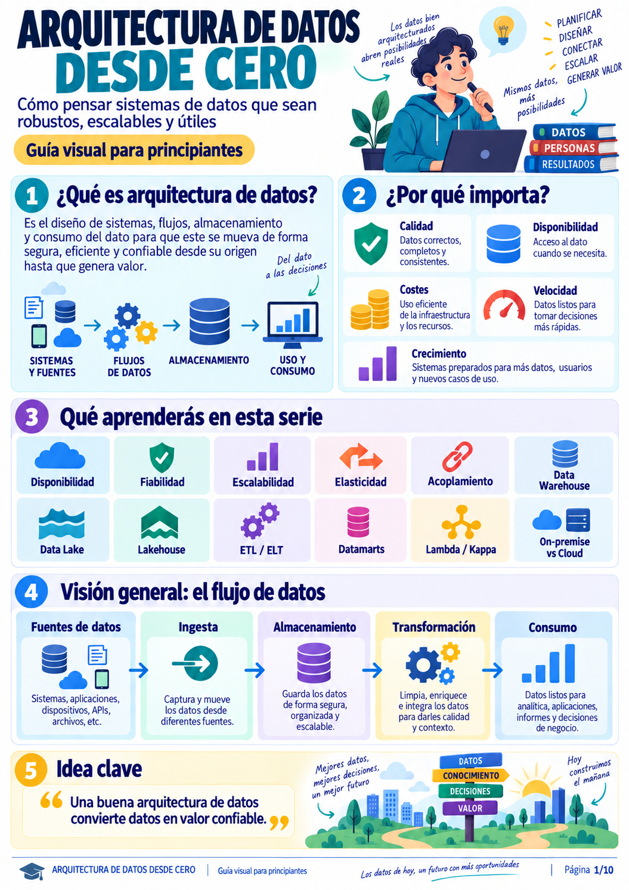
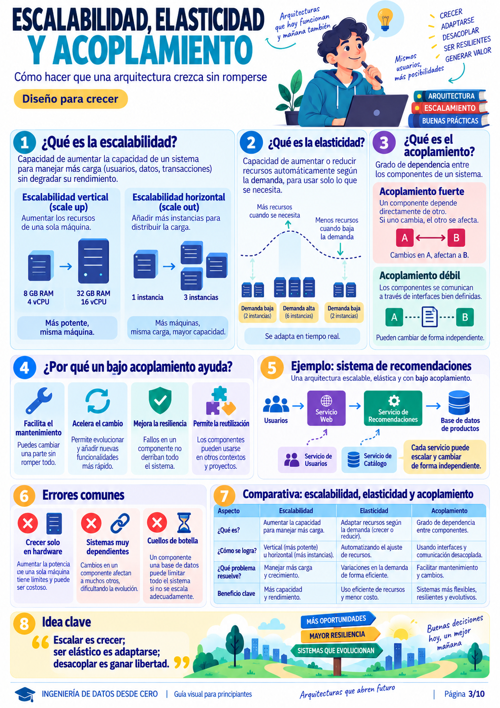
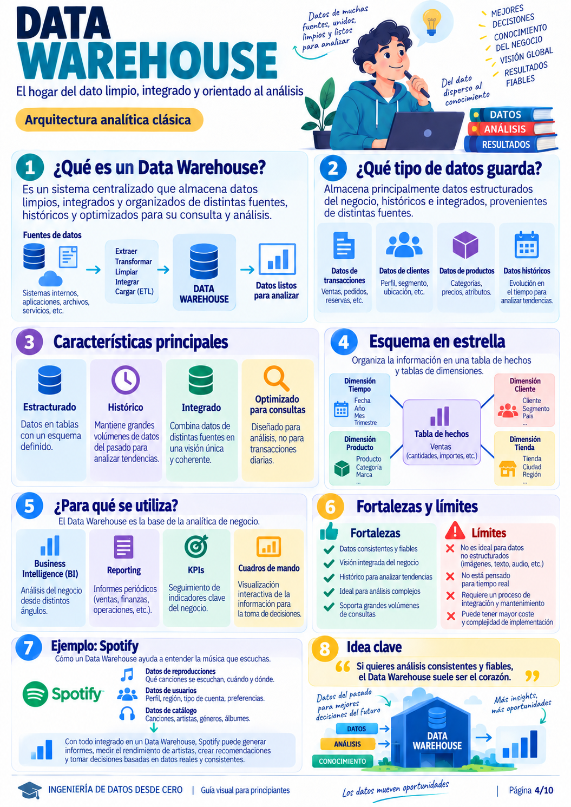
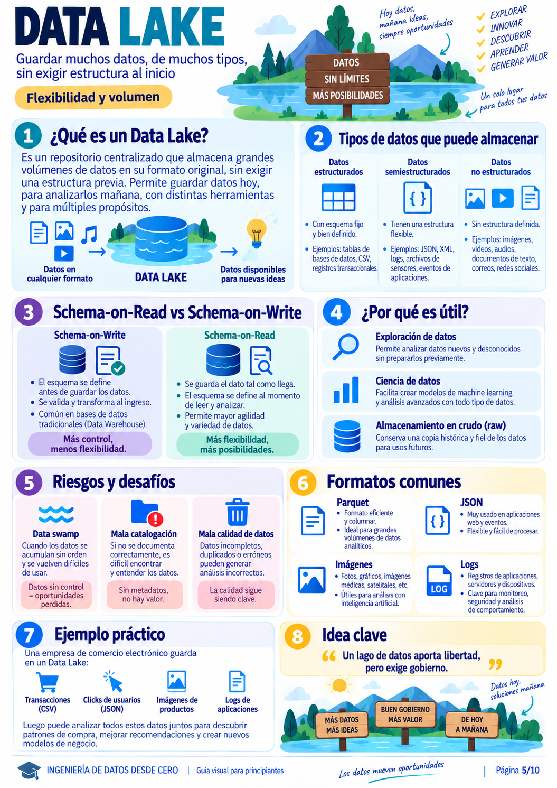
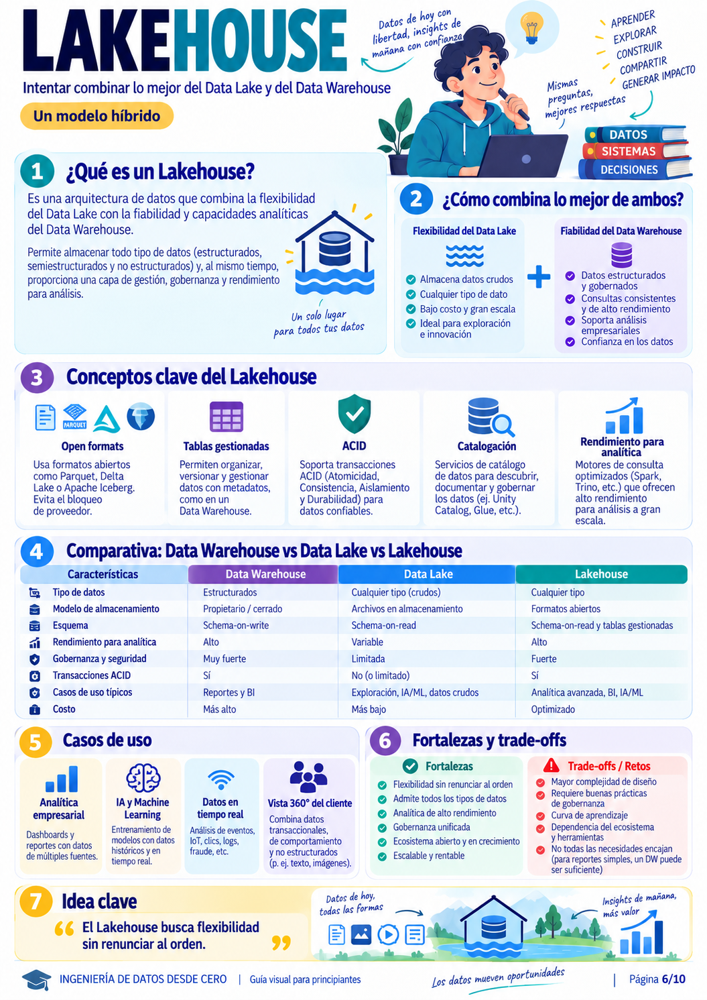
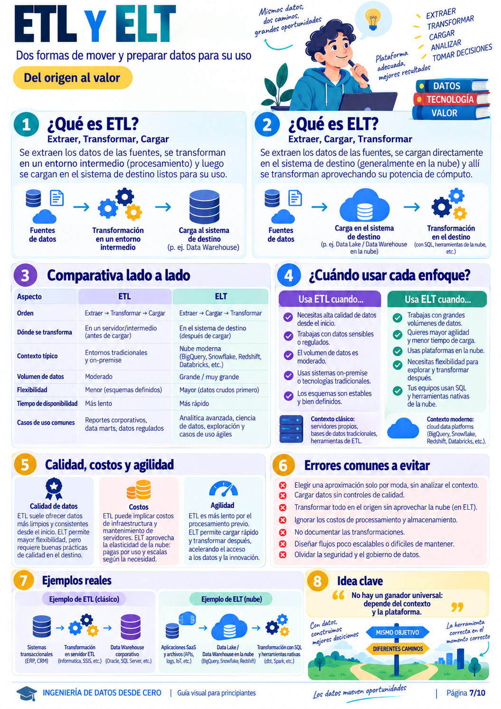
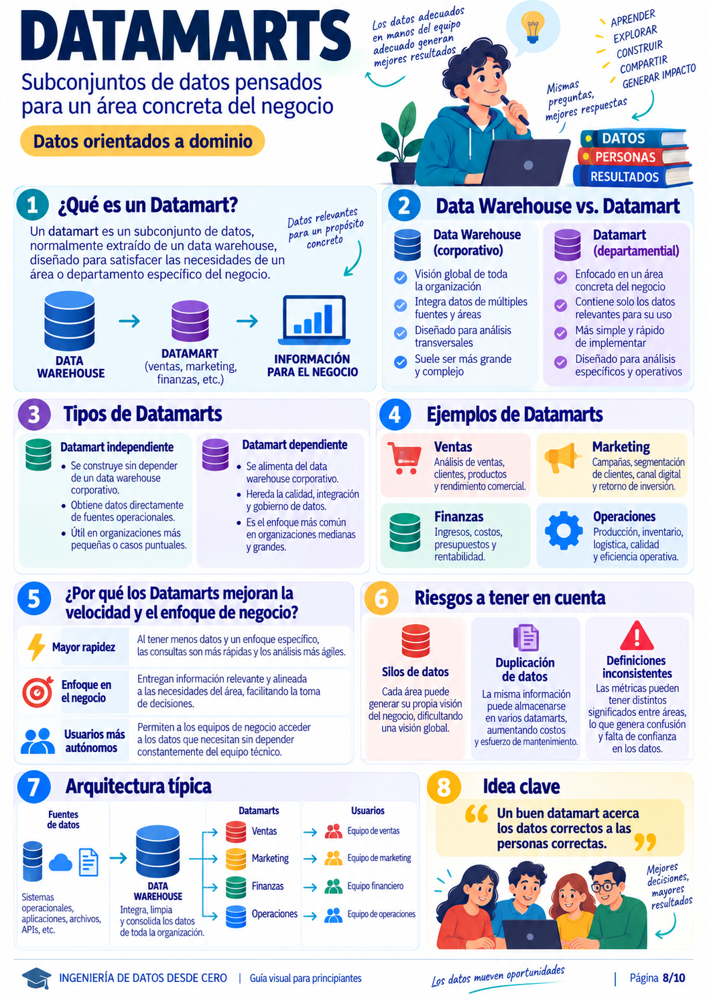
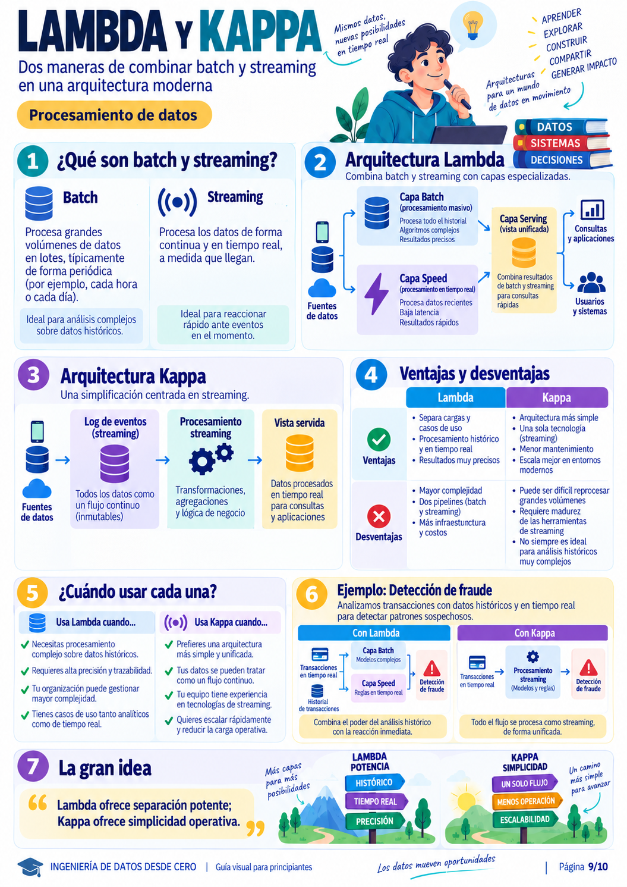
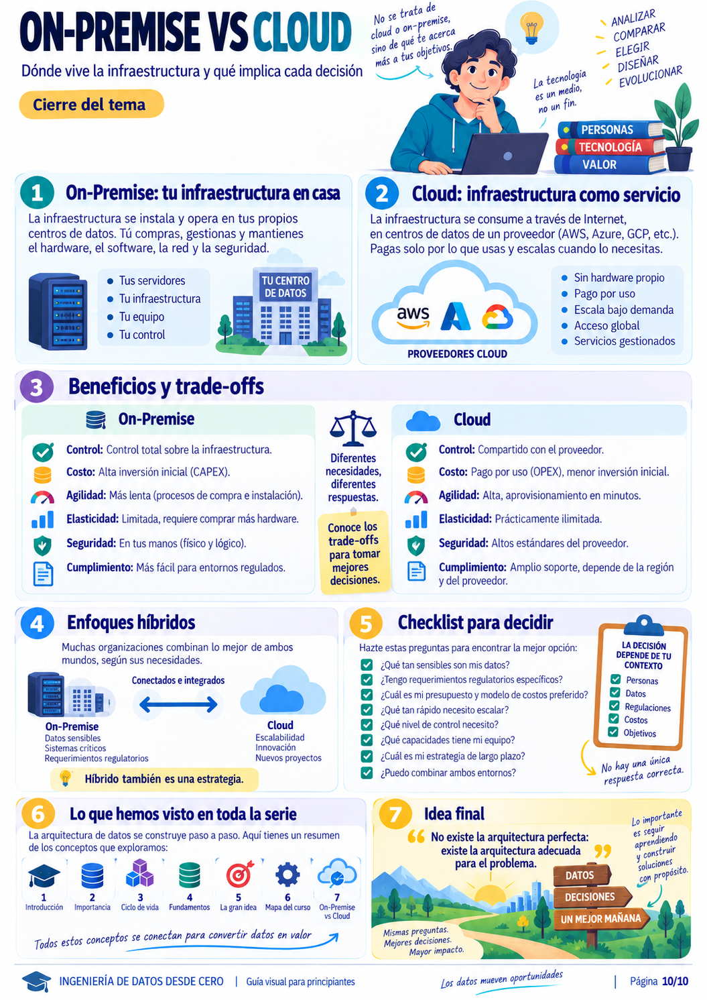

# 🏛️ Laboratorio de Arquitectura de Datos: De Cero a Sistemas Confiables y Escalables

> **Objetivo del Laboratorio:**  
> Aprender a pensar y diseñar sistemas de datos robustos, escalables y orientados a generar valor real en el negocio. A través de **10 infografías fundamentales**, desgranamos desde los conceptos esenciales (disponibilidad, acoplamiento, escalabilidad) hasta las arquitecturas analíticas modernas (**Data Warehouse, Data Lake, Lakehouse, ETL vs ELT, Datamarts, Lambda y Kappa, y Cloud vs On-Premise**).  
> Incluye un **laboratorio práctico ejecutable en Python y SQLite** ([`laboratorio_practico.py`](./laboratorio_practico.py)) para aterrizar los conceptos sin requerir nubes de pago ni clústeres complejos.

---

## 🗺️ Mapa de Ruta del Curso de Arquitectura

```
                        EL VIAJE DEL ARQUITECTO DE DATOS
 ┌──────────────────────────────────────────────────────────────────────────────────┐
 │ 1. FUNDAMENTOS Y PRINCIPIOS DE DISEÑO                                            │
 │    • Módulo 1: ¿Qué es Arquitectura de Datos y su Flujo de Vida?                 │
 │    • Módulo 2: Disponibilidad vs Fiabilidad (El mito del 99.9% Uptime)           │
 │    • Módulo 3: Escalabilidad, Elasticidad y Bajo Acoplamiento                    │
 ├──────────────────────────────────────────────────────────────────────────────────┤
 │ 2. PARADIGMAS DE ALMACENAMIENTO ANALÍTICO                                        │
 │    • Módulo 4: Data Warehouse (Modelo Kimball y Esquema en Estrella)             │
 │    • Módulo 5: Data Lake (Schema-on-Read vs Schema-on-Write y el Data Swamp)     │
 │    • Módulo 6: Lakehouse (El estándar híbrido: Parquet + Transacciones ACID)     │
 ├──────────────────────────────────────────────────────────────────────────────────┤
 │ 3. INGENIERÍA DE PROCESAMIENTO Y DOMINIOS DE NEGOCIO                             │
 │    • Módulo 7: ETL clásico vs ELT moderno (El impacto del cómputo cloud)         │
 │    • Módulo 8: Datamarts Departamentales y la prevención de Silos de Datos      │
 │    • Módulo 9: Arquitectura Lambda y Kappa (Unión de Batch y Streaming)          │
 ├──────────────────────────────────────────────────────────────────────────────────┤
 │ 4. ESTRATEGIA Y TOMA DE DECISIONES                                               │
 │    • Módulo 10: On-Premise vs Cloud (CAPEX vs OPEX y Modelos Híbridos)           │
 │    • Laboratorio Práctico en Código (Pipeline reproducible paso a paso)          │
 └──────────────────────────────────────────────────────────────────────────────────┘
```

---

## 📑 Módulo 1: Arquitectura de Datos Desde Cero y el Ciclo de Vida Universal



### 1.1. ¿Qué es la Arquitectura de Datos?
No es simplemente elegir una base de datos o instalar un servidor. **Es el diseño integral de sistemas, flujos, almacenamiento y consumo** para que los datos viajen de forma segura, eficiente y confiable desde donde se producen hasta donde resuelven una pregunta de negocio.

### 1.2. El Flujo de Datos Universal (Pipeline End-to-End)
Toda arquitectura del mundo —desde una startup hasta Netflix o Uber— sigue estas 5 etapas:
```
  [1. Fuentes]  ──>  [2. Ingesta]  ──>  [3. Almacenamiento]  ──>  [4. Transformación]  ──>  [5. Consumo]
  Bases OLTP,         Captura batch        Bases relacionales,         Limpieza, unión,         Dashboards BI,
  APIs, sensores,     o streaming,         Data Lake crudo,            enriquecimiento,         Machine Learning,
  archivos JSON.      conectores CDC.      tablas staging.             métricas de negocio.     APIs operativas.
```

> 👁️ **Ojo con esto (Sabiduría de Arquitectura):**  
> *"El objetivo de una empresa nunca es guardar datos por acumularlos, sino convertirlos en decisiones y productos de valor. Guardar petabytes sin catalogar ni consumir es solo un gasto de almacenamiento."*

---

## 📑 Módulo 2: Disponibilidad y Fiabilidad (Estabilidad y Confianza)


A menudo los ingenieros principiantes confunden estos dos términos, pero tienen implicaciones de negocio diametralmente distintas:

| Concepto | Pregunta Clave | Métrica Habitual | Ejemplo Real |
| :--- | :--- | :--- | :--- |
| **Disponibilidad (*Availability*)** | *¿El sistema responde cuando lo llamo?* | Tiempo de actividad (*Uptime*): 99.9% ("tres nueves" = máx. 8.7h caída/año). | Una web bancaria que carga su pantalla de inicio en 200 ms. |
| **Fiabilidad (*Reliability*)** | *¿El sistema hace lo correcto y preserva la integridad de los datos?* | Tasa de error en transacciones, pérdida de paquetes, consistencia. | El banco procesa la transferencia sin duplicar el cobro ni perder fondos. |

```
                       EL PELIGRO DEL SISTEMA ENGAÑOSO
        ┌────────────────────────────────────────────────────────┐
        │  UN SISTEMA PUEDE ESTAR 100% DISPONIBLE...             │
        │  ...Y SER COMPLETAMENTE INFIABLE:                      │
        │  (La API devuelve HTTP 200 OK de inmediato,            │
        │   pero arroja datos corruptos o saldos incorrectos).   │
        └────────────────────────────────────────────────────────┘
```

### Mecanismos de Protección Arquitectónica:
1. **Redundancia:** No depender de una sola máquina. Duplicar componentes críticos.
2. **Replicación:** Copias sincrónicas o asincrónicas de la base de datos (Primario / Réplica de Lectura).
3. **Failover Automático:** Si el nodo principal cae, el balanceador redirige el tráfico a la réplica en segundos.
4. **Backups Probados:** Un backup que nunca se ha restaurado en pruebas no es un backup; es un acto de fe.

> 👁️ **Ojo con esto (Sabiduría de Arquitectura):**  
> *"Disponible no siempre significa fiable, y fiable no siempre significa altamente disponible (por ejemplo, una base de datos puede apagarse 10 minutos para un mantenimiento crítico para no corromper datos). El equilibrio adecuado lo dicta el impacto en el negocio."*

---

## 📑 Módulo 3: Escalabilidad, Elasticidad y Acoplamiento



### 3.1. Escalabilidad Vertical (*Scale-Up*) vs Horizontal (*Scale-Out*)
* **Vertical:** Cambiar tu servidor de 8 GB RAM a 64 GB RAM. Tiene un techo físico y el precio por gigabyte sube exponencialmente.
* **Horizontal:** Repartir el trabajo entre 5 servidores de 8 GB. Es más resiliente: si uno muere, quedan cuatro trabajando.

### 3.2. Elasticidad: La Regla de la Demanda Dinámica
La escalabilidad es la capacidad de crecer; la **elasticidad** es la capacidad de **crecer y decrecer automáticamente** según la carga.
* *Black Friday (14:00h):* 10 instancias activas para absorber el tráfico.
* *Madrugada (04:00h):* Se reducen a 2 instancias para no pagar servidores ociosos.

### 3.3. Acoplamiento Fuerte vs Bajo Acoplamiento
* **Acoplamiento Fuerte:** El Servicio de Facturación llama directamente a la base de datos interna del Servicio de Usuarios. Si el equipo de usuarios cambia el nombre de una columna, rompe las facturas de la empresa.
* **Bajo Acoplamiento (Recomendado):** Los sistemas se comunican mediante **APIs bien documentadas** o **colas de mensajería (Kafka/RabbitMQ)**. Cada componente puede rediseñarse por dentro sin afectar al resto.

> 👁️ **Ojo con esto (Sabiduría de Arquitectura):**  
> *"Escalar es crecer; ser elástico es adaptarse al coste justo; desacoplar es ganar libertad para que los equipos evolucionen a diferente velocidad."*

---

## 📑 Módulo 4: Data Warehouse y el Modelo Dimensional en Estrella



El **Data Warehouse (DWH)** es el corazón analítico corporativo clásico. Guarda datos estructurados, históricos, integrados y optimizados para lectura y reportes ejecutivos.

### El Esquema en Estrella (*Star Schema* - Filosofía Ralph Kimball)
En lugar de normalizar en decenas de tablas como en una base transaccional (3FN), el Data Warehouse organiza la información en dos tipos de tablas muy claras:

```
                            ESQUEMA EN ESTRELLA (STAR SCHEMA)
                                 ┌──────────────────┐
                                 │   dim_customer   │
                                 │ (Nombre, Ciudad, │
                                 │   Segmento VIP)  │
                                 └────────┬─────────┘
                                          │ 1
                                          │
       ┌──────────────────┐               │               ┌──────────────────┐
       │     dim_date     │          *    ▼    *          │   dim_product    │
       │ (Fecha, Trimestre├──────────────►█◄──────────────┤ (Categoría, SKU, │
       │  Año, DíaSemana) │           fact_sales          │  PrecioLista)    │
       └──────────────────┘         (Tabla Central        └──────────────────┘
                                      de Hechos)
                                   • sale_id (PK)
                                   • customer_id (FK)
                                   • product_id (FK)
                                   • date_id (FK)
                                   ─────────────────
                                   • quantity (Métrica)
                                   • total_amount (€)
```

1. **Tabla de Hechos (*Fact Table*):** Contiene **eventos medibles cuantitativos** (ventas, pedidos, clics) y las claves foráneas hacia las dimensiones.
2. **Tablas de Dimensiones (*Dimension Tables*):** Contienen el **contexto descriptivo** (quién, cuándo, dónde, qué producto).

> 👁️ **Ojo con esto (Sabiduría de Arquitectura):**  
> *"Las tablas de hechos crecen en millones de filas verticales; las dimensiones crecen poco en filas pero aportan los filtros ('corte por mes', 'corte por país') en las cláusulas WHERE y GROUP BY."*

---

## 📑 Módulo 5: Data Lake y el Peligro del *Data Swamp*



### 5.1. ¿Por qué nace el Data Lake?
El Data Warehouse es excelente, pero exige definir el esquema **antes** de guardar los datos (*Schema-on-Write*). Si te llegan 500 GB de logs en JSON, audios de llamadas o imágenes de productos, el Data Warehouse no puede almacenarlos económicamente.

El **Data Lake** almacena todo en su formato crudo y original (*Schema-on-Read*):
* **Estructurados:** CSVs, tablas de bases de datos.
* **Semiestructurados:** JSONs anidados, eventos de IoT, XMLs.
* **No estructurados:** PDFs, vídeos, imágenes médicas, audios.

### 5.2. Formato Columnar Analítico: Apache Parquet
En un Data Lake moderno, los datos tabulares no se guardan en CSV, sino en **Parquet**:
* Almacenamiento por columnas (si tu consulta solo pide `edad` y `precio`, no lee el resto de columnas del disco).
* Alta compresión binaria (reduce el almacenamiento y el coste de lectura en un 70-80%).

```
          ALERTA DE ARQUITECTURA: EVITAR EL "DATA SWAMP"
   ┌────────────────────────────────────────────────────────┐
   │ Si viertes datos en un Data Lake sin catalogación,     │
   │ sin control de versiones, sin linaje y sin metadatos,  │
   │ el lago se convierte en una CIÉNAGA DE DATOS:          │
   │ Nadie sabrá qué datos hay, quién los subió ni si son   │
   │ confiables, y el proyecto quedará abandonado.          │
   └────────────────────────────────────────────────────────┘
```

> 👁️ **Ojo con esto (Sabiduría de Arquitectura):**  
> *"Un Data Lake aporta máxima libertad de ingesta, pero exige estricto gobierno de datos. La catalogación y los metadatos son la frontera entre un lago cristalino y una ciénaga inutilizable."*

---

## 📑 Módulo 6: Lakehouse (La Fusión Híbrida Moderna)



El **Lakehouse** es la arquitectura predominante de la década actual (popularizada por herramientas como Databricks, Delta Lake y Apache Iceberg):

$$\text{Lakehouse} = \text{Bajo coste y apertura del Data Lake} + \text{Transacciones ACID y velocidad del Data Warehouse}$$

### Comparativa Definitiva de Almacenamiento:

| Dimensión | Data Warehouse Clásico | Data Lake Tradicional | Lakehouse Moderno |
| :--- | :--- | :--- | :--- |
| **Tipos de Datos** | Estructurados únicamente. | Crudos: estructurados, semi y no estructurados. | Todos los tipos de datos unificados. |
| **Esquema** | *Schema-on-Write* (estricto). | *Schema-on-Read* (flexible). | *Schema-on-Read* con validación y evolución de esquemas. |
| **Soporte ACID** | Total (Transacciones seguras). | Inexistente o muy rudimentario. | **Total** (soporta `UPDATE`, `DELETE`, `MERGE` y *Time Travel*). |
| **Formato de Ficheros** | Propietario / Cerrado. | Ficheros abiertos (JSON, CSV). | **Formatos abiertos estándar (Delta, Iceberg, Hudi)**. |
| **Coste** | Elevado (cómputo y storage acoplados). | Muy bajo (almacenamiento en blobs S3/Blob). | Optimizado (almacenamiento económico + cómputo elástico). |

> 👁️ **Ojo con esto (Sabiduría de Arquitectura):**  
> *"El Lakehouse evita la duplicación histórica donde las empresas tenían un Data Lake para científicos de datos y copiaban luego los datos a un Data Warehouse para analistas de negocio. Ahora una sola copia abierta sirve para ambos perfiles."*

---

## 📑 Módulo 7: ETL vs ELT (El Viaje del Procesamiento)



### 7.1. ETL Clásico (*Extract, Transform, Load*)
1. **Extract:** Extrae datos de los sistemas de origen.
2. **Transform:** Un servidor intermedio de cómputo (ej. un clúster de Informatica o un script en Python) filtra, limpia y agrega.
3. **Load:** Carga únicamente el resultado limpio en el Data Warehouse corporativo.
* *Contexto histórico:* El almacenamiento y la CPU del Data Warehouse eran muy caros; convenía transformar antes de entrar.

### 7.2. ELT Moderno (*Extract, Load, Transform*)
1. **Extract:** Extrae de las fuentes (APIs, logs, bases operativas).
2. **Load:** Carga los datos tal cual en crudo en el Data Warehouse cloud (Snowflake, BigQuery, Databricks).
3. **Transform:** Mediante SQL y herramientas como **dbt (*data build tool*)**, se ejecutan las transformaciones **dentro del propio destino**.
* *¿Por qué triunfa hoy?:* El almacenamiento en la nube es ultrabarato y los motores analíticos procesan petabytes en SQL en pocos segundos.

> 👁️ **Ojo con esto (Sabiduría de Arquitectura):**  
> *"Usa ETL cuando trates datos hiper-regulados o confidenciales que no pueden tocar el almacén sin anonimizarse previamente. Usa ELT cuando busques agilidad, volumen masivo y quieras conservar el histórico crudo para futuras preguntas de negocio."*

---

## 📑 Módulo 8: Datamarts Departamentales y la Batalla contra los Silos



Un **Datamart** es un subconjunto de datos diseñado para responder a las necesidades específicas de un área concreta:
* **Datamart de Ventas:** Cierres comerciales, comisiones, conversión de leads.
* **Datamart de Finanzas:** Flujo de caja, conciliación contable, auditoría tributaria.
* **Datamart de Marketing:** Coste de adquisición (CAC), atribución de campañas y valor de vida del cliente (LTV).

```
                  ARQUITECTURA DE DATAMARTS RECOMENDADA
                               (Dependientes)
                         ┌───────────────────────┐
                         │     DATA WAREHOUSE    │
                         │       CENTRAL         │
                         │ (Única fuente verdad) │
                         └───────────┬───────────┘
                                     │
           ┌─────────────────────────┼─────────────────────────┐
           ▼                         ▼                         ▼
 ┌───────────────────┐     ┌───────────────────┐     ┌───────────────────┐
 │Datamart Marketing │     │ Datamart Finanzas │     │Datamart Operación │
 │(Vistas y métricas)│     │(Vistas y métricas)│     │(Vistas y métricas)│
 └───────────────────┘     └───────────────────┘     └───────────────────┘
```

> 👁️ **Ojo con esto (Sabiduría de Arquitectura):**  
> *"Peligro mortal: Los Datamarts Independientes (que toman datos directamente de fuentes operacionales sin pasar por un núcleo común). Provocan 'Silos de Datos': Marketing dirá que hubo 10.000 clientes activos y Finanzas dirá que fueron 8.500 porque cada departamento calculó la métrica con criterios distintos."*

---

## 📑 Módulo 9: Arquitectura Lambda vs Kappa (Batch y Streaming)



Cuando un negocio necesita analizar el pasado pero también reaccionar en el presente milisegundo:

### 1. Arquitectura Lambda (La Solución de Dos Vías)
* **Capa Batch:** Procesa todo el histórico inmutable con algoritmos pesados y máxima precisión (ej. cada noche).
* **Capa Speed:** Procesa en tiempo real el flujo que llega ahora mismo con baja latencia (ej. los últimos 10 minutos con Apache Flink o Spark Streaming).
* **Capa Serving:** Combina los resultados precalculados de Batch con los datos de Speed para dar una vista unificada a la aplicación.
* *Desventaja:* Tienes que programar y mantener la misma lógica dos veces (en batch y en streaming).

### 2. Arquitectura Kappa (La Unificación en Streaming)
* **Principio:** Todo es un flujo continuo de eventos inmutables (ej. en Apache Kafka).
* No hay dos capas distintas; el mismo motor de streaming procesa tanto los eventos en tiempo real como los eventos históricos almacenados en el log del bus de datos.

> 👁️ **Ojo con esto (Sabiduría de Arquitectura):**  
> *"Lambda separa potencia histórica y velocidad con dos tuberías; Kappa simplifica la operativa unificando todo en streaming continuo si tu equipo domina sistemas de eventos."*

---

## 📑 Módulo 10: On-Premise vs Cloud (Cierre Estratégico)



| Factor | On-Premise (Centro de Datos Local) | Cloud (AWS, Azure, Google Cloud) |
| :--- | :--- | :--- |
| **Modelo Financiero** | **CAPEX:** Gran inversión inicial en servidores, licencias y aire acondicionado. | **OPEX:** Coste operativo mensual variable (pagas por lo que consumes por segundo). |
| **Tiempo de Despliegue** | Semanas o meses para comprar, montar y configurar servidores físicos. | Minutos para levantar un clúster global con un clic o script Terraform. |
| **Mantenimiento** | Tú gestionas cables, discos duros rotos, refrigeración y parches de firmware. | El proveedor gestiona el hardware; tú te enfocas en el dato. |
| **Casos Ideales** | Requerimientos de soberanía militar, latencias de sub-milisegundo en planta industrial o regulaciones estrictas. | Startups, empresas en rápido crecimiento, analítica escalable y proyectos de IA/ML. |

> 👁️ **Ojo con esto (Sabiduría de Arquitectura):**  
> *"No existe la arquitectura 'perfecta' ni 'universal': existe la arquitectura ADECUADA para tu volumen, presupuesto y equipo humano. En muchas grandes corporaciones, el modelo híbrido (datos hipercríticos on-premise y analítica en la nube) es la solución más inteligente."*

---

## 🧪 Práctica de Laboratorio en Código: [`laboratorio_practico.py`](./laboratorio_practico.py)

Para consolidar todos estos conceptos, hemos creado un laboratorio completo en Python estándar y SQLite que reproduce cada elemento de una arquitectura de datos sin costes de nube:

### ¿Qué hace el script?
1. **Simula un Data Lake crudo (`Schema-on-Read`):** Almacena eventos JSON imperfectos y con campos dispares en la carpeta `datalake_raw/`.
2. **Construye un Data Warehouse Dimensional:** Crea el Esquema en Estrella con `dim_customer`, `dim_product`, `dim_date` y la tabla central `fact_sales`.
3. **Ejecuta ETL vs ELT en vivo:**
   * Muestra la transformación en memoria en Python antes de insertar (ETL).
   * Muestra la carga directa a una tabla `staging` y la transformación mediante SQL analítico in-database (ELT).
4. **Despliega Datamarts Departamentales:** Genera vistas virtuales de negocio para Marketing y Finanzas sin duplicar datos ni romper la coherencia.
5. **Simula la Arquitectura Lambda:** Fusiona en la capa Serving la facturación histórica consolidada (Batch) con transacciones que llegan en vivo en streaming (Speed).

---

### Instrucciones para Ejecutar el Laboratorio:

1. **Abrir la terminal en este directorio:**
   ```bash
   cd "/Users/fjbanezares/databases_flash_course/Databases_Intro/1. Fundamentals/3. Arq. Datos"
   ```

2. **Ejecutar el script con Python:**
   ```bash
   python3 laboratorio_practico.py
   ```

3. **Salida esperada por consola:**
   ```text
   ===========================================================================
   🚀 BIENVENIDO AL LABORATORIO DE ARQUITECTURA DE DATOS DESDE CERO
   ===========================================================================

   ===========================================================================
     🏢 PASO 1: DATA LAKE — Almacenamiento en Crudo (Schema-on-Read)
   ===========================================================================
   ✓ Guardados 4 eventos crudos en el Data Lake: 'datalake_raw/events_partition_20260925.json'

   ===========================================================================
     🏢 PASO 2: DATA WAREHOUSE — Esquema en Estrella (Star Schema)
   ===========================================================================
   ✓ Tablas creadas con éxito:
     ⭐ dim_customer (Dimensión Cliente)
     ⭐ dim_product  (Dimensión Producto)
     ⭐ dim_date     (Dimensión Tiempo)
     📊 fact_sales   (Tabla Central de Hechos: métricas numéricas agregables)

   ===========================================================================
     🏢 PASO 3: ETL vs ELT — Dos Enfoques para Transformar Datos
   ===========================================================================
   [A] Demostración de ETL (Extract -> Transform en memoria -> Load al DW):
     3. Load: Hechos insertados limpiamente en 'fact_sales' mediante ETL.

   [B] Demostración de ELT (Extract -> Load a Staging crudo -> Transform con SQL):
     2. Transformación SQL dentro de la base de datos (filosofía dbt / Cloud Warehouse):
        -> Cliente: Alice    | Categoría: Electrónica  | Total Calculado por SQL: 1,650.00 €
        -> Cliente: Bob      | Categoría: Accesorios   | Total Calculado por SQL: 51.00 €
        -> Cliente: Charlie  | Categoría: Accesorios   | Total Calculado por SQL: 85.00 €

   ===========================================================================
     🏢 PASO 4: DATAMARTS — Subconjuntos de Negocio sin Duplicar Datos
   ===========================================================================
   📊 Consulta al Datamart de Marketing:
      Cliente    | Canal        | Pedidos  | Valor de Vida (LTV) 
      -------------------------------------------------------
      Alice      | pos_terminal | 1        |          450.00 €
      Alice      | web_store    | 1        |        1,200.00 €

   📈 Consulta al Datamart de Finanzas:
      Categoría       | Unidades   | Ingresos Totales   | Ticket Medio
      ------------------------------------------------------------
      Accesorios      | 3          |          136.00 € |      68.00 €
      Electrónica     | 2          |        1,650.00 € |     825.00 €

   ===========================================================================
     🏢 PASO 5: ARQUITECTURA LAMBDA — Unión de Batch y Streaming
   ===========================================================================
   📦 Capa Batch (Histórico Consolidado Diario): Facturación cerrada = 1,786.00 €
   ⚡ Capa Speed (Streaming en Tiempo Real): Transacción en vivo recibida = +4,999.00 €
   🌐 Capa Serving (Vista Unificada para el Dashboard Ejecutivo):
      >>> TOTAL EN TIEMPO REAL (Batch + Speed) = 6,785.00 € <<<
   ===========================================================================
   ```

---

## 💡 Ejercicio Propuesto para el Alumno (Reto Práctico)

Abre el archivo [`laboratorio_practico.py`](./laboratorio_practico.py) y realiza las siguientes dos mejoras de arquitectura:

1. **Añadir una nueva dimensión (`dim_store`):**
   * En el evento `event_id: 104`, verás que existe un campo opcional `"store_id": "Madrid_01"`.
   * Diseña la tabla de dimensión `dim_store (store_id, store_name, city)` y enlaza su clave en la tabla de hechos `fact_sales`.
2. **Crear el Datamart de Operaciones / Logística:**
   * Diseña una vista SQL llamada `datamart_operaciones` que muestre qué productos tienen mayor rotación de stock (unidades vendidas acumuladas).
3. **Reflexión de Arquitectura:**
   * ¿Qué ocurriría si la tienda recibe 50.000 pedidos por segundo durante el Black Friday? ¿Mantendrías el pipeline ETL síncrono en Python o moverías la ingesta a una cola desacoplada tipo Kafka con procesamiento ELT? Justifica tu respuesta en base al **Módulo 3 (Bajo Acoplamiento)** y al **Módulo 7 (ELT)**.
