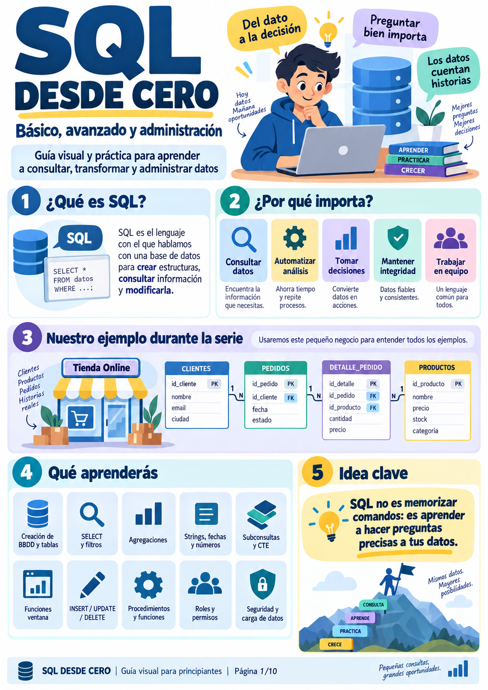
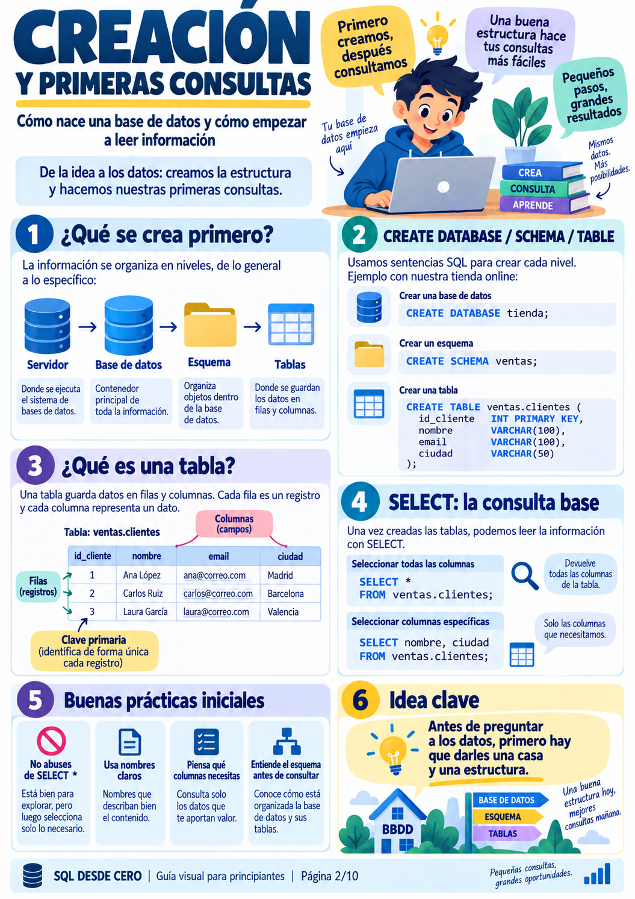
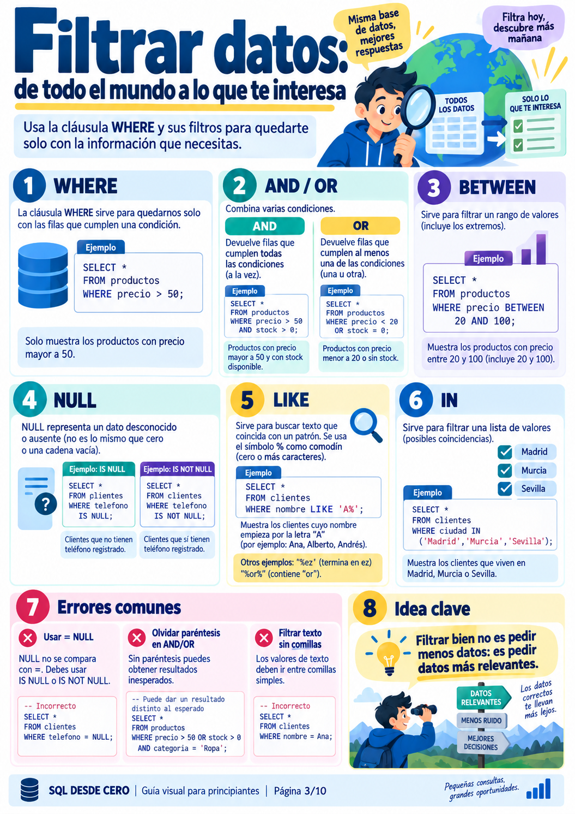
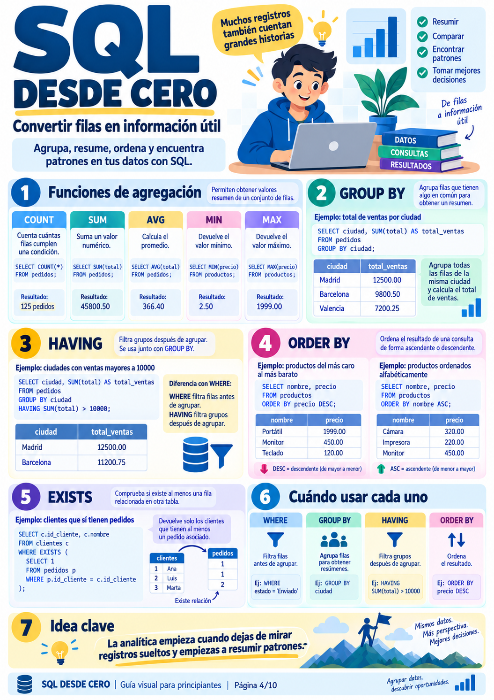
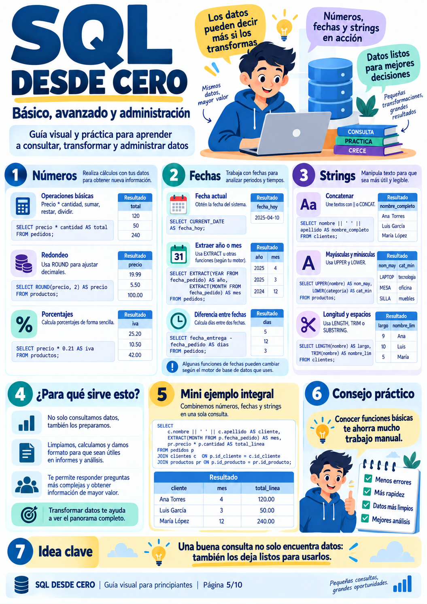
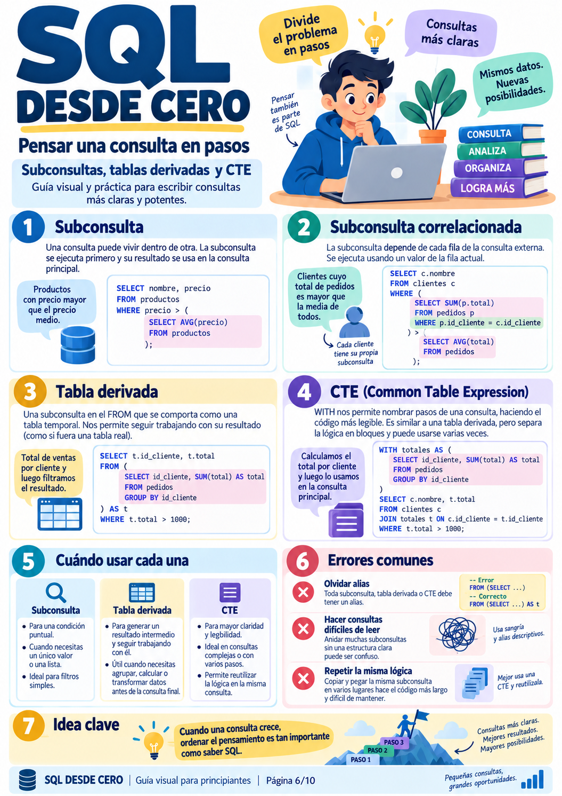
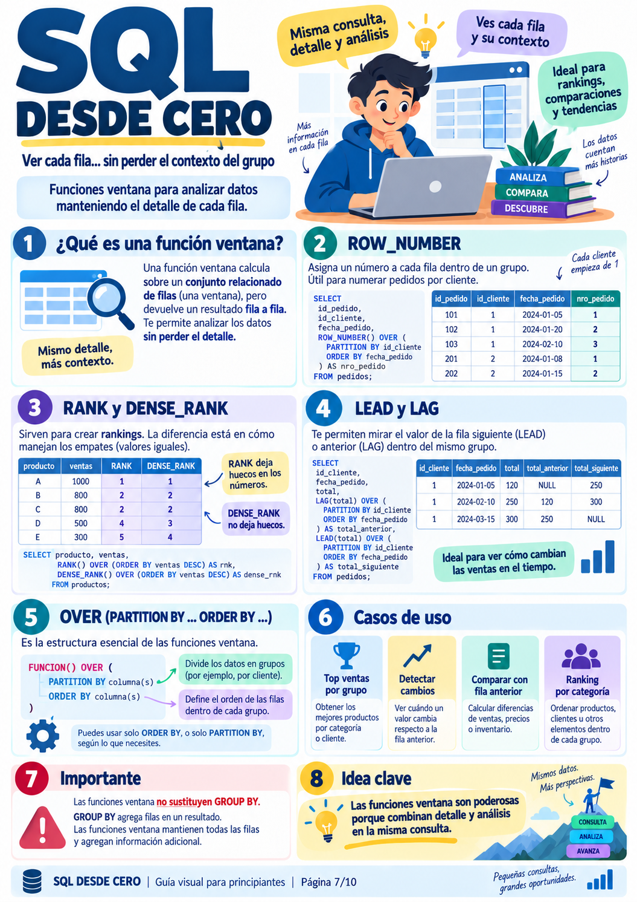
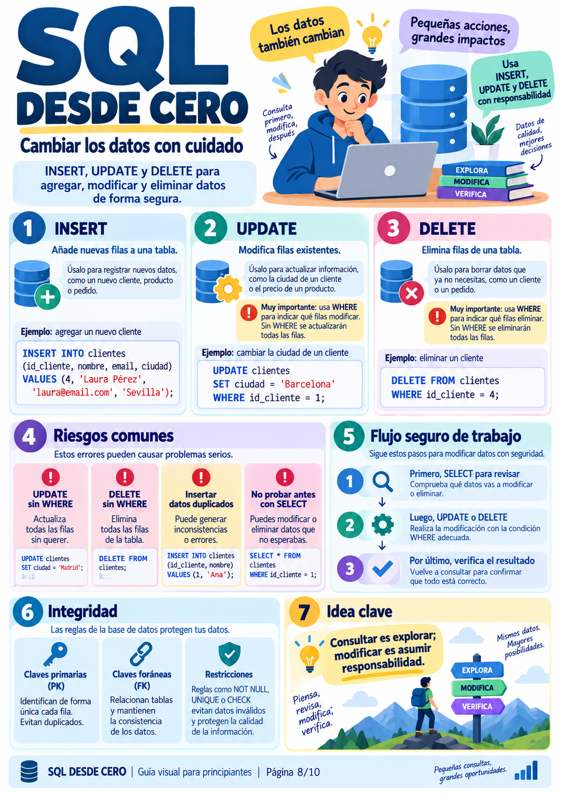
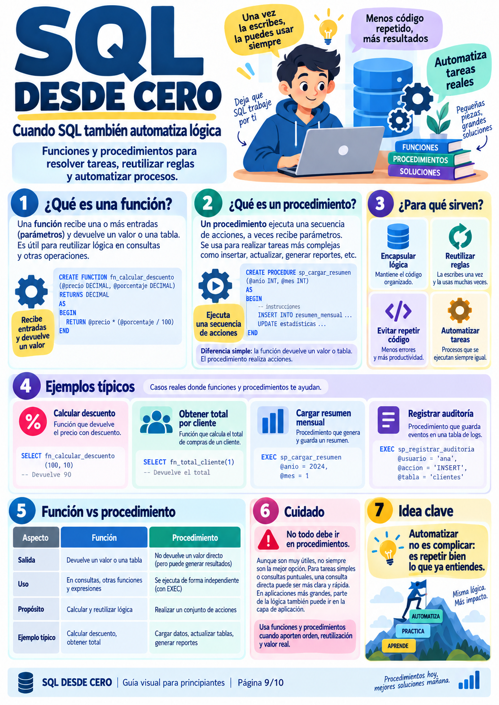
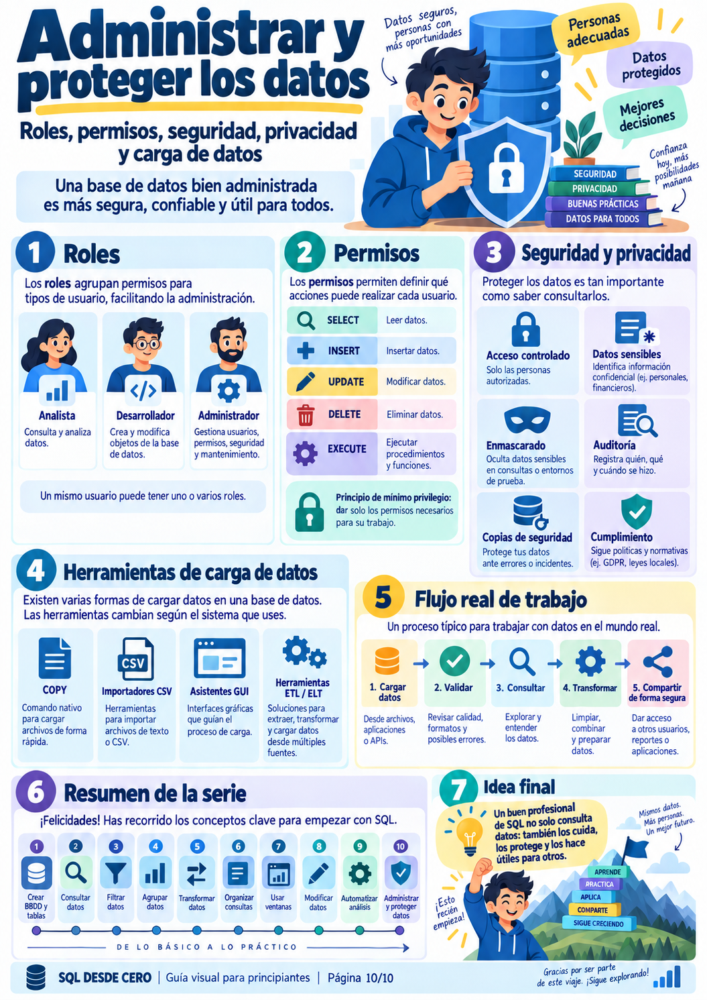

# ⚡ Curso Práctico de SQL Desde Cero: De Principiante a Experto

> **Objetivo del Curso:**  
> Dominar el lenguaje SQL de forma exhaustiva, rigurosa y eminentemente práctica. A través de **10 infografías estructuradas**, desglosamos desde la creación de esquemas y filtros elementales hasta técnicas avanzadas utilizadas en ingeniería de datos profesional (**CTEs, Funciones Ventana, Subconsultas Correlacionadas, DML Seguro, Automatización con Funciones y Administración de Roles**).  
> 
> Cada sección incluye explicaciones detalladas, consejos de arquitectura, trampas frecuentes a evitar y **ejercicios prácticos continuos** que puedes ejecutar de inmediato en el laboratorio interactivo adjunto ([`laboratorio_sql_interactivo.py`](./laboratorio_sql_interactivo.py)).

---

## 🗺️ Mapa Curricular del Curso

```
                          EL ITINERARIO FORMATIVO DE SQL
 ┌──────────────────────────────────────────────────────────────────────────────────┐
 │ 1. FUNDAMENTOS Y CONSULTA BÁSICA                                                 │
 │    • Módulo 1: Qué es SQL y el Modelo de Negocio (Tienda Online)                 │
 │    • Módulo 2: DDL y Primeras Consultas (CREATE, Esquemas, SELECT y Buenas Práct.)│
 │    • Módulo 3: Filtrado Exhaustivo (WHERE, AND/OR, LIKE, BETWEEN, Gestión de NULL)│
 ├──────────────────────────────────────────────────────────────────────────────────┤
 │ 2. AGREGACIÓN, TRANSFORMACIÓN Y PASOS MODULARES                                  │
 │    • Módulo 4: Agregaciones y Agrupación (COUNT, SUM, AVG, GROUP BY, HAVING)     │
 │    • Módulo 5: Transformaciones de Datos (Strings, Fechas y Matemáticas)         │
 │    • Módulo 6: Pensar en Pasos: Subconsultas, Tablas Derivadas y CTEs (WITH)     │
 ├──────────────────────────────────────────────────────────────────────────────────┤
 │ 3. ANALÍTICA AVANZADA Y MODIFICACIÓN CONTROLADA                                  │
 │    • Módulo 7: Funciones Ventana (ROW_NUMBER, RANK, DENSE_RANK, LAG, LEAD)       │
 │    • Módulo 8: DML con Responsabilidad (INSERT, UPDATE, DELETE y Transacciones)  │
 ├──────────────────────────────────────────────────────────────────────────────────┤
 │ 4. AUTOMATIZACIÓN, GOBERNANZA Y ADMINISTRACIÓN                                   │
 │    • Módulo 9: Automatizar Lógica (Funciones vs Procedimientos Almacenados)      │
 │    • Módulo 10: Roles, Permisos (GRANT/REVOKE), Carga Masiva (COPY) y Seguridad  │
 └──────────────────────────────────────────────────────────────────────────────────┘
```

---

## 🚀 Entorno de Pruebas: Cómo Practicar en Vivo

Para que no leas código en abstracto, tienes listo en esta carpeta un entorno interactivo en Python puro y SQLite sin instalar servidores:

```bash
cd "Databases_Intro/1. Fundamentals/4. sql"

# Opción A: Abrir el menú interactivo con consola libre
python3 laboratorio_sql_interactivo.py

# Opción B: Ejecutar todas las demostraciones del tirón
python3 laboratorio_sql_interactivo.py --run-all
```

---

## 📑 Módulo 1: ¿Qué es SQL y el Modelo de Negocio de la Serie?



### 1.1. ¿Qué es SQL?
**SQL (*Structured Query Language*)** es el estándar internacional para comunicarse con sistemas gestores de bases de datos relacionales (RDBMS) como PostgreSQL, SQLite, MySQL u Oracle. Con SQL realizamos cuatro grandes familias de operaciones:
1. **DQL (*Data Query Language*):** Consultar y analizar datos (`SELECT`).
2. **DDL (*Data Definition Language*):** Definir estructuras y tablas (`CREATE`, `ALTER`, `DROP`).
3. **DML (*Data Manipulation Language*):** Insertar, modificar o borrar registros (`INSERT`, `UPDATE`, `DELETE`).
4. **DCL (*Data Control Language*):** Gestionar permisos y seguridad (`GRANT`, `REVOKE`).

### 1.2. Nuestro Modelo de Datos: La Tienda Online
A lo largo de todo el curso utilizaremos el modelo relacional de una tienda online de comercio electrónico:

```
                            MODELO ENTIDAD-RELACIÓN: TIENDA ONLINE
       ┌──────────────────┐               ┌──────────────────┐
       │     CLIENTES     │ 1           N │     PEDIDOS      │
       ├──────────────────┤───────────────┤──────────────────┤
       │ id_cliente (PK)  │               │ id_pedido (PK)   │
       │ nombre           │               │ id_cliente (FK)  │
       │ email (UNIQUE)   │               │ fecha            │
       │ ciudad           │               │ estado           │
       │ telefono (NULL)  │               └────────┬─────────┘
       └──────────────────┘                        │ 1
                                                   │
                                                   │ N
       ┌──────────────────┐               ┌────────▼─────────┐
       │    PRODUCTOS     │ 1           N │  DETALLE_PEDIDO  │
       ├──────────────────┤───────────────┤──────────────────┤
       │ id_producto (PK) │───────────────│ id_detalle (PK)  │
       │ nombre           │               │ id_pedido (FK)   │
       │ precio           │               │ id_producto (FK) │
       │ stock            │               │ cantidad         │
       │ categoria        │               │ precio_unitario  │
       └──────────────────┘               └──────────────────┘
```

> 👁️ **Ojo con esto (Sabiduría SQL):**  
> *"SQL no consiste en memorizar comandos de memoria. Consiste en aprender a descomponer un problema del mundo real en preguntas precisas dirigidas a la base de datos."*

---

## 📑 Módulo 2: DDL y Primeras Consultas



### 2.1. Jerarquía Estructural: Servidor $\to$ Base de Datos $\to$ Esquema $\to$ Tabla
1. **Servidor:** El proceso de software y hardware donde corre el motor (puerto 5432 en Postgres).
2. **Base de Datos:** El contenedor principal lógico (`tienda` o `world`).
3. **Esquema (*Schema*):** Una carpeta organizativa dentro de la base de datos (por defecto `public` en Postgres).
4. **Tabla:** La estructura bidimensional de filas (*registros*) y columnas (*campos tipados*).

### 2.2. Sintaxis de Creación (DDL)
```sql
CREATE TABLE clientes (
    id_cliente INT PRIMARY KEY,
    nombre VARCHAR(100) NOT NULL,
    email VARCHAR(100) UNIQUE NOT NULL,
    ciudad VARCHAR(50) NOT NULL,
    telefono VARCHAR(20)
);
```

### 2.3. La Consulta Base: `SELECT`
* **Consulta Completa:** `SELECT * FROM clientes;` (Devuelve todas las columnas).
* **Consulta Específica:** `SELECT nombre, ciudad FROM clientes;` (Recomendado en producción).

> 👁️ **Ojo con esto (Sabiduría SQL):**  
> *"Evita el abuso de `SELECT *` en entornos de producción. Leer columnas que no vas a usar satura la memoria, desperdicia ancho de banda de red e invalida el uso de índices de solo cobertura (*Covering Indexes*)."*

#### 🧪 Práctica en Vivo 2.1:
Ejecuta en la consola interactiva:
```sql
SELECT nombre, precio, categoria FROM productos LIMIT 5;
```

---

## 📑 Módulo 3: Filtrar Datos con Precisión



La cláusula `WHERE` permite cribar registros antes de que sean procesados en memoria.

### 3.1. Operadores de Comparación y Lógicos
* **Comparadores:** `=`, `!=` (o `<>`), `>`, `<`, `>=`, `<=`.
* **`AND`:** Ambas condiciones deben ser verdaderas a la vez:
  ```sql
  SELECT * FROM productos WHERE precio > 50 AND stock > 0;
  ```
* **`OR`:** Basta con que una condición sea verdadera:
  ```sql
  SELECT * FROM productos WHERE precio < 20 OR stock = 0;
  ```
* **`BETWEEN`:** Rango inclusivo (incluye ambos extremos):
  ```sql
  SELECT * FROM productos WHERE precio BETWEEN 20 AND 100;
  ```
* **`IN`:** Comprueba pertenencia a una lista discreta:
  ```sql
  SELECT * FROM clientes WHERE ciudad IN ('Madrid', 'Barcelona', 'Sevilla');
  ```

### 3.2. Búsqueda de Texto con `LIKE` y Comodines
* `%` representa **cero o más caracteres**.
* `_` representa **exactamente un único carácter**.
```sql
-- Clientes cuyo nombre empieza por 'A'
SELECT * FROM clientes WHERE nombre LIKE 'A%';

-- Productos que contienen la palabra 'Tech'
SELECT * FROM productos WHERE nombre LIKE '%Tech%';
```

### 3.3. El Gran Peligro: Cómo Tratar los Valores `NULL`
En SQL, `NULL` no es ni cero ni una cadena vacía `""`; representa un **valor desconocido o ausente**.

```
                         LA TRAMPA DE NULL EN SQL
   ┌─────────────────────────────────────────────────────────────┐
   │  ❌ INCORRECTO: SELECT * FROM clientes WHERE telefono = NULL;│
   │     (Siempre devolverá 0 filas porque NULL = NULL es FALSO). │
   ├─────────────────────────────────────────────────────────────┤
   │  ✅ CORRECTO:   SELECT * FROM clientes WHERE telefono IS NULL;│
   │  ✅ NEGACIÓN:   SELECT * FROM clientes WHERE telefono IS NOT NULL;│
   └─────────────────────────────────────────────────────────────┘
```

> 👁️ **Ojo con esto (Sabiduría SQL):**  
> *"La lógica de SQL ante `NULL` es trivalente (Verdadero, Falso o Desconocido). Nunca compares con `= NULL` o `!= NULL`. Usa siempre `IS NULL` o `IS NOT NULL`."*

#### 🧪 Práctica en Vivo 3.1:
Encuentra todos los clientes que no tienen teléfono registrado y que vivan en Barcelona o Madrid:
```sql
SELECT id_cliente, nombre, ciudad, telefono 
FROM clientes 
WHERE telefono IS NULL AND ciudad IN ('Madrid', 'Barcelona');
```

---

## 📑 Módulo 4: Agregación, Agrupación y Orden



### 4.1. Las 5 Funciones de Agregación Clásicas
* `COUNT(*)`: Cuenta el número total de filas.
* `COUNT(columna)`: Cuenta las filas **donde la columna NO es NULL**.
* `SUM(columna)`: Suma acumulada de valores numéricos.
* `AVG(columna)`: Media aritmética.
* `MIN(columna)` y `MAX(columna)`: Valor mínimo y máximo.

### 4.2. `GROUP BY`: Agrupar por Categorías
Permite calcular métricas para cada grupo:
```sql
SELECT ciudad, COUNT(*) AS total_clientes
FROM clientes
GROUP BY ciudad;
```

### 4.3. La Diferencia Crucial: `WHERE` vs `HAVING`

```
                      ORDEN DE FILTRADO EN EL MOTOR SQL
         ┌────────────────────────────────────────────────────────┐
         │ 1. WHERE:  Filtra filas individuales ANTES de agrupar. │
         │ 2. GROUP BY: Agrupa las filas supervivientes.          │
         │ 3. HAVING: Filtra los grupos calculados DESPUÉS.       │
         └────────────────────────────────────────────────────────┘
```

* **Ejemplo Correcto:** Ciudades con clientes donde el gasto agrupado supere 500 €:
  ```sql
  SELECT c.ciudad, SUM(d.cantidad * d.precio_unitario) AS gasto_total
  FROM clientes c
  JOIN pedidos p ON c.id_cliente = p.id_cliente
  JOIN detalle_pedido d ON p.id_pedido = d.id_pedido
  WHERE p.estado != 'Cancelado'          -- Filtro WHERE: elimina pedidos cancelados
  GROUP BY c.ciudad
  HAVING SUM(d.cantidad * d.precio_unitario) > 500; -- Filtro HAVING: grupos > 500€
  ```

### 4.4. `ORDER BY`: Ordenar Resultados
* `ASC`: Ascendente (por defecto, menor a mayor o A-Z).
* `DESC`: Descendente (mayor a menor o Z-A).

> 👁️ **Ojo con esto (Sabiduría SQL):**  
> *"No intentes usar alias de columnas o funciones de agregación en el `WHERE` (ej. `WHERE COUNT(*) > 5` provocará un error de sintaxis). Para filtrar sobre resultados agregados, la única herramienta válida es `HAVING`."*

#### 🧪 Práctica en Vivo 4.1:
Obtén las categorías de productos con un stock total acumulado superior a 40 unidades, ordenadas de mayor a menor:
```sql
SELECT categoria, SUM(stock) AS stock_total, COUNT(*) AS variedades
FROM productos
GROUP BY categoria
HAVING SUM(stock) > 40
ORDER BY stock_total DESC;
```

---

## 📑 Módulo 5: Transformaciones de Strings, Fechas y Números



Una base de datos no es solo un almacén de lectura pasiva; es un motor capaz de preparar y limpiar los datos antes de entregarlos al frontend o al pipeline de Machine Learning.

### 5.1. Manipulación de Números
* **Operaciones directas:** `precio * cantidad`, `precio * 1.21` (aplicar IVA).
* **Redondeo:** `ROUND(precio, 2)`.

### 5.2. Manipulación de Cadenas de Texto (*Strings*)
* **Concatenación:** `||` (en PostgreSQL y SQLite) o función `CONCAT(a, b)`.
  ```sql
  SELECT nombre || ' <' || email || '>' AS remitente FROM clientes;
  ```
* **Normalización:** `UPPER(nombre)` (todo mayúsculas), `LOWER(email)` (todo minúsculas).
* **Longitud y Limpieza:** `LENGTH(nombre)` (número de caracteres), `TRIM(nombre)` (elimina espacios residuales).

### 5.3. Manipulación de Fechas
* **Fecha actual:** `CURRENT_DATE`.
* **Extracción de partes temporales:**  
  * *PostgreSQL:* `EXTRACT(YEAR FROM fecha)`, `EXTRACT(MONTH FROM fecha)`.  
  * *SQLite:* `strftime('%Y', fecha)`, `strftime('%m', fecha)`.

> 👁️ **Ojo con esto (Sabiduría SQL):**  
> *"Las funciones de fechas son el área donde más varían los dialectos SQL (PostgreSQL usa `EXTRACT`, SQLite usa `strftime`, SQL Server usa `DATEPART`). Siempre verifica la documentación específica de tu motor al trabajar con intervalos temporales."*

#### 🧪 Práctica en Vivo 5.1:
Genera un extracto contable que muestre el nombre del cliente en mayúsculas, el mes del pedido y el total con IVA formateado a 2 decimales:
```sql
SELECT 
    UPPER(c.nombre) AS cliente,
    p.fecha,
    ROUND(d.cantidad * d.precio_unitario * 1.21, 2) AS total_con_iva
FROM clientes c
JOIN pedidos p ON c.id_cliente = p.id_cliente
JOIN detalle_pedido d ON p.id_pedido = d.id_pedido
WHERE p.estado = 'Entregado';
```

---

## 📑 Módulo 6: Pensar en Pasos: Subconsultas y CTEs (`WITH`)



Cuando una pregunta de negocio requiere múltiples pasos lógicos, no intentes resolverla en una sola sentencia críptica.

### 6.1. Subconsulta Escalar (Devuelve un único valor)
* *Pregunta:* "¿Qué productos son más caros que la media de la tienda?"
```sql
SELECT nombre, precio, categoria
FROM productos
WHERE precio > (SELECT AVG(precio) FROM productos);
```

### 6.2. Subconsulta Correlacionada (Depende de cada fila externa)
* *Pregunta:* "Clientes que tienen al menos un pedido activo":
```sql
SELECT c.nombre
FROM clientes c
WHERE EXISTS (
    SELECT 1 FROM pedidos p WHERE p.id_cliente = c.id_cliente AND p.estado != 'Cancelado'
);
```

### 6.3. Tablas Derivadas (Subconsultas en el `FROM`)
```sql
SELECT t.ciudad, AVG(t.gasto) AS gasto_medio_ciudad
FROM (
    SELECT c.ciudad, p.id_pedido, SUM(d.cantidad * d.precio_unitario) AS gasto
    FROM clientes c
    JOIN pedidos p ON c.id_cliente = p.id_cliente
    JOIN detalle_pedido d ON p.id_pedido = d.id_pedido
    GROUP BY c.ciudad, p.id_pedido
) AS t
GROUP BY t.ciudad;
```
> ⚠️ **Regla estricta:** En SQL estándar, **toda subconsulta en el `FROM` debe tener obligatoriamente un alias** (ej. `AS t`). Omitir el alias provocará un error de sintaxis inmediato.

### 6.4. La Herramienta Suprema de Legibilidad: Common Table Expressions (CTE - `WITH`)
El bloque `WITH` permite nombrar tablas temporales legibles que se pueden reutilizar:

```sql
WITH resumen_clientes AS (
    SELECT 
        p.id_cliente,
        COUNT(DISTINCT p.id_pedido) AS total_pedidos,
        SUM(d.cantidad * d.precio_unitario) AS dinero_gastado
    FROM pedidos p
    JOIN detalle_pedido d ON p.id_pedido = d.id_pedido
    WHERE p.estado != 'Cancelado'
    GROUP BY p.id_cliente
)
SELECT 
    c.nombre,
    c.ciudad,
    r.total_pedidos,
    r.dinero_gastado
FROM clientes c
JOIN resumen_clientes r ON c.id_cliente = r.id_cliente
WHERE r.dinero_gastado > 600
ORDER BY r.dinero_gastado DESC;
```

> 👁️ **Ojo con esto (Sabiduría SQL):**  
> *"Si tu consulta tiene más de 30 líneas o anida múltiples subconsultas unas dentro de otras, refactorízala usando CTEs (`WITH`). Harás que tu código sea modular, testeable paso a paso y comprensible para tus compañeros de equipo."*

#### 🧪 Práctica en Vivo 6.1:
Utiliza un CTE para encontrar qué clientes han comprado productos de la categoría 'Electrónica':
```sql
WITH compradores_electronica AS (
    SELECT DISTINCT p.id_cliente
    FROM pedidos p
    JOIN detalle_pedido d ON p.id_pedido = d.id_pedido
    JOIN productos pr ON d.id_producto = pr.id_producto
    WHERE pr.categoria = 'Electrónica'
)
SELECT c.nombre, c.email, c.ciudad
FROM clientes c
JOIN compradores_electronica e ON c.id_cliente = e.id_cliente;
```

---

## 📑 Módulo 7: Funciones Ventana (*Window Functions*)



Las **Funciones Ventana** son una de las herramientas más solicitadas en entrevistas técnicas de Data Engineering y BI.

### 7.1. ¿Qué es una Función Ventana y en qué se diferencia de `GROUP BY`?
* `GROUP BY`: Colapsa múltiples filas en una sola fila resumen (pierdes el detalle individual).
* **Función Ventana (`OVER`):** **Mantiene todas las filas individuales**, pero añade una columna calculada contextual sobre un grupo de filas relacionadas.

```
       GROUP BY (Colapsa filas)          FUNCIONES VENTANA (Conserva detalle)
       ┌───────────────┬───────┐         ┌──────┬────────┬───────────────┬──────────┐
       │ Categoría     │ Total │         │ id   │ Fecha  │ Categoría     │ TotalCat │
       ├───────────────┼───────┤         ├──────┼────────┼───────────────┼──────────┤
       │ Electrónica   │ 1650€ │         │ 1    │ Enero  │ Electrónica   │ 1650€    │
       │ Accesorios    │ 136€  │         │ 2    │ Febrero│ Electrónica   │ 1650€    │
       └───────────────┴───────┘         │ 3    │ Enero  │ Accesorios    │ 136€     │
                                         └──────┴────────┴───────────────┴──────────┘
```

### 7.2. Sintaxis Universal
$$\text{FUNCIÓN}() \quad \text{OVER} \quad (\text{PARTITION BY } \text{columna} \quad \text{ORDER BY } \text{columna})$$

* **`PARTITION BY`:** Divide los datos en grupos (ventanas) independientes.
* **`ORDER BY`:** Define el orden en el que se evalúan las filas dentro de cada grupo.

### 7.3. Catálogo de Funciones Ventana Principales:
1. **`ROW_NUMBER()`:** Asigna un número secuencial único ($1, 2, 3, \dots$) a cada fila dentro de la partición. Ideal para paginación o deduplicación.
2. **`RANK()` vs `DENSE_RANK()`:**  
   * Si dos filas empatan en el puesto 2:  
     * `RANK()` asignará: $1, 2, 2, 4$ (deja huecos en la numeración).  
     * `DENSE_RANK()` asignará: $1, 2, 2, 3$ (no deja huecos).
3. **`LAG(columna)` y `LEAD(columna)`:**  
   * `LAG()` accede al valor de la **fila anterior** dentro de la ventana.  
   * `LEAD()` accede al valor de la **fila siguiente**.  
   * *Caso de oro:* Calcular el crecimiento de ventas respecto al pedido o mes anterior.

> 👁️ **Ojo con esto (Sabiduría SQL):**  
> *"Las funciones ventana se ejecutan DESPUÉS del `WHERE` y del `HAVING`. Por tanto, no puedes filtrar directamente una función ventana en el `WHERE` de la misma consulta; para filtrarla (por ejemplo, para obtener solo el `ROW_NUMBER() = 1`), debes envolverla dentro de un CTE o tabla derivada."*

#### 🧪 Práctica en Vivo 7.1 (Top 1 Producto Más Caro por Categoría):
```sql
WITH ranking_productos AS (
    SELECT 
        nombre,
        categoria,
        precio,
        DENSE_RANK() OVER (PARTITION BY categoria ORDER BY precio DESC) AS ranking
    FROM productos
)
SELECT nombre, categoria, precio
FROM ranking_productos
WHERE ranking = 1;
```

---

## 📑 Módulo 8: Modificar Datos con Responsabilidad (DML)



Consultar datos es seguro; modificarlos (`INSERT`, `UPDATE`, `DELETE`) exige un protocolo estricto para evitar pérdidas irreversibles en producción.

### 8.1. `INSERT`: Inserción de Filas
```sql
INSERT INTO clientes (id_cliente, nombre, email, ciudad, telefono)
VALUES (9, 'Marcos Peña', 'marcos@correo.com', 'Valencia', '600000111');
```

### 8.2. El Riesgo Mortal del `UPDATE` y `DELETE` sin `WHERE`
```sql
-- 💥 ERROR DESTRUIDOR: Cambia la ciudad de TODOS los clientes a 'Madrid'
UPDATE clientes SET ciudad = 'Madrid';

-- 💥 ERROR CATASTRÓFICO: Vacía la tabla entera de clientes
DELETE FROM clientes;
```

### 8.3. El Flujo de Trabajo Seguro en 3 Pasos
1. **Paso 1 (SELECT de inspección):** Escribe primero un `SELECT` con el `WHERE` exacto para verificar visualmente qué filas vas a tocar:
   ```sql
   SELECT * FROM productos WHERE id_producto = 4;
   ```
2. **Paso 2 (UPDATE/DELETE con transacción):** Ejecuta la modificación dentro de una transacción explícita (`BEGIN TRANSACTION`):
   ```sql
   BEGIN TRANSACTION;
   UPDATE productos SET precio = 29.99 WHERE id_producto = 4;
   ```
3. **Paso 3 (Verificar y Confirmar):** Comprueba el cambio. Si es correcto, confirma con `COMMIT;`. Si algo huele mal, descarta con `ROLLBACK;`.

> 👁️ **Ojo con esto (Sabiduría SQL):**  
> *"En producción, acostúmbrate a escribir la palabra `WHERE` ANTES de escribir el `UPDATE` o `DELETE`. Una transacción abierta con un `SELECT` previo es tu cinturón de seguridad ante desastres."*

---

## 📑 Módulo 9: Automatizar con Funciones y Procedimientos



Cuando una lógica de negocio se repite constantemente o requiere múltiples pasos atómicos:

### 9.1. ¿Cuál es la diferencia entre una Función y un Procedimiento?

| Característica | Función (`FUNCTION`) | Procedimiento Almacenado (`PROCEDURE`) |
| :--- | :--- | :--- |
| **Devolución de Datos** | **Obligatorio:** Devuelve un valor escalar o una tabla. | Opcional: Ejecuta acciones (no devuelve un valor por expresión). |
| **Uso en Consultas** | Se puede invocar **dentro de un `SELECT`**, `WHERE` u `ORDER BY`. | Se invoca de forma aislada mediante `CALL` o `EXEC`. |
| **Transacciones** | Generalmente no puede iniciar ni cerrar transacciones (`COMMIT`). | **Sí puede** gestionar transacciones internas (`COMMIT` / `ROLLBACK`). |
| **Propósito Típico** | Cálculos matemáticos, formateo de texto, conversiones. | Tareas batch masivas, archivado nocturno, auditorías complejas. |

### 9.2. Ejemplo Conceptual:
* **Función:**
  ```sql
  -- Uso dentro de una consulta cotidiana:
  SELECT nombre, precio, fn_calcular_iva(precio) AS iva FROM productos;
  ```
* **Procedimiento:**
  ```sql
  -- Tarea de mantenimiento ejecutada por un cron nocturno:
  CALL sp_cerrar_pedidos_mensuales(2026, 9);
  ```

> 👁️ **Ojo con esto (Sabiduría SQL):**  
> *"No satures tu base de datos convirtiéndola en un servidor de aplicaciones. Las funciones y procedimientos son excelentes para reglas que exigen máxima cercanía al dato, pero una lógica de negocio excesiva dentro del motor dificulta el testing unitario y el control de versiones en Git."*

---

## 📑 Módulo 10: Seguridad, Roles, Permisos y Carga de Datos



Una base de datos robusta en producción no otorga la contraseña de superusuario (`postgres` o `root`) a todo el mundo.

### 10.1. Los 3 Roles Típicos en una Organización
1. **Analista / BI:** Solo requiere permisos de lectura (`SELECT`) sobre vistas y datamarts limpios.
2. **Desarrollador / Aplicación Backend:** Permisos de lectura y escritura (`SELECT`, `INSERT`, `UPDATE`, `DELETE`) sobre tablas operativas; sin permisos para borrar bases de datos ni crear usuarios.
3. **Administrador de BBDD (DBA):** Control total, creación de esquemas, optimización de índices, copias de seguridad y auditoría.

### 10.2. El Principio de Mínimo Privilegio (DCL: `GRANT` y `REVOKE`)
```sql
-- Crear un usuario solo de lectura para analistas
CREATE ROLE analista_bi LOGIN PASSWORD 'XXXX';

-- Otorgar permiso ÚNICAMENTE de lectura sobre la tabla clientes
GRANT SELECT ON clientes TO analista_bi;

-- Revocar permiso de eliminación por precaución
REVOKE DELETE ON ALL TABLES IN SCHEMA public FROM analista_bi;
```

### 10.3. Carga Masiva Eficiente: El Comando `COPY`
Cuando necesitas insertar 10 millones de filas desde un CSV, **nunca** ejecutes 10 millones de sentencias `INSERT INTO` individuales. Cada `INSERT` genera una sobrecarga de red y transacción independiente.
* Usa la orden de carga nativa en bloque de PostgreSQL:
  ```sql
  COPY productos(id_producto, nombre, precio, stock, categoria)
  FROM '/ruta/datos_productos.csv' WITH (FORMAT csv, HEADER true);
  ```

> 👁️ **Ojo con esto (Sabiduría SQL):**  
> *"El Principio de Mínimo Privilegio es la regla de oro de la seguridad: cada usuario, microservicio o script debe tener únicamente los permisos estrictamente necesarios para su tarea, y ninguno más."*

---

## 🏆 Proyecto de Evaluación Final: Las 5 Preguntas del Director Comercial

Abre el laboratorio interactivo (`python3 laboratorio_sql_interactivo.py`), entra en la opción `[7] Consola Interactiva Libre` y resuelve estos 5 retos reales de negocio:

1. **Reto 1 (Cesta Media por Ciudad):**  
   Calcula la cantidad total de artículos comprados y el importe medio por pedido para cada ciudad.
2. **Reto 2 (Clientes Fieles con Múltiples Compras):**  
   Muestra los clientes que han realizado más de 1 pedido, indicando cuántos pedidos hicieron y la fecha de su último pedido.
3. **Reto 3 (Productos Huérfanos de Venta):**  
   Encuentra qué productos del catálogo nunca han sido incluidos en ningún detalle de pedido (utiliza un `LEFT JOIN` con `IS NULL` o `NOT EXISTS`).
4. **Reto 4 (Crecimiento Intermensual):**  
   Utiliza `LAG()` sobre un CTE agrupado por mes para calcular la diferencia de facturación entre cada mes de 2026 y el mes inmediatamente anterior.
5. **Reto 5 (Ranking de Clientes VIP):**  
   Utiliza `DENSE_RANK()` para asignar un podio (1º, 2º, 3º...) a los 3 clientes que más dinero han aportado a la tienda.
