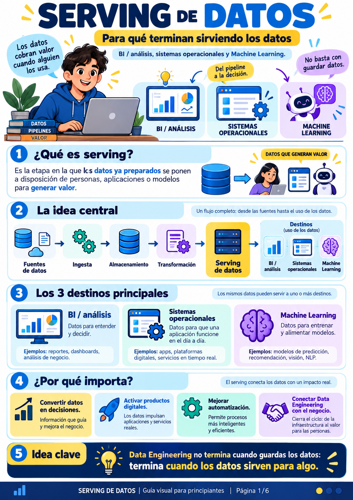
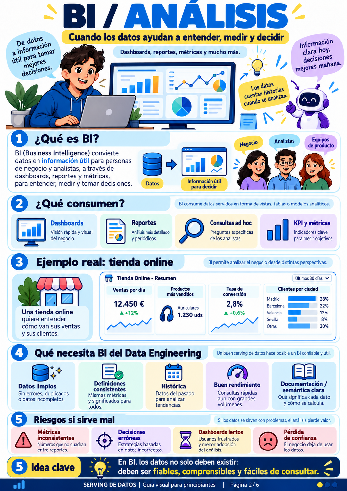
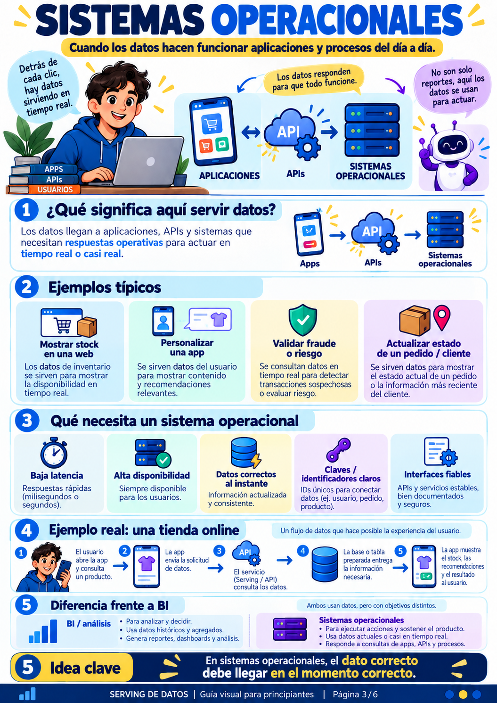
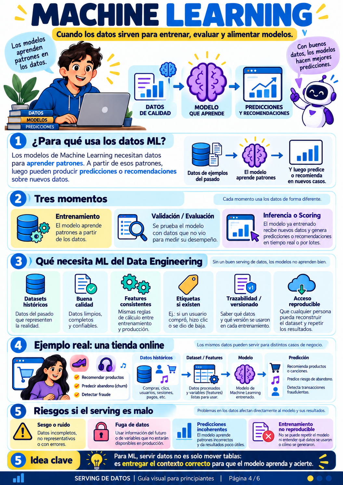
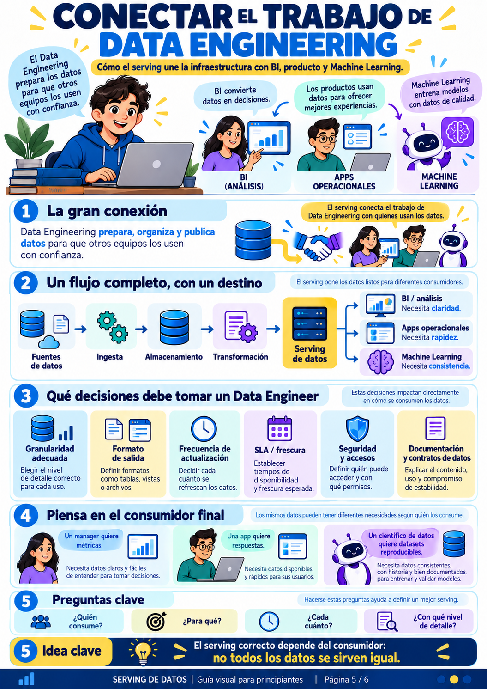
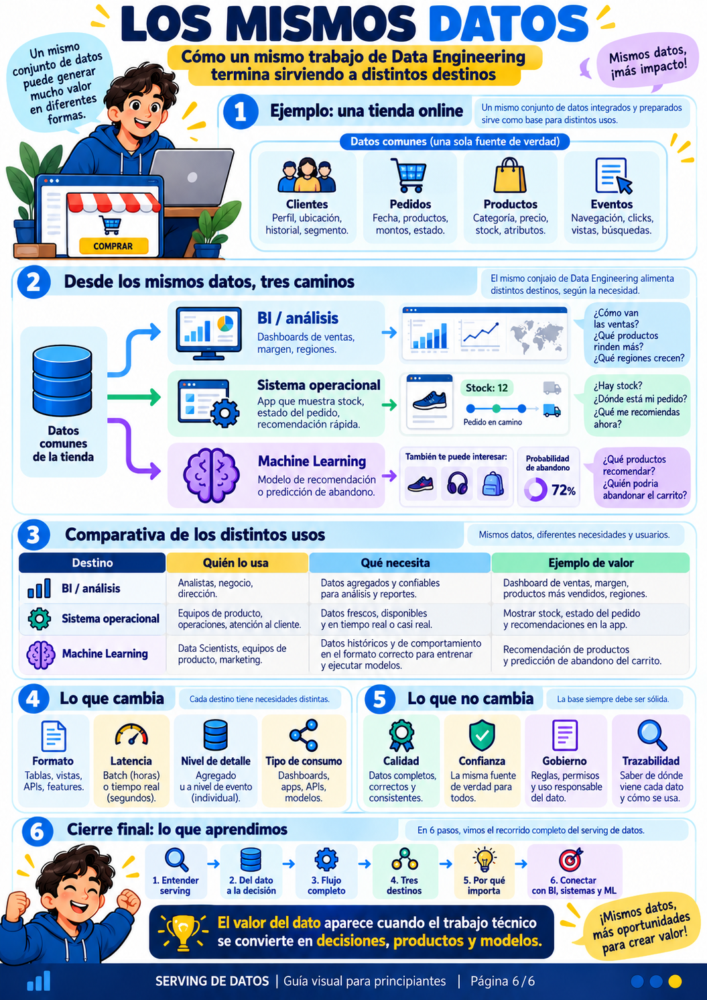

# 🚀 Serving y Uso de Datos: Del Almacén al Negocio, Operaciones y Machine Learning

> *"Data Engineering no termina cuando guardas los datos: termina cuando los datos sirven para algo."*

---

## 🧭 ¿Por qué este capítulo es crucial?

En los capítulos anteriores aprendiste a diseñar diagramas Entidad/Relación, a normalizar tablas (1NF, 2NF, 3NF), a diseñar arquitecturas (Data Warehouse, Data Lake, Lakehouse) y a consultar datos con SQL avanzado.

Sin embargo, en el mundo profesional existe una trampa muy común: **acumular terabytes de datos limpios en una base de datos que nadie consulta.** 

Cuando los datos se quedan atrapados en servidores sin resolver un problema real, la empresa no tiene un activo; tiene un **pantano de costes** de almacenamiento.

El **Serving de Datos** (*puesta a disposición*) es la última milla de la ingeniería de datos: el puente que conecta toda la infraestructura técnica con el valor tangible.

---

## 🗺️ Mapa de Contenidos

1. [Infografía 1: ¿Qué es Serving de Datos? El flujo de valor](#1-qué-es-serving-de-datos-el-flujo-de-valor)
2. [Infografía 2: Destino 1 — Business Intelligence y Analítica](#2-destino-1--business-intelligence-y-analítica-bi)
3. [Infografía 3: Destino 2 — Sistemas Operacionales y APIs](#3-destino-2--sistemas-operacionales-y-aplicaciones)
4. [Infografía 4: Destino 3 — Machine Learning e Inteligencia Artificial](#4-destino-3--machine-learning-e-inteligencia-artificial)
5. [Infografía 5: Decisiones Técnicas y Conexión con los Consumidores](#5-decisiones-técnicas-y-conexión-con-los-consumidores)
6. [Infografía 6: Los Mismos Datos para Tres Destinos Distintos](#6-los-mismos-datos-para-tres-destinos-distintos)
7. [Laboratorio Práctico en Python: Los 3 Destinos en Código Real](#7-laboratorio-práctico-en-código-python)
8. [Preguntas de Autoevaluación y Retos Didácticos](#8-preguntas-de-autoevaluación-y-retos-didácticos)

---

## 1. ¿Qué es Serving de Datos? El flujo de valor



### 1.1. Concepto Fundamental
El **Serving** es la fase del ciclo de vida del dato en la que la información —después de haber sido extraída, limpiada, validada y modelada— **se expone en el formato, velocidad y granularidad adecuados** para que personas, sistemas automáticos o modelos matemáticos tomen acciones.

Pensemos en la analogía de una **cadena logística de alimentos**:
1. **Fuentes:** Las granjas y campos de cultivo (bases de datos transaccionales, eventos de clics, sensores IoT).
2. **Ingesta:** Los camiones frigoríficos que transportan la mercancía en bruto (Kafka, Airflow, Fivetran).
3. **Almacenamiento:** El gran almacén centralizado (Data Lake, S3, HDFS).
4. **Transformación:** La cocina industrial donde se lava, pela, cocina y empaqueta la comida (dbt, Spark, SQL).
5. **Serving:** **El restaurante y el punto de venta.** Si la comida se queda en las cajas del almacén y nadie se la sirve al comensal en su plato caliente, todo el trabajo anterior fue un desperdicio.

### 1.2. Los Tres Grandes Destinos
Un mismo dato puede y suele alimentar tres necesidades completamente diferentes:

| Destino | Propósito Principal | Consumidor Típico | Pregunta Clave |
| :--- | :--- | :--- | :--- |
| **1. BI / Análisis** | Entender el pasado y decidir el futuro. | Directores, analistas de negocio, marketing. | *"¿Por qué bajaron las ventas en Valencia en agosto?"* |
| **2. Sistemas Operacionales** | Sostener la operativa diaria en tiempo real. | Aplicaciones móviles, pasarelas de pago, APIs. | *"¿Quedan zapatillas de la talla 42 en este instante para cobrar al usuario?"* |
| **3. Machine Learning** | Aprender patrones para predecir o automatizar. | Modelos de scoring, sistemas de recomendación. | *"¿Qué probabilidad hay de que este usuario cancele su suscripción hoy?"* |

> 👁️ **Ojo con esto (La trampa del Data Swamp):**
> Guardar datos "por si acaso algún día sirven" sin definir de antemano el caso de uso del serving casi siempre conduce a bases de datos hinchadas, costosas y abandonadas. Diseña tus tuberías pensando **primero en quién y cómo va a consumir el dato**.

---

## 2. Destino 1 — Business Intelligence y Analítica (BI)



### 2.1. ¿Qué es y qué necesita el BI?
El **Business Intelligence (Inteligencia de Negocio)** convierte datos históricos y agregados en conocimiento accionable para humanos.

Las herramientas de BI (como Power BI, Tableau, Looker o Metabase) consumen los datos principalmente mediante:
- **Dashboards interactivos:** Vistas visuales de alto nivel (gráficos de barras, líneas de tendencia, mapas).
- **Reportes periódicos:** Listados detallados de cierre contable, inventario semanal o auditorías.
- **Consultas ad-hoc:** Preguntas imprevistas que formula un analista mediante SQL: `SELECT categoria, SUM(total) FROM ventas WHERE fecha >= '2026-01-01' GROUP BY categoria`.
- **KPIs (Indicadores Clave de Rendimiento):** Métricas como Tasa de Conversión, Coste de Adquisición de Cliente (CAC) o Ticket Medio.

### 2.2. ¿Qué le pide BI al Ingeniero de Datos?
Para que un analista pueda trabajar sin volverse loco, el serving analítico debe garantizar:
1. **Datos limpios y deduplicados:** Si un cliente hizo una compra pero el pipeline la duplicó, el dashboard de finanzas mostrará ingresos irreales.
2. **Definiciones semánticas consistentes:** ¿Qué es un "cliente activo"? Si para Marketing es quien abrió la app en los últimos 30 días, pero para Finanzas es quien pagó una factura este mes, los dashboards darán números contradictorios y el equipo directivo perderá la confianza en los datos.
3. **Buen rendimiento analítico (OLAP):** Los analistas no pueden esperar 5 minutos a que un filtro de fechas cargue. Para ello se utilizan bases de datos columnares (Snowflake, BigQuery, ClickHouse) o vistas materializadas preagregadas.
4. **Profundidad histórica:** Para calcular crecimientos año contra año (*Year-over-Year*), se necesitan meses o años de histórico consolidado.

### 2.3. Riesgos de un mal serving en BI
* **Métricas inconsistentes:** Dos directores entran a un comité con números distintos para la misma métrica.
* **Dashboards lentos:** Los usuarios ejecutivos abandonan las herramientas y vuelven a pedírselo todo a mano por email en ficheros Excel desactualizados.
* **Pérdida de credibilidad:** Una vez que el negocio detecta errores en los números de un dashboard, costará meses recuperar su confianza en los datos.

> 👁️ **Ojo con esto (La diferencia entre dato y métrica):**
> Un dato es una fila en una tabla: `pedido_id: 104, monto: 50€`. Una métrica es una regla de negocio agregada sobre ese dato: `Ticket Medio = Suma de Montos / Conteo de Pedidos Válidos (excluyendo devoluciones)`. El Data Engineer debe asegurar que la lógica de cálculo esté centralizada y no dispersa en 10 dashboards diferentes.

---

## 3. Destino 2 — Sistemas Operacionales y Aplicaciones



### 3.1. ¿Qué significa servir datos a sistemas operacionales?
Aquí los datos **no se analizan pasivamente en un gráfico: se ejecutan para que una aplicación funcione.**

Cada vez que abres una app en tu móvil, ocurren decenas de peticiones a bases de datos operacionales (OLTP) o APIs de serving:
- **Consultar inventario:** Comprobar si hay stock antes de permitir añadir al carrito.
- **Perfil de usuario:** Cargar tus preferencias, tu cesta guardada y tu dirección de envío.
- **Detección de fraude:** Antes de autorizar un pago de 1.200 €, un microservicio consulta en 50 milisegundos si la tarjeta se usó hace 5 minutos en otro país.
- **Rastreo logístico:** "¿Dónde está el repartidor con mi cena?".

### 3.2. Exigencias del Serving Operacional
A diferencia de BI, donde esperar 3 segundos por un gráfico mensual es aceptable, un sistema operacional impone requisitos críticos:
1. **Latencia ultra baja:** Respuestas en milisegundos (10 ms - 200 ms). Si la app tarda más, el usuario la cierra.
2. **Alta disponibilidad (99.99% Uptime):** La base de datos operacional no puede apagarse los domingos por mantenimiento.
3. **Consistencia transaccional (ACID):** Dos personas no pueden comprar el último asiento de un avión al mismo tiempo.
4. **Acceso puntual por clave (Key-Value o Índices B-Tree):** Consultas como `SELECT * FROM productos WHERE sku = 'ZAP-42'` optimizadas al extremo.

### 3.3. Comparativa Clave: BI vs. Sistemas Operacionales

| Criterio | Destino BI / Analítica | Destino Sistemas Operacionales |
| :--- | :--- | :--- |
| **Objetivo** | Entender, medir y decidir estrategias. | Ejecutar acciones y sostener el producto vivo. |
| **Nivel de detalle** | Agregado (sumas, promedios, meses). | Atómico y puntual (este usuario, este producto). |
| **Latencia esperada** | Segundos a minutos. | Milisegundos (< 100 ms). |
| **Tipo de consultas** | OLAP (`GROUP BY`, grandes escaneos). | OLTP (`SELECT ... WHERE id = ?`, `UPDATE`). |
| **Tecnologías típicas** | BigQuery, Snowflake, ClickHouse, DuckDB. | PostgreSQL, MySQL, Redis, DynamoDB, MongoDB. |

> 👁️ **Ojo con esto (Nunca lances queries de BI a tu base operacional):**
> El error más clásico del novato es conectar Tableau o Power BI directamente a la base de datos de producción de la tienda web. Un analista lanza una query pesada que escanea 10 millones de pedidos pasados, satura la CPU del servidor, bloquea las tablas y hace que los clientes en la web reciban un error 500 y no puedan pagar. ¡Separa siempre el entorno analítico del operacional!

---

## 4. Destino 3 — Machine Learning e Inteligencia Artificial



### 4.1. El rol de los datos en Machine Learning
Un modelo de Machine Learning no es magia: es un **algoritmo estadístico que busca patrones matemáticos en datos históricos** para realizar predicciones sobre datos futuros desconocidos.

Por eso se dice en la industria: **"Garbage In, Garbage Out"** (Si alimentas al modelo con basura, predecirá basura).

### 4.2. Los Tres Momentos del Dato en ML
Un pipeline de Machine Learning utiliza los datos en tres fases radicalmente distintas:

```
[Datos Históricos] ───> 1. Entrenamiento (Training) ───> Aprende pesos y patrones
                               │
[Datos Nuevos No Vistos] ─> 2. Validación / Test ──────> Mide precisión real (evita overfitting)
                               │
[Producción en Vivo] ──> 3. Inferencia (Scoring) ──────> Emite predicción en tiempo real o batch
```

1. **Entrenamiento (Training):** El algoritmo analiza miles o millones de ejemplos pasados junto con su resultado real (etiqueta o *target*). *Ejemplo: 50.000 carritos de la compra pasados, con la etiqueta de si el cliente terminó comprando o abandonó la web.*
2. **Validación y Evaluación:** Se prueba el modelo con datos que **nunca vio durante el entrenamiento** para evaluar si aprendió patrones generales o si simplemente memorizó los datos (sobreajuste o *overfitting*).
3. **Inferencia (Scoring):** El modelo ya entrenado se despliega en producción. Cuando entra un usuario nuevo, el sistema le pasa sus variables actuales y el modelo predice instantáneamente: *"Probabilidad de abandono: 85% ➔ Disparar cupón de descuento en pantalla"*.

### 4.3. El Gran Desafío: Feature Consistency y Data Leakage
Un Data Engineer que prepara datos para ML debe vigilar dos peligros mortales:
- **Data Leakage (Fuga de Datos):** Introducir por error en el entrenamiento información que en la vida real solo se sabría *después* del evento.
  * *Ejemplo disparatado:* Querer predecir si un paciente tiene gripe incluyendo como variable predictora *"¿Se tomó la medicina para la gripe?"*. El modelo tendrá un 99.9% de acierto en el laboratorio, pero en el hospital real no servirá de nada.
- **Sesgo de Entrenamiento-Servicio (Train-Serve Skew):** Calcular una variable (p. ej. *gasto acumulado*) con una fórmula en el entrenamiento histórico en Python, y luego calcularla de forma ligeramente distinta en la API operacional en Java/Go. El modelo recibirá números distorsionados y fallará.

> 👁️ **Ojo con esto (Feature Stores):**
> Para evitar inconsistencias entre entrenamiento e inferencia, las empresas modernas usan **Feature Stores** (como Feast o Hopsworks): un catálogo centralizado donde una variable como `promedio_compras_30d` se define una sola vez en código y se sirve tanto en batch para entrenar como en milisegundos por API para inferir.

---

## 5. Decisiones Técnicas y Conexión con los Consumidores



### 5.1. No todos los datos se sirven igual
El Data Engineer no puede limitarse a decir: *"He dejado una tabla en Postgres, búscate la vida"*. Debe tomar 6 decisiones estratégicas:

1. **Granularidad adecuada:** ¿El consumidor necesita la transacción individual segundo a segundo (App / ML) o el resumen agrupado por día y tienda (BI)?
2. **Formato de salida:** ¿Una vista SQL relacional? ¿Un fichero comprimido Parquet en S3? ¿Un endpoint REST/JSON de baja latencia? ¿Un mensaje en un topic de Kafka?
3. **Frecuencia de actualización:** ¿Tiempo real (< 1 segundo), streaming (minutos), micro-batch (horas) o batch nocturno (diario a las 03:00 AM)?
4. **SLA y Frescura (Data Freshness):** Si el pipeline falla, ¿cuánto tiempo tolera el negocio antes de que suponga un impacto económico grave?
5. **Seguridad, PII y Gobernanza:** ¿Los datos contienen nombres, tarjetas o emails? Si un analista de marketing consulta la base analítica, los datos confidenciales deben estar enmascarados (*hash* o anonimización).
6. **Contratos de Datos (Data Contracts):** Acuerdo formal entre los ingenieros de backend y los ingenieros de datos. Si el backend cambia el nombre de la columna `precio` por `importe_total_eur` sin avisar, romperá las APIs, los dashboards y los modelos de ML a la vez.

---

## 6. Los Mismos Datos para Tres Destinos Distintos



Imaginemos una empresa de comercio electrónico (**TechStore**). Su repositorio central de datos almacena:
- `Clientes`: ID, nombre, email, ciudad, fecha_registro.
- `Productos`: ID, nombre, categoría, precio, stock.
- `Pedidos`: ID, cliente_id, producto_id, cantidad, total, fecha, estado.
- `Eventos Web`: ID, cliente_id, minutos_sesion, carritos_creados, compra_finalizada.

Observemos cómo **un solo ecosistema de datos** se divide en 3 arquitecturas de serving:

```
                            ┌───────────────────────────────────────────────┐
                            │      TechStore Datos Únicos y Limpios         │
                            │      (Clientes, Productos, Pedidos, Eventos)  │
                            └──────────────────────┬────────────────────────┘
                                                   │
                ┌──────────────────────────────────┼──────────────────────────────────┐
                │                                  │                                  │
                ▼                                  ▼                                  ▼
      ┌────────────────────┐            ┌────────────────────┐             ┌────────────────────┐
      │  1. BI / ANALÍTICA │            │  2. OPERACIONAL    │             │  3. MACHINE LEARN. │
      └─────────┬──────────┘            └─────────┬──────────┘             └─────────┬──────────┘
                │                                  │                                  │
    • Agregaciones históricas          • Transaccional ACID                • Vector de Features:
    • Consultas OLAP por ciudad        • Consulta stock por SKU            • [minutos, carritos, ...]
    • Métricas: Facturación,           • Latencia < 20 ms                  • Inferencia de Churn
      Ticket Medio, Conversión         • Reserva de unidades               • Recomienda producto
                │                                  │                                  │
                ▼                                  ▼                                  ▼
        📊 Cuadro de Mando                 🛒 Carrito de Compra                🤖 Pop-up de Retención
        para el Director                   del Usuario en la App               Automático al 80% Prob.
```

---

## 7. Laboratorio Práctico en Código Python

Para que tus alumnos puedan tocar con las manos cómo se programa y se consume cada uno de estos tres destinos, hemos creado el script interactivo y modular:

👉 **[laboratorio_serving_tres_destinos.py](./laboratorio_serving_tres_destinos.py)**

### 7.1. ¿Qué es SQLite y por qué lo usamos aquí?
En este laboratorio utilizamos **SQLite** (a través del módulo nativo `sqlite3` de Python).
* **Es "Serverless" (Sin Servidor):** A diferencia de PostgreSQL o MySQL, que requieren instalar un proceso demonio en segundo plano, abrir puertos de red (5432, 3306), crear usuarios y recordar contraseñas, SQLite se ejecuta directamente dentro del propio proceso de Python.
* **Todo en un único archivo:** Toda la base de datos (tablas, claves foráneas, índices y datos) reside en un único fichero local: `tienda_techstore.db`. Si quieres resetear el ejercicio o compartirlo con tus alumnos, basta con copiar o borrar ese archivo.
* **100% Estándar y ACID:** Pese a ser ultraligero, implementa SQL completo con soporte de transacciones atómicas (`BEGIN TRANSACTION`, `COMMIT`, `ROLLBACK`), restricciones `CHECK` y claves foráneas (`FOREIGN KEY`).
* **¿Cuándo usar SQLite vs PostgreSQL en el mundo real?**
  * **Usa SQLite:** Para docencia, desarrollo local, prototipos, pruebas unitarias, aplicaciones móviles (iOS/Android) y software embebido.
  * **Usa PostgreSQL:** Cuando necesites alta concurrencia de decenas o cientos de usuarios escribiendo simultáneamente por red, clustering y arquitecturas distribuidas.

### 7.2. Preparación del Entorno: Librerías Nativas vs `pip`
Es fundamental que los alumnos comprendan qué viene con Python y qué debe instalarse por separado:
* **Módulos Nativos (Vienen de serie con Python):** `sqlite3`, `sys`, `os`, `time`, `random`. No hay que instalar nada para usarlos.
* **Librerías de Terceros (Requieren instalación con `pip`):**
  * `numpy`: Biblioteca fundamental para cálculo numérico y vectores matriciales.
  * `scikit-learn`: La biblioteca de referencia en Python para algoritmos de Machine Learning tradicionales.

> ⚠️ **Aviso para alumnos antes de ejecutar:**
> Si al ejecutar el script en tu terminal recibes el error `ModuleNotFoundError: No module named 'sklearn'`, instala las dependencias ejecutando:
> ```bash
> pip install numpy scikit-learn
> # o en sistemas con Python 3:
> pip3 install numpy scikit-learn
> ```

---

### 7.3. Inspección del Contenido de las Tablas en SQLite

El script incluye un **Inspector de Base de Datos** que permite a los alumnos ver el contenido real de las tablas antes de cualquier transformación:

```bash
python3 laboratorio_serving_tres_destinos.py --db
```

#### Estructura y Muestra de Datos:

1. **Tabla `clientes` (Entidad Maestra):**
| ID | Nombre | Email | Ciudad | Nivel Fidelidad | Fecha Reg. |
| :---: | :--- | :--- | :--- | :---: | :---: |
| 1 | Lucía Gómez | user1@techstore.com | Barcelona | 2-Plata | 2026-01-15 |
| 2 | Carlos Ruiz | user2@techstore.com | Valencia | 3-Oro | 2026-01-15 |
| 3 | Sofía Martín | user3@techstore.com | Sevilla | 1-Bronce | 2026-01-15 |

2. **Tabla `productos` (Catálogo con Stock Transaccional):**
| ID | SKU | Nombre | Categoría | Precio | Stock Actual |
| :---: | :--- | :--- | :--- | :---: | :---: |
| 1 | `ZAP-RUN-42` | Zapatillas Running Pro | Calzado | 89.99 € | 15 uds |
| 2 | `AUR-WIR-01` | Auriculares Bluetooth Noise-Cancelling | Electrónica | 129.50 € | 4 uds |
| 3 | `MON-GAM-27` | Monitor Gaming 27" 144Hz | Electrónica | 210.00 € | 4 uds |

3. **Tabla `visitas_web` (Eventos de Navegación para BI y ML):**
| ID | Cliente ID | Minutos Sesión | Páginas Vistas | ¿Añadió Cesta? | ¿Descargó Folleto? | Abandono (TARGET) |
| :---: | :---: | :---: | :---: | :---: | :---: | :---: |
| 1 | 1 | 11.7 | 21 | SÍ (1) | NO (0) | 🟢 COMPRÓ (0) |
| 2 | 6 | 22.1 | 36 | SÍ (1) | NO (0) | 🔴 ABANDONÓ (1) |
| 5 | 2 | 18.7 | 13 | NO (0) | NO (0) | 🔴 ABANDONÓ (1) |

---

### 7.4. Modos de Ejecución del Laboratorio

Los alumnos disponen de múltiples flags de línea de comandos y un menú interactivo:

```bash
# 1. Recorrido didáctico PASO A PASO (Pausas con [ENTER] para leer con calma)
python3 laboratorio_serving_tres_destinos.py --paso-a-paso

# 2. Demostración completa fluida (Inspección + Operacional + BI + Machine Learning)
python3 laboratorio_serving_tres_destinos.py --run-all

# 3. Ver únicamente el contenido y tablas de SQLite
python3 laboratorio_serving_tres_destinos.py --db

# 4. Probar únicamente el endpoint operacional y las transacciones ACID
python3 laboratorio_serving_tres_destinos.py --operacional

# 5. Ver únicamente el Cuadro de Mando Ejecutivo de Business Intelligence
python3 laboratorio_serving_tres_destinos.py --bi

# 6. Entrenar y probar la inferencia viva de Machine Learning (con feedback paso a paso)
python3 laboratorio_serving_tres_destinos.py --ml

# 7. Lanzar el quiz interactivo de casos de uso
python3 laboratorio_serving_tres_destinos.py --quiz

# 8. Abrir el menú interactivo guiado
python3 laboratorio_serving_tres_destinos.py
```


---

## 8. Preguntas de Autoevaluación y Retos Didácticos

Plantea estas preguntas a tus alumnos en clase para abrir debate:

### ❓ Pregunta 1: La decisión de arquitectura
> *Un cliente entra en la app móvil y quiere ver el listado de sus últimos 5 pedidos realizados con su estado actual de entrega. ¿A qué destino pertenece este caso de uso y qué base de datos debería responder?*
- **Respuesta didáctica:** Es un caso **Operacional**. Requiere baja latencia (< 100 ms) y consulta puntual por `cliente_id`. Debe responder la base de datos operacional (OLTP) o una caché, nunca el Data Warehouse analítico.

### ❓ Pregunta 2: El dilema del KPI
> *El equipo de Marketing dice que este mes hemos tenido 1.500 conversiones, pero el equipo de Finanzas dice que solo han entrado 1.320 ventas. ¿Por qué ocurre esto y cómo lo resuelve el Data Engineering?*
- **Respuesta didáctica:** Ocurre por falta de **definición semántica unificada**. Marketing quizás cuenta como conversión cuando el usuario pulsa "Confirmar pedido", mientras que Finanzas solo cuenta pedidos cuyo pago ha sido liquidado por el banco (descontando cancelaciones o pagos fallidos). El Data Engineer debe crear una capa de métricas formal (Métricas Semánticas) para que ambos hablen el mismo idioma.

### ❓ Pregunta 3: El peligro del Machine Learning
> *Entrenas un modelo para predecir si un préstamo bancario será impagado. Incluyes una variable llamada `reclamaciones_judiciales_abiertas`. El modelo obtiene un 99.8% de precisión en el test. ¿Por qué el Chief Risk Officer te despedirá si lo pones en producción?*
- **Respuesta didáctica:** Es un caso flagrante de **Data Leakage (Fuga de Datos)**. Una reclamación judicial solo se abre *meses después* de que el préstamo haya sido impagado. En el momento en que un cliente solicita un préstamo por primera vez, esa variable no existe aún. El modelo memorizó una consecuencia futura en lugar de predecir el riesgo inicial.

---

## 🏁 Conclusión y Aprendizajes Clave

1. Los datos no tienen valor por el simple hecho de existir almacenados; **su valor nace en el serving**.
2. **BI** necesita claridad, historia y agregaciones para guiar decisiones humanas.
3. **Los sistemas operacionales** necesitan velocidad, transacciones seguras y disponibilidad para mover aplicaciones vivas.
4. **Machine Learning** necesita consistencia de variables, evitar fugas temporales y datasets limpios para generalizar patrones matemáticos.
5. El Data Engineer profesional no es solo un fontanero de tuberías: **es el garante de que el dato correcto llegue al consumidor adecuado, en el formato exacto y a la velocidad necesaria.**
