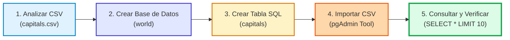

# 🐘 Práctica Guiada: Crear una Base de Datos, Crear Tablas e Importar un CSV en PostgreSQL con pgAdmin

> *"Un buen análisis del dato te ayuda a definir la estructura correcta de la tabla."*

¡Bienvenido/a a esta práctica guiada! En este laboratorio aprenderás el flujo completo de trabajo con **PostgreSQL** y **pgAdmin**, partiendo desde un archivo de datos en bruto (`capitals.csv`) hasta tener una base de datos relacional creada, una tabla correctamente tipada y los datos importados y listos para consultar.

---

## 📌 Índice de la Práctica
1. [Objetivos y Materiales](#-objetivos-y-materiales)
2. [Paso 1: Análisis del Archivo CSV](#-paso-1-análisis-del-archivo-csv)
3. [Paso 2: Definición del Esquema y Tipos de Datos](#-paso-2-definición-del-esquema-y-tipos-de-datos)
4. [Paso 3: Crear la Base de Datos en pgAdmin (`world`)](#-paso-3-crear-la-base-de-datos-en-pgadmin)
5. [Paso 4: Crear la Tabla con SQL (`CREATE TABLE capitals`)](#-paso-4-crear-la-tabla-con-sql)
6. [Paso 5: Verificar la Creación de la Tabla](#-paso-5-verificar-la-creación-de-la-tabla)
7. [Paso 6: Importar los Datos del CSV desde pgAdmin](#-paso-6-importar-los-datos-del-csv-desde-pgadmin)
8. [Paso 7: Comprobar y Consultar los Datos con SQL](#-paso-7-comprobar-y-consultar-los-datos-con-sql)
9. [Consejos y Buenas Prácticas](#-consejos-y-buenas-prácticas)
10. [Resumen del Flujo de Trabajo](#-resumen-del-flujo-de-trabajo)
11. [💡 Lo que se extrae de esta práctica (Puntos Clave)](#-lo-que-se-extrae-de-esta-práctica-puntos-clave)
12. [🚀 Reto Adicional: Practica con `flags.csv`](#-reto-adicional-practica-con-flagscsv)

---

## 🎯 Objetivos y Materiales

### ¿Qué vas a conseguir?
- Dominar el flujo profesional de migración de datos planos (CSV) a una base de datos relacional SQL.
- Manejar con soltura **pgAdmin 4**, la interfaz gráfica oficial de PostgreSQL.
- Comprender el tipado de datos en SQL (`SERIAL`, `VARCHAR`, `TEXT`) y la importancia de las claves primarias (`PRIMARY KEY`).
- Ejecutar sentencias DDL (*Data Definition Language*) y DQL (*Data Query Language*).

### Archivos de la práctica
- `create table myadmin.png`: Infografía visual de referencia con los 10 puntos clave.
- `capitals.csv`: Archivo con los países del mundo y sus respectivas capitales.
- `flags.csv`: Archivo complementario para el ejercicio práctico adicional.


---

## 📄 Paso 1: Análisis del Archivo CSV

El archivo [`capitals.csv`](./capitals.csv) contiene una lista de países y sus capitales en formato **CSV** (*Comma Separated Values*).

Si abrimos las primeras líneas del archivo:
```csv
id,country,capital
1,Afghanistan,Kabul
2,Aland Islands,Mariehamn
3,Albania,Tirana
4,Algeria,Algiers
5,American Samoa,Pago Pago
6,Andorra,Andorra la Vella
7,Angola,Luanda
... (todos los países del mundo)
```

### Características del archivo:
- **Separador:** Los valores están delimitados por comas (`,`).
- **Filas:** Cada línea física del archivo representa un registro único.
- **Cabecera (*Header*):** La primera línea define los nombres de los atributos: `id`, `country` y `capital`.
- **Identificador:** Cada fila ya viene con un número secuencial único (`id`).

<div style="background-color: #f0fdf4; border-left: 5px solid #22c55e; padding: 12px 18px; margin: 16px 0; border-radius: 6px; color: #166534;">
<strong>🟢 Lo que se extrae de este paso:</strong><br>
Nunca se debe crear una tabla a ciegas. Inspeccionar previamente el archivo permite identificar el delimitador exacto, comprobar si incluye fila de cabecera y detectar qué columna servirá de identificador unívoco.
</div>

---

## 📐 Paso 2: Definición del Esquema y Tipos de Datos

Antes de escribir una sola línea de código SQL, debemos traducir las columnas del CSV a tipos de datos relacionales eficientes:

| Campo | Ejemplo | Tipo de dato en PostgreSQL | Justificación técnica |
| :--- | :--- | :--- | :--- |
| **`id`** | `1` | `SERIAL PRIMARY KEY` | Identificador único numérico y autoincremental. Garantiza que cada registro sea irrepetible. |
| **`country`** | `Afghanistan` | `VARCHAR(45)` | Cadena de texto. Ningún nombre de país en el dataset supera los 45 caracteres. |
| **`capital`** | `Kabul` | `VARCHAR(45)` | Cadena de texto. Ninguna capital en el dataset supera los 45 caracteres. |

> [!TIP]
> **¿Por qué `VARCHAR(45)` y no `TEXT`?**  
> Podríamos usar `TEXT` para admitir cualquier longitud sin límite. Sin embargo, cuando conocemos la longitud máxima esperada de los datos, `VARCHAR(45)` actúa como regla de validación natural, impidiendo que accidentalmente se almacenen textos excesivos o basura de datos.

<div style="background-color: #f0fdf4; border-left: 5px solid #22c55e; padding: 12px 18px; margin: 16px 0; border-radius: 6px; color: #166534;">
<strong>🟢 Lo que se extrae de este paso:</strong><br>
El diseño del esquema es el cimiento de la base de datos. Una buena elección de tipos ahorra espacio en disco, acelera los índices de búsqueda y protege la integridad de los datos frente a entradas erróneas.
</div>

---

## 🗄️ Paso 3: Crear la Base de Datos en pgAdmin

Vamos a crear el contenedor lógico donde vivirá nuestra tabla: una base de datos llamada `world`.

1. Abre **pgAdmin 4** e introduce la contraseña maestra si te la solicita.
2. En el panel lateral izquierdo (*Object Explorer*), expande la rama **Servers**.
3. Haz doble clic sobre tu servidor (por ejemplo, **PostgreSQL 15** o **PostgreSQL 16**).
   - Si te pide contraseña, introduce la que configuraste al instalar PostgreSQL (el usuario predeterminado es `postgres`).
4. Haz clic derecho sobre **Databases** ➡️ **Create** ➡️ **Database...**.
5. En la ventana emergente:
   - **Database:** Escribe `world`.
   - **Owner:** Mantén `postgres`.
6. Haz clic en **Save** (Guardar).

 *(Ver recuadro 3 de la infografía)*

<div style="background-color: #f0fdf4; border-left: 5px solid #22c55e; padding: 12px 18px; margin: 16px 0; border-radius: 6px; color: #166534;">
<strong>🟢 Lo que se extrae de este paso:</strong><br>
Una instancia de PostgreSQL puede albergar múltiples bases de datos independientes. Cada base de datos aísla completamente sus esquemas, tablas, usuarios y permisos.
</div>

---

## 💻 Paso 4: Crear la Tabla con SQL

Una vez creada la base de datos `world`, vamos a ejecutar el código SQL para generar la tabla `capitals`.

1. En el árbol izquierdo de pgAdmin, haz clic sobre la base de datos **`world`** para seleccionarla.
2. En la barra superior, abre la herramienta de consultas haciendo clic en el icono **Query Tool** (o menú contextual: clic derecho en `world` ➡️ **Query Tool**).
3. Escribe la siguiente sentencia DDL en el editor:

```sql
CREATE TABLE capitals (
    id SERIAL PRIMARY KEY,
    country VARCHAR(45),
    capital VARCHAR(45)
);
```

4. Pulsa el botón **Execute / Refresh** (icono de ▶️ o tecla `F5`).
5. En la pestaña inferior (*Messages*), deberás ver:
   ```text
   CREATE TABLE
   Query returned successfully in ... msec.
   ```

> [!WARNING]
> **¡No olvides el punto y coma (;) al final!**  
> A diferencia de lenguajes dinámicos como JavaScript o Python, en SQL el carácter `;` es el terminador obligatorio que indica al motor que la instrucción ha concluido.

<div style="background-color: #f0fdf4; border-left: 5px solid #22c55e; padding: 12px 18px; margin: 16px 0; border-radius: 6px; color: #166534;">
<strong>🟢 Lo que se extrae de este paso:</strong><br>
Con <code>SERIAL PRIMARY KEY</code>, PostgreSQL genera internamente una secuencia (Sequence) autoincremental y un índice B-Tree único, asegurando identificadores únicos y búsquedas a máxima velocidad.
</div>

---

## 🔍 Paso 5: Verificar la Creación de la Tabla

Comprobemos que la tabla existe en la jerarquía de PostgreSQL:

1. En el panel izquierdo de pgAdmin, navega por el siguiente camino:
   ```text
   Servers
     └── PostgreSQL [versión]
           └── Databases
                 └── world
                       └── Schemas
                             └── public
                                   └── Tables
                                         └── capitals
   ```
2. Deberías ver la tabla `capitals` listada bajo `Tables`.

> [!IMPORTANT]
> **¿No ves la tabla listada?**  
> 1. Haz clic derecho sobre `Tables` (o sobre `world`) y selecciona **Refresh**.  
> 2. Asegúrate de que la pestaña del *Query Tool* estaba conectada a la base de datos `world` y no a la base de datos por defecto `postgres`.

<div style="background-color: #f0fdf4; border-left: 5px solid #22c55e; padding: 12px 18px; margin: 16px 0; border-radius: 6px; color: #166534;">
<strong>🟢 Lo que se extrae de este paso:</strong><br>
En PostgreSQL, las tablas viven dentro de un <em>Schema</em> (por defecto <code>public</code>). Comprender la jerarquía <em>Servidor ➔ Base de Datos ➔ Esquema ➔ Tabla</em> evita confusiones de conexión y permisos.
</div>

---

## 📥 Paso 6: Importar los Datos del CSV desde pgAdmin

Ahora pasaremos los datos de [`capitals.csv`](./capitals.csv) directamente a la tabla `capitals` usando la utilidad gráfica de pgAdmin.

1. Haz clic derecho sobre la tabla **`capitals`** ➡️ selecciona **Import/Export Data...**.
2. En la ventana emergente que se abre:
   - **Pestaña *General*:**
     - Cambia el interruptor superior a **Import** (en color azul).
     - En **Filename**, haz clic en el botón de tres puntos (`...`) y busca la ruta absoluta de tu archivo [`capitals.csv`](./capitals.csv).
     - En **Format**, selecciona **`csv`**.
     - En **Encoding**, puedes dejarlo en `UTF-8` o en blanco (por defecto).
   - **Pestaña *Options*:**
     - Marca la casilla **Header** en **Yes** (activado). *(Esto es crucial: le dice a Postgres que la primera fila no es un dato, sino los nombres de las columnas)*.
     - **Delimiter:** Selecciona o escribe `,` (coma).
     - **Quote:** Mantén `"` (comilla doble estándar).
3. Haz clic en el botón **OK**.
4. En la esquina inferior derecha aparecerá una notificación:
   ```text
   Process completed successfully.
   ```

<div style="background-color: #f0fdf4; border-left: 5px solid #22c55e; padding: 12px 18px; margin: 16px 0; border-radius: 6px; color: #166534;">
<strong>🟢 Lo que se extrae de este paso:</strong><br>
pgAdmin envuelve la sentencia nativa <code>\copy</code> de PostgreSQL en un asistente gráfico intuitivo. Indicar correctamente la cabecera (Header) y el delimitador evita errores típicos de conversión de tipos (como intentar meter el texto "id" en una columna numérica).
</div>

---

## 🔎 Paso 7: Comprobar y Consultar los Datos con SQL

Para validar que los datos se importaron íntegramente, realizamos una consulta interactiva en el **Query Tool**:

```sql
SELECT * FROM capitals
LIMIT 10;
```

Pulsa **Execute (F5)**. En la pestaña inferior **Data Output** verás los primeros 10 países con sus capitales:

| id | country | capital |
| :--- | :--- | :--- |
| **1** | Afghanistan | Kabul |
| **2** | Aland Islands | Mariehamn |
| **3** | Albania | Tirana |
| **4** | Algeria | Algiers |
| **5** | American Samoa | Pago Pago |
| **6** | Andorra | Andorra la Vella |
| **7** | Angola | Luanda |
| **8** | Anguilla | The Valley |
| **9** | Antarctica | *(null)* |
| **10** | Antigua And Barbuda | St. John's |

### Otras consultas útiles de verificación:
```sql
-- Contar el total de países importados
SELECT COUNT(*) AS total_paises FROM capitals;

-- Buscar la capital de un país concreto
SELECT capital FROM capitals WHERE country = 'Spain';

-- Buscar qué país tiene una capital determinada
SELECT country FROM capitals WHERE capital = 'Tokyo';
```

<div style="background-color: #f0fdf4; border-left: 5px solid #22c55e; padding: 12px 18px; margin: 16px 0; border-radius: 6px; color: #166534;">
<strong>🟢 Lo que se extrae de este paso:</strong><br>
Una importación no está completa hasta que se verifica con consultas de agregación (como <code>COUNT(*)</code>) y muestreo (<code>LIMIT</code>). Notamos que registros como Antártida tienen capital <code>NULL</code>, lo que demuestra cómo SQL gestiona la ausencia de valor sin romper la estructura.
</div>

---

## 🛡️ Consejos y Buenas Prácticas

- ✅ **Analiza siempre antes de crear:** Inspecciona los valores extremos (textos más largos, valores nulos, formatos de fecha) en el archivo original.
- ✅ **Ajusta los tipos de datos:** Usa tipos específicos (`INT`, `VARCHAR(n)`, `BOOLEAN`, `DATE`) en lugar de almacenar todo en texto genérico.
- ✅ **Claves Primarias obligatorias:** Toda tabla debe tener una Primary Key (`SERIAL` o `BIGSERIAL` en PostgreSQL) para garantizar unicidad e indexación rápida.
- ✅ **Seguridad y contraseñas:** Mantén a buen recaudo las credenciales del usuario `postgres` y no uses contraseñas en texto plano en repositorios públicos.
- ✅ **Archivos masivos (>1 millón de filas):** Para conjuntos masivos de datos, la herramienta gráfica de pgAdmin puede ser lenta; en esos casos se recomienda el comando SQL directo:
  ```sql
  COPY capitals(id, country, capital)
  FROM '/ruta/absoluta/capitals.csv'
  DELIMITER ','
  CSV HEADER;
  ```

---

## 🔄 Resumen del Flujo de Trabajo



---

## 💡 Lo que se extrae de esta práctica (Puntos Clave)

<div style="background-color: #f0fdf4; border: 2px solid #22c55e; padding: 20px; border-radius: 8px; margin: 20px 0;">

### 🟢 Conclusiones y Aprendizajes Extraídos

1. **El formato CSV como estándar universal:**  
   Es el formato plano por excelencia para intercambio de información entre hojas de cálculo, APIs y motores de bases de datos.

2. **Tipado fuerte y estructuración formal:**  
   En PostgreSQL las tablas se crean formalmente mediante DDL (`CREATE TABLE`). Tipos como `SERIAL` y `VARCHAR(45)` garantizan orden, consistencia e integridad que ningún archivo plano puede ofrecer por sí solo.

3. **Productividad con interfaces gráficas (pgAdmin):**  
   pgAdmin facilita enormemente las tareas administrativas (crear BDs, explorar esquemas e importar archivos) sin perder la potencia de ejecutar código SQL nativo en el *Query Tool*.

4. **Importación asistida sin código de migración:**  
   La herramienta *Import/Export Data* de pgAdmin permite cargar cientos o miles de registros en cuestión de segundos configurando únicamente el delimitador y la cabecera.

5. **Rendimiento y escalabilidad relacional:**  
   PostgreSQL maneja volúmenes masivos de datos de forma transaccional (ACID), permitiendo realizar consultas complejas, filtrados e indexaciones instantáneas.

> **"De un simple archivo CSV a una base de datos robusta, estructurada y consultable en solo unos pasos."**

</div>

---

## 🚀 Reto Adicional: Practica con `flags.csv`

En la misma carpeta dispones del archivo [`flags.csv`](./flags.csv). Pon a prueba lo aprendido:

1. Inspecciona las columnas y tipos de [`flags.csv`](./flags.csv).
2. Abre el **Query Tool** en la base de datos `world`.
3. Crea una nueva tabla `flags` con los tipos de datos apropiados.
4. Importa los datos de [`flags.csv`](./flags.csv) usando la ventana **Import/Export Data**.
5. Realiza un `SELECT * FROM flags LIMIT 5;` para verificar el resultado.

<details>
<summary><b>💡 Ver solución sugerida para el reto</b></summary>

```sql
-- 1. Crear tabla flags
CREATE TABLE flags (
    id SERIAL PRIMARY KEY,
    name VARCHAR(45),
    flag VARCHAR(10)
);

-- 2. Consultar tras la importación
SELECT * FROM flags LIMIT 5;
```

</details>

