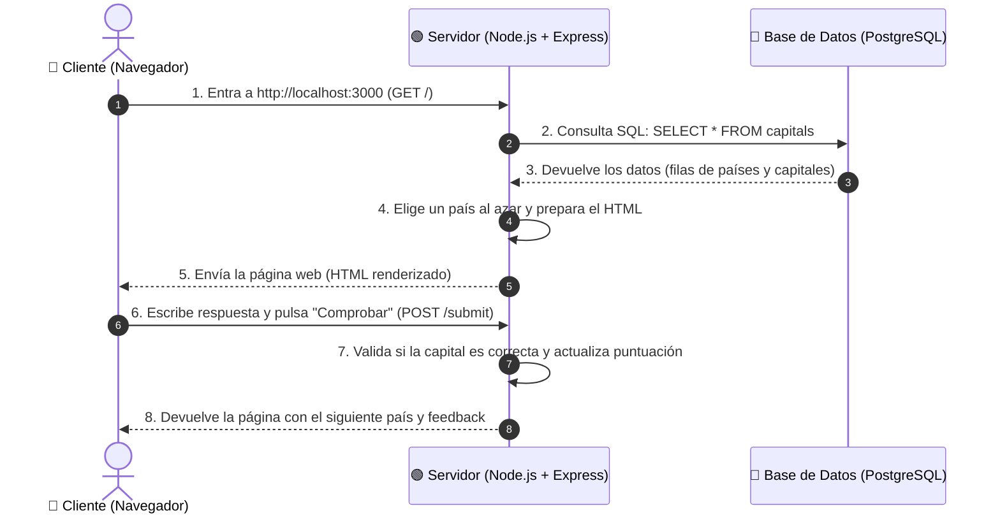

# 🐘 Práctica Guiada: Conectar PostgreSQL con Node.js y Express (SELECT / Read)

> *"Con unas pocas líneas de código podemos leer datos reales de PostgreSQL y dar vida a nuestras aplicaciones web."*

¡Bienvenido/a a esta práctica guiada! En este laboratorio vas a dar un salto fundamental como desarrollador/a: **conectar una base de datos relacional (PostgreSQL) con una aplicación web real**.

Hasta ahora hemos trabajado con bases de datos desde su propia consola o desde pgAdmin. Hoy aprenderás cómo tu código en JavaScript puede conectarse a PostgreSQL, pedir datos mediante una consulta `SELECT` y mostrar esos datos dinámicamente en una página web.

Construiremos el juego **World Capitals Quiz**: un quiz interactivo en el navegador que ya no tendrá países inventados ni escritos a mano en el código, sino que consultará en tiempo real la tabla `capitals` que creamos en la base de datos `world`.

---

## 📌 Índice de Contenidos

1. [Conceptos Fundamentales desde Cero (Sin suponer nada previo)](#-conceptos-fundamentales-desde-cero)
   - [¿Qué es Node.js?](#1-qué-es-nodejs)
   - [¿Qué es npm y el archivo package.json?](#2-qué-es-npm-y-el-archivo-packagejson)
   - [¿Qué es Express?](#3-qué-es-express)
   - [La Arquitectura Cliente-Servidor-Base de Datos](#4-la-arquitectura-cliente-servidor-base-de-datos)
   - [¿Qué es EJS y las plantillas?](#5-qué-es-ejs-y-las-plantillas-vistas)
2. [Estructura del Proyecto del Alumno (`World+Capital+Quiz`)](#-estructura-del-proyecto-worldcapitalquiz)
3. [Paso 1: Instalación de Dependencias](#-paso-1-instalación-de-dependencias)
4. [Paso 2: Comprender el Problema Inicial en `index.js`](#-paso-2-comprender-el-problema-inicial-en-indexjs)
5. [Paso 3: Instalar y Comprender la Librería `pg` (node-postgres)](#-paso-3-instalar-y-comprender-la-librería-pg)
6. [Paso 4: Configurar los Datos de Conexión](#-paso-4-configurar-los-datos-de-conexión)
7. [Paso 5: Ejecutar la Consulta `SELECT * FROM capitals`](#-paso-5-ejecutar-la-consulta-select--from-capitals)
8. [Paso 6: ¿Qué recibimos exactamente de PostgreSQL? (`res.rows`)](#-paso-6-qué-recibimos-exactamente-de-postgresql-resrows)
9. [Paso 7: Conectar los Datos al Quiz y Probar en el Navegador](#-paso-7-conectar-los-datos-al-quiz-y-probar-en-el-navegador)
10. [Código Completo Explicado Línea por Línea](#-código-completo-explicado-línea-por-línea)
11. [Buenas Prácticas, Seguridad y Variables de Entorno](#-buenas-prácticas-seguridad-y-variables-de-entorno)
12. [Resolución de Problemas Frecuentes (*Troubleshooting*)](#-resolución-de-problemas-frecuentes-troubleshooting)
13. [💡 Lo que se extrae de esta práctica (Puntos Clave en Verde)](#-lo-que-se-extrae-de-esta-práctica-puntos-clave)
14. [🚀 Reto Adicional: El Quiz de Banderas (`flags`)](#-reto-adicional-el-quiz-de-banderas-flags)

---

## 🧠 Conceptos Fundamentales desde Cero

*(Si nunca has visto Node o Express, esta sección te dará las bases necesarias explicadas de forma sencilla y directa)*.

### 1. ¿Qué es Node.js?
Normalmente, JavaScript solo se podía ejecutar dentro de un navegador web (Google Chrome, Firefox, Safari) para cosas como animaciones o validar un formulario.

**Node.js** es un entorno que permite ejecutar JavaScript **fuera del navegador**, directamente en el sistema operativo de tu ordenador o en un servidor. Con Node.js podemos crear programas de backend, servidores web y conectar bases de datos.

### 2. ¿Qué es npm y el archivo `package.json`?
- **npm (*Node Package Manager*):** Es la mayor tienda/biblioteca de código libre del mundo para JavaScript. Permite descargar librerías creadas por otros desarrolladores (para crear servidores, cifrar contraseñas, conectar bases de datos, etc.).
- **`package.json`:** Es el "DNI" o receta de nuestro proyecto. En él se indica el nombre del proyecto y, sobre todo, la lista de **dependencias** (librerías externas) que el proyecto necesita para funcionar.
- **`node_modules/`:** Carpeta donde `npm` descarga físicamente todo el código de esas librerías. Nunca se sube a GitHub porque pesa mucho; cualquiera puede regenerarla ejecutando `npm install`.

### 3. ¿Qué es Express?
Node.js por sí solo es muy básico. **Express** es el framework (marco de trabajo) web más popular para Node.js. 
Nos permite crear un servidor web en menos de 10 líneas de código y responder a las peticiones del usuario:
- **Petición GET (`app.get`):** Cuando el usuario entra a `http://localhost:3000/` con su navegador para ver la página web.
- **Petición POST (`app.post`):** Cuando el usuario rellena un formulario y pulsa un botón como "Comprobar" o "Enviar", enviando datos al servidor.
- **Puerto (`port 3000`):** Es la "puerta de entrada" virtual en tu ordenador por donde escucha tu servidor.

### 4. La Arquitectura Cliente-Servidor-Base de Datos

Mira cómo viaja la información entre los 3 protagonistas de esta práctica:



### 5. ¿Qué es EJS y las plantillas (Vistas)?
En una web normal, el archivo `index.html` es estático (siempre tiene el mismo texto). 
En este proyecto usamos **EJS (*Embedded JavaScript*)**, que son archivos `.ejs` dentro de la carpeta `views/`. 
Permiten incrustar variables de JavaScript dentro del HTML:
- `<%= question.country %>`: Muestra en pantalla el país que el servidor eligió al azar.
- `<%= totalScore %>`: Muestra la puntuación actual del jugador.

---

## 📂 Estructura del Proyecto `World+Capital+Quiz`

Si entras en la carpeta [`World+Capital+Quiz`](file:///Users/fjbanezares/databases_flash_course/Databases_Intro/3.%20Postgres/4.%20select%20in%20postgres/World+Capital+Quiz/), verás los siguientes archivos:

```text
World+Capital+Quiz/
├── capitals.csv        # Archivo con los 250 países del mundo
├── package.json        # Configuración del proyecto y dependencias
├── public/             # Archivos estáticos accesibles directamente
│   └── styles/
│       └── main.css    # Estilos visuales del quiz
├── views/              # Plantillas dinámicas de interfaz
│   └── index.ejs       # Estructura visual del juego
├── index.js            # ARCHIVO PRINCIPAL DE TRABAJO (Aquí programarás)
└── solution.js         # Código resuelto de referencia
```

---

## 📦 Paso 1: Instalación de Dependencias

Antes de ejecutar el servidor, necesitamos instalar las librerías indicadas en el `package.json` (`express`, `ejs`, `body-parser`, `axios`, `pg`).

Abre tu terminal en la carpeta del proyecto:

```bash
# Navegar hasta la carpeta del proyecto
cd "Databases_Intro/3. Postgres/4. select in postgres/World+Capital+Quiz"

# Instalar todas las librerías necesarias
npm install
```

🔍 **¿Qué hace este comando?**  
Lee el archivo `package.json`, contacta con el registro oficial de npm y descarga en una carpeta llamada `node_modules/` todas las herramientas necesarias.

<div style="background-color: #f0fdf4; border-left: 5px solid #22c55e; padding: 12px 18px; margin: 16px 0; border-radius: 6px; color: #166534;">
<strong>🟢 Lo que se extrae de este paso:</strong><br>
Siempre que descargues o abras un proyecto Node.js por primera vez, el paso obligatorio número 1 es ejecutar <code>npm install</code> para crear el entorno local de dependencias.
</div>

---

## 🧐 Paso 2: Comprender el Problema Inicial en `index.js`

Abre el archivo [`index.js`](file:///Users/fjbanezares/databases_flash_course/Databases_Intro/3.%20Postgres/4.%20select%20in%20postgres/World+Capital+Quiz/index.js). Observa las líneas 7 a 11:

```javascript
let quiz = [
  { country: "France", capital: "Paris" },
  { country: "United Kingdom", capital: "London" },
  { country: "United States of America", capital: "New York" },
];
```

### ¿Por qué esto es una mala práctica?
1. **Datos "hardcodeados":** Solo hay 3 países escritos directamente en el código. Si queremos 200 países, tendríamos miles de líneas de texto mezcladas con la lógica.
2. **Datos desactualizados o erróneos:** (¡La capital de EEUU no es Nueva York, sino Washington D.C.!). Para corregirlo tendrías que modificar el código fuente y reiniciar el servidor.
3. **Falta de persistencia y dinamismo:** Los datos deben vivir en su lugar natural: **una base de datos relacional (PostgreSQL)**.

> **🎯 Nuestro objetivo:** Eliminar esa lista fija y hacer que la variable `quiz` se rellene automáticamente consultando la tabla `capitals` en PostgreSQL mediante una sentencia SQL `SELECT`.

---

## 🔌 Paso 3: Instalar y Comprender la Librería `pg`

Node.js no sabe por sí solo cómo "hablar" el protocolo de PostgreSQL. Necesita un traductor (un *driver*).

Ese driver oficial se llama **`pg`** (*node-postgres*).

```bash
npm install pg
```

*(En nuestro proyecto ya está listado en el `package.json`, por lo que al hacer `npm install` en el Paso 1 ya quedó instalado).*

### ¿Cómo lo importamos en nuestro código?
En la parte superior de `index.js`, agregamos la importación del paquete `pg`:

```javascript
import pg from "pg";
```

O si utilizáramos sintaxis antigua CommonJS: `const { Client } = require('pg');`. En este proyecto usamos ES Modules (`"type": "module"` en `package.json`), por lo que usamos `import pg from "pg";`.

<div style="background-color: #f0fdf4; border-left: 5px solid #22c55e; padding: 12px 18px; margin: 16px 0; border-radius: 6px; color: #166534;">
<strong>🟢 Lo que se extrae de este paso:</strong><br>
El paquete <code>pg</code> es el puente estándar entre JavaScript y PostgreSQL. Nos proporciona clases como <code>Client</code> y <code>Pool</code> para autenticarnos, enviar sentencias SQL y recibir los resultados estructurados como objetos nativos de JavaScript.
</div>

---

## ⚙️ Paso 4: Configurar los Datos de Conexión

Para que nuestra aplicación pueda entrar a PostgreSQL, necesita las credenciales exactas del servidor que configuraste en la práctica anterior:

```javascript
const db = new pg.Client({
  user: "postgres",       // Usuario por defecto de PostgreSQL
  host: "localhost",      // Tu propio ordenador (máquina local)
  database: "world",      // La base de datos que creamos en pgAdmin
  password: "TU_PASSWORD", // La contraseña que pusiste al instalar Postgres
  port: 5432,             // Puerto estándar de PostgreSQL
});

// Abrir la conexión con el motor de base de datos
db.connect();
```

### Explicación detallada de cada parámetro:

| Parámetro | Valor típico | ¿Qué significa en lenguaje humano? |
| :--- | :--- | :--- |
| **`user`** | `"postgres"` | El nombre del superusuario administrativo. |
| **`host`** | `"localhost"` | Dirección donde corre PostgreSQL. `localhost` significa "este mismo equipo". |
| **`database`** | `"world"` | El nombre exacto de la base de datos que contiene la tabla `capitals`. |
| **`password`** | `"tu_contraseña"` | La clave que introdujiste cuando abriste pgAdmin por primera vez. |
| **`port`** | `5432` | El número de puerto de red reservado mundialmente para PostgreSQL. |

> [!CAUTION]
> Asegúrate de sustituir `"TU_PASSWORD"` por la contraseña real que configuraste en tu instalación de PostgreSQL (por ejemplo, `123456`, `postgres`, `admin`, etc.). Si la contraseña no coincide, la conexión fallará con un error `password authentication failed`.

---

## 📡 Paso 5: Ejecutar la Consulta `SELECT * FROM capitals`

Ahora ejecutamos la consulta SQL para leer todos los registros de la tabla `capitals`.

En lugar de tener el array `quiz` con 3 países fijos, lo inicializamos vacío:

```javascript
let quiz = [];
```

Y le pedimos a PostgreSQL que lo llene usando el método `db.query()`:

```javascript
db.query("SELECT * FROM capitals", (err, res) => {
  if (err) {
    console.error("Error al ejecutar la consulta SQL:", err.stack);
  } else {
    quiz = res.rows;
    console.log(`¡Éxito! Se han cargado ${quiz.length} países desde PostgreSQL.`);
  }
  db.end(); // Cerramos la conexión una vez leídos los datos
});
```

### ¿Qué hace cada parte de este código?
1. **`db.query("SELECT * FROM capitals", ...)`**: Envía la sentencia SQL idéntica a la que escribías en pgAdmin.
2. **`(err, res) => { ... }` (Función Callback)**: Como las consultas a bases de datos tardan unos milisegundos, Node.js no congela la aplicación; cuando Postgres termina de responder, ejecuta esta función.
3. **`if (err)`**: Si hubo algún fallo (por ejemplo, la tabla no existe o la sintaxis es incorrecta), capturamos el error sin que se caiga el servidor.
4. **`quiz = res.rows`**: Guarda las filas devueltas por PostgreSQL directamente en nuestra variable global `quiz`.
5. **`db.end()`**: Cierra la sesión del cliente con la base de datos para no dejar conexiones colgadas en memoria.

<div style="background-color: #f0fdf4; border-left: 5px solid #22c55e; padding: 12px 18px; margin: 16px 0; border-radius: 6px; color: #166534;">
<strong>🟢 Lo que se extrae de este paso:</strong><br>
Las operaciones de base de datos en Node.js son <strong>asíncronas</strong>. Node no se bloquea esperando a la base de datos; delega la consulta al motor PostgreSQL y gestiona la respuesta en el callback (o promesa), garantizando un rendimiento de alta concurrencia.
</div>

---

## 🎁 Paso 6: ¿Qué recibimos exactamente de PostgreSQL? (`res.rows`)

Cuando PostgreSQL ejecuta un `SELECT *`, no devuelve texto plano ni un archivo CSV. 
La librería `pg` **convierte automáticamente cada fila de la tabla en un Objeto JavaScript**, y agrupa todas las filas dentro de un array llamado `res.rows`.

Si hicieras un `console.log(res.rows[0])`, verías:

```javascript
// res.rows es un Array de Objetos:
[
  { id: 1, country: 'Afghanistan', capital: 'Kabul' },
  { id: 2, country: 'Aland Islands', capital: 'Mariehamn' },
  { id: 3, country: 'Albania', capital: 'Tirana' },
  { id: 4, country: 'Algeria', capital: 'Algiers' },
  ... y así hasta los ~250 países del dataset!
]
```

### ¿Por qué esto encaja perfectamente con nuestra app?
Fíjate en las propiedades del objeto:
- `country`: coincide con lo que pide la plantilla EJS (`<%= question.country %>`).
- `capital`: coincide con la verificación de respuesta (`currentQuestion.capital.toLowerCase() === answer.toLowerCase()`).

¡No hace falta transformar nada! El nombre de las columnas en SQL se convierte automáticamente en las claves de las propiedades del objeto en JavaScript.

<div style="background-color: #f0fdf4; border-left: 5px solid #22c55e; padding: 12px 18px; margin: 16px 0; border-radius: 6px; color: #166534;">
<strong>🟢 Lo que se extrae de este paso:</strong><br>
El mapeo de datos entre SQL y Node.js es transparente: <strong>Tabla SQL ➔ Array</strong> y <strong>Fila SQL ➔ Objeto JavaScript</strong>. Las columnas definidas en el <code>CREATE TABLE</code> se convierten en las propiedades del objeto (<code>row.country</code>, <code>row.capital</code>).
</div>

---

## 🎮 Paso 7: Conectar los Datos al Quiz y Probar en el Navegador

### 1. Iniciar la aplicación
En tu terminal, situado en la carpeta del proyecto, ejecuta:

```bash
node index.js
```

Si todo está bien configurado, verás en la consola:

```text
Server is running at http://localhost:3000
¡Éxito! Se han cargado 249 países desde PostgreSQL.
```

### 2. Abrir el juego en el navegador
Abre tu navegador web favorito (Chrome, Edge, Safari...) y entra a:
👉 **`http://localhost:3000`**

### 3. ¡A jugar!
1. Aparecerá el nombre de un país al azar obtenido directamente de tu base de datos (por ejemplo, *Albania*).
2. Escribe la capital (por ejemplo, *Tirana*) y pulsa **Submit**.
3. Si aciertas:
   - Se sumará 1 punto a tu marcador (*Total Score: 1*).
   - Verás un tic verde `✔`.
   - Se seleccionará otro país al azar.
4. Si fallas:
   - Saldrá una cruz roja `✖` y un mensaje de fin de juego con tu puntuación acumulada.

### 4. ¿Cómo detener el servidor y saber si el puerto 3000 quedó libre?

Cuando terminas de probar tu aplicación y quieres apagarla, o si necesitas reiniciarla tras modificar código:

1. **Detener el proceso en la terminal:**  
   Presiona en tu teclado la combinación **`Ctrl + C`** (en Mac y Linux esto envía una señal `SIGINT` que interrumpe y detiene el proceso de Node.js).

2. **¿Cómo comprobar si el puerto 3000 realmente quedó libre?**  
   A veces una aplicación no se cierra del todo y se queda "fantasma" ocupando el puerto. En la terminal de Mac o Linux, ejecuta:
   ```bash
   lsof -i :3000
   ```
   - **`lsof` (*List Open Files*):** En Mac y Unix todo se gestiona como archivos abiertos, incluidas las conexiones de red.
   - **`-i :3000`:** Filtra para examinar específicamente el puerto de red 3000.

   **¿Cómo interpretar el resultado?**
   - **Si no devuelve nada** (vuelve a salir la línea de comandos vacía):  
     ✅ ¡Perfecto! El puerto está **100% libre** y listo para volverse a usar.
   - **Si aparece una lista con columnas (`COMMAND`, `PID`, `NODE`...)**:  
     ⚠️ Hay un proceso que sigue ocupando el puerto.

3. **¿Cómo forzar el cierre ("matar el proceso") si se quedó bloqueado?**  
   - **Opción A (por su identificador `PID`):** Busca el número que aparece en la columna `PID` (por ejemplo, `48291`) y ejecuta:
     ```bash
     kill -9 48291
     ```
   - **Opción B (comando automático en una sola línea):**
     ```bash
     kill -9 $(lsof -t -i :3000)
     ```
     *(Este comando busca el PID que ocupa el puerto 3000 y lo finaliza al instante).*

---

## 📜 Código Completo Explicado Línea por Línea

Aquí tienes el archivo final completo [`solution.js`](file:///Users/fjbanezares/databases_flash_course/Databases_Intro/3.%20Postgres/4.%20select%20in%20postgres/World+Capital+Quiz/solution.js) con comentarios didácticos en cada sección:

```javascript
// 1. IMPORTACIÓN DE LIBRERÍAS
import express from "express";       // Framework web para crear el servidor
import bodyParser from "body-parser"; // Procesa los formularios enviados por el usuario
import pg from "pg";                 // Driver para comunicar Node.js con PostgreSQL

// 2. CONFIGURACIÓN DEL CLIENTE DE BASE DE DATOS
const db = new pg.Client({
  user: "postgres",       // Usuario administrador de PostgreSQL
  host: "localhost",      // Dirección del servidor (tu ordenador)
  database: "world",      // Nombre de la base de datos
  password: "TU_PASSWORD", // Tu contraseña personal de PostgreSQL
  port: 5432,             // Puerto por defecto
});

// 3. INICIALIZACIÓN DEL SERVIDOR WEB
const app = express();
const port = 3000;

// 4. CONEXIÓN Y CONSULTA A POSTGRESQL
db.connect(); // Abrir conexión con PostgreSQL

let quiz = []; // Array donde guardaremos todos los países

// Ejecutamos la consulta SQL SELECT
db.query("SELECT * FROM capitals", (err, res) => {
  if (err) {
    console.error("Error ejecutando la consulta SQL:", err.stack);
  } else {
    quiz = res.rows; // Guardamos las 249 filas en memoria
    console.log(`Cargados ${quiz.length} países de la base de datos.`);
  }
  db.end(); // Cerramos la conexión tras leer los datos
});

// 5. VARIABLES DE ESTADO DEL JUEGO
let totalCorrect = 0;
let currentQuestion = {};

// 6. MIDDLEWARES (Configuraciones de Express)
app.use(bodyParser.urlencoded({ extended: true })); // Permite leer req.body.answer del formulario
app.use(express.static("public"));                  // Permite servir el archivo CSS de diseño

// 7. RUTA GET "/" - PÁGINA DE INICIO
app.get("/", async (req, res) => {
  totalCorrect = 0;      // Reiniciamos puntuación
  await nextQuestion();  // Elegimos un país al azar
  console.log(currentQuestion);
  res.render("index.ejs", { question: currentQuestion }); // Renderizamos la vista con el país
});

// 8. RUTA POST "/submit" - COMPROBAR LA RESPUESTA
app.post("/submit", (req, res) => {
  let answer = req.body.answer.trim(); // Obtenemos lo que escribió el usuario (sin espacios sobrantes)
  let isCorrect = false;

  // Comparamos sin importar mayúsculas o minúsculas
  if (currentQuestion.capital.toLowerCase() === answer.toLowerCase()) {
    totalCorrect++;
    isCorrect = true;
  }

  nextQuestion(); // Elegir siguiente país
  res.render("index.ejs", {
    question: currentQuestion,
    wasCorrect: isCorrect,
    totalScore: totalCorrect,
  });
});

// 9. FUNCIÓN AUXILIAR PARA OBTENER UN PAÍS ALEATORIO
async function nextQuestion() {
  const randomCountry = quiz[Math.floor(Math.random() * quiz.length)];
  currentQuestion = randomCountry;
}

// 10. ARRANCAR EL SERVIDOR
app.listen(port, () => {
  console.log(`Servidor escuchando en http://localhost:${port}`);
});
```

---

## 🔒 Buenas Prácticas, Seguridad y Variables de Entorno

En aplicaciones profesionales y en producción:

1. **Nunca subas contraseñas al código fuente (*Hardcoding*):**  
   Si subes este archivo a GitHub, cualquiera podrá ver tu contraseña de PostgreSQL. En proyectos reales se utiliza la librería `dotenv` con un archivo `.env`:
   ```bash
   npm install dotenv
   ```
   ```javascript
   // Archivo .env (no se sube a GitHub):
   DB_USER=postgres
   DB_PASSWORD=mi_clave_secreta
   DB_HOST=localhost
   DB_PORT=5432
   DB_DATABASE=world
   ```
2. **Client vs Pool de Conexiones:**
   - `pg.Client`: Es una única conexión dedicada. Adecuada para scripts puntuales o cargar datos al arrancar el servidor (como hicimos aquí).
   - `pg.Pool`: Para aplicaciones web reales con cientos de usuarios simultáneos, se usa un "Pool" (reserva de conexiones reutilizables), evitando abrir y cerrar conexiones en cada petición HTTP.
3. **Evitar inyección SQL:**
   - Si más adelante buscas un país que el usuario escribe, **nunca concatenes strings** como `"SELECT * FROM capitals WHERE country = '" + userInput + "'"`.  
   - Usa siempre **consultas parametrizadas**:
     ```javascript
     db.query("SELECT * FROM capitals WHERE country = $1", [userInput]);
     ```

---

## 🛠️ Resolución de Problemas Frecuentes (*Troubleshooting*)

| Error en consola | Causa principal | Solución |
| :--- | :--- | :--- |
| `password authentication failed for user "postgres"` | La contraseña en el objeto `new pg.Client` no coincide con la de tu instalación. | Escribe la contraseña exacta que usas para abrir pgAdmin. |
| `database "world" does not exist` | No creaste la base de datos `world` en el Paso 3 de la lección anterior. | Abre pgAdmin y crea la base de datos con nombre `world`. |
| `relation "capitals" does not exist` | La tabla no se creó dentro de la base de datos `world` o se llamó con otro nombre. | Comprueba en pgAdmin que `capitals` está en `world -> Schemas -> public -> Tables`. |
| `Cannot find module 'express'` o `'pg'` | No se ejecutó la instalación de dependencias. | Ejecuta `npm install` en la terminal dentro de la carpeta `World+Capital+Quiz`. |
| `Address already in use :::3000` | Ya tienes otro proceso ocupando el puerto 3000. | Comprueba qué proceso lo tiene con `lsof -i :3000` y libéralo ejecutando `kill -9 $(lsof -t -i :3000)` o cambia temporalmente el puerto a `3001` en `index.js`. |

---

## 💡 Lo que se extrae de esta práctica (Puntos Clave)

<div style="background-color: #f0fdf4; border: 2px solid #22c55e; padding: 22px; border-radius: 8px; margin: 24px 0;">

### 🟢 Conclusiones y Aprendizajes Extraídos de la Práctica

1. **La base de datos desacopla los datos del código:**  
   Al extraer los países a PostgreSQL, el código de la aplicación se mantiene limpio, modular y ligero. Si mañana agregamos 50 países más o corregimos un dato, la aplicación los consumirá al instante sin tocar una sola línea de JavaScript.

2. **`pg` como estándar de conexión:**  
   El paquete `pg` (*node-postgres*) gestiona el protocolo binario de PostgreSQL, la autenticación y la conversión transparente de tipos SQL a tipos nativos de JavaScript.

3. **Mapeo automático a objetos JavaScript:**  
   PostgreSQL devuelve el resultado estructurado en `res.rows`. Cada columna definida en SQL (`country`, `capital`) se convierte directamente en una propiedad accesible (`row.country`, `row.capital`).

4. **Ciclo completo Fullstack:**  
   Has completado el ciclo completo del desarrollo backend:
   $$\text{CSV en bruto} \longrightarrow \text{PostgreSQL (DDL/DQL)} \longrightarrow \text{Node.js + Express} \longrightarrow \text{EJS / Navegador}$$

5. **El valor de la asincronía:**  
   Aprender que las bases de datos tardan tiempo en responder y que Node.js aprovecha los callbacks y promesas para continuar atendiendo usuarios sin bloquearse.

> **"Una base de datos convierte una simple maqueta web en una aplicación real, dinámica y persistente."**

</div>

---

## 🚀 Reto Adicional: El Quiz de Banderas (`flags`)

En la carpeta [`8.2 Postgres Read`](file:///Users/fjbanezares/databases_flash_course/Databases_Intro/3.%20Postgres/4.%20select%20in%20postgres/8.2%20Postgres%20Read/) tienes una variante del proyecto pensada para jugar con las banderas del mundo (`flags.csv`).

### Instrucciones para el alumno:
1. Crea la tabla `flags` en tu base de datos `world` en pgAdmin:
   ```sql
   CREATE TABLE flags (
       id SERIAL PRIMARY KEY,
       name VARCHAR(45),
       flag VARCHAR(10)
   );
   ```
2. Importa el archivo [`flags.csv`](file:///Users/fjbanezares/databases_flash_course/Databases_Intro/3.%20Postgres/4.%20select%20in%20postgres/8.2%20Postgres%20Read/flags.csv) con la opción *Import/Export Data* (recuerda activar *Header: Yes*).
3. Abre [`8.2 Postgres Read/index.js`](file:///Users/fjbanezares/databases_flash_course/Databases_Intro/3.%20Postgres/4.%20select%20in%20postgres/8.2%20Postgres%20Read/index.js) y:
   - Configura la conexión con `pg.Client`.
   - Realiza la consulta `SELECT * FROM flags`.
   - Guarda el resultado en la variable `quiz`.
4. Arranca el servidor con `node index.js` y adivina a qué país pertenece cada bandera emoji.

<details>
<summary><b>💡 Ver solución de la consulta para el reto flags</b></summary>

```javascript
import pg from "pg";

const db = new pg.Client({
  user: "postgres",
  host: "localhost",
  database: "world",
  password: "TU_PASSWORD",
  port: 5432,
});

db.connect();

let quiz = [];
db.query("SELECT * FROM flags", (err, res) => {
  if (err) {
    console.error("Error al consultar banderas:", err.stack);
  } else {
    quiz = res.rows;
    console.log(`Cargadas ${quiz.length} banderas desde la BD.`);
  }
  db.end();
});
```

</details>
