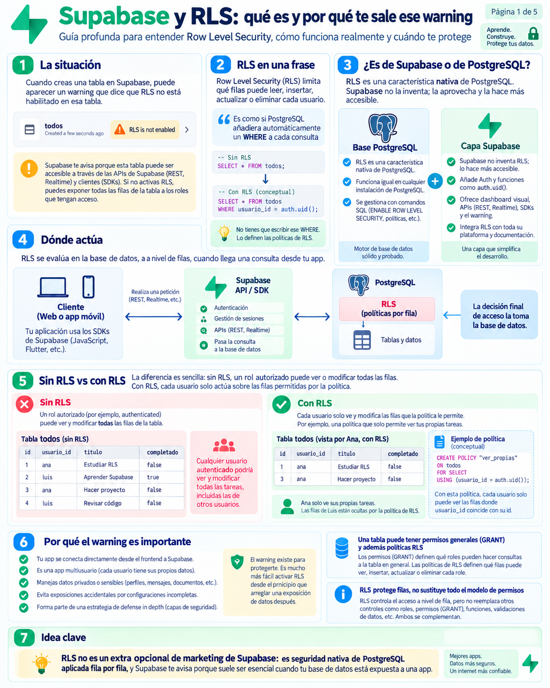
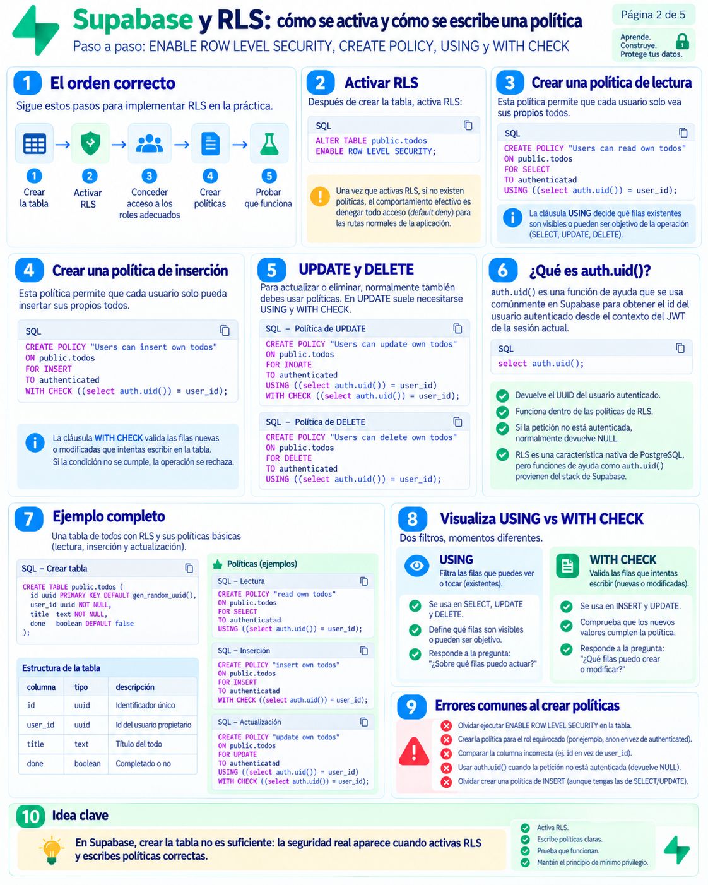
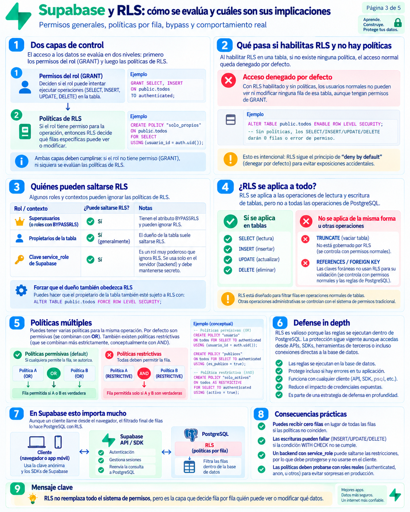
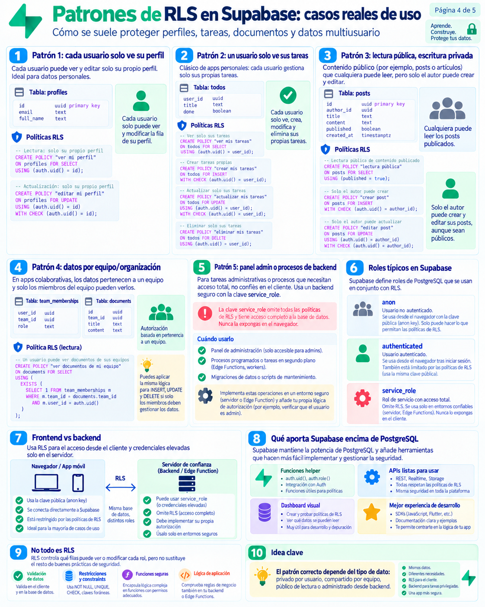
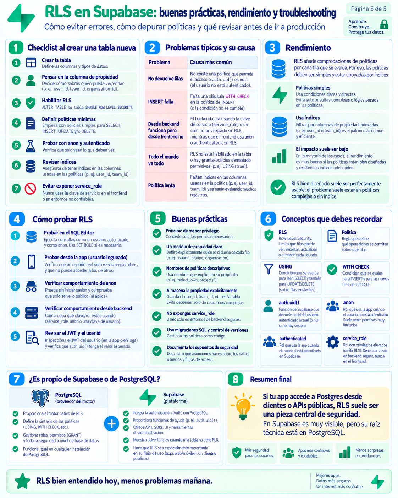

# 🛡️ Guía Práctica: Row Level Security (RLS) en PostgreSQL y Supabase
### *Seguridad a Nivel de Fila desmitificada: qué es, cómo funciona, patrones de uso y laboratorio paso a paso*

> *"Row Level Security (RLS) es como si PostgreSQL inyectara automáticamente un `WHERE` invisible en cada consulta, garantizando que cada usuario vea y modifique única y exclusivamente sus propios datos."*

Bienvenido/a a esta guía sobre **Row Level Security (RLS)**. Aunque suele considerarse un tema avanzado, su concepto fundamental es asombrosamente simple y elegante. En esta guía repasaremos los conceptos clave de la serie de 5 infografías, aclararemos un gazapo (*typo*) técnico que aparece en una de ellas y realizaremos un laboratorio hiperbásico paso a paso para ver su efecto en vivo.

---

## ⚡ La Verdad Fundamental: ¿Es RLS de Supabase o de PostgreSQL?

> [!IMPORTANT]
> **RLS es una característica 100% NATIVA de PostgreSQL** (incorporada en PostgreSQL desde la versión 9.5 en 2016).  
> **Supabase NO ha inventado RLS.** Funciona exactamente igual en un PostgreSQL local en tu Mac, en Docker, en AWS RDS o en Supabase.
>
> **¿Por qué entonces Supabase insiste tanto en RLS y te muestra avisos de advertencia en naranja?**  
> En el desarrollo tradicional (como la práctica de Node.js que hicimos con Express), tu código backend hacía de "policía intermediario". Pero en aplicaciones modernas con Supabase, **tu frontend (la web o la app móvil) se conecta directamente a la base de datos a través de APIs públicas**. Si no activas RLS, ¡cualquier usuario con la clave pública podría leer o borrar toda tu tabla!

---

## 🔍 Resumen Rápido de las 5 Infografías

### Página 1: La situación, el Warning y el concepto


1. **El Warning naranja en Supabase:** Cuando creas una tabla, Supabase te muestra `RLS is not enabled`. Te avisa porque esa tabla es accesible instantáneamente a través de su API pública.
2. **RLS en una sola frase:** Es un filtro automático a nivel de fila.
   - Sin RLS: `SELECT * FROM tareas;` ➔ Devuelve todas las filas de la tabla de todos los usuarios.
   - Con RLS: PostgreSQL transforma tu consulta por debajo en `SELECT * FROM tareas WHERE usuario_id = auth.uid();`.
3. **Dónde actúa:** En el motor de PostgreSQL. La decisión de seguridad la toma la base de datos antes de devolver un solo byte a la red.

---

### Página 2: Activación, Sintaxis y... ¡La aclaración del Typo "INDATE"!


> [!CAUTION]
> ### 🕵️‍♂️ Misterio Resuelto: ¿Qué es `FOR INDATE` en la Infografía 2?
> En la **Página 2 (Sección 5)** de la infografía verás este bloque de código:
> ```sql
> -- ⚠️ ¡CUIDADO! Esto contiene una errata mecanográfica (typo):
> CREATE POLICY "Users can update own todos"
> ON public.todos
> FOR INDATE              -- <--- ¡ESTO ES UN TYPO!
> TO authenticatad        -- <--- ¡OTRO TYPO ("authenticatad")!
> ...
> ```
> **¿Por qué pone `INDATE`?**  
> **Es 100% un error tipográfico (*typo*) del diseñador de la infografía.** En el teclado QWERTY las letras **U** e **I** están juntas (`U - I`). Al querer escribir `UPDATE`, se le escapó `INDATE`.  
> En el estándar SQL de PostgreSQL **NO EXISTE la palabra `INDATE`**. La sintaxis correcta y universal siempre es:
> ```sql
> -- ✅ Sintaxis correcta oficial en PostgreSQL:
> CREATE POLICY "Users can update own todos"
> ON public.todos
> FOR UPDATE
> TO authenticated
> USING ((select auth.uid()) = user_id)
> WITH CHECK ((select auth.uid()) = user_id);
> ```

#### Los conceptos clave de esta página:
* **Activar RLS en una tabla:**
  ```sql
  ALTER TABLE nombre_tabla ENABLE ROW LEVEL SECURITY;
  ```
* **Diferencia crucial entre `USING` y `WITH CHECK`:**
  - **`USING` (Filtro de lectura / filas existentes):** Comprueba qué filas ya existentes tienes permiso de ver o tocar. Se aplica en `SELECT`, `UPDATE` y `DELETE`.
  - **`WITH CHECK` (Filtro de validación / filas nuevas):** Comprueba si la nueva fila que estás intentando insertar o modificar cumple con las reglas. Se aplica en `INSERT` y `UPDATE`.
* **¿Qué es `auth.uid()`?**  
  Es una función auxiliar que provee Supabase para extraer el ID único (UUID) del usuario que tiene la sesión iniciada a través del token JWT.

---

### Página 3: Evaluación, Permisos y "Default Deny"


1. **Las dos capas de seguridad:**
   - **Capa 1: Permisos de tabla (`GRANT`):** ¿Tiene este rol permiso para ejecutar `SELECT` en la tabla en general?
   - **Capa 2: Políticas RLS:** Si tiene permiso en la tabla, ¿qué filas concretas puede ver?
2. **Denegación por defecto (*Default Deny*):**  
   Si ejecutas `ENABLE ROW LEVEL SECURITY` en una tabla y **no creas ninguna política**, el resultado es un bloqueo total: ningún usuario estándar podrá leer ni escribir nada (devuelve 0 filas).
3. **¿Quién puede saltarse RLS?**
   - **Superusuarios** (tienen el atributo `BYPASSRLS`).
   - La clave secreta **`service_role`** de Supabase (por eso solo debe usarse en servidores backend seguros, **nunca en el navegador del cliente**).

---

### Página 4: Patrones Reales de la Industria y Roles


* **Patrón 1 (Perfil de usuario):** Cada usuario solo puede ver y editar su propio perfil (`auth.uid() = id`).
* **Patrón 2 (Tareas / Documentos privados):** Cada fila pertenece a un autor (`auth.uid() = user_id`).
* **Patrón 3 (Blog / Artículos públicos):** Lectura libre para cualquiera si el post está publicado (`USING (published = true)`), pero edición restringida solo al autor.
* **Patrón 4 (Equipos / Organizaciones):** Ver documentos si el usuario pertenece al equipo (`EXISTS (SELECT 1 FROM team_memberships ...)`).
* **Los 3 Roles en Supabase:**
  - `anon`: Visitante no registrado (usuario anónimo).
  - `authenticated`: Usuario que ha iniciado sesión con éxito.
  - `service_role`: Servidor de backend con acceso total (ignora RLS).

---

### Página 5: Buenas Prácticas y Rendimiento


1. **¿Por qué mi frontend recibe un array vacío `[]`?**  
   Causa nº 1: No has definido una política que dé permiso para ese rol o `auth.uid()` es nulo (no ha iniciado sesión).
2. **Regla de oro de rendimiento:**  
   Como RLS evalúa la política fila por fila, **crea siempre un índice sobre la columna de propiedad**:
   ```sql
   CREATE INDEX idx_todos_user_id ON todos(user_id);
   ```

---

## 🎮 Laboratorio Hiperbásico: RLS en Acción Paso a Paso

Vamos a comprobar el efecto de RLS con un ejercicio práctico que puedes ejecutar en cualquier entorno: en tu consola `psql`, en pgAdmin o en el **SQL Editor** de Supabase.

*(Tienes todo este código listo para ejecutar en el archivo [`demo_rls_basico.sql`](./demo_rls_basico.sql)).*

### Paso 1: Crear una tabla y dos usuarios de prueba

```sql
-- 1. Creamos la tabla de secretos:
CREATE TABLE mis_secretos (
    id SERIAL PRIMARY KEY,
    propietario VARCHAR(50) NOT NULL,
    secreto TEXT NOT NULL,
    es_publico BOOLEAN DEFAULT false
);

-- 2. Creamos dos usuarios de prueba:
CREATE ROLE usuario_ana WITH LOGIN PASSWORD '1234';
CREATE ROLE usuario_carlos WITH LOGIN PASSWORD '1234';

-- Les damos permisos generales para consultar la tabla:
GRANT SELECT, INSERT ON mis_secretos TO usuario_ana, usuario_carlos;

-- 3. Insertamos datos de prueba:
INSERT INTO mis_secretos (propietario, secreto, es_publico) VALUES
('usuario_ana', 'Tengo miedo a la oscuridad', false),
('usuario_ana', 'Me encanta programar en Python', true),
('usuario_carlos', 'Perdí las llaves de la oficina', false),
('usuario_carlos', 'Mi comida favorita es la paella', true);
```

---

### Paso 2: Probar SIN RLS (Fuga de datos)

Simulamos que somos `usuario_ana`:
```sql
SET ROLE usuario_ana;
SELECT * FROM mis_secretos;
```

**Resultado:**
```text
 id |   propietario  |                 secreto                 | es_publico 
----+----------------+-----------------------------------------+------------
  1 | usuario_ana    | Tengo miedo a la oscuridad              | f
  2 | usuario_ana    | Me encanta programar en Python          | t
  3 | usuario_carlos | Perdí las llaves de la oficina          | f
  4 | usuario_carlos | Mi comida favorita es la paella         | t
```
❌ **Problema:** Ana puede leer los secretos íntimos de Carlos (`Perdí las llaves...`). ¡No hay privacidad!

Regresamos al rol administrador:
```sql
RESET ROLE;
```

---

### Paso 3: Activar RLS y ver el efecto "Default Deny"

Activamos la seguridad a nivel de fila en la tabla:
```sql
ALTER TABLE mis_secretos ENABLE ROW LEVEL SECURITY;
```

Volvemos a probar como `usuario_ana`:
```sql
SET ROLE usuario_ana;
SELECT * FROM mis_secretos;
```

**Resultado:**
```text
(0 rows)
```
🔒 **¡Efecto Deny por Defecto!** Como RLS está activo pero aún no hemos definido ninguna política, PostgreSQL protege los datos denegando el acceso a todos los usuarios normales.

Regresamos al administrador:
```sql
RESET ROLE;
```

---

### Paso 4: Crear una política para secretos públicos

Queremos que cualquiera pueda ver los secretos marcados como públicos:
```sql
CREATE POLICY "Ver secretos publicos"
ON mis_secretos
FOR SELECT
USING (es_publico = true);
```

Probamos de nuevo como `usuario_ana`:
```sql
SET ROLE usuario_ana;
SELECT * FROM mis_secretos;
```

**Resultado:**
```text
 id |   propietario  |             secreto             | es_publico 
----+----------------+---------------------------------+------------
  2 | usuario_ana    | Me encanta programar en Python  | t
  4 | usuario_carlos | Mi comida favorita es la paella | t
```
👁️ **¡Magia!** Ahora Ana ve los 2 secretos públicos, pero los secretos privados siguen 100% ocultos.

Regresamos al administrador:
```sql
RESET ROLE;
```

---

### Paso 5: Crear una política para ver los secretos propios

Queremos que cada usuario además pueda ver sus propios secretos (aunque sean privados):
```sql
CREATE POLICY "Ver secretos propios"
ON mis_secretos
FOR SELECT
USING (propietario = current_user);
```
*(En PostgreSQL nativo usamos `current_user`; en Supabase usarías `auth.uid() = user_id`).*

Probamos de nuevo como `usuario_ana`:
```sql
SET ROLE usuario_ana;
SELECT * FROM mis_secretos;
```

**Resultado:**
```text
 id |   propietario  |             secreto             | es_publico 
----+----------------+---------------------------------+------------
  1 | usuario_ana    | Tengo miedo a la oscuridad      | f  <-- ¡Su secreto privado!
  2 | usuario_ana    | Me encanta programar en Python  | t
  4 | usuario_carlos | Mi comida favorita es la paella | t
```
🎯 **¡Objetivo cumplido!** Ana ve todos sus secretos (públicos y privados) y los secretos públicos de Carlos. El secreto privado de Carlos no aparece en el resultado.

Regresamos al administrador:
```sql
RESET ROLE;
```

---

### Paso 6: Escritura segura con `WITH CHECK`

¿Qué impide que Ana inserte un secreto falso haciéndose pasar por Carlos? Usamos `WITH CHECK`:

```sql
CREATE POLICY "Solo insertar secretos propios"
ON mis_secretos
FOR INSERT
WITH CHECK (propietario = current_user);
```

Probamos como `usuario_ana`:
```sql
SET ROLE usuario_ana;

-- Intento de suplantación:
INSERT INTO mis_secretos (propietario, secreto, es_publico)
VALUES ('usuario_carlos', 'Carlos confiesa que robó el café', false);
```

**Respuesta de PostgreSQL:**
```text
ERROR: new row violates row-level security policy for table "mis_secretos"
```
🛑 **¡PostgreSQL bloqueó el ataque automáticamente!** Gracias a `WITH CHECK`, nadie puede crear filas asignadas a otra persona.

Regresamos al administrador:
```sql
RESET ROLE;
```

---

## 💡 Lo que se extrae de esta práctica (Puntos Clave)

<div style="background-color: #f0fdf4; border: 2px solid #22c55e; padding: 22px; border-radius: 8px; margin: 24px 0;">

### 🟢 Conclusiones y Aprendizajes Extraídos

1. **RLS es de PostgreSQL, no de Supabase:**  
   PostgreSQL lleva implementando RLS de forma nativa desde la versión 9.5. Supabase lo hace visible e indispensable porque su arquitectura expone la base de datos a Internet mediante APIs públicas.

2. **El typo `INDATE` aclarado:**  
   No existe `INDATE` en SQL. En la infografía 2 se cometió una errata mecanográfica al pulsar la tecla `I` junto a la `U`. La instrucción oficial es **`FOR UPDATE`**.

3. **`USING` vs `WITH CHECK`:**  
   - `USING` actúa como un **filtro de selección** para filas que ya existen en el disco (en `SELECT`, `UPDATE`, `DELETE`).  
   - `WITH CHECK` actúa como una **aduana de validación** para filas que se van a guardar o modificar (en `INSERT`, `UPDATE`).

4. **Principio de "Default Deny":**  
   Habilitar RLS (`ENABLE ROW LEVEL SECURITY`) cierra todas las puertas. Si no escribes ninguna política con `CREATE POLICY`, nadie podrá leer ni escribir (excepto los superusuarios).

5. **Rendimiento:**  
   Las columnas utilizadas en las políticas (como `user_id` o `propietario`) deben tener siempre un **índice** (`CREATE INDEX`) para que la consulta no se vuelva lenta cuando la tabla tenga miles de registros.

</div>
