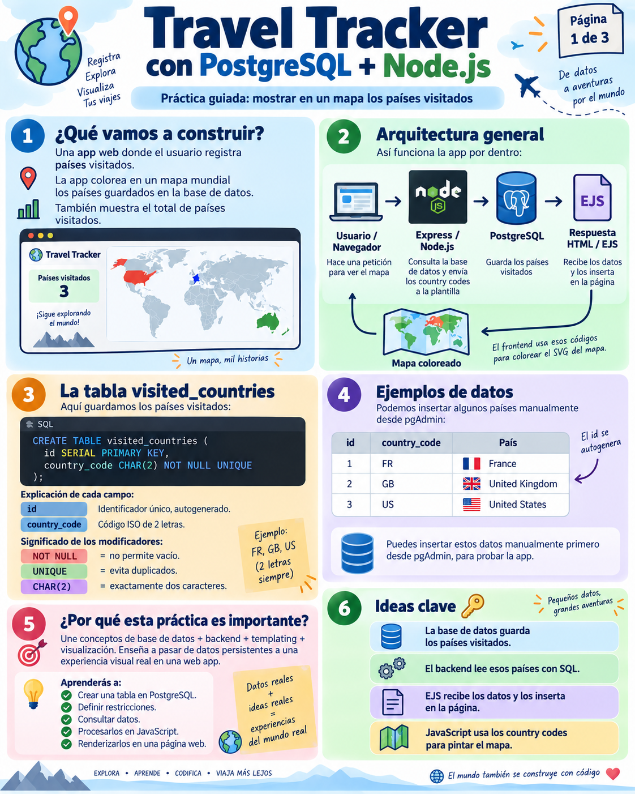
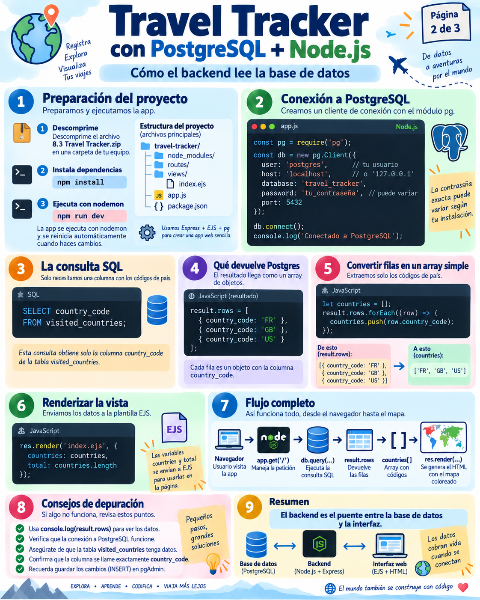
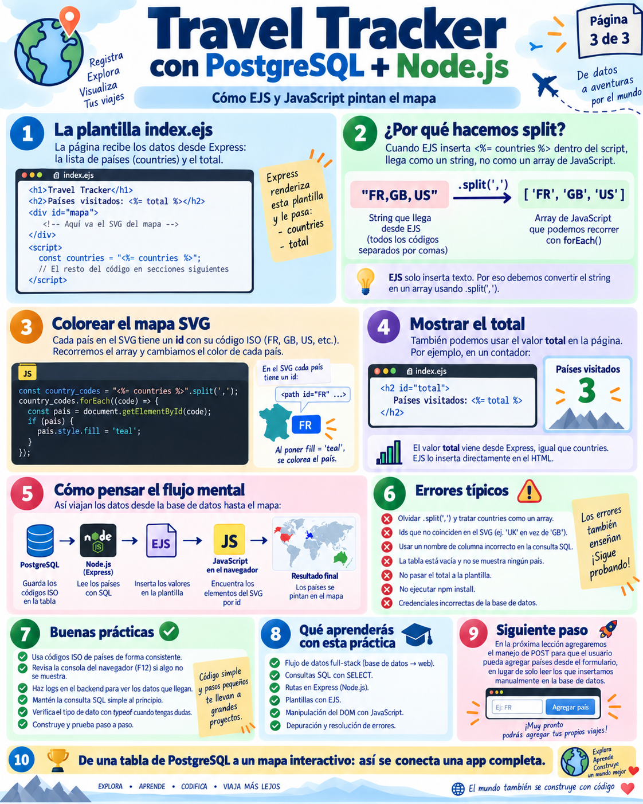

# 🗺️ Travel Tracker — Parte 1: Lectura Básica y Renderizado en el Mapa

> **Objetivo de la Parte 1:**  
> Aprender a conectar **Node.js** con **PostgreSQL**, consultar los países que ya hemos visitado (`SELECT`), enviar esos datos al motor de plantillas **EJS** y hacer que un mapa mundial interactivo en **SVG** coloree dinámicamente dichos países en el navegador.

---

## 📸 1. Las Infografías de la Parte 1

Esta primera etapa se basa en las 3 infografías fundamentales del proyecto:

### 1.1. Arquitectura General y Esquema de Datos


* **¿Qué ve el usuario?:** Un encabezado con el título del proyecto, un formulario para teclear países, un contador `Total Countries: X` y un mapa mundial vectorial en formato SVG.
* **Base de datos:** Una tabla inicial llamada `visited_countries` con dos columnas:
  * `id`: Clave primaria autoincremental (`SERIAL PRIMARY KEY`).
  * `country_code`: Código ISO de 2 letras (`CHAR(2) NOT NULL UNIQUE`).
* **Semilla de datos inicial:** Tres países cargados para arrancar:
  ```sql
  INSERT INTO visited_countries (country_code) VALUES ('FR'), ('GB'), ('US');
  ```

> [!IMPORTANT]
> **¿Quién crea esta tabla y quién inyecta `'FR'`, `'GB'` y `'US'`?**  
> **Node.js NO los genera automáticamente.** En el diseño de la práctica, debes crear la tabla `visited_countries` e insertar esas 3 filas directamente en PostgreSQL (mediante pgAdmin o el script SQL) **antes** de arrancar el servidor `node solution1.js`. De lo contrario, la consulta `SELECT` fallará indicando que la tabla no existe.

---

### 1.2. Backend con Node.js, Express y Driver `pg`


* **Configuración del Servidor Express:** Importación de dependencias y middlewares (`body-parser`, `express.static`).
* **Conexión con PostgreSQL:** Creación del cliente `new pg.Client(...)` con usuario, host, base de datos `world`, contraseña y puerto `5432`.
* **Consulta Asíncrona:** `await db.query("SELECT country_code FROM visited_countries")`.
* **Transformación:** Conversión de las filas devueltas por PostgreSQL (array de objetos) a una lista simple de códigos (array de strings).
* **Renderizado:** Paso de variables a `res.render("index.ejs", { countries, total })`.

---

### 1.3. Frontend: El Puente entre EJS y el SVG en el DOM


* **El "truco" de interpolación:** Cómo convertir la lista de países que viaja desde el servidor en un array nativo de JavaScript dentro del navegador:
  ```javascript
  const country_codes = "<%= countries %>".split(",");
  ```
* **Pintado en el DOM:** Cada país en el mapa SVG es un elemento `<path id="XX">`. Al recorrer los códigos con un bucle, JavaScript busca el elemento en el navegador y le aplica color:
  ```javascript
  country_codes.forEach(code => {
    document.getElementById(code).style.fill = 'teal';
  });
  ```

---

## 🐣 2. Conceptos Fundamentales: "No demos nada por sabido"

### ¿Qué es `async` y `await` en JavaScript?
Imagina un camarero en un restaurante:
* **Modo síncrono (bloqueante):** El camarero va a la cocina, pide un plato y **se queda de pie esperando 20 minutos** sin atender a nadie más hasta que el plato está listo. Todo el restaurante se paraliza.
* **Modo asíncrono con `async/await`:** El camarero pide el plato a la cocina (`await`), y mientras los cocineros trabajan, el camarero sigue atendiendo a otros clientes. Cuando la cocina termina, el camarero recoge el resultado y continúa.

En Node.js, **consultar una base de datos toma tiempo** (red, disco, ejecución SQL). Usamos `async` en la función para avisar que habrá pausas, y `await` delante de la consulta para esperar la respuesta de PostgreSQL de manera no bloqueante:

```javascript
// La función lleva "async"
app.get("/", async (req, res) => {
  // "await" pausa esta función hasta que PostgreSQL responda con los datos
  const result = await db.query("SELECT country_code FROM visited_countries");
  
  // Una vez obtenidos los datos, seguimos adelante:
  res.render("index.ejs", { countries: ... });
});
```

---

### ¿Cómo devuelve PostgreSQL los datos en Node.js?
Cuando ejecutas `const result = await db.query(...)`, la variable `result` es un objeto con mucha información interna (comando ejecutado, número de filas, etc.). La propiedad más importante es **`result.rows`**, que siempre es un **Array de Objetos**:

```javascript
// Contenido de result.rows:
[
  { country_code: 'FR' },
  { country_code: 'GB' },
  { country_code: 'US' }
]
```

Pero en el frontend necesitamos simplemente:
```javascript
['FR', 'GB', 'US']
```

Por eso en el código se realiza esta transformación:
```javascript
let countries = [];
result.rows.forEach((country) => {
  countries.push(country.country_code);
});
```
*(O de forma más moderna con `.map`: `const countries = result.rows.map(row => row.country_code);`)*.

---

### ¿Cómo funciona el paso de datos de Node.js al Navegador mediante EJS?

Esta es una de las dudas más frecuentes en el desarrollo web con plantillas:
1. **En el servidor (Node.js):**
   ```javascript
   res.render("index.ejs", { countries: countries, total: countries.length });
   ```
2. **En la plantilla (`views/index.ejs`):**
   Dentro del HTML hay una etiqueta `<script>` que se ejecutará en el navegador del usuario:
   ```html
   <script>
     const country_codes = "<%= countries %>".split(",");
     country_codes.forEach(code => {
       document.getElementById(code).style.fill = 'teal';
     });
   </script>
   ```
3. **¿Qué ocurre tras bambalinas?:**
   * Cuando EJS procesa `<%= countries %>`, llama al método `.toString()` del array de JavaScript. En JavaScript, `['FR', 'GB', 'US'].toString()` se convierte en la cadena `"FR,GB,US"`.
   * El navegador recibe el HTML ya procesado:
     ```html
     <script>
       const country_codes = "FR,GB,US".split(",");
       ...
     </script>
     ```
   * En el navegador, `.split(",")` corta la cadena por cada coma y vuelve a crear el array `['FR', 'GB', 'US']`.
   * Finalmente, `document.getElementById('FR').style.fill = 'teal'` busca el `<path id="FR">` del mapa SVG y le cambia el color a turquesa.

---

## 💻 3. Análisis del Código: [`solution1.js`](./solution1.js)

Veamos el código completo con sus comentarios explicativos:

```javascript
import express from "express";
import bodyParser from "body-parser";
import pg from "pg"; // Driver oficial de PostgreSQL para Node.js

const app = express();
const port = 3000;

// Configuración de la conexión a PostgreSQL con pg.Client
const db = new pg.Client({
  user: "postgres",
  host: "localhost",
  database: "world",
  password: "XXXX", // Ajusta a tu contraseña local
  port: 5432,
});
db.connect(); // Abre el canal de comunicación TCP con PostgreSQL

// Middlewares
app.use(bodyParser.urlencoded({ extended: true }));
app.use(express.static("public"));

// GET /: Consulta la BD y renderiza el mapa inicial
app.get("/", async (req, res) => {
  // 1. Ejecutamos la consulta SQL
  const result = await db.query("SELECT country_code FROM visited_countries");
  
  // 2. Convertimos el array de objetos a array de strings
  let countries = [];
  result.rows.forEach((country) => {
    countries.push(country.country_code);
  });
  console.log(result.rows);

  // 3. Renderizamos la vista index.ejs pasando la lista y el total
  res.render("index.ejs", { countries: countries, total: countries.length });

  // ⚠️ NOTA DIDÁCTICA:
  // db.end() cierra la conexión con la base de datos.
  // En solution1.js se incluyó para cerrar la conexión tras la primera prueba,
  // pero en una aplicación real NUNCA se debe cerrar la conexión dentro de una ruta,
  // ya que la siguiente persona que recargue la web obtendría un error de conexión cerrada.
  // Por eso en las siguientes soluciones verás que esta línea se elimina.
  db.end();
});

app.listen(port, () => {
  console.log(`Server running on http://localhost:${port}`);
});
```

---

## 📊 4. SQL Esencial de esta Parte 1

| Sentencia SQL | ¿Qué hace? | Ejemplo |
| :--- | :--- | :--- |
| **`CREATE TABLE`** | Crea una tabla definiendo columnas y tipos. | `CREATE TABLE visited_countries (id SERIAL PRIMARY KEY, country_code CHAR(2) NOT NULL UNIQUE);` |
| **`SERIAL`** | Crea un entero autoincremental automático (1, 2, 3...). | `id SERIAL` |
| **`PRIMARY KEY`** | Identificador único de cada fila; no admite nulos ni repetidos. | `PRIMARY KEY (id)` |
| **`CHAR(2)`** | Cadena de texto de longitud fija (exactamente 2 caracteres). | `'FR'`, `'ES'`, `'US'` |
| **`UNIQUE`** | Restricción que prohíbe valores duplicados en esa columna. | `country_code CHAR(2) UNIQUE` |
| **`SELECT`** | Lee y recupera filas de una tabla. | `SELECT country_code FROM visited_countries;` |
| **`INSERT INTO`** | Inserta nuevas filas en una tabla. | `INSERT INTO visited_countries (country_code) VALUES ('FR');` |

---

## ⏭️ Siguiente Paso
En la Parte 1 solo podemos **leer** países que ya estén metidos a mano en la base de datos.  
En la **[Parte 2: Creación de Tablas, Importación de CSV e INSERT](./parte2-Insert/parte2_tablas_csv_insert.md)** aprenderemos a:
1. Crear la tabla de referencia `countries`.
2. Importar el catálogo mundial desde `countries.csv`.
3. Crear el formulario web para que el usuario inserte países dinámicamente (`POST /add`).
