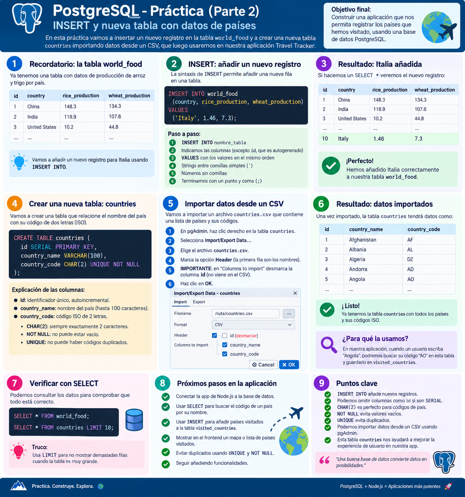
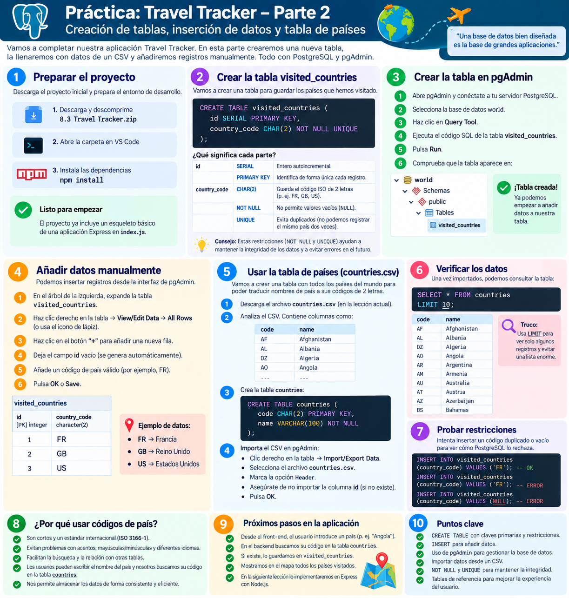
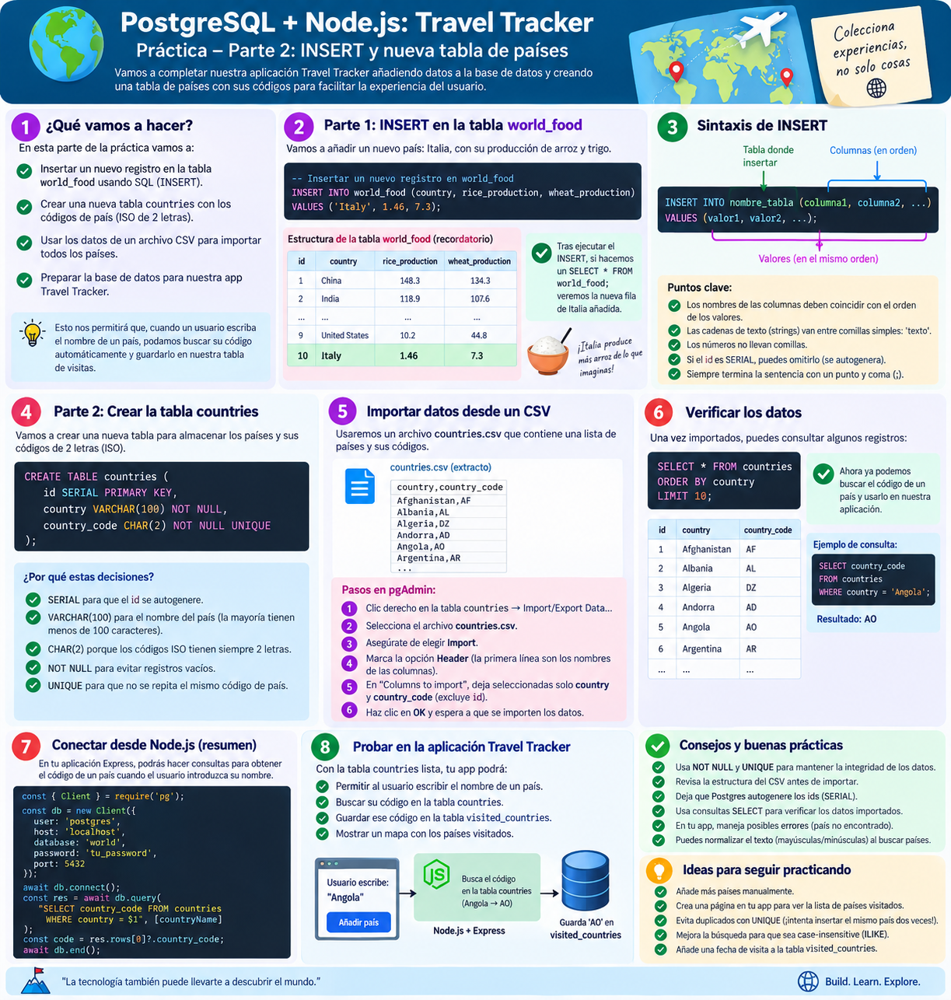
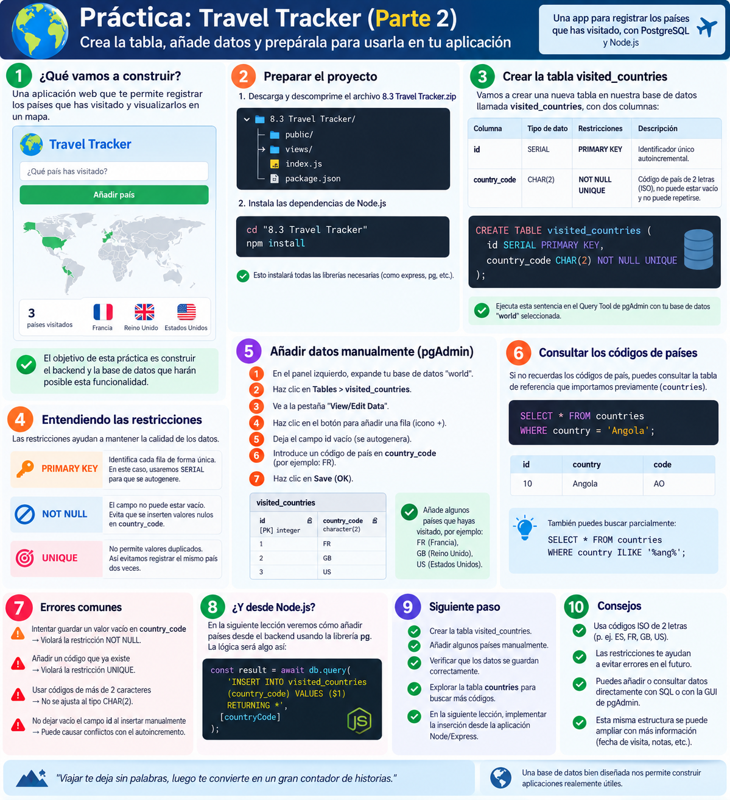
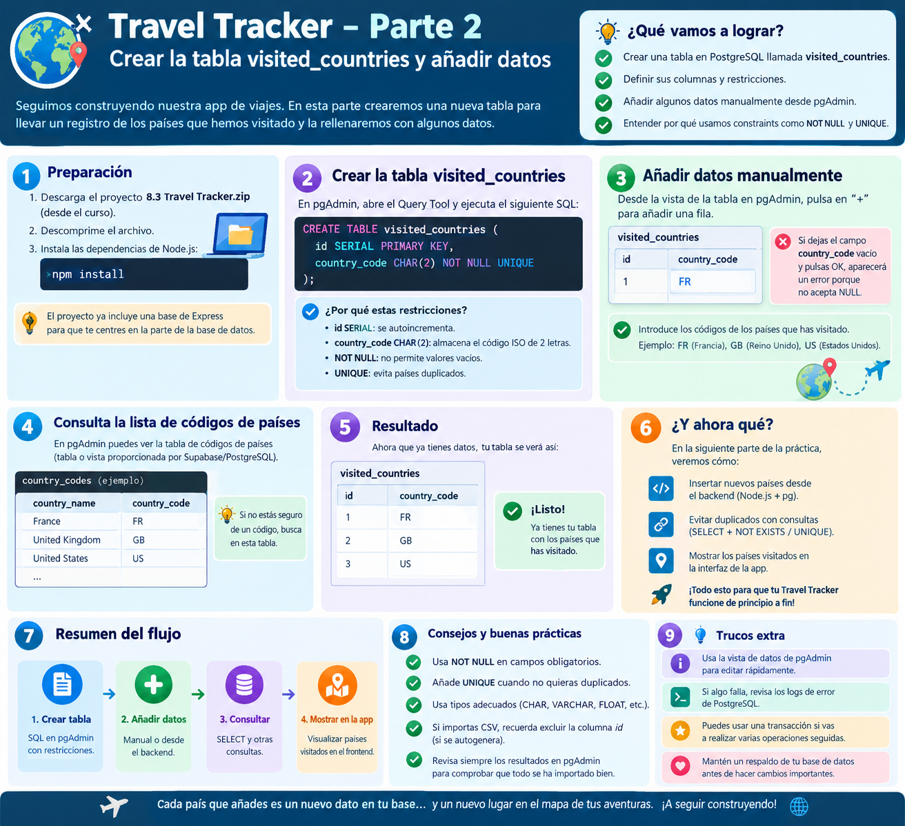

# 📦 Travel Tracker — Parte 2: Creación de Tablas, Importación de CSV e INSERT

> **Objetivo de la Parte 2:**  
> Aprender a crear y estructurar tablas en **PostgreSQL**, importar datos masivos desde archivos **CSV** usando **pgAdmin** o comandos SQL, realizar inserciones individuales con `INSERT INTO`, y conectar un formulario web en **Node.js/Express** para traducir el nombre de un país a su código ISO y guardarlo en la base de datos mediante el patrón **PRG (Post-Redirect-Get)**.

---

## 📸 1. Análisis de las 5 Infografías de la Parte 2

Esta lección cuenta con 5 infografías didácticas que explican el proceso paso a paso:

### 1.1. Infografía 1: Del Recordatorio de `world_food` a la Creación de `countries`


* **Recordatorio de `world_food`:** Cómo añadir una nueva fila usando la sintaxis estándar de `INSERT INTO`.
* **Creación de la tabla `countries`:**
  ```sql
  CREATE TABLE countries (
      id SERIAL PRIMARY KEY,
      country_name VARCHAR(100),
      country_code CHAR(2) UNIQUE NOT NULL
  );
  ```
* **Importación desde CSV en pgAdmin:** Uso del diálogo *Import/Export Data* seleccionando `countries.csv`, marcando `Header` y seleccionando las columnas correspondientes.

---

### 1.2. Infografía 2: Creación de `visited_countries` y Restricciones


* **Creación de la tabla de visitas:**
  ```sql
  CREATE TABLE visited_countries (
      id SERIAL PRIMARY KEY,
      country_code CHAR(2) NOT NULL UNIQUE
  );
  ```
* **Diseño del esquema:** Qué significa cada restricción (`SERIAL`, `PRIMARY KEY`, `CHAR(2)`, `NOT NULL`, `UNIQUE`).
* **Inserción manual de datos:** Añadir Francia (`FR`), Reino Unido (`GB`) y Estados Unidos (`US`) desde la interfaz visual de pgAdmin o mediante SQL.
* **Comprobación de restricciones:** Qué ocurre si intentamos insertar un código duplicado o un valor nulo.

---

### 1.3. Infografía 3: Inserción, Importación y Conexión desde Node.js


* **Sintaxis canónica de `INSERT`:** Correspondencia posicional de columnas y valores.
* **Consulta de verificación:** `SELECT * FROM countries ORDER BY country LIMIT 10;`.
* **Flujo completo con Node.js:** El usuario escribe `"Angola"`, Node.js consulta `countries` para obtener `"AO"`, y guarda `"AO"` en `visited_countries`.

---

### 1.4. Infografía 4: Errores Comunes y Restricciones en Profundidad


* **Errores frecuentes al insertar:**
  * Intentar guardar cadenas de más de 2 caracteres en un campo `CHAR(2)` (ej. `"FRA"` o `"FRANCE"` fallarán).
  * No respetar la restricción `UNIQUE` intentando insertar el mismo país dos veces.
  * Tocar el campo `id` autoincremental al insertar manualmente.
* **Búsqueda parcial con `ILIKE`:** `SELECT * FROM countries WHERE country ILIKE '%ang%';`.

---

### 1.5. Infografía 5: Resumen del Flujo de Datos y Buenas Prácticas


* **El ciclo de 4 pasos:**
  1. Crear tablas en SQL / pgAdmin con restricciones adecuadas.
  2. Añadir datos (manualmente o mediante importación de CSV).
  3. Consultar los datos con `SELECT`.
  4. Mostrar el resultado en el frontend coloreando el mapa.

---

## 🐣 2. Conceptos Fundamentales Explicados sin Tecnicismos

### 2.1. Anatomía de una sentencia `INSERT INTO`
La sentencia `INSERT INTO` es la orden que le damos a la base de datos para crear una nueva fila:

```sql
INSERT INTO world_food (country, rice_production, wheat_production)
VALUES ('Italy', 1.46, 7.3);
```

#### Reglas de oro del `INSERT`:
1. **Las columnas van entre paréntesis:** `(country, rice_production, wheat_production)`.
2. **Los valores van en el mismo orden:** `'Italy'` va a `country`, `1.46` a `rice_production`, etc.
3. **Comillas simples para texto:** En SQL, las cadenas de texto siempre van entre comillas simples (`'Italy'`). Las comillas dobles (`"Italy"`) son para nombres de tablas o columnas.
4. **Números sin comillas:** `1.46` y `7.3` son números; si les pones comillas se tratarán como texto.
5. **Las columnas autoincrementales (`SERIAL`) se omiten:** Como `id` se genera solo (1, 2, 3...), no hace falta incluirlo en la lista de columnas.

---

### 2.2. ¿Por qué usamos códigos ISO de 2 letras (`CHAR(2)`)?
El estándar internacional **ISO 3166-1 alfa-2** asigna a cada país del mundo un código de dos letras:
* España: `ES`
* Francia: `FR`
* Estados Unidos: `US`
* Reino Unido: `GB`
* Japón: `JP`

#### ¿Qué ventajas tiene frente a guardar nombres completos?
* **Evita problemas de idiomas y acentos:** En español decimos *"España"*, en inglés *"Spain"*, en francés *"Espagne"*. El código `ES` es universal.
* **Eficiencia de almacenamiento:** `CHAR(2)` reserva exactamente 2 bytes en disco por fila.
* **Compatibilidad directa con el mapa SVG:** En `views/index.ejs`, cada país en el dibujo del mapa tiene como ID su código ISO (`<path id="ES" ...>`). Al guardar `ES`, pintar el país en la pantalla se hace en una sola línea de código: `document.getElementById('ES').style.fill = 'teal'`.

---

### 2.3. ¿Qué significan las restricciones (*Constraints*)?
Una base de datos profesional no es una simple hoja de cálculo; es un sistema que **hace cumplir reglas**:

| Restricción | ¿Qué significa en lenguaje sencillo? | ¿Qué pasa si la violamos? |
| :--- | :--- | :--- |
| **`PRIMARY KEY`** | "El documento de identidad único de la fila". No puede haber dos filas con la misma clave ni puede estar vacía. | Error de clave duplicada o nula. |
| **`NOT NULL`** | "Prohibido dejar este campo en blanco". Debe tener un valor obligatoriamente. | `ERROR: null value in column violates not-null constraint`. |
| **`UNIQUE`** | "Prohibido repetir el mismo valor en esta columna". | `ERROR: duplicate key value violates unique constraint` (código `23505`). |

---

## 📂 3. Cómo Importar Datos desde Archivos CSV

En la carpeta del proyecto disponemos de dos archivos CSV:
1. [`world-food.csv`](../world-food.csv) — Producción de alimentos en varios países.
2. [`countries.csv`](../countries.csv) — Catálogo de los 249 países del mundo con su código ISO.

### 3.1. Método A: Importación mediante pgAdmin 4 (Visual)
1. Abre **pgAdmin 4** y conéctate a tu base de datos `world`.
2. En el Query Tool, crea la tabla `countries`:
   ```sql
   CREATE TABLE countries (
       id SERIAL PRIMARY KEY,
       country_code CHAR(2) NOT NULL UNIQUE,
       country_name VARCHAR(100) NOT NULL
   );
   ```
3. En el árbol de la izquierda, despliega `world -> Schemas -> public -> Tables`.
4. Haz clic derecho sobre la tabla **`countries`** y selecciona **Import/Export Data...**
5. Configura las opciones:
   * Pestaña **Import/Export**: Selecciona **Import**.
   * **Filename**: Selecciona la ruta al archivo `countries.csv`.
   * **Format**: `csv`.
   * Pestaña **Options**: Activa **Header** (porque la primera línea del CSV contiene los nombres de las columnas).
   * Pestaña **Columns**: Asegúrate de que las columnas coincidan (`id`, `country_code`, `country_name`).
6. Haz clic en **OK**. Verás el mensaje `Process completed successfully`.

---

### 3.2. Método B: Importación mediante Terminal (`psql`)
Si prefieres la línea de comandos, puedes importar el archivo directamente con la orden `\copy`:

```bash
PGPASSWORD=XXXX /Library/PostgreSQL/15/bin/psql -U postgres -d world -c "\copy countries(id, country_code, country_name) FROM 'countries.csv' WITH (FORMAT csv, HEADER true);"
```

---

### 3.3. Comprobación con `SELECT` y `LIMIT`
Para comprobar que los datos se importaron correctamente sin saturar la terminal con 249 filas, usamos la cláusula **`LIMIT`**:

```sql
SELECT * FROM countries ORDER BY id ASC LIMIT 5;
```

Resultado esperado:
```
 id | country_code |   country_name    
----+--------------+-------------------
  1 | AF           | Afghanistan
  2 | AX           | Aland Islands
  3 | AL           | Albania
  4 | DZ           | Algeria
  5 | AS           | American Samoa
(5 rows)
```

---

## 🌐 4. Integración con Node.js y Express: [`solution2.js`](../solution2.js)

En `solution2.js`, añadimos la funcionalidad para que el usuario pueda escribir un país en el formulario HTML y la aplicación lo procese.

### 4.1. El Patrón PRG (Post-Redirect-Get)
Uno de los conceptos más importantes de la arquitectura web:

```
[ NAVEGADOR ]                                 [ SERVIDOR NODE.JS ]
      │                                                │
      │ 1. Envía formulario (POST /add)                │
      ├───────────────────────────────────────────────>│
      │    body: { country: "Spain" }                  │ 2. Busca "Spain" -> "ES"
      │                                                │ 3. Inserta "ES" en BD
      │ 4. Respuesta 302: Redirige a "/"               │
      │<───────────────────────────────────────────────┤
      │                                                │
      │ 5. Petición limpia (GET /)                     │
      ├───────────────────────────────────────────────>│
      │                                                │ 6. Lee visitas actualizadas
      │ 7. Devuelve HTML con mapa pintado              │ 7. res.render("index.ejs")
      │<───────────────────────────────────────────────┤
```

* **¿Por qué NO hacer `res.render()` directamente dentro del `POST /add`?:**  
  Si renderizas la vista en la respuesta del POST, la URL en el navegador del usuario sigue siendo `http://localhost:3000/add`. Si el usuario pulsa **F5 (Actualizar)**, el navegador intentará **reenviar el formulario**, lo que causaría errores de inserción duplicada.  
  Con `res.redirect("/")`, el navegador realiza una petición `GET /` limpia e inofensiva.

---

### 4.2. Análisis del Código de [`solution2.js`](../solution2.js)

```javascript
import express from "express";
import bodyParser from "body-parser";
import pg from "pg";

const app = express();
const port = 3000;

// Conexión a la base de datos PostgreSQL
const db = new pg.Client({
  user: "postgres",
  host: "localhost",
  database: "world",
  password: "XXXX",
  port: 5432,
});
db.connect();

// Middlewares necesarios
// - urlencoded permite leer datos de formularios HTML (req.body)
app.use(bodyParser.urlencoded({ extended: true }));
app.use(express.static("public"));

// FUNCIÓN MODULAR REUTILIZABLE:
// Consulta la BD y devuelve un array plano con los códigos visitados
async function checkVisisted() {
  const result = await db.query("SELECT country_code FROM visited_countries");
  let countries = [];
  result.rows.forEach((country) => {
    countries.push(country.country_code);
  });
  return countries;
}

// GET /: Muestra la página principal con los países visitados
app.get("/", async (req, res) => {
  const countries = await checkVisisted();
  res.render("index.ejs", { countries: countries, total: countries.length });
});

// POST /add: Procesa el formulario para añadir un nuevo país
app.post("/add", async (req, res) => {
  // 1. Leemos lo que escribió el usuario en el <input name="country">
  const input = req.body["country"];

  // 2. Consulta parametrizada con $1 para buscar el código ISO
  const result = await db.query(
    "SELECT country_code FROM countries WHERE country_name = $1",
    [input]
  );

  // 3. Si el país existe en la tabla de referencia:
  if (result.rows.length !== 0) {
    const data = result.rows[0];
    const countryCode = data.country_code;

    // 4. Lo insertamos en la tabla de visitas
    await db.query("INSERT INTO visited_countries (country_code) VALUES ($1)", [
      countryCode,
    ]);

    // 5. Redirigimos al inicio (Patrón PRG)
    res.redirect("/");
  }
});

app.listen(port, () => {
  console.log(`Server running on http://localhost:${port}`);
});
```

---

## 📊 5. Chuleta SQL de la Parte 2

| Comando SQL | Propósito | Ejemplo |
| :--- | :--- | :--- |
| **`INSERT INTO ... VALUES`** | Añade una nueva fila a una tabla. | `INSERT INTO visited_countries (country_code) VALUES ('ES');` |
| **`SELECT ... WHERE`** | Filtra filas por una condición exacta. | `SELECT country_code FROM countries WHERE country_name = 'Spain';` |
| **`ORDER BY ... ASC / DESC`** | Ordena los resultados por una columna. | `SELECT * FROM countries ORDER BY country_name ASC;` |
| **`LIMIT n`** | Limita el número de filas devueltas. | `SELECT * FROM countries LIMIT 10;` |
| **`\copy ... FROM`** | Importa un archivo CSV a una tabla (CLI). | `\copy countries FROM 'countries.csv' WITH CSV HEADER;` |

---

## ⏭️ Siguiente Paso
En la Parte 2 el sistema funciona, pero **es muy frágil**:
* ¿Qué pasa si el usuario escribe `"Wakanda"` o comete una falta ortográfica? La app se cuelga porque `result.rows[0]` es `undefined`.
* ¿Qué pasa si el usuario intenta añadir un país que ya visitó? PostgreSQL arroja un error de clave duplicada (`UNIQUE`) y el servidor se cae.
* ¿Qué pasa si escribe `"spain"` en minúsculas en vez de `"Spain"`?

Todo esto lo resolvemos de forma profesional en la **[Parte 3: Manejo de Errores y Búsqueda Flexible (Fuzzy Search)](../parte3-error-handling/parte3_errores_y_busqueda_flexible.md)**.
