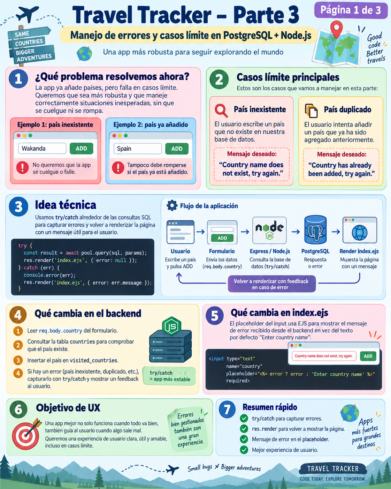
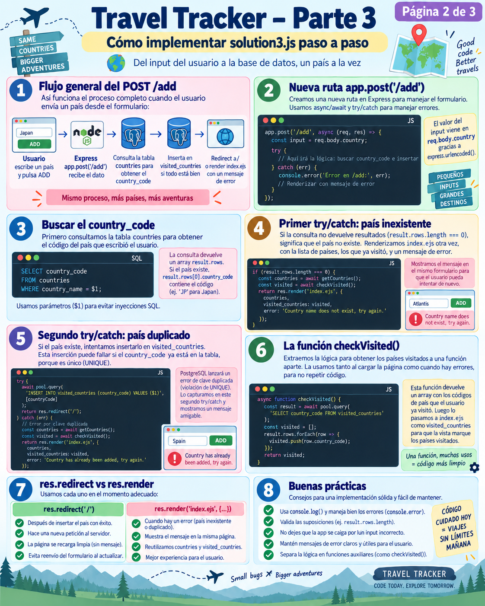
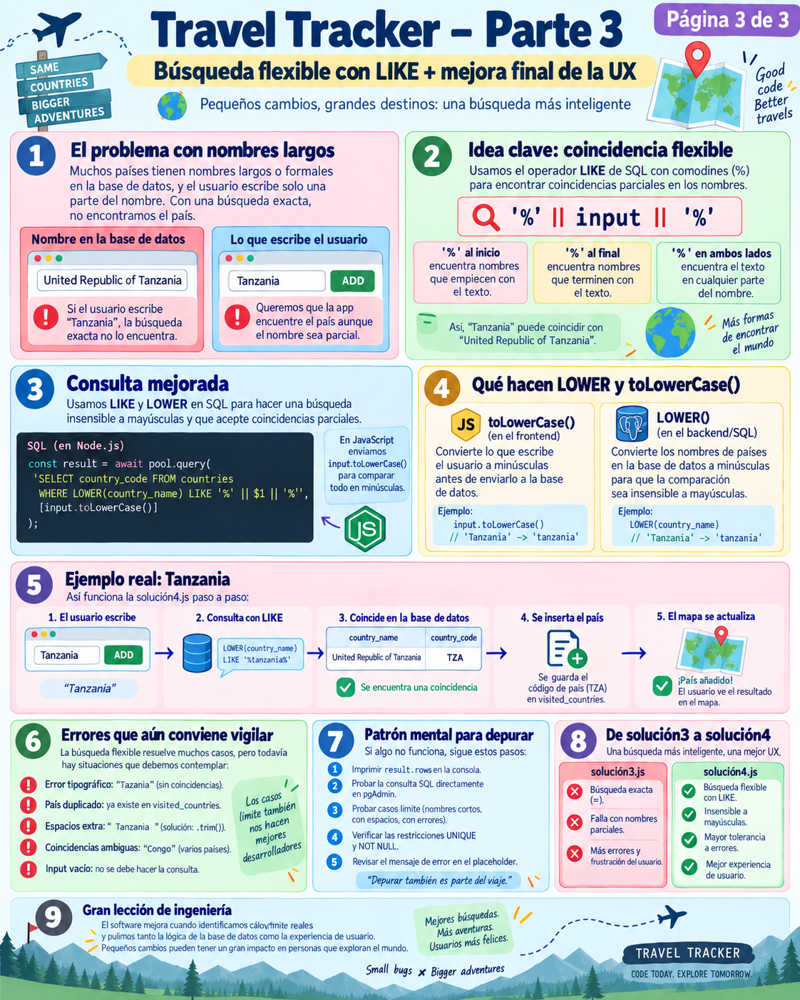

# 🛡️ Travel Tracker — Parte 3: Manejo de Errores y Búsqueda Flexible (*Fuzzy Search*)

> **Objetivo de la Parte 3:**  
> Transformar nuestra aplicación de un prototipo frágil a un sistema **robusto, resiliente y tolerante a fallos**. Aprenderemos a capturar errores con bloques `try...catch` anidados (países inexistentes y duplicados), enviar mensajes amigables al usuario en el formulario y utilizar **`LIKE`**, **`LOWER()`** y el operador de concatenación **`||`** de **PostgreSQL** para permitir búsquedas flexibles e insensibles a mayúsculas y minúsculas.

---

## 📸 1. Análisis de las Infografías de la Parte 3

> 💡 *Nota curiosa:* El archivo `Part3TravelTracker1.png` que se encuentra en esta carpeta corresponde a una chuleta general de Linux que se colocó por despiste. La lección oficial de Travel Tracker se compone de las **3 páginas maestras**: `Part3TravelTracker2.png`, `Part3TravelTracker3.png` y `Part3TravelTracker4.png`.

---

### 1.1. Página 1 de 3: Manejo de Errores y Casos Límite (*Edge Cases*)


* **Los dos problemas a resolver:**
  1. **País inexistente:** El usuario escribe *"Wakanda"* o comete una errata como *"Spani"*. La aplicación no debe colgarse ni mostrar una pantalla en blanco con errores técnicos; debe responder con amabilidad:  
     `"Country name does not exist, try again."`
  2. **País ya visitado (duplicado):** El usuario intenta añadir *"Spain"* por segunda vez. La base de datos debe rechazarlo por la restricción `UNIQUE`, y la app debe avisar:  
     `"Country has already been added, try again."`
* **Cambio en el frontend (`views/index.ejs`):**  
  El campo de texto utiliza la variable `locals.error` enviada desde Express para mostrar el mensaje de advertencia en el propio *placeholder* del formulario:
  ```html
  <input type="text" name="country" autofocus 
         placeholder="<%= locals.error ? error : 'Enter country name' %>">
  ```

---

### 1.2. Página 2 de 3: Implementación Paso a Paso de `solution3.js`


* **Estructura de doble `try...catch` anidado:**
  * **Try Externo:** Busca el país en la tabla `countries`. Si no existe, lanza un error que es atrapado por el `catch` externo.
  * **Try Interno:** Intenta insertar el código en `visited_countries`. Si el país ya estaba guardado, PostgreSQL lanza un error de clave duplicada (`UNIQUE`), el cual es atrapado por el `catch` interno.
* **Diferencia clave entre `res.redirect()` y `res.render()`:**
  * Si la inserción tiene éxito ➔ `res.redirect("/")` (Petición limpia, sin errores).
  * Si ocurre un error ➔ `res.render("index.ejs", { countries, total, error: "..." })` (Mantiene al usuario en la misma página para mostrarle qué falló).

---

### 1.3. Página 3 de 3: Búsqueda Flexible con `LIKE` y `LOWER()` (`solution4.js`)


* **El problema de los nombres oficiales largos:**  
  En la base de datos, Tanzania está guardada como *"United Republic of Tanzania"*. Si el usuario escribe simplemente *"Tanzania"*, una búsqueda con el operador de igualdad estricta (`=`) dirá que el país no existe.
* **La solución técnica:**  
  Uso de `LIKE` con comodines `%` y concatenación de cadenas `||`:
  ```sql
  SELECT country_code FROM countries 
  WHERE LOWER(country_name) LIKE '%' || $1 || '%';
  ```
* **Normalización a minúsculas:**  
  `LOWER(country_name)` convierte el texto de la columna en PostgreSQL a minúsculas, e `input.toLowerCase()` convierte el texto tecleado por el usuario en JavaScript, logrando una comparación 100% insensible a mayúsculas.

---

## 🐣 2. Conceptos Fundamentales: "No demos nada por sabido"

### 2.1. ¿Qué es un error en programación y qué es `try...catch`?
Imagina un trapecista en un circo:
* **Sin `try...catch`:** Si el trapecista comete un error en el aire, cae directamente al suelo. En Node.js, si ocurre un fallo no controlado (un error no capturado), **el servidor se detiene por completo (se cae)** y deja de responder a todos los usuarios del mundo.
* **Con `try...catch`:** El bloque `try` es el trapecio donde intentamos ejecutar acciones que podrían salir mal. El bloque `catch` es la **red de seguridad**. Si algo falla dentro del `try`, la ejecución salta de inmediato al `catch`, permitiéndonos recuperarnos con gracia y mostrar un mensaje amable al usuario.

```javascript
try {
  // Intentamos hacer algo arriesgado (consultar o insertar en la base de datos)
  const result = await db.query(...);
} catch (error) {
  // Si algo falló, se ejecuta este código y el servidor NO se cae
  console.log("Ocurrió un error:", error.message);
}
```

---

### 2.2. ¿Cómo se produce el Error 1 (País inexistente)?
Veamos exactamente qué pasa en la memoria de JavaScript cuando alguien busca `"Wakanda"`:

1. Ejecutamos la consulta:
   ```javascript
   const result = await db.query(
     "SELECT country_code FROM countries WHERE country_name = $1",
     ["Wakanda"]
   );
   ```
2. Como *"Wakanda"* no existe en la tabla `countries`, PostgreSQL no devuelve ninguna fila. Por tanto:
   ```javascript
   result.rows; // Es un array vacío: []
   result.rows.length; // Es 0
   ```
3. En la siguiente línea de código, intentamos acceder al primer elemento:
   ```javascript
   const data = result.rows[0]; // data es "undefined"
   const countryCode = data.country_code; // 💥 ¡BOOM!
   ```
4. Intentar leer `.country_code` de algo que es `undefined` provoca un error nativo de JavaScript:  
   `TypeError: Cannot read properties of undefined (reading 'country_code')`.
5. Al estar dentro del `try` externo, JavaScript salta inmediatamente a su bloque `catch`, evitando que la aplicación se caiga y permitiéndonos renderizar:
   ```javascript
   res.render("index.ejs", {
     countries: countries,
     total: countries.length,
     error: "Country name does not exist, try again.",
   });
   ```

---

### 2.3. ¿Cómo se produce el Error 2 (País duplicado)?
Supongamos que el usuario ya tiene Francia (`'FR'`) en su lista y vuelve a escribir `"France"`:

1. La búsqueda en la tabla maestra `countries` tiene éxito y devuelve `countryCode = 'FR'`.
2. A continuación, intentamos insertarlo en la tabla de visitas:
   ```javascript
   await db.query("INSERT INTO visited_countries (country_code) VALUES ($1)", ['FR']);
   ```
3. Recordemos la definición de la tabla:
   ```sql
   CREATE TABLE visited_countries (
       id SERIAL PRIMARY KEY,
       country_code CHAR(2) NOT NULL UNIQUE  -- 👈 Restricción UNIQUE
   );
   ```
4. **PostgreSQL detiene la inserción** y lanza un error formal de base de datos:  
   `error: duplicate key value violates unique constraint "visited_countries_country_code_key"`  
   *(Código de error SQL standard: `23505`)*.
5. El `try` interno intercepta este error y ejecuta su `catch`:
   ```javascript
   res.render("index.ejs", {
     countries: countries,
     total: countries.length,
     error: "Country has already been added, try again.",
   });
   ```

---

## 💻 3. Código de la Solución 3: [`solution3.js`](../solution3.js)

Aquí vemos cómo se articulan ambos niveles de protección:

```javascript
// POST /add con manejo robusto de errores
app.post("/add", async (req, res) => {
  const input = req.body["country"];

  // =====================================================================
  // TRY EXTERNO: Gestiona la búsqueda del país en el catálogo "countries"
  // =====================================================================
  try {
    const result = await db.query(
      "SELECT country_code FROM countries WHERE country_name = $1",
      [input]
    );

    const data = result.rows[0];
    const countryCode = data.country_code; // Si no existe el país, aquí salta al CATCH EXTERNO

    // ===================================================================
    // TRY INTERNO: Gestiona la inserción en la tabla de visitas
    // ===================================================================
    try {
      await db.query(
        "INSERT INTO visited_countries (country_code) VALUES ($1)",
        [countryCode]
      );
      // Éxito total: redirigimos limpiamente
      res.redirect("/");
    } catch (err) {
      // CATCH INTERNO: Ocurre si el país ya había sido añadido (Violación UNIQUE)
      console.log(err);
      const countries = await checkVisisted();
      res.render("index.ejs", {
        countries: countries,
        total: countries.length,
        error: "Country has already been added, try again.",
      });
    }
  } catch (err) {
    // CATCH EXTERNO: Ocurre si el país no existe en la base de datos
    console.log(err);
    const countries = await checkVisisted();
    res.render("index.ejs", {
      countries: countries,
      total: countries.length,
      error: "Country name does not exist, try again.",
    });
  }
});
```

---

## 🚀 4. La Solución Definitiva: Búsqueda Flexible (*Fuzzy Search*) en [`solution4.js`](../solution4.js)

En `solution3.js` los errores están controlados, pero la experiencia del usuario (UX) es muy rígida:
* Si el usuario escribe `"spain"` (en minúsculas), el sistema dice que no existe porque en la base de datos está como `"Spain"`.
* Si escribe `"Tanzania"`, dice que no existe porque en la BD está como `"United Republic of Tanzania"`.

### 4.1. El Operador `LIKE` y los Comodines `%`
En SQL:
* El signo de igualdad `=` exige coincidencia exacta al 100%:  
  `country_name = 'Spain'` solo coincide con `'Spain'`.
* El operador `LIKE` permite usar el comodín **`%`**, que significa *"cualquier conjunto de caracteres"*:
  * `'Sp%'` ➔ Encuentra todo lo que **empiece** por *"Sp"* (*Spain*, *Special*).
  * `'%ia'` ➔ Encuentra todo lo que **termine** en *"ia"* (*Albania*, *Armenia*, *Australia*).
  * `'%an%'` ➔ Encuentra todo lo que **contenga** *"an"* en cualquier posición (*Tanzania*, *France*, *Angola*).

---

### 4.2. El Operador de Concatenación en SQL: `||`
En JavaScript unimos cadenas con `+`:
```javascript
"%" + input + "%" // JavaScript
```

En **PostgreSQL**, el operador de unión de cadenas es la doble barra vertical **`||`**:
```sql
'%' || $1 || '%' -- PostgreSQL
```

Al hacer:
```javascript
const result = await db.query(
  "SELECT country_code FROM countries WHERE LOWER(country_name) LIKE '%' || $1 || '%';",
  [input.toLowerCase()]
);
```
Ocurren 3 cosas simultáneamente:
1. `input.toLowerCase()`: Si el usuario escribió `"SPAIN"`, Node.js lo convierte a `"spain"`.
2. `LOWER(country_name)`: PostgreSQL pasa a minúsculas los nombres guardados en la base de datos durante la comparación.
3. `'%' || $1 || '%'`: Construye la expresión `'%spain%'`, permitiendo encontrar el país sin importar si se escribió con mayúsculas, minúsculas o si el nombre contiene palabras adicionales.

---

### 4.3. Ejemplo Real: Caso Tanzania
```
[ Usuario teclea ]  ──> "Tanzania"
         │
[ Node.js ]         ──> input.toLowerCase() = "tanzania"
         │
[ PostgreSQL ]      ──> LOWER("United Republic of Tanzania") LIKE '%tanzania%'
         │
[ Coincidencia ]    ──> ¡ÉXITO! Encuentra la fila y devuelve country_code = "TZ"
         │
[ Inserción ]       ──> Guarda "TZ" en visited_countries
         │
[ Resultado ]       ──> El mapa SVG colorea Tanzania (<path id="TZ">) en turquesa.
```

---

## 📊 5. Chuleta SQL de la Parte 3

| Expresión SQL | Significado | Ejemplo |
| :--- | :--- | :--- |
| **`LOWER(columna)`** | Convierte el texto de la columna a minúsculas. | `LOWER(country_name)` |
| **`UPPER(columna)`** | Convierte el texto de la columna a mayúsculas. | `UPPER(country_code)` |
| **`LIKE`** | Comparador de texto con comodines. | `WHERE country_name LIKE 'A%';` |
| **`ILIKE`** | Versión de `LIKE` propia de PostgreSQL que ignora mayúsculas/minúsculas sin necesidad de llamar a `LOWER()`. | `WHERE country_name ILIKE '%spain%';` |
| **`||`** | Operador de concatenación de cadenas en SQL. | `'%' || $1 || '%'` |
| **`%`** | Comodín que representa cero, uno o múltiples caracteres. | `'%land%'` (Finland, Poland, Ireland...) |
| **`_`** | Comodín que representa exactamente un carácter. | `'U_'` (US, UK...) |

---

## 🏆 6. Resumen de Ingeniería de Software

1. **La base de datos es la última línea de defensa:** Restricciones como `UNIQUE` impiden que los datos se corrompan incluso si el código de Node.js tuviera un bug.
2. **El backend debe ser diplomático:** Los errores se deben capturar con `try...catch` y traducirse a mensajes comprensibles para las personas.
3. **El software debe adaptarse al usuario, no al revés:** Permitir búsquedas parciales e insensibles a mayúsculas convierte una app frustrante en una aplicación intuitiva y agradable.

---

## 🗑️ 7. Extensión Avanzada: [`solution5.js`](../solution5.js) (Completando el ciclo CRUD con DELETE)

Hasta la Solución 4, nuestra aplicación solo permitía **Crear (INSERT)** y **Leer (SELECT)**. Para completar las operaciones fundamentales de cualquier base de datos (**CRUD**: *Create, Read, Update, Delete*), hemos creado **`solution5.js`**:

* **Sentencia SQL:**
  ```sql
  DELETE FROM visited_countries WHERE country_code = $1;
  ```
* **Verificación con `result.rowCount`:**  
  Permite saber si se borró alguna fila o si el país no estaba visitado:
  ```javascript
  if (deleteResult.rowCount === 0) {
    // El país no estaba en la lista de visitas
  } else {
    // ¡País eliminado! Redirige al inicio y el mapa lo despinta
  }
  ```
* **Interfaz:** Al arrancar con `node solution5.js`, la vista activa automáticamente el formulario de borrado en rojo junto al formulario de adición en turquesa.

