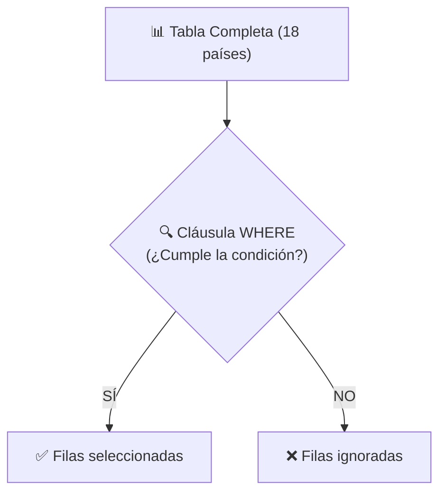
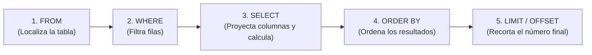

# 🌾 Práctica Flash: Dominar `SELECT`, `WHERE` y Análisis en PostgreSQL
### *De la proyección básica de datos al filtrado avanzado, LIKE, ordenación y agrupaciones*

> *"En las bases de datos relacionales, el 90% del trabajo diario de un desarrollador o analista consiste en hacer preguntas inteligentes con `SELECT`. Saber formular el `WHERE` adecuado convierte millones de datos caóticos en información clara, limpia y procesable."*

Bienvenido/a a esta práctica flash. A través de la serie de 4 infografías visuales aprenderemos a consultar, transformar, filtrar y agrupar datos paso a paso en **PostgreSQL**, sin dar absolutamente nada por sabido y poniendo especial énfasis en las combinaciones lógicas de `LIKE`, `AND` y `OR`.

---

## 📌 Índice de Contenidos

1. [¿Qué hace realmente `SELECT`?](#1-qué-hace-realmente-select)
2. [Página 1: Proyección, Alias (`AS`) y Valores Únicos (`DISTINCT`)](#2-página-1-proyección-alias-as-y-valores-únicos-distinct)
3. [Página 2: Filtros con `WHERE` y Operadores de Comparación](#3-página-2-filtros-con-where-y-operadores-de-comparación)
4. [⚡ Especial en Profundidad: Patrones `LIKE`/`ILIKE` y la Trampa de los `AND`/`OR`](#4-especial-en-profundidad-patrones-likeilike-y-la-trampa-de-los-andor)
   - [¿Qué es un patrón de texto?](#qué-es-un-patrón-de-texto)
   - [Los comodines `%` y `_`](#los-comodines--y-_)
   - [`LIKE` vs `ILIKE` en PostgreSQL](#like-vs-ilike-en-postgresql)
   - [La Trampa de Precedencia: ¿Por qué `AND` vence a `OR`?](#la-trampa-de-la-precedencia-por-qué-and-vence-a-or)
5. [Página 3: Ordenar (`ORDER BY`), Limitar (`LIMIT`/`OFFSET`) y Columnas Calculadas](#5-página-3-ordenar-order-by-limitar-limitoffset-y-columnas-calculadas)
   - [El Orden Mental de Ejecución en SQL](#el-orden-mental-de-ejecución-en-sql)
6. [Página 4: Agregaciones (`COUNT`, `SUM`, `AVG`), `GROUP BY` y `HAVING`](#6-página-4-agregaciones-group-by-y-having)
   - [Diferencia de Oro: `WHERE` vs `HAVING`](#diferencia-de-oro-where-vs-having)
   - [La Consulta Maestra](#la-consulta-maestra)
7. [🎮 Laboratorio Flash Paso a Paso con `world_food`](#7-laboratorio-flash-paso-a-paso-con-world_food)
8. [💡 Lo que se extrae de esta práctica (Puntos Clave)](#8-lo-que-se-extrae-de-esta-práctica-puntos-clave)

---

## 1. ¿Qué hace realmente `SELECT`?

En el lenguaje SQL existen dos tipos de operaciones:
1. **Comandos de modificación (DML/DDL):** `INSERT`, `UPDATE`, `DELETE`, `CREATE TABLE`. Estos comandos alteran el disco duro, cambian los datos o destruyen tablas.
2. **Comando de lectura (`SELECT`):** Es una operación de **solo lectura**. 
   - Puedes ejecutar mil veces un `SELECT` sin miedo: **jamás modificará ni borrará un solo dato** de tu base de datos.
   - Su función es consultar, calcular, resumir y proyectar los datos en una tabla temporal que se muestra en tu pantalla.

---

## 2. Página 1: Proyección, Alias (`AS`) y Valores Únicos (`DISTINCT`)


### Conceptos Fundamentales de la Infografía 1

#### 1. ¿Qué es la "Proyección"?
En la terminología de bases de datos, **proyectar** significa elegir qué columnas verticales queremos que viajen desde el disco hasta nuestra pantalla.

* **`SELECT * FROM tabla;` (Seleccionar todo):**  
  El asterisco `*` es un comodín que significa: *"Tráeme todas las columnas existentes"*.  
  > ⚠️ **Consejo profesional:** En entornos de producción reales con millones de filas, evita usar `SELECT *`. Cargar columnas que no necesitas satura la memoria RAM del servidor y consume ancho de banda de red innecesario.

* **Seleccionar columnas concretas:**  
  Basta con listar los nombres de las columnas separados por comas:
  ```sql
  SELECT country, wheat_production FROM world_food;
  ```

#### 2. Renombrar columnas con `AS` (Alias)
A menudo, los nombres de las columnas en la base de datos están en inglés o usan abreviaturas técnicas poco amigables (`wheat_production`, `cnt_usr`). La palabra reservada **`AS`** permite darles un "nombre de pila" provisional más claro en el resultado final:
```sql
SELECT 
    country AS pais, 
    wheat_production AS toneladas_trigo 
FROM world_food;
```
*(Esto no renombra la columna en la tabla real; solo cambia la etiqueta del encabezado en el informe que ves).*

#### 3. Eliminar duplicados con `DISTINCT`
Si una columna contiene valores repetidos (por ejemplo, muchas filas con la región `'Asia'`), la palabra clave **`DISTINCT`** filtra el resultado para mostrar **únicamente valores únicos**:
```sql
SELECT DISTINCT region FROM world_food;
```

---

## 3. Página 2: Filtros con `WHERE` y Operadores de Comparación


### La Cláusula `WHERE`: El filtro de filas
Mientras que `SELECT` elige qué **columnas verticales** ver, **`WHERE`** actúa como un colador horizontal para decidir qué **filas horizontales** cumplen una condición para ser mostradas.



#### Operadores de Comparación Básicos

| Operador | Significado | Ejemplo | Lectura en lenguaje humano |
| :---: | :--- | :--- | :--- |
| **`=`** | Igual a | `region = 'Asia'` | "Filas donde la región sea exactamente Asia" |
| **`!=`** o **`<>`** | Distinto de | `country != 'Brazil'` | "Todos los países excepto Brasil" |
| **`>`** | Mayor estrictamente | `wheat_production > 20.0` | "Producción de trigo superior a 20M" |
| **`>=`** | Mayor o igual que | `wheat_production >= 20.0` | "Producción de trigo de 20M o más" |
| **`<`** | Menor estrictamente | `rice_production < 10.0` | "Producción de arroz inferior a 10M" |
| **`<=`** | Menor o igual que | `rice_production <= 10.0` | "Producción de arroz de 10M o menos" |

> [!NOTE]
> **Regla de oro de sintaxis:**
> * Las cadenas de texto y fechas **SIEMPRE van entre comillas simples** (`'China'`, `'Asia'`).
> * Los números decimales y enteros **NUNCA llevan comillas** (`20.0`, `5`). Si pones `'20'`, obligas a PostgreSQL a hacer conversiones innecesarias.

#### Operadores Especiales: `IN`, `BETWEEN` y `NULL`

* **`IN (...)` (Pertenencia a una lista):**  
  En lugar de escribir `country = 'China' OR country = 'India' OR country = 'Vietnam'`, usamos `IN`:
  ```sql
  SELECT country FROM world_food WHERE country IN ('China', 'India', 'Vietnam');
  ```
* **`BETWEEN valor1 AND valor2` (Rango continuo inclusivo):**  
  Equivale a `wheat_production >= 10.0 AND wheat_production <= 35.0`:
  ```sql
  SELECT country, wheat_production 
  FROM world_food 
  WHERE wheat_production BETWEEN 10.0 AND 35.0;
  ```
* **Tratamiento de `NULL` (Valores vacíos o desconocidos):**  
  En bases de datos relacionales, `NULL` no es el número cero ni un texto vacío; representa la **ausencia total de valor**.  
  Por tanto, la expresión matemática `columna = NULL` **siempre devuelve falso en SQL**. La forma obligatoria de preguntar es:
  ```sql
  -- ✅ Correcto:
  SELECT country FROM world_food WHERE rice_production IS NULL;
  SELECT country FROM world_food WHERE wheat_production IS NOT NULL;
  ```

---

## 4. ⚡ Especial en Profundidad: Patrones `LIKE`/`ILIKE` y la Trampa de los `AND`/`OR`

Aquí es donde tropiezan la gran mayoría de estudiantes de bases de datos. Vamos a desgranarlo con lupa.

### ¿Qué es un patrón de texto?
A veces no buscas un país exacto como `'China'`, sino países que *"empiecen por U"*, *"contengan la palabra land"* o *"tengan exactamente 5 letras"*. Para esto se usa el operador **`LIKE`**.

### Los Comodines (*Wildcards*)
En SQL existen solo dos comodines mágicos:

1. **`%` (Porcentaje):** Representa **cero, uno o infinitos caracteres**.
   - `'U%'` ➔ Empieza obligatoriamente por 'U' seguida de cualquier cosa (*Ukraine*, *United States*).
   - `'%a'` ➔ Termina obligatoriamente por la letra 'a' (*China*, *India*, *Nigeria*).
   - `'%an%'` ➔ Contiene las letras 'an' en cualquier posición (*Canada*, *Germany*, *Bangladesh*).
2. **`_` (Guion bajo):** Representa **exactamente un único carácter**.
   - `'_____'` (cinco guiones) ➔ Cualquier texto de exactamente 5 letras (*China*, *India*, *Egypt*).
   - `'____a'` ➔ Exactamente 5 letras cuyo final sea la letra 'a' (*China*, *India*).

---

### `LIKE` vs `ILIKE` en PostgreSQL

PostgreSQL es uno de los pocos motores que distingue estrictamente entre mayúsculas y minúsculas:
* **`LIKE` (Case-Sensitive):** Distingue mayúsculas y minúsculas.  
  `WHERE country LIKE 'u%'` ➔ **No encontrará nada**, porque en la base de datos están escritas como `'Ukraine'` o `'United States'` con 'U' mayúscula.
* **`ILIKE` (Case-Insensitive):** Es una extensión propia y potente de PostgreSQL que **ignora mayúsculas y minúsculas**.  
  `WHERE country ILIKE 'u%'` ➔ Encontrará con éxito tanto *Ukraine* como *united states*.

---

### La Trampa de la Precedencia: ¿Por qué `AND` vence a `OR`?

Imagina esta petición de negocio:
> *"Necesito una lista de los países cuyos nombres comiencen por 'B' o por 'C', y que ADEMÁS tengan una producción de trigo superior a 20 millones de toneladas."*

Un alumno novato suele escribir:
```sql
-- ❌ CONSULTA ENGAÑOSA (Resultado erróneo):
SELECT country, wheat_production 
FROM world_food 
WHERE country LIKE 'B%' OR country LIKE 'C%' AND wheat_production > 20.0;
```

#### ¿Por qué esta consulta devuelve resultados inesperados?
En matemáticas, la multiplicación tiene prioridad sobre la suma ($2 + 3 \times 4 = 14$, no $20$).  
En lógica de bases de datos, **el operador `AND` tiene mayor precedencia (prioridad) que el operador `OR`**.

Por tanto, el motor de PostgreSQL evalúa la consulta agrupándola mentalmente así:
$$\text{country LIKE 'B\%'} \quad \mathbf{OR} \quad \left(\text{country LIKE 'C\%'} \quad \mathbf{AND} \quad \text{wheat\_production} > 20.0\right)$$

* **Consecuencia:** Si un país empieza por **'B'** (como *Brazil*, con solo 6.1 de trigo o *Bangladesh* con 1.2 de trigo), la condición `country LIKE 'B%'` es verdadera, por lo que **¡PostgreSQL lo incluye en la pantalla aunque su trigo sea casi nulo!**

```text
-- Resultado obtenido por la consulta engañosa:
   country    | wheat_production 
--------------+------------------
 Brazil       |              6.1   <--- ¡ERROR! No supera 20M, pero entró por culpa del OR
 Bangladesh   |              1.2   <--- ¡ERROR! Tampoco supera 20M
 Canada       |             35.2   <--- Correcto (Cumplió C% y trigo > 20)
 China        |            134.0   <--- Correcto (Cumplió C% y trigo > 20)
```

#### La Solución Obligatoria: Usar Paréntesis `()`
Los paréntesis rompen la prioridad por defecto y obligan al motor a evaluar primero la disyunción:

```sql
-- ✅ CONSULTA CORRECTA (Con paréntesis protectores):
SELECT country, wheat_production 
FROM world_food 
WHERE (country LIKE 'B%' OR country LIKE 'C%') AND wheat_production > 20.0;
```

**Resultado correcto:**
```text
 country | wheat_production 
---------+------------------
 Canada  |             35.2
 China   |            134.0
(2 rows)
```
*(Brasil y Bangladesh quedan eliminados correctamente porque no superan los 20 millones de trigo).*

---

## 5. Página 3: Ordenar (`ORDER BY`), Limitar (`LIMIT`/`OFFSET`) y Columnas Calculadas


### 1. `ORDER BY`: Poner orden al caos
Las bases de datos relacionales no garantizan ningún orden de almacenamiento físico en el disco. Si no pides un orden específico, las filas saldrán como el disco prefiera.
* **`ORDER BY columna ASC`:** Orden ascendente (de menor a mayor, de la A a la Z). Es el comportamiento predeterminado si no especificas nada.
* **`ORDER BY columna DESC`:** Orden descendente (de mayor a menor, de la Z a la A).

### 2. `LIMIT` y `OFFSET`: La base de la paginación web
Cuando visitas una tienda online como Amazon o un blog, no ves los 100.000 productos a la vez; ves páginas de 10 en 10.
* **`LIMIT n`:** Recorta el resultado para devolver como máximo $n$ filas.
* **`OFFSET m`:** Salta o descarta las primeras $m$ filas antes de empezar a contar.

```sql
-- Página 1 del catálogo (los 5 primeros):
SELECT country FROM world_food LIMIT 5 OFFSET 0;

-- Página 2 del catálogo (los 5 siguientes, saltándose los 5 primeros):
SELECT country FROM world_food LIMIT 5 OFFSET 5;
```

### 3. Columnas Calculadas (Aritmética en tiempo real)
PostgreSQL permite realizar operaciones matemáticas entre columnas sobre la marcha (`+`, `-`, `*`, `/`):
```sql
SELECT 
    country,
    (rice_production + wheat_production) AS produccion_total_grano
FROM world_food;
```

---

### El Orden Mental de Ejecución en SQL

> [!IMPORTANT]
> **Uno de los secretos mejor guardados de SQL:**  
> Aunque al programar escribimos la palabra `SELECT` en la primera línea, el motor de PostgreSQL **NO la ejecuta primero**.

Mira cómo viajan los datos internamente en cada consulta:



1. **`FROM`**: Primero busca la tabla en disco (`world_food`).
2. **`WHERE`**: Descarta las filas que no cumplan los filtros.
3. **`SELECT`**: De las filas supervivientes, extrae las columnas pedidas y calcula alias.
4. **`ORDER BY`**: Ordena ese conjunto resultante.
5. **`LIMIT`**: Corta la lista final y te entrega el resultado.

*(Por eso no puedes usar un alias creado en el `SELECT` dentro del `WHERE`, ¡porque en el momento en que se evalúa el `WHERE`, el `SELECT` todavía no ha nacido!)*.

---

## 6. Página 4: Agregaciones (`COUNT`, `SUM`, `AVG`), `GROUP BY` y `HAVING`


### 1. Las 5 Funciones de Agregación Clásicas
Una función de agregación procesa múltiples filas y las colapsa en un único número resumen:
* **`COUNT(*)`**: Cuenta el total de filas.
* **`SUM(columna)`**: Suma todos los valores de esa columna numérica.
* **`AVG(columna)`**: Calcula la media aritmética o promedio.
* **`MIN(columna)`**: Obtiene el valor más pequeño.
* **`MAX(columna)`**: Obtiene el valor más grande.

```sql
SELECT 
    COUNT(*) AS total_paises,
    ROUND(AVG(wheat_production), 1) AS media_trigo
FROM world_food;
```

---

### 2. `GROUP BY`: Agrupar categorías
Si quieres conocer la producción de trigo **por cada continente o región**:
```sql
SELECT 
    region,
    COUNT(*) AS paises_en_region,
    SUM(wheat_production) AS trigo_total
FROM world_food
GROUP BY region;
```

> [!CAUTION]
> **Error típico de examen/entrevista:**  
> Si pones una columna en el `SELECT` que no está dentro de una función de agregación (como `region`), **esa columna debe estar obligatoriamente en el `GROUP BY`**. De lo contrario, PostgreSQL dará error porque no sabe cómo encajar nombres individuales dentro de una suma agrupada.

---

### Diferencia de Oro: `WHERE` vs `HAVING`

| Cláusula | ¿Cuándo actúa? | ¿Sobre qué filtra? | ¿Admite funciones de agregación (`SUM`, `AVG`)? |
| :--- | :--- | :--- | :---: |
| **`WHERE`** | **ANTES** de agrupar | Filtra **filas individuales** originales de la tabla | ❌ **NUNCA** (Da error sintáctico) |
| **`HAVING`** | **DESPUÉS** de agrupar | Filtra **grupos ya agregados** producidos por `GROUP BY` | ✅ **SÍ, SIEMPRE** |

* Ejemplo claro:
  ```sql
  SELECT region, SUM(wheat_production) AS total_trigo
  FROM world_food
  WHERE year = 2024              -- WHERE: solo mira registros del año 2024
  GROUP BY region
  HAVING SUM(wheat_production) > 50.0; -- HAVING: descarta las regiones cuyo total sume menos de 50M
  ```

---

### La Consulta Maestra
Este ejemplo combina **todas las cláusulas de SQL** en una sola sentencia elegante:

```sql
SELECT 
    region,
    COUNT(*) AS numero_paises,
    ROUND(SUM(wheat_production), 1) AS total_trigo,
    ROUND(AVG(rice_production), 1) AS promedio_arroz
FROM world_food
WHERE year >= 2020                          -- 1. Filtra filas individuales
GROUP BY region                             -- 2. Agrupa por continente
HAVING SUM(wheat_production) > 30.0         -- 3. Filtra grupos con alta producción
ORDER BY total_trigo DESC                   -- 4. Ordena los grupos de mayor a menor
LIMIT 3;                                    -- 5. Devuelve solo el podio (Top 3)
```

---

## 7. 🎮 Laboratorio Flash Paso a Paso con `world_food`

Tienes el archivo ejecutable listo en [`laboratorio_world_food.sql`](./laboratorio_world_food.sql). Puedes abrir tu terminal con `psql`, pgAdmin o Supabase SQL Editor y probar cada reto.

### Reto 1: Crear y poblar la tabla didáctica

```sql
DROP TABLE IF EXISTS world_food CASCADE;

CREATE TABLE world_food (
    id SERIAL PRIMARY KEY,
    country VARCHAR(50) NOT NULL,
    region VARCHAR(50) NOT NULL,
    rice_production NUMERIC(10, 1),
    wheat_production NUMERIC(10, 1),
    year INT DEFAULT 2024
);

INSERT INTO world_food (country, region, rice_production, wheat_production, year) VALUES
('China', 'Asia', 214.0, 134.0, 2024),
('India', 'Asia', 178.0, 107.0, 2024),
('Indonesia', 'Asia', 54.6, 0.1, 2024),
('Vietnam', 'Asia', 43.5, 0.0, 2024),
('Bangladesh', 'Asia', 56.4, 1.2, 2024),
('United States', 'Americas', 10.4, 49.7, 2024),
('Brazil', 'Americas', 11.2, 6.1, 2024),
('Canada', 'Americas', 0.0, 35.2, 2024),
('Argentina', 'Americas', 1.4, 17.5, 2024),
('Russia', 'Europe', 1.1, 85.9, 2024),
('Ukraine', 'Europe', 0.5, 26.0, 2024),
('France', 'Europe', 0.1, 33.7, 2024),
('Germany', 'Europe', 0.0, 24.1, 2024),
('Australia', 'Oceania', 0.3, 31.7, 2024),
('Egypt', 'Africa', 4.8, 9.0, 2024),
('Nigeria', 'Africa', 8.5, 0.2, 2024),
('Algeria', 'Africa', NULL, 3.1, 2024),
('Iceland', 'Europe', 0.0, NULL, 2024);
```

---

### Reto 2: Probar la búsqueda de patrones con paréntesis

Ejecuta la consulta con paréntesis y observa cómo filtra de forma impecable:
```sql
SELECT country, region, wheat_production 
FROM world_food 
WHERE (country LIKE 'B%' OR country LIKE 'C%') AND wheat_production > 20.0;
```

**Salida esperada:**
```text
 country |  region  | wheat_production 
---------+----------+------------------
 China   | Asia     |            134.0
 Canada  | Americas |             35.2
(2 rows)
```

---

### Reto 3: Encontrar países con producción desconocida (`IS NULL`)

```sql
SELECT country, region 
FROM world_food 
WHERE rice_production IS NULL OR wheat_production IS NULL;
```

**Salida esperada:**
```text
 country | region 
---------+--------
 Algeria | Africa
 Iceland | Europe
(2 rows)
```

---

### Reto 4: Obtener el Top 3 de regiones agrícolas

```sql
SELECT 
    region,
    COUNT(*) AS total_paises,
    ROUND(SUM(wheat_production), 1) AS produccion_trigo
FROM world_food
GROUP BY region
ORDER BY produccion_trigo DESC
LIMIT 3;
```

**Salida esperada:**
```text
  region  | total_paises | produccion_trigo 
----------+--------------+------------------
 Asia     |            5 |            242.3
 Europe   |            5 |            169.7
 Americas |            4 |            108.5
(3 rows)
```

---

## 8. 💡 Lo que se extrae de esta práctica (Puntos Clave)

<div style="background-color: #f0fdf4; border: 2px solid #22c55e; padding: 22px; border-radius: 8px; margin: 24px 0;">

### 🟢 Conclusiones y Aprendizajes Extraídos

1. **`SELECT` jamás altera datos:** Es una operación de lectura y transformación en memoria.
2. **`LIKE` vs `ILIKE`:** Recuerda que PostgreSQL distingue mayúsculas en `LIKE`. Si quieres una búsqueda tolerante al texto del usuario, usa siempre `ILIKE`.
3. **El peligro del `AND` sobre el `OR`:** `AND` tiene mayor prioridad lógica. Cuando mezcles ambas condiciones con patrones de texto, **usa siempre paréntesis `(A OR B) AND C`** para evitar fugas de registros no deseados.
4. **`IS NULL` es obligatorio:** En SQL nunca compares `= NULL`. La comparación matemática con nulos siempre falla; debe usarse `IS NULL` o `IS NOT NULL`.
5. **El orden de ejecución no es el orden de escritura:** PostgreSQL evalúa `FROM ➔ WHERE ➔ SELECT ➔ ORDER BY ➔ LIMIT`.
6. **`WHERE` filtra filas antes; `HAVING` filtra grupos después:** Jamás pongas funciones agregadas (`COUNT`, `SUM`) dentro de un `WHERE`.

</div>
