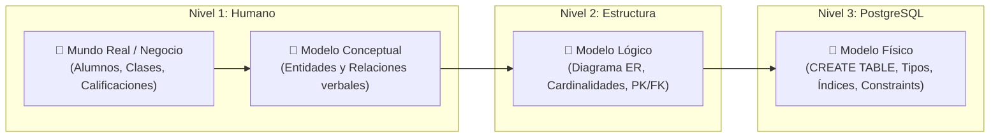
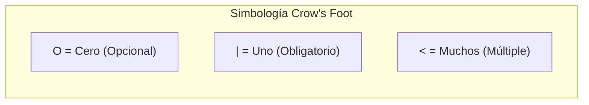
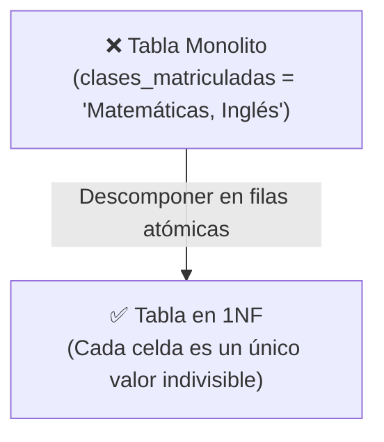
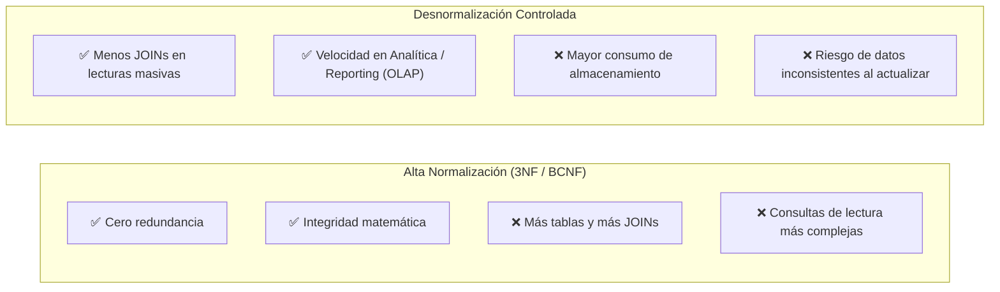
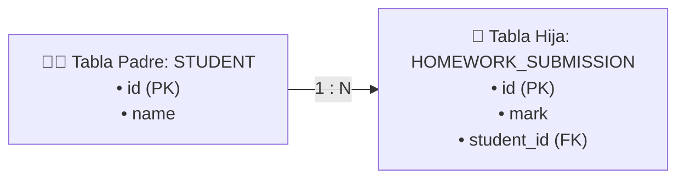
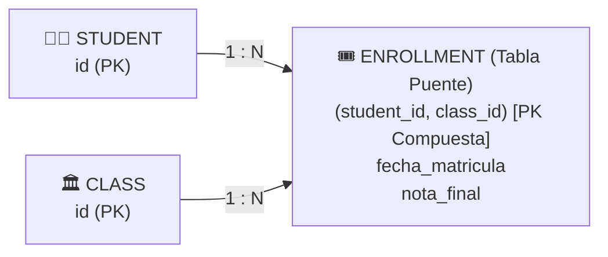
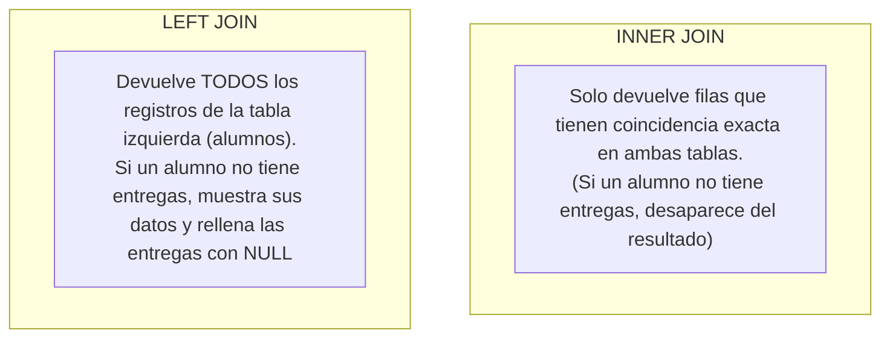

# 🏛️ Laboratorio Flash: Arquitectura de Bases de Datos, Modelo Entidad-Relación y Formas Normales (1NF, 2NF, 3NF)
### *Del mundo real al diseño relacional robusto en PostgreSQL: Relaciones 1:1, 1:N, N:M, Normalización y Decisiones de Arquitectura*

> *"Una base de datos no es solo un almacén de filas; es un modelo matemático de las reglas de un negocio. Si el diseño relacional es sólido, el código del backend es limpio y rápido. Si el diseño es defectuoso, ninguna cantidad de código o servidores caros podrá compensar las inconsistencias y la lentitud."*

Bienvenido/a a este laboratorio didáctico y teórico de **Arquitectura y Modelado Relacional en PostgreSQL**. En esta guía utilizaremos como hilo conductor la serie de **8 infografías visuales** creadas para este curso, combinándolas con teoría de diseño, formas normales, diagramas entidad-relación y código SQL real y ejecutable.

---

## 📌 Índice de Contenidos

1. [El Ciclo del Modelado: Del Problema Real al Motor SQL](#1-el-ciclo-del-modelado-del-problema-real-al-motor-sql)
2. [Infografía 1: Del Mundo Real a las Tablas (Entidades, Atributos y Reglas de Negocio)](#2-infografía-1-del-mundo-real-a-las-tablas)
3. [Infografía 2: Aprende a Leer la Cardinalidad (Pata de Gallo / Crow's Foot)](#3-infografía-2-aprende-a-leer-la-cardinalidad)
4. [Infografía 3: Llaves y Restricciones (El Escudo Protector de PostgreSQL)](#4-infografía-3-llaves-y-restricciones)
5. [Evolución de Arquitecturas: De la "Mega-Tabla" Caótica a las Formas Normales (1NF, 2NF, 3NF)](#5-evolución-de-arquitecturas-de-la-mega-tabla-a-las-formas-normales)
   - [Nivel 0: El Antipatrón de la Hoja de Cálculo Única (Excel)](#nivel-0-el-antipatrón-de-la-hoja-de-cálculo-única)
   - [Primera Forma Normal (1NF): Atomicidad y Cero Repeticiones](#primera-forma-normal-1nf-atomicidad-y-cero-repeticiones)
   - [Segunda Forma Normal (2NF): Dependencia Funcional Completa](#segunda-forma-normal-2nf-dependencia-funcional-completa)
   - [Tercera Forma Normal (3NF): Eliminación de Dependencias Transitivas](#tercera-forma-normal-3nf-eliminación-de-dependencias-transitivas)
   - [El Dilema del Ingeniero: ¿Cuándo Normalizar y Cuándo Desnormalizar?](#el-dilema-del-ingeniero-cuándo-normalizar-y-cuándo-desnormalizar)
6. [Infografía 4: Relación Uno a Uno (1:1) – Anatomía, Pros y Contras](#6-infografía-4-relación-uno-a-uno-11)
7. [Infografía 5: Relación Uno a Muchos (1:N) – La Regla de Oro](#7-infografía-5-relación-uno-a-muchos-1n)
8. [Infografía 6: Relación Muchos a Muchos (N:M) – La Tabla Puente](#8-infografía-6-relación-muchos-a-muchos-nm)
9. [Infografía 7: Consultas con `JOIN` – Reconstruir Datos sin Destruir el Disco](#9-infografía-7-consultas-con-join)
10. [Infografía 8: Del Dibujo a la Arquitectura Funcional en Producción](#10-infografía-8-del-dibujo-a-la-arquitectura-funcional)
11. [Laboratorio Práctico SQL Paso a Paso](#11-laboratorio-práctico-sql-paso-a-paso)
    - [Fase 1: Creación del Esquema con Constraints y Foreign Keys](#fase-1-creación-del-esquema-con-constraints-y-foreign-keys)
    - [Fase 2: Inserción de Datos Coherentes con Transacciones](#fase-2-inserción-de-datos-coherentes-con-transacciones)
    - [Fase 3: Consultas Avanzadas con JOINs y Agregaciones](#fase-3-consultas-avanzadas-con-joins-y-agregaciones)
    - [Fase 4: El Test de Casos Prohibidos (Validando la Integridad)](#fase-4-el-test-de-casos-prohibidos-validando-la-integridad)
12. [Matriz Comparativa de Decisiones de Arquitectura](#12-matriz-comparativa-de-decisiones-de-arquitectura)

---

## 1. El Ciclo del Modelado: Del Problema Real al Motor SQL

Diseñar una base de datos **nunca** empieza abriendo `pgAdmin` o escribiendo `CREATE TABLE`. Empieza entendiendo la realidad. En la ingeniería de software existen tres niveles universales de abstracción:



| Nivel | Qué define | En qué lenguaje se expresa | Ejemplo |
| :--- | :--- | :--- | :--- |
| **Conceptual** | Qué elementos existen en el negocio y cómo conviven. | Lenguaje natural y diagramas conceptuales de alto nivel. | *"Los estudiantes se matriculan en clases y entregan tareas"*. |
| **Lógico** | Estructuras tabulares, llaves primarias, foráneas y cardinalidades (1:1, 1:N, N:M), sin importar el motor específico. | Diagramas Entidad-Relación (ERD) en notación Pata de Gallo. | Entidad `student` vinculada a `enrollment` mediante `student_id`. |
| **Físico** | Tablas reales, tipos de datos exactos (`INT`, `VARCHAR(100)`, `TIMESTAMPTZ`), índices, particiones y políticas de borrado en cascada. | Sentencias DDL de **PostgreSQL**. | `student_id INT REFERENCES student(id) ON DELETE CASCADE`. |

---

## 2. Infografía 1: Del Mundo Real a las Tablas


### Los 4 Pilares del Modelado de Datos

Toda base de datos relacional se compone de cuatro piezas fundamentales:

1. **Entidad (`Entity`):**  
   Cualquier objeto, sujeto o concepto del mundo real sobre el cual necesitamos almacenar información de manera persistente.  
   *Ejemplo en una academia:* `Alumno`, `Clase`, `Profesor`, `Tarea`, `Ficha de Contacto`.
2. **Atributo (`Attribute`):**  
   Una propiedad o característica medible que describe a una entidad.  
   *Ejemplo:* En la entidad `Alumno`, sus atributos son `nombre`, `apellidos`, `email`, `fecha_nacimiento`. En la tabla física, cada atributo se convertirá en una **columna**.
3. **Fila / Instancia / Tupla (`Row / Record`):**  
   Un ejemplar concreto del mundo real.  
   *Ejemplo:* `Angela Torres`, con email `angela@escuela.es`. Representa una fila horizontal en la tabla `student`.
4. **Relación (`Relationship`):**  
   La asociación que conecta dos o más entidades.  
   *Ejemplo:* Angela (alumna) **se matricula en** Matemáticas (clase), y Angela **entrega** la Tarea 1.

### La Pregunta Bidireccional de Oro

> [!IMPORTANT]
> Para modelar una relación jamás basta con preguntarse qué hace A con B. **Siempre debes hacerte la pregunta en ambos sentidos**:
> 1. *Sentido A $\to$ B:* ¿Cuántos objetos B puede tener un solo objeto A?
> 2. *Sentido B $\to$ A:* ¿Cuántos objetos A puede tener un solo objeto B?

* **Ejemplo 1 (Alumno $\leftrightarrow$ Ficha médica/contacto):**  
  - ¿Cuántas fichas de contacto tiene un alumno? $\to$ Máximo **1**.  
  - ¿A cuántos alumnos pertenece esa ficha? $\to$ Exactamente a **1**.  
  - **Resultado:** Relación **Uno a Uno (1:1)**.
* **Ejemplo 2 (Alumno $\leftrightarrow$ Entregas de deberes):**  
  - ¿Cuántas entregas puede hacer una alumna? $\to$ **Muchas** ($N$).  
  - ¿A cuántos alumnos pertenece una entrega concreta? $\to$ A **1** solo alumno.  
  - **Resultado:** Relación **Uno a Muchos (1:N)**.
* **Ejemplo 3 (Alumno $\leftrightarrow$ Clases / Asignaturas):**  
  - ¿En cuántas clases puede matricularse una alumna? $\to$ En **Muchas** ($M$).  
  - ¿Cuántos alumnos pueden cursar una clase (ej. Matemáticas)? $\to$ **Muchos** ($N$).  
  - **Resultado:** Relación **Muchos a Muchos (N:M)**.

> [!TIP]
> **Las reglas del negocio mandan sobre el diseño:** Si la dirección de la escuela decide que a partir de mañana las entregas de tareas se pueden hacer en parejas, la relación `Alumno-Entrega` deja de ser 1:N y se convierte automáticamente en N:M. Tu arquitectura debe reflejar las reglas de la organización, no tus suposiciones previas.

---

## 3. Infografía 2: Aprende a Leer la Cardinalidad


La **cardinalidad** expresa numéricamente los límites de una relación: cuántas filas de una tabla pueden asociarse como mínimo y como máximo a una fila de otra tabla.

### La Notación Pata de Gallo (Crow's Foot)

En la industria del software, el estándar universal para diagramas ER es la notación **Pata de Gallo**:



Combinando estos símbolos se obtienen las 4 cardinalidades cardinales:

| Notación | Símbolos | Nombre Técnico | Significado en Lenguaje Natural |
| :---: | :---: | :--- | :--- |
| **`0..1`** | Círculo + Barra | **Cero o Uno** | Opcional. Puede no tener ninguna fila asociada, o a lo sumo una. (Ej. Angela tiene ficha de contacto, Jack todavía no). |
| **`1..1`** | Barra + Barra | **Exactamente Uno** | Obligatorio y único. Debe tener una y exactamente una fila vinculada. |
| **`0..N`** | Círculo + Pata | **Cero a Muchos** | Opcional múltiple. Puede no tener ninguna fila, o tener una o cientos. (Ej. Angela tiene 3 deberes entregados; Jack no ha entregado ninguno). |
| **`1..N`** | Barra + Pata | **Uno a Muchos** | Múltiple obligatorio. Debe tener al menos una fila vinculada para existir. |

### La Gran Distinción: ¿Mínimo o Máximo?

> [!CAUTION]
> **El mínimo y el máximo son preguntas totalmente independientes:**
> Que una alumna *pueda* tener 100 entregas (máximo $N$) **no obliga** a que tenga que tener alguna hoy para poder registrarse (mínimo $0$).  
> La restricción `NOT NULL` en una clave foránea infantil obliga a que **cada entrega tenga obligatoriamente un alumno dueño**, pero jamás obliga a que todo alumno tenga que tener entregas registradas.

---

## 4. Infografía 3: Llaves y Restricciones (El Escudo Protector de PostgreSQL)


Una base de datos no es solo un dibujo bonito en un papel. Para que el motor garantice que ningún usuario ni aplicación pueda corromper la información, usamos **restricciones formales** (`CONSTRAINTS`):

### 1. `PRIMARY KEY` (Clave Primaria - PK)
- Identifica de forma inequívoca y exclusiva cada fila de una tabla.
- **Regla estricta:** Es automáticamente `UNIQUE` y prohíbe taxativamente valores `NULL`.
- Puede ser una sola columna (ej. `id SERIAL PRIMARY KEY` o `UUID`) o una clave compuesta por varias columnas (ej. `(student_id, class_id)` en una matrícula).

### 2. `FOREIGN KEY` (Clave Foránea - FK)
- Es el enlace físico entre dos tablas.
- Exige que el valor almacenado en la columna hija **exista previamente** en la clave primaria de la tabla padre referenciada.
- Si intentas insertar una entrega con `student_id = 99` y en la tabla `student` solo existen los alumnos 1 al 10, **PostgreSQL abortará la operación con un error de integridad referencial**.

### 3. Restricciones Auxiliares de Oro

* **`UNIQUE`:** Impide valores duplicados en una columna o conjunto de columnas (ej. `email UNIQUE`). En PostgreSQL, por defecto, se permiten múltiples valores `NULL` a menos que se acompañe de `NOT NULL`.
* **`NOT NULL`:** Exige que la columna contenga obligatoriamente un valor; rechaza cualquier inserción vacía.
* **`CHECK`:** Obliga a que los datos cumplan una condición lógica booleana personalizada (ej. `CHECK (nota_final >= 0 AND nota_final <= 10)` o `CHECK (precio > 0)`).

> [!WARNING]
> **El Gran Mito del Nombre de Columna:**  
> Ponerle a una columna el nombre `student_id` o `id_alumno` **NO crea ninguna relación**. Solo es un nombre de texto. La relación y la protección solo existen cuando declaras explícitamente:
> ```sql
> CONSTRAINT fk_alumno FOREIGN KEY (student_id) REFERENCES student(id)
> ```
> 
> **Atención al Rendimiento:**  
> Cuando creas una `PRIMARY KEY` o un `UNIQUE`, PostgreSQL crea automáticamente un **índice B-Tree** para acelerar las búsquedas. **Sin embargo, declarar una `FOREIGN KEY` NO crea un índice automático en la tabla hija**. En bases de datos con miles o millones de registros, debes crear siempre manualmente un índice sobre las columnas con claves foráneas para que los `JOIN` y los borrados no penalicen la CPU:
> ```sql
> CREATE INDEX idx_entregas_student_id ON homework_submission(student_id);
> ```

---

## 5. Evolución de Arquitecturas: De la "Mega-Tabla" a las Formas Normales

Para comprender a fondo la arquitectura relacional, analicemos el problema clásico que sufren las empresas cuando crecen: **¿Cómo organizar los datos sin caer en el caos?**

Imagina que debemos gestionar una academia con alumnos, contactos, tareas entregadas y clases.

---

### Nivel 0: El Antipatrón de la Hoja de Cálculo Única

El error más común de los equipos inexpertos es meterlo absolutamente todo en una sola tabla desnormalizada:

```
TABLA HORROROSA: academia_excel_monolito
┌────┬─────────┬───────────────────┬──────────────┬───────────────┬─────────┬─────────┬─────────┬─────────┬───────────────────────────────┐
│ id │ nombre  │ email             │ telefono     │ ciudad        │ tarea1  │ nota1   │ tarea2  │ nota2   │ clases_matriculadas           │
├────┼─────────┼───────────────────┼──────────────┼───────────────┼─────────┼─────────┼─────────┼─────────┼───────────────────────────────┤
│ 1  │ Angela  │ angela@escuela.es │ 612-345-678  │ Madrid        │ Álgebra │ 8.5     │ Historia│ 9.0     │ Matemáticas, Inglés, Física   │
│ 2  │ Jack    │ jack@escuela.es   │ NULL         │ NULL          │ NULL    │ NULL    │ NULL    │ NULL    │ Matemáticas                   │
│ 3  │ Angela  │ angela@escuela.es │ 612-345-678  │ Madrid        │ Ensayos │ 7.0     │ NULL    │ NULL    │ Literatura                    │
└────┴─────────┴───────────────────┴──────────────┴───────────────┴─────────┴─────────┴─────────┴─────────┴───────────────────────────────┘
```

#### ¿Por qué esta arquitectura es destructiva?
1. **Columnas de Tareas Repetitivas (`tarea1`, `tarea2`):** ¿Qué ocurre si un alumno entrega 20 tareas? ¿Añadimos 40 columnas nuevas a la tabla (`tarea3`, `nota3`... `tarea20`, `nota20`)?
2. **Campos con Listas Separadas por Comas (`clases_matriculadas`):** Buscar qué alumnos están matriculados en *"Física"* exige hacer un costoso y propenso a fallos `LIKE '%Física%'`. Imposible indexar con eficiencia y propenso a errores tipográficos.
3. **Anomalía de Inserción:** No podemos dar de alta una nueva clase (ej. *"Química"*) hasta que un alumno se matricule en ella, porque la tabla depende del ID de alumno.
4. **Anomalía de Modificación:** Si Angela cambia de teléfono, hay que actualizar 10 filas distintas. Si una sola falla, los datos entran en contradicción.
5. **Anomalía de Borrado:** Si eliminamos la fila 3 de Angela para quitar su entrega de ensayos, ¡podríamos borrar accidentalmente su matrícula en Literatura!

Para solucionar esto de manera matemática y rigurosa, Edgar F. Codd formuló las **Formas Normales**.

---

### Primera Forma Normal (1NF): Atomicidad y Cero Repeticiones

Una tabla está en **1NF** si y solo si:
1. Cada celda contiene un **único valor atómico e indivisible** (nada de listas `"Matemáticas, Inglés"` ni JSONs mezclados para datos relacionales estructurados).
2. No existen **grupos repetitivos** de columnas (`tarea1`, `tarea2`, `tarea3`).
3. Existe una **clave primaria definida** que identifica de forma unívoca cada fila.

#### Paso a 1NF:
Eliminamos la columna separada por comas y los grupos de tareas:



---

### Segunda Forma Normal (2NF): Dependencia Funcional Completa

Una tabla está en **2NF** si:
1. Ya cumple la **1NF**.
2. **Todos los atributos que no forman parte de la clave primaria dependen por completo de TODA la clave primaria**, no de una fracción de ella.

> [!NOTE]
> La 2NF entra en juego principalmente en tablas con **claves primarias compuestas**. Si una clave primaria está formada por `(student_id, class_id)`, cualquier columna de esa tabla debe describir la combinación exacta de ambos, no solo al alumno o solo a la clase.

#### La Infracción Típica de 2NF:
Imagina una tabla de matrículas:
- Clave Primaria: `(student_id, class_id)`
- Columnas: `fecha_matricula`, `nombre_alumno`, `aula_clase`, `nota_final`.

- `nota_final` depende de **ambos**: ¿Qué nota sacó *este alumno* en *esta clase*? (Correcto).
- Pero `nombre_alumno` depende **únicamente de `student_id`**. ¡No depende de qué clase curse!
- Y `aula_clase` depende **únicamente de `class_id`**.

**Solución 2NF:** Extraer `nombre_alumno` a la tabla `student` y `aula_clase` a la tabla `class`. En la tabla `enrollment` solo dejamos `student_id`, `class_id`, `fecha_matricula` y `nota_final`.

---

### Tercera Forma Normal (3NF): Eliminación de Dependencias Transitivas

Una tabla está en **3NF** si:
1. Ya cumple la **2NF**.
2. **Ningún atributo no clave depende de otro atributo no clave** (es decir, no hay dependencias transitivas: $A \to B \to C$).

#### La Infracción Típica de 3NF:
En la tabla `student`:
- Clave Primaria: `id`.
- Columnas: `nombre`, `email`, `codigo_postal`, `ciudad_residencia`, `provincia`.

El `id` determina el `codigo_postal`. Pero el `codigo_postal` determina por sí mismo la `ciudad_residencia` y la `provincia`.  
Si 500 alumnos viven en el código postal `28001`, escribiremos `"Madrid"` 500 veces. Si alguien comete una errata y escribe `"Madird"`, tendremos inconsistencia.

**Solución 3NF:** Crear una tabla independiente `codigos_postales (cp, ciudad, provincia)` y en `student` almacenar únicamente `codigo_postal`.

---

### El Dilema del Ingeniero: ¿Cuándo Normalizar y Cuándo Desnormalizar?

Normalizar hasta 3NF o BCNF es el estándar de oro en sistemas transaccionales (**OLTP**), pero todo diseño arquitectónico implica un equilibrio de compromisos (*trade-offs*):



| Factor | Arquitectura Normalizada (3NF) | Arquitectura Desnormalizada |
| :--- | :--- | :--- |
| **Casos de Uso Ideales** | Aplicaciones web operativas, banca, comercio electrónico, ERPs, registros académicos. | Data Warehouses, analítica masiva (BigQuery, Redshift), paneles de dashboards y lecturas frecuentes. |
| **Escrituras (`INSERT`, `UPDATE`)** | **Ultrarrápidas y seguras:** Solo tocas una fila en un solo lugar. | **Lentas y complejas:** Hay que sincronizar múltiples copias del mismo dato. |
| **Lecturas (`SELECT`)** | Requieren combinar tablas con `JOIN`. | Rápidas en una sola tabla plana, pero consumen más memoria RAM y disco. |
| **Integridad de Datos** | Blindada por el motor relacional. | Delegada en el código del programador (muy peligroso). |

---

## 6. Infografía 4: Relación Uno a Uno (1:1)


Una relación **Uno a Uno (1:1)** conecta dos entidades donde **cada registro de la tabla A corresponde a como máximo un registro de la tabla B, y viceversa**.

En nuestro ejemplo escolar:
- Cada `student` tiene como máximo **una** `contact_detail` (ficha de contacto con teléfono, dirección de emergencia y datos privados).
- Cada `contact_detail` pertenece a **un único** alumno.

### ¿Cómo se implementa físicamente en PostgreSQL?

Hay dos estrategias de implementación limpia:

#### Estrategia Recomendada: Compartir la Clave Primaria (PK = FK)
Hacemos que la clave primaria de la tabla hija sea simultáneamente la clave foránea que apunta al padre:
```sql
CREATE TABLE contact_detail (
    student_id INT PRIMARY KEY, -- Es PK y a la vez FK
    phone VARCHAR(20),
    address VARCHAR(200),
    CONSTRAINT fk_student_contact 
        FOREIGN KEY (student_id) REFERENCES student(id) ON DELETE CASCADE
);
```
*Ventaja:* Es imposible que un alumno tenga dos fichas, porque `student_id` no puede repetirse al ser clave primaria. Ahorra índices y espacio en disco.

#### Estrategia Alternativa: Columna FK con restricción `UNIQUE`
```sql
CREATE TABLE contact_detail (
    id SERIAL PRIMARY KEY,
    student_id INT NOT NULL UNIQUE, -- UNIQUE garantiza que la relación sea 1:1 y no 1:N
    phone VARCHAR(20),
    address VARCHAR(200),
    CONSTRAINT fk_student_contact FOREIGN KEY (student_id) REFERENCES student(id)
);
```

### ¿Por qué no meterlo todo en la misma tabla `student`?

Si la relación es 1:1, muchos desarrolladores novatos preguntan: *"¿Por qué no añadir simplemente las columnas `phone` y `address` a la tabla `student`?"*

#### Ventajas de dividir en una tabla 1:1 separada:
1. **Datos Dispersos u Opcionales (*Sparse Data*):** Si solo el 15% de los alumnos rellena la ficha médica o de contacto, incluir esas columnas en `student` crearía filas llenas de valores `NULL` consumiendo espacio de bloques y fragmentando la tabla principal.
2. **Seguridad y Segregación de Permisos:** Puedes conceder permisos a los administrativos para leer `student`, pero restringir el acceso a `contact_detail` exclusivamente a los servicios médicos mediante privilegios `GRANT` o seguridad por filas (`Row Level Security - RLS`).
3. **Optimización de Memoria y Lectura (Particionado Vertical):** Las consultas que listan alumnos (`SELECT id, name FROM student`) leen páginas de disco mucho más compactas, sin tener que cargar strings pesados de direcciones o textos que rara vez se consultan.

#### Cuándo NO separar:
> [!CAUTION]
> **No dividas por manía.** Si los datos siempre existen (obligatorios 100%), no tienen requerimientos especiales de seguridad y siempre se leen juntos, mantenerlos en la misma tabla ahorra la sobrecarga de un `JOIN`.

---

## 7. Infografía 5: Relación Uno a Muchos (1:N)


La relación **Uno a Muchos (1:N)** es el corazón de las bases de datos relacionales. Representa la jerarquía natural: un padre tiene muchos hijos, pero cada hijo tiene un único padre.

En nuestra escuela:
- Un alumno (`student`) puede realizar **muchas entregas de tareas** (`homework_submission`) o **ninguna**.
- Cada entrega pertenece de forma inmutable a **un único alumno**.

### La Regla de Oro Inquebrantable de las Claves Foráneas

> [!IMPORTANT]
> **La clave foránea (FK) SIEMPRE se coloca en la tabla del lado del "Muchos" (la tabla hija).**  
> Jamás se coloca en el lado del "Uno".



### Errores Catastróficos a Evitar:
1. **Añadir `UNIQUE` a la FK en la tabla hija:** Si declaras `student_id INT UNIQUE` en `homework_submission`, ¡destruyes la relación 1:N y la conviertes en 1:1! Impedirías que Angela pueda entregar una segunda tarea.
2. **Intentar guardar listas de IDs en el padre:** Nunca añadas una columna `entregas_ids VARCHAR = '101,102,103'` en la tabla del alumno. Destruye la 1NF, rompe la integridad referencial y hace inviables los índices.

### Desmitificando el "Efecto Espejo" de los JOINs
Cuando ejecutamos:
```sql
SELECT s.name, h.mark 
FROM student s 
JOIN homework_submission h ON s.id = h.student_id;
```
El resultado mostrará:
| name | mark |
| :--- | :--- |
| Angela | 8.5 |
| Angela | 9.0 |
| Angela | 7.5 |

> [!NOTE]
> Ver el nombre de Angela repetido 3 veces en la pantalla **NO significa que hayamos duplicado información en el disco duro**. En la tabla `student` sigue habiendo **una sola fila** de Angela. La repetición es solo el resultado matemático de la proyección temporal de la relación.

---

## 8. Infografía 6: Relación Muchos a Muchos (N:M)


Una relación **Muchos a Muchos (N:M)** ocurre cuando:
- Una fila de la tabla A puede vincularse a múltiples filas de la tabla B.
- Y una fila de la tabla B puede vincularse a múltiples filas de la tabla A.

*Ejemplo:* Angela cursa *Matemáticas* e *Inglés*. Pero la clase de *Matemáticas* recibe a la vez a *Angela* y a *Jack*.

### El Teorema Relacional de la Tabla Puente (Junction Table)

> [!IMPORTANT]
> **Los motores SQL no permiten relacionar dos tablas directamente en N:M.**  
> Toda relación Muchos a Muchos se implementa físicamente descomponiéndola en **dos relaciones Uno a Muchos (1:N)** que convergen en una **tabla intermedia o asociativa**, llamada **tabla puente**.



### Anatomía de la Tabla Puente en PostgreSQL:
```sql
CREATE TABLE enrollment (
    student_id INT NOT NULL,
    class_id INT NOT NULL,
    enrollment_date DATE NOT NULL DEFAULT CURRENT_DATE,
    final_grade NUMERIC(4,2),
    -- Clave Primaria Compuesta: Impide que Angela se matricule dos veces en la misma clase
    PRIMARY KEY (student_id, class_id),
    CONSTRAINT fk_enrollment_student FOREIGN KEY (student_id) REFERENCES student(id) ON DELETE CASCADE,
    CONSTRAINT fk_enrollment_class FOREIGN KEY (class_id) REFERENCES class(id) ON DELETE CASCADE
);
```

### ¿Dónde van los atributos de la relación?
Pregúntate: ¿La fecha de matrícula o la nota final pertenecen al alumno? **No**, un alumno no tiene una "nota final" abstracta. ¿Pertenecen a la clase? **Tampoco**, una clase no tiene una sola nota.  
Pertenecen al **vínculo específico entre ese alumno y esa clase**. Por tanto, deben residir estrictamente en la tabla puente `enrollment`.

> [!TIP]
> **¿Y si un alumno puede repetir la misma clase en cursos o años diferentes?**  
> Si Jack suspende Matemáticas en el curso 2024-2025 y vuelve a cursarla en 2025-2026, la clave `(student_id, class_id)` rechazaría la segunda matrícula por duplicado.  
> La solución de arquitectura es ampliar la clave primaria compuesta para incluir el periodo:
> `PRIMARY KEY (student_id, class_id, academic_year)` o utilizar un ID autoincremental `enrollment_id SERIAL PRIMARY KEY` con un índice contextual.

---

## 9. Infografía 7: Consultas con `JOIN` – Reconstruir Datos sin Fusionar Tablas


Normalizar una base de datos significa separar la información en tablas independientes para garantizar su integridad. El comando **`JOIN`** es la herramienta que nos permite volver a reunir esa información de forma temporal cuando la necesitamos para un informe o una pantalla de la aplicación.

### `INNER JOIN` vs `LEFT JOIN`: El Comportamiento Crítico



### Atravesando una Relación N:M (Dos Saltos de Puente)
Para saber qué clases cursa Angela, la consulta debe saltar de la tabla del alumno a la tabla puente, y de la tabla puente a la tabla de clases:

```sql
SELECT 
    s.name AS alumno,
    c.title AS asignatura,
    e.final_grade AS calificacion
FROM student s
JOIN enrollment e ON s.id = e.student_id  -- Salto 1: Alumno -> Matrícula
JOIN class c ON e.class_id = c.id         -- Salto 2: Matrícula -> Clase
WHERE s.name = 'Angela';
```

### ⚠️ La Gran Trampa de `COUNT(*)` frente a `COUNT(columna)` con `LEFT JOIN`

Imagina que Carlos es un alumno que acaba de ingresar y **aún no ha presentado ninguna tarea**.

Si escribimos:
```sql
SELECT s.name, COUNT(*) AS total_tareas
FROM student s
LEFT JOIN homework_submission h ON s.id = h.student_id
WHERE s.name = 'Carlos'
GROUP BY s.name;
```
**¡Resultado erróneo!** Mostrará `Carlos | 1`, porque `COUNT(*)` cuenta el número de filas recibidas en el resultado, y la fila con `Carlos | NULL` es una fila válida devuelta por el `LEFT JOIN`.

**La Solución Correcta:**
```sql
SELECT s.name, COUNT(h.id) AS total_tareas
FROM student s
LEFT JOIN homework_submission h ON s.id = h.student_id
WHERE s.name = 'Carlos'
GROUP BY s.name;
```
`COUNT(h.id)` ignora los valores `NULL`. Como `h.id` es `NULL` para Carlos, el resultado será exactamente `Carlos | 0`.

---

## 10. Infografía 8: Del Dibujo a la Arquitectura Funcional


Llevar un diagrama a una base de datos de producción exige dominar las reglas operativas de integridad y mantenimiento:

### Políticas de Borrado de Claves Foráneas (`ON DELETE`)

¿Qué debe hacer PostgreSQL cuando un usuario intenta borrar un alumno que ya tiene entregas o matrículas asociadas?

| Política | Sintaxis SQL | Comportamiento | Cuándo usarla |
| :--- | :--- | :--- | :--- |
| **Bloquear (Por Defecto)** | `ON DELETE RESTRICT` o `NO ACTION` | **Impide borrar al padre.** Si intentas borrar a Angela y tiene 3 entregas, PostgreSQL lanza un error y detiene la transacción. | Máxima seguridad financiera o legal: no puedes borrar una factura si tiene pagos asociados. |
| **Cascada** | `ON DELETE CASCADE` | **Borra al padre y automáticamente elimina a todos sus hijos vinculados.** Si borras a Angela, se eliminan en el mismo instante sus entregas y sus matrículas. | Datos subordinados que carecen de sentido sin el padre (ej. items de un carrito de compras o fichas de contacto). |
| **Poner a Nulo** | `ON DELETE SET NULL` | Conserva las filas hijas, pero coloca un valor `NULL` en la columna de la clave foránea. Exige que la FK admita nulos. | Cuando el objeto hijo tiene valor propio (ej. si se borra un profesor, las clases que impartía no se borran; quedan con `profesor_id = NULL` temporalmente). |

### El Orden Sagrado de Operaciones

1. **Creación:** Se crean primero las tablas padre independientes (`student`, `class`, `teacher`) y por último las tablas dependientes (`enrollment`, `homework_submission`).
2. **Inserción:** Se insertan primero los padres. Utiliza siempre la cláusula `RETURNING id` para no asumir IDs fijos en tu backend.
3. **Transaccionalidad (`ACID`):** Si una operación de negocio requiere insertar en dos tablas a la vez (ej. dar de alta un alumno y crear de inmediato su ficha de contacto), envuélvelas en una transacción:
   ```sql
   BEGIN;
   -- Ambas se ejecutan con éxito o ninguna toca el disco duro
   COMMIT;
   ```

---

## 11. Laboratorio Práctico SQL Paso a Paso

A continuación tienes el código SQL completo y funcional, diseñado para ser ejecutado en PostgreSQL (a través de `pgAdmin`, `psql` o cualquier cliente SQL).

### Fase 1: Creación del Esquema con Constraints y Foreign Keys

```sql
-- Limpieza de entorno para pruebas reproducibles
DROP TABLE IF EXISTS homework_submission CASCADE;
DROP TABLE IF EXISTS enrollment CASCADE;
DROP TABLE IF EXISTS contact_detail CASCADE;
DROP TABLE IF EXISTS class CASCADE;
DROP TABLE IF EXISTS teacher CASCADE;
DROP TABLE IF EXISTS student CASCADE;

-- 1. Tabla de Alumnos (Entidad Principal Independiente)
CREATE TABLE student (
    id SERIAL PRIMARY KEY,
    name VARCHAR(50) NOT NULL,
    lastname VARCHAR(50) NOT NULL,
    email VARCHAR(100) NOT NULL UNIQUE,
    enrollment_year INT NOT NULL CHECK (enrollment_year >= 2000),
    created_at TIMESTAMPTZ DEFAULT CURRENT_TIMESTAMP
);

-- 2. Tabla de Profesores
CREATE TABLE teacher (
    id SERIAL PRIMARY KEY,
    name VARCHAR(50) NOT NULL,
    department VARCHAR(50) NOT NULL,
    email VARCHAR(100) NOT NULL UNIQUE
);

-- 3. Tabla de Clases / Asignaturas
CREATE TABLE class (
    id SERIAL PRIMARY KEY,
    code VARCHAR(10) NOT NULL UNIQUE,
    title VARCHAR(100) NOT NULL,
    teacher_id INT,
    CONSTRAINT fk_class_teacher 
        FOREIGN KEY (teacher_id) REFERENCES teacher(id) 
        ON DELETE SET NULL -- Si el profesor se retira, la clase permanece
);

-- 4. Relación 1:1 -> Ficha de Contacto (PK = FK)
CREATE TABLE contact_detail (
    student_id INT PRIMARY KEY,
    phone VARCHAR(20) NOT NULL,
    emergency_contact VARCHAR(100),
    address VARCHAR(200),
    CONSTRAINT fk_contact_student 
        FOREIGN KEY (student_id) REFERENCES student(id) 
        ON DELETE CASCADE -- Si se borra el alumno, se borra su ficha médica/contacto
);

-- 5. Relación 1:N -> Entregas de Tareas (FK en el lado "Muchos")
CREATE TABLE homework_submission (
    id SERIAL PRIMARY KEY,
    student_id INT NOT NULL,
    title VARCHAR(100) NOT NULL,
    mark NUMERIC(4,2) CHECK (mark >= 0.0 AND mark <= 10.0),
    submitted_at TIMESTAMPTZ DEFAULT CURRENT_TIMESTAMP,
    CONSTRAINT fk_submission_student 
        FOREIGN KEY (student_id) REFERENCES student(id) 
        ON DELETE CASCADE
);

-- 6. Relación N:M -> Tabla Puente de Matrículas
CREATE TABLE enrollment (
    student_id INT NOT NULL,
    class_id INT NOT NULL,
    enrollment_date DATE NOT NULL DEFAULT CURRENT_DATE,
    academic_year VARCHAR(9) NOT NULL DEFAULT '2025-2026',
    final_grade NUMERIC(4,2) CHECK (final_grade >= 0.0 AND final_grade <= 10.0),
    -- Clave Primaria Compuesta: Impide que el mismo alumno se matricule dos veces en el mismo curso
    PRIMARY KEY (student_id, class_id, academic_year),
    CONSTRAINT fk_enrollment_student 
        FOREIGN KEY (student_id) REFERENCES student(id) 
        ON DELETE CASCADE,
    CONSTRAINT fk_enrollment_class 
        FOREIGN KEY (class_id) REFERENCES class(id) 
        ON DELETE RESTRICT -- Impide borrar una clase si tiene alumnos matriculados
);

-- Índices de apoyo recomendados para acelerar JOINs en las FKs
CREATE INDEX idx_submission_student ON homework_submission(student_id);
CREATE INDEX idx_enrollment_class ON enrollment(class_id);
CREATE INDEX idx_class_teacher ON class(teacher_id);
```

---

### Fase 2: Inserción de Datos Coherentes con Transacciones

```sql
BEGIN;

-- Insertar Alumnos
INSERT INTO student (id, name, lastname, email, enrollment_year) VALUES
(1, 'Angela', 'Torres', 'angela@escuela.es', 2024),
(2, 'Jack', 'Miller', 'jack@escuela.es', 2024),
(3, 'Carlos', 'Gómez', 'carlos@escuela.es', 2025);

-- Sincronizar secuencia SERIAL
SELECT setval('student_id_seq', (SELECT MAX(id) FROM student));

-- Insertar Ficha 1:1 (Angela tiene ficha; Jack y Carlos todavía no)
INSERT INTO contact_detail (student_id, phone, emergency_contact, address) VALUES
(1, '+34 612 345 678', 'Rosa Torres (Madre)', 'Calle Sol 12, Madrid');

-- Insertar Profesores
INSERT INTO teacher (id, name, department, email) VALUES
(1, 'Dr. Alan Turing', 'Ciencias Exactas', 'turing@escuela.es'),
(2, 'Dra. Ada Lovelace', 'Computación', 'lovelace@escuela.es');

SELECT setval('teacher_id_seq', (SELECT MAX(id) FROM teacher));

-- Insertar Clases
INSERT INTO class (id, code, title, teacher_id) VALUES
(10, 'MAT101', 'Matemáticas Discretas', 1),
(20, 'ENG101', 'Inglés Técnico', NULL), -- Clase sin profesor asignado temporalmente
(30, 'PHY101', 'Física Cuántica', 1);

SELECT setval('class_id_seq', (SELECT MAX(id) FROM class));

-- Insertar Relaciones 1:N (Entregas de Tareas)
-- Angela tiene 3 deberes entregados; Jack y Carlos no tienen ninguno aún
INSERT INTO homework_submission (student_id, title, mark) VALUES
(1, 'Tarea 1: Conjuntos y Lógica', 8.50),
(1, 'Tarea 2: Inducción Matemática', 9.00),
(1, 'Tarea 3: Grafos y Árboles', 7.50);

-- Insertar Relaciones N:M en la Tabla Puente (Matrículas)
-- Angela cursa Inglés y Matemáticas
-- Jack cursa Matemáticas y Física
INSERT INTO enrollment (student_id, class_id, academic_year, final_grade) VALUES
(1, 20, '2024-2025', 9.00), -- Angela en Inglés
(1, 10, '2024-2025', 8.50), -- Angela en Matemáticas
(2, 10, '2024-2025', 7.50), -- Jack en Matemáticas
(2, 30, '2024-2025', 8.00); -- Jack en Física

COMMIT;
```

---

### Fase 3: Consultas Avanzadas con JOINs y Agregaciones

#### Consulta 1: Vista Global de Alumnos con su Ficha de Contacto (1:1 con `LEFT JOIN`)
```sql
SELECT 
    s.id,
    s.name || ' ' || s.lastname AS alumno,
    s.email,
    COALESCE(c.phone, 'Sin teléfono registrado') AS telefono,
    COALESCE(c.emergency_contact, 'No especificado') AS contacto_emergencia
FROM student s
LEFT JOIN contact_detail c ON s.id = c.student_id;
```

#### Consulta 2: Desglose de Matrículas (N:M con Clases y Profesores)
```sql
SELECT 
    s.name AS alumno,
    c.code AS codigo_clase,
    c.title AS asignatura,
    COALESCE(t.name, 'Pendiente de asignar') AS profesor,
    e.final_grade AS calificacion_final
FROM student s
JOIN enrollment e ON s.id = e.student_id
JOIN class c ON e.class_id = c.id
LEFT JOIN teacher t ON c.teacher_id = t.id
ORDER BY s.name, c.title;
```

#### Consulta 3: El Gran Control de Entregas (`LEFT JOIN` y `COUNT(columna)`)
Comprobamos que Carlos tiene exactamente `0` entregas y no `1`:
```sql
SELECT 
    s.name AS alumno,
    COUNT(h.id) AS total_entregas_completadas,
    COALESCE(ROUND(AVG(h.mark), 2), 0.00) AS nota_media_deberes
FROM student s
LEFT JOIN homework_submission h ON s.id = h.student_id
GROUP BY s.id, s.name
ORDER BY total_entregas_completadas DESC;
```

---

### Fase 4: El Test de Casos Prohibidos (Validando la Integridad)

Un buen arquitecto de software no da por terminado su trabajo hasta comprobar que la base de datos **rechaza las operaciones que violan las reglas del negocio**:

```sql
-- CASO PROHIBIDO 1: Insertar entrega para un alumno que no existe
-- ERROR: insert or update on table "homework_submission" violates foreign key constraint "fk_submission_student"
INSERT INTO homework_submission (student_id, title, mark)
VALUES (999, 'Tarea Fantasma', 10.0);

-- CASO PROHIBIDO 2: Ficha 1:1 duplicada (Intentar crear una segunda ficha a Angela)
-- ERROR: duplicate key value violates unique constraint "contact_detail_pkey"
INSERT INTO contact_detail (student_id, phone, emergency_contact, address)
VALUES (1, '+34 600 000 000', 'Otro Contacto', 'Calle Falsa 123');

-- CASO PROHIBIDO 3: Matrícula N:M duplicada en el mismo curso académico
-- ERROR: duplicate key value violates unique constraint "enrollment_pkey"
INSERT INTO enrollment (student_id, class_id, academic_year)
VALUES (1, 10, '2024-2025');

-- CASO PROHIBIDO 4: Borrar una clase que tiene alumnos matriculados (ON DELETE RESTRICT)
-- ERROR: update or delete on table "class" violates foreign key constraint "fk_enrollment_class"
DELETE FROM class WHERE id = 10;

-- CASO PERMITIDO CON EFECTO EN CASCADA: Borrar a Angela elimina sus entregas y ficha
DELETE FROM student WHERE id = 1;
-- Al consultar las entregas, ya no queda rastro de las tareas huérfanas de Angela:
SELECT * FROM homework_submission WHERE student_id = 1; -- Devuelve 0 filas
```

---

## 12. Matriz Comparativa de Decisiones de Arquitectura

Para sintetizar todo lo aprendido, utiliza esta tabla como guía de diseño cuando te enfrentes a nuevos requerimientos:

| Tipo de Relación | ¿Dónde se ubica la FK? | Restricciones Clave | Pros de esta Solución | Contras / Riesgos a vigilar |
| :--- | :--- | :--- | :--- | :--- |
| **Uno a Uno (1:1)** | En la tabla accesoria o hija (`contact_detail`). Puede ser a la vez PK y FK. | `PRIMARY KEY` o `UNIQUE NOT NULL` sobre la FK. | - Aísla datos opcionales/dispersos.<br>- Permite seguridad y permisos independientes.<br>- Tablas principales más compactas. | - Añade un `JOIN` si casi siempre se consultan los datos juntos.<br>- Requiere control transaccional al insertar. |
| **Uno a Muchos (1:N)** | **Siempre en la tabla del lado "Muchos"** (`homework_submission`). | FK hacia la tabla padre + `NOT NULL` (si la relación es obligatoria). Índice manual en la FK. | - Modela el 90% de las relaciones del mundo real.<br>- Integridad referencial automática con `ON DELETE CASCADE/RESTRICT`. | - Nunca añadir `UNIQUE` a la FK.<br>- Requiere indexar la FK para no degradar el borrado y los JOINs. |
| **Muchos a Muchos (N:M)** | **En una tabla intermedia / puente** (`enrollment`). Lleva 2 FKs. | `PRIMARY KEY (id_a, id_b)` compuesta para evitar duplicados. | - Permite atributos propios de la relación (notas, fechas).<br>- Escala sin alterar las tablas base. | - Requiere dos `JOIN` consecutivos para conectar las entidades extremas. |
| **Recursiva / Jerárquica** | En la misma tabla (ej. `empleado.jefe_id` apunta a `empleado.id`). | FK referenciando a la misma tabla; nullable en la raíz. | - Modela árboles de categorías, organigramas o comentarios anidados. | - Las consultas multinivel complejas requieren consultas recursivas con `WITH RECURSIVE`. |

---

> 🚀 **¡Enhorabuena!** Ahora dominas la teoría, el modelado visual, las formas normales y la implementación práctica en PostgreSQL para diseñar arquitecturas de datos seguras, escalables y profesionales.
