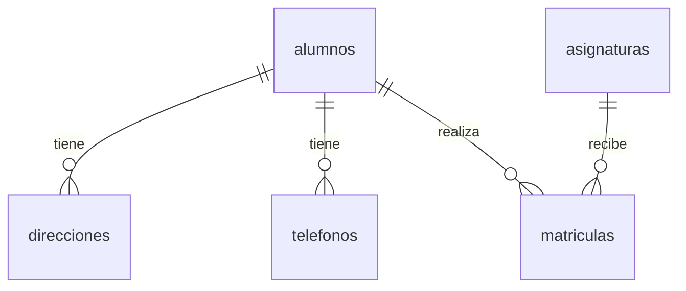

# MySQL desde cero: ordenador, Docker y nube

Guía práctica para una pequeña academia · Revisada el 24 de octubre de 2026.

## 1. Qué vamos a construir

Una base de datos llamada `academia_demo` con alumnos, asignaturas, matrículas, direcciones y teléfonos. Primero prepararemos MySQL; después crearemos las tablas, insertaremos datos y haremos consultas de dificultad creciente.

**Elige uno de los tres caminos de instalación. Después sigue el mismo laboratorio SQL de los apartados 5 y 6.** No necesitas instalar los tres ni repetir el código tres veces. Si pruebas los tres, tendrás tres bases independientes: no se sincronizan automáticamente.

| Camino | Dónde funciona el servidor | Dónde quedan los datos | Qué necesitas |
|---|---|---|---|
| Local | En tu ordenador, como servicio | Directorio de datos de MySQL | MySQL Community Server |
| Docker | En un contenedor de tu ordenador | Volumen de Docker | Docker Desktop o Docker Engine |
| Online | En un servidor del proveedor | Almacenamiento del proveedor | Cuenta gratuita y un cliente |

### Servidor y cliente no son lo mismo

- **Servidor MySQL (`mysqld`)**: guarda los datos y ejecuta las consultas. Tiene que estar arrancado.
- **Cliente `mysql`**: programa de terminal con el que enviamos SQL al servidor.
- **Cliente gráfico**: por ejemplo MySQL Workbench o DBeaver Community. Permite escribir SQL y ver resultados en tablas. Instalar solo un cliente no instala necesariamente el servidor.

Los bloques `sql` se pegan dentro del cliente MySQL o en su editor SQL. Los bloques `bash` y `powershell` se ejecutan en la terminal del sistema operativo. No copies los delimitadores de los bloques.

Usaremos MySQL **8.4 LTS** como referencia reproducible. Las consultas también sirven en MySQL 8.0 y versiones posteriores. En Ubuntu, la versión del repositorio puede ser distinta.

## 2. Camino A: instalar MySQL directamente en tu ordenador

Sigue únicamente el apartado de tu sistema operativo. Las contraseñas del documento son ejemplos de laboratorio: cámbialas por las tuyas.

### 2.1. Windows

1. Abre [MySQL Community Server](https://dev.mysql.com/downloads/mysql/).
2. Selecciona la rama 8.4 LTS, Windows y el paquete MSI compatible con tu equipo. Si aparece una pantalla de registro, utiliza la opción de descargar sin iniciar sesión cuando esté disponible.
3. Ejecuta el MSI. Instala el servidor y utiliza **MySQL Configurator** para configurarlo. En 8.4 esta es la ruta de referencia; no necesitas buscar el antiguo instalador todo-en-uno de 8.0.
4. Selecciona una configuración de desarrollo si aparece esa opción. Mantén TCP/IP y el puerto `3306`. Para practicar únicamente en tu ordenador no necesitas abrir el puerto a conexiones externas en el firewall.
5. Define y guarda la contraseña de `root`, el administrador de MySQL.
6. Configura el servicio de Windows —por ejemplo `MySQL84`— para arrancar automáticamente. Aplica los cambios.
7. Abre PowerShell y conecta. Si elegiste otra carpeta de instalación, ajusta la ruta:

```powershell
& "C:\Program Files\MySQL\MySQL Server 8.4\bin\mysql.exe" -u root -p
```

`-p` hace que pida la contraseña sin escribirla en el comando. Al teclearla no verás caracteres: es normal.

Si ya tienes la carpeta `bin` en el PATH, basta con `mysql -u root -p`.

Para comprobar el servicio, abre `services.msc` desde Inicio, localiza MySQL y verifica que esté en ejecución. El nombre exacto depende de lo que elegiste durante la instalación.

### 2.2. macOS

1. Abre [MySQL Community Server](https://dev.mysql.com/downloads/mysql/).
2. Elige macOS y un paquete DMG compatible con tu versión del sistema y procesador: ARM64 para Apple Silicon; x86_64 para Intel si hay paquete compatible. No instales un paquete para otra arquitectura o versión de macOS.
3. Abre el DMG y ejecuta el instalador PKG.
4. Completa la inicialización y guarda la contraseña de `root`. Utiliza la autenticación predeterminada.
5. Activa el arranque del servidor con el sistema si el instalador ofrece la opción.
6. Abre Terminal y conecta:

```bash
/usr/local/mysql/bin/mysql -u root -p
```

Si el servidor no se ha iniciado, utiliza su panel MySQL en los ajustes del sistema, cuando esté disponible, o el script de la instalación oficial:

```bash
sudo /usr/local/mysql/support-files/mysql.server start
```

Para detenerlo con ese script, sustituye `start` por `stop`. No inicialices de nuevo una instalación que ya contiene datos.

### 2.3. Ubuntu

En Terminal:

```bash
sudo apt update
sudo apt install mysql-server
sudo systemctl enable --now mysql
sudo systemctl status mysql
```

Si se abre un visor de estado, sal con `q`. Para entrar como administrador:

```bash
sudo mysql
```

En Ubuntu es habitual que `root` acceda mediante la identidad del usuario del sistema, sin contraseña MySQL. Por eso se utiliza `sudo mysql`.

Estos comandos son para Ubuntu con systemd. No son instrucciones universales para todas las distribuciones Linux.

### 2.4. Primera comprobación y usuario de prácticas —los tres sistemas—

Dentro de MySQL:

```sql
SELECT VERSION() AS version_mysql, CURRENT_USER() AS usuario;
```

Crea la base y un usuario limitado a ella. Ejecuta esto como administrador una sola vez, antes del laboratorio:

```sql
CREATE DATABASE IF NOT EXISTS academia_demo
  CHARACTER SET utf8mb4 COLLATE utf8mb4_unicode_ci;

CREATE USER 'profesor'@'localhost'
  IDENTIFIED BY 'Clase_Local_2026_Cambia';

GRANT ALL PRIVILEGES ON academia_demo.* TO 'profesor'@'localhost';
```

No necesitas `FLUSH PRIVILEGES` después de `CREATE USER` y `GRANT`.

Sal del cliente:

```sql
exit;
```

Vuelve a conectar como `profesor` usando el mismo ejecutable de tu sistema:

```bash
mysql -u profesor -p academia_demo
```

En Windows o macOS, si `mysql` no está en el PATH, utiliza la ruta completa mostrada antes y cambia los argumentos por `-u profesor -p academia_demo`.

**Siguiente paso:** ejecuta los apartados 5 y 6 en esta conexión. La base ya está creada; `CREATE DATABASE IF NOT EXISTS` puede repetirse.

## 3. Camino B: MySQL en Docker con persistencia

### 3.1. Preparar Docker

1. Instala [Docker Desktop](https://docs.docker.com/desktop/) para tu sistema compatible. En Windows utiliza contenedores Linux y el backend WSL 2 si lo solicita el instalador; puede requerir virtualización y reinicio.
2. Abre Docker Desktop y espera a que el motor esté listo. En Linux también puedes utilizar [Docker Engine](https://docs.docker.com/engine/install/).
3. En Terminal o PowerShell comprueba:

```bash
docker version
docker run --rm hello-world
```

`docker version` debe mostrar información del cliente y del servidor. Si el cliente no conecta, comprueba que Docker esté iniciado.

### 3.2. Crear un volumen y arrancar MySQL

Los siguientes comandos están en una sola línea para que sirvan en Bash y PowerShell:

```bash
docker volume create academia_mysql_datos
docker run --name mysql-academia -e MYSQL_ROOT_PASSWORD=Root_Demo_2026_Cambia -e MYSQL_DATABASE=academia_demo -e MYSQL_USER=profesor -e MYSQL_PASSWORD=Clase_Docker_2026_Cambia -p 127.0.0.1:3307:3306 -v academia_mysql_datos:/var/lib/mysql -d mysql:8.4
```

| Parte | Significado |
|---|---|
| `--name mysql-academia` | Nombre del contenedor |
| `mysql:8.4` | Imagen oficial de MySQL en la rama 8.4 |
| `-d` | Ejecutar en segundo plano |
| `MYSQL_ROOT_PASSWORD` | Contraseña inicial del administrador |
| `MYSQL_DATABASE` | Base que se crea al inicializar |
| `MYSQL_USER` y `MYSQL_PASSWORD` | Usuario inicial con permisos sobre esa base |
| `127.0.0.1:3307:3306` | Puerto 3307 del ordenador hacia el 3306 del contenedor; accesible localmente |
| `academia_mysql_datos:/var/lib/mysql` | Monta el volumen donde MySQL guarda sus datos |

Usamos `3307` en tu ordenador para no chocar con una instalación local que ya use `3306`. La etiqueta `8.4` recibe revisiones; no fija un parche exacto.

Comprueba el arranque:

```bash
docker ps
docker logs mysql-academia
```

La primera inicialización puede tardar. Espera al mensaje final de servidor listo para conexiones; durante la preparación pueden aparecer mensajes de un servidor temporal.

### 3.3. Entrar y cargar el ejemplo

No necesitas instalar el cliente MySQL en tu ordenador: ya viene dentro de la imagen.

```bash
docker exec -it mysql-academia mysql -u profesor -p academia_demo
```

Introduce `Clase_Docker_2026_Cambia`, o la contraseña que hayas elegido.

```sql
SELECT VERSION(), DATABASE();
```

**Ahora ejecuta los apartados 5 y 6 aquí.** Después regresa al siguiente apartado para comprobar la persistencia.

Si prefieres un cliente gráfico en tu ordenador, conecta a `127.0.0.1`, puerto `3307`, usuario `profesor`, base `academia_demo`. Dentro del contenedor MySQL sigue escuchando en `3306`.

### 3.4. Prueba real: borrar el contenedor conservando los datos

Después de insertar los datos del apartado 5:

```sql
SELECT COUNT(*) AS total_alumnos FROM academia_demo.alumnos;
```

Resultado esperado: `4`. Sal con `exit;` y ejecuta en la terminal:

```bash
docker stop mysql-academia
docker rm mysql-academia
docker volume ls
```

El contenedor ya no existe, pero el volumen `academia_mysql_datos` sigue ahí.

Recrea el contenedor con el mismo volumen:

```bash
docker run --name mysql-academia -p 127.0.0.1:3307:3306 -v academia_mysql_datos:/var/lib/mysql -d mysql:8.4
```

No hace falta repetir las variables de inicialización: la base y sus usuarios ya están en el volumen. Espera al arranque y conecta:

```bash
docker exec -it mysql-academia mysql -u profesor -p academia_demo
```

Usa la contraseña anterior. Sin volver a crear tablas ni insertar nada:

```sql
SELECT COUNT(*) AS total_alumnos FROM alumnos;
```

**Debe seguir devolviendo `4`.** Esa es la prueba de persistencia.

### 3.5. Qué conserva y qué elimina cada comando

| Acción | Comando | ¿Se conservan los datos del volumen? |
|---|---|---|
| Parar | `docker stop mysql-academia` | Sí |
| Arrancar el contenedor existente | `docker start mysql-academia` | Sí |
| Borrar el contenedor parado | `docker rm mysql-academia` | Sí |
| Inspeccionar el volumen | `docker volume inspect academia_mysql_datos` | Sí, solo muestra información |
| Borrar el volumen sin contenedores asociados | `docker volume rm academia_mysql_datos` | **No: elimina los datos** |

Un volumen persiste respecto al ciclo de vida del contenedor; no es una copia de seguridad. Puede perderse si eliminas el volumen o el almacenamiento de Docker. Con Docker Desktop suele estar dentro de su máquina virtual Linux: no necesitas manipular sus ficheros manualmente.

**Cambiar `MYSQL_PASSWORD` al recrear un contenedor no cambia la contraseña guardada en un volumen existente.** Esas variables sirven para la primera inicialización. Para cambiar una contraseña existente hay que hacerlo en MySQL con permisos adecuados.

### 3.6. Copia de seguridad sencilla, sin problemas de redirección en PowerShell

Crea un volcado SQL dentro del contenedor. El comando pedirá la contraseña de `profesor`:

```bash
docker exec -it mysql-academia mysqldump -u profesor -p --single-transaction --no-tablespaces --set-gtid-purged=OFF --result-file=/tmp/academia_backup.sql academia_demo
docker cp mysql-academia:/tmp/academia_backup.sql ./academia_backup.sql
```

El archivo queda en la carpeta actual de tu ordenador. Para este laboratorio basta con un volcado sin cambios simultáneos de estructura.

Para restaurarlo en una base `academia_demo` de pruebas ya creada:

```bash
docker cp ./academia_backup.sql mysql-academia:/tmp/academia_backup.sql
docker exec -it mysql-academia mysql -u profesor -p academia_demo
```

Dentro del cliente:

```sql
SOURCE /tmp/academia_backup.sql;
```

**El volcado puede reemplazar tablas del mismo nombre.** Restaura únicamente donde quieras recuperar ese contenido.

### 3.7. Alternativa opcional: Docker Compose

No ejecutes esta alternativa a la vez que el contenedor anterior: ambos publicarían el puerto 3307. Puedes seguir utilizando solo `docker run`.

Si quieres pasar a Compose conservando los datos, para y elimina el contenedor anterior; conserva el volumen. Crea una carpeta y guarda en ella un archivo llamado `compose.yaml`:

```yaml
services:
  mysql:
    image: mysql:8.4
    environment:
      MYSQL_ROOT_PASSWORD: Root_Demo_2026_Cambia
      MYSQL_DATABASE: academia_demo
      MYSQL_USER: profesor
      MYSQL_PASSWORD: Clase_Docker_2026_Cambia
    ports:
      - "127.0.0.1:3307:3306"
    volumes:
      - datos:/var/lib/mysql

volumes:
  datos:
    external: true
    name: academia_mysql_datos
```

Utilizamos el volumen externo creado antes. Si empiezas directamente por Compose, ejecuta primero `docker volume create academia_mysql_datos`.

Desde la carpeta del archivo:

```bash
docker compose up -d
docker compose logs mysql
docker compose exec mysql mysql -u profesor -p academia_demo
```

Para desmontar el servicio:

```bash
docker compose down
```

El volumen externo se conserva. En este ejemplo incluso `down -v` no elimina ese volumen externo; con volúmenes administrados por Compose, `down -v` sí puede borrar los datos. No reutilices ese comando sin entender cómo están definidos tus volúmenes.

## 4. Camino C: MySQL online gratuito

### 4.1. Una opción comparable a Atlas para este ejercicio

**Aiven for MySQL Free** ofrece MySQL gestionado. A fecha de revisión, sus páginas oficiales indican: 1 CPU, 1 GB RAM, 1 GB de almacenamiento, sin tarjeta y sin límite temporal del plan. Es adecuado para aprender y para cargas ligeras.

Tiene límites: un servicio por tipo y organización, máximo de 76 conexiones y sin SLA ni soporte del plan de pago. El proveedor advierte de posibles apagados por inactividad prolongada. Comprueba las condiciones al registrarte: pueden cambiar. No confundas el plan **Free** con una prueba temporal de un plan de pago.

Fuentes: [presentación del plan gratuito](https://aiven.io/free-mysql-database), [límites oficiales](https://aiven.io/docs/products/mysql/concepts/mysql-free-tier) y [planes e inactividad](https://aiven.io/).

### 4.2. Crear el servicio y conectar

1. Regístrate en [Aiven](https://console.aiven.io/).
2. Crea un servicio de tipo **MySQL** y selecciona explícitamente **Free**. Elige una región disponible cercana.
3. Espera a que esté listo. En su información de conexión copia **host**, **puerto**, **usuario**, **contraseña** y descarga el certificado CA si lo proporciona.
4. Si el servicio aplica restricciones de red, autoriza tu IP pública actual.
5. Instala un cliente gráfico como [DBeaver Community](https://dbeaver.io/download/), crea una conexión MySQL e introduce esos datos. Permite descargar el controlador MySQL si lo solicita.
6. Configura SSL/TLS en la conexión utilizando la CA del proveedor y la verificación del certificado y del nombre del servidor. Sigue los parámetros que muestre Aiven; no desactives la validación para resolver errores.
7. Prueba la conexión y abre un editor SQL asociado a ella.

El servidor está online, pero puedes manejarlo desde un cliente instalado en tu ordenador. No necesitas instalar un servidor MySQL local.

Si tienes el cliente de terminal oficial, puedes conectar así, sustituyendo `HOST_REAL` y `PUERTO_REAL` por los valores del panel. Ajusta también el usuario si es diferente de `avnadmin`:

```bash
mysql --host=HOST_REAL --port=PUERTO_REAL --user=avnadmin --password --ssl-mode=VERIFY_IDENTITY --ssl-ca=ca.pem
```

Ejecuta el comando desde la carpeta donde guardaste `ca.pem`, o utiliza su ruta completa. `--password` pide la clave de forma interactiva.

### 4.3. Crear nuestra base y ejecutar el laboratorio

En el editor SQL o en el cliente conectado a Aiven:

```sql
CREATE DATABASE IF NOT EXISTS academia_demo
  CHARACTER SET utf8mb4 COLLATE utf8mb4_unicode_ci;
USE academia_demo;
SELECT VERSION(), DATABASE();
```

**Continúa con los apartados 5 y 6 sin modificar sus tablas ni consultas.** Utiliza el usuario del servicio, no el `root` de tu ordenador ni el `profesor` de Docker.

Si un proveedor o usuario distinto no permite crear bases, utiliza la base que te haya asignado: omite `CREATE DATABASE` y cambia `USE academia_demo` por `USE nombre_asignado`. En las consultas posteriores usamos nombres de tabla sin prefijo para facilitarlo.

## 5. Laboratorio común: crear la academia y sus datos

### 5.1. El modelo, antes del código

| Tabla | Qué representa | Relación |
|---|---|---|
| `alumnos` | Una fila por alumno | Tabla principal |
| `direcciones` | Domicilios de cada alumno | Un alumno puede tener 0, 1 o varias direcciones |
| `telefonos` | Teléfonos de cada alumno | Un alumno puede tener 0, 1 o varios teléfonos |
| `asignaturas` | Catálogo de materias | Una fila por asignatura |
| `matriculas` | Qué alumno cursa qué asignatura | Une alumnos y asignaturas: relación N:M |

En este modelo las direcciones y los teléfonos pertenecen a los alumnos. Una matrícula representa la pareja alumno–asignatura; para simplificar no modelamos cursos académicos ni repeticiones.



No guardamos teléfonos separados por comas en una celda. Cada teléfono ocupa una fila y apunta a su alumno. Así podemos buscarlo, modificarlo o eliminarlo sin partir cadenas de texto.

### 5.2. Crear la base y las tablas

Ejecuta el siguiente bloque **una sola vez en cada instalación nueva**. No borra datos existentes. Si ya ejecutaste la creación de tablas, no la repitas: continúa con las consultas. Más adelante hay un reinicio opcional explícito.

```sql
CREATE DATABASE IF NOT EXISTS academia_demo
  CHARACTER SET utf8mb4 COLLATE utf8mb4_unicode_ci;
USE academia_demo;

CREATE TABLE alumnos (
    id INT AUTO_INCREMENT PRIMARY KEY,
    nombre VARCHAR(80) NOT NULL,
    email VARCHAR(120) NOT NULL UNIQUE
) ENGINE=InnoDB;

CREATE TABLE asignaturas (
    id INT AUTO_INCREMENT PRIMARY KEY,
    nombre VARCHAR(100) NOT NULL UNIQUE,
    creditos INT NOT NULL
) ENGINE=InnoDB;

CREATE TABLE direcciones (
    id INT AUTO_INCREMENT PRIMARY KEY,
    alumno_id INT NOT NULL,
    calle VARCHAR(150) NOT NULL,
    ciudad VARCHAR(80) NOT NULL,
    codigo_postal VARCHAR(12) NOT NULL,
    FOREIGN KEY (alumno_id) REFERENCES alumnos(id)
) ENGINE=InnoDB;

CREATE TABLE telefonos (
    id INT AUTO_INCREMENT PRIMARY KEY,
    alumno_id INT NOT NULL,
    numero VARCHAR(25) NOT NULL,
    tipo VARCHAR(20) NOT NULL,
    FOREIGN KEY (alumno_id) REFERENCES alumnos(id),
    UNIQUE (alumno_id, numero)
) ENGINE=InnoDB;

CREATE TABLE matriculas (
    alumno_id INT NOT NULL,
    asignatura_id INT NOT NULL,
    nota DECIMAL(4,2) NULL,
    PRIMARY KEY (alumno_id, asignatura_id),
    FOREIGN KEY (alumno_id) REFERENCES alumnos(id),
    FOREIGN KEY (asignatura_id) REFERENCES asignaturas(id),
    CHECK (nota BETWEEN 0 AND 10)
) ENGINE=InnoDB;
```

Claves para leer el código:

- `PRIMARY KEY`: identifica una fila sin ambigüedad.
- `AUTO_INCREMENT`: MySQL puede generar el siguiente identificador.
- `FOREIGN KEY`: impide que una dirección o matrícula apunte a un alumno inexistente.
- `NOT NULL`: el dato es obligatorio; `UNIQUE`: no puede repetirse.
- `VARCHAR`: texto de longitud variable. Teléfonos y códigos postales son texto porque pueden contener prefijos, espacios o ceros iniciales.
- `DECIMAL(4,2)`: hasta cuatro cifras en total, dos de ellas decimales; permite `10.00`.
- `NULL` en la nota: todavía no hay calificación. No significa cero.
- La clave primaria doble en `matriculas` impide matricular dos veces al mismo alumno en la misma asignatura.
- `CHECK` limita la nota numérica entre 0 y 10; permite el `NULL` declarado.

Las claves foráneas no incluyen borrado en cascada: si intentas borrar un alumno con datos dependientes, MySQL lo impedirá. Es una elección sencilla para no borrar información relacionada por accidente.

### 5.3. Insertar datos ficticios

Usamos identificadores explícitos para que el ejemplo sea fácil de seguir. En una aplicación puedes omitir `id` y dejar que `AUTO_INCREMENT` lo asigne.

```sql
INSERT INTO alumnos (id, nombre, email) VALUES
(1, 'Ana',   'ana@example.com'),
(2, 'Luis',  'luis@example.com'),
(3, 'Marta', 'marta@example.com'),
(4, 'Pablo', 'pablo@example.com');

INSERT INTO asignaturas (id, nombre, creditos) VALUES
(1, 'Bases de datos', 6),
(2, 'Programacion', 6),
(3, 'Redes', 4),
(4, 'Inteligencia artificial', 6);

INSERT INTO direcciones (id, alumno_id, calle, ciudad, codigo_postal) VALUES
(1, 1, 'Calle Sol 10',      'Murcia', '30001'),
(2, 1, 'Calle Luna 5',      'Madrid', '28001'),
(3, 2, 'Avenida Mar 20',    'Murcia', '30002'),
(4, 3, 'Calle Universidad 8', 'Valencia', '46001');

INSERT INTO telefonos (id, alumno_id, numero, tipo) VALUES
(1, 1, '+34 600 000 001', 'movil'),
(2, 1, '+34 910 000 001', 'casa'),
(3, 2, '+34 600 000 002', 'movil');

INSERT INTO matriculas (alumno_id, asignatura_id, nota) VALUES
(1, 1, 8.50),
(1, 2, 9.00),
(2, 1, 6.00),
(2, 3, NULL),
(3, 2, 7.50);
```

Hay ausencias intencionadas: Pablo no tiene matrículas ni direcciones; Marta y Pablo no tienen teléfono; Inteligencia artificial no tiene alumnos. Nos servirán para entender `LEFT JOIN`.

### 5.4. Comprobar que todo está preparado

```sql
SHOW TABLES;
DESCRIBE alumnos;

SELECT 'alumnos' AS tabla, COUNT(*) AS filas FROM alumnos
UNION ALL
SELECT 'asignaturas', COUNT(*) FROM asignaturas
UNION ALL
SELECT 'direcciones', COUNT(*) FROM direcciones
UNION ALL
SELECT 'telefonos', COUNT(*) FROM telefonos
UNION ALL
SELECT 'matriculas', COUNT(*) FROM matriculas;
```

Debes obtener 5 tablas y estos recuentos: alumnos `4`, asignaturas `4`, direcciones `4`, teléfonos `3`, matrículas `5`. `UNION ALL` simplemente coloca los resultados uno debajo de otro.

## 6. Consultas de menos a más

Si acabas de abrir una conexión nueva, selecciona primero la base:

```sql
USE academia_demo;
```

### Nivel 1. Ver los alumnos

```sql
SELECT *
FROM alumnos
ORDER BY id;
```

`SELECT` elige las columnas; `*` significa todas; `FROM` indica la tabla. `ORDER BY` garantiza el orden solicitado. Sin él, no debes asumir un orden de salida.

### Nivel 2. Elegir columnas y filtrar

```sql
SELECT nombre, email
FROM alumnos
WHERE nombre = 'Ana';
```

Resultado: Ana y `ana@example.com`.

```sql
SELECT nombre, creditos
FROM asignaturas
WHERE creditos >= 6
ORDER BY nombre
LIMIT 2;
```

Filtra materias de al menos 6 créditos, las ordena y devuelve como máximo dos. Resultado: Bases de datos e Inteligencia artificial.

### Nivel 3. JOIN: alumnos que tienen teléfono

```sql
SELECT a.nombre, t.numero, t.tipo
FROM alumnos AS a
INNER JOIN telefonos AS t ON t.alumno_id = a.id
ORDER BY a.id, t.id;
```

`a` y `t` son alias cortos. `ON` expresa cómo encajan las filas. `INNER JOIN` —también escrito `JOIN`— solo devuelve coincidencias.

| nombre | numero | tipo |
|---|---|---|
| Ana | +34 600 000 001 | movil |
| Ana | +34 910 000 001 | casa |
| Luis | +34 600 000 002 | movil |

Ana aparece dos veces porque tiene dos teléfonos. No es un error ni una duplicación de su registro en `alumnos`. Marta y Pablo no aparecen porque no hay coincidencia en `telefonos`.

### Nivel 4. LEFT JOIN: conservar también a quienes no tienen teléfono

```sql
SELECT a.nombre, t.numero, t.tipo
FROM alumnos AS a
LEFT JOIN telefonos AS t ON t.alumno_id = a.id
ORDER BY a.id, t.id;
```

| nombre | numero | tipo |
|---|---|---|
| Ana | +34 600 000 001 | movil |
| Ana | +34 910 000 001 | casa |
| Luis | +34 600 000 002 | movil |
| Marta | NULL | NULL |
| Pablo | NULL | NULL |

`LEFT JOIN` conserva todas las filas de la tabla izquierda (`alumnos`). Cuando no hay teléfono, rellena las columnas de la derecha con `NULL`.

Para mostrar un texto más amigable:

```sql
SELECT a.nombre, COALESCE(t.numero, 'Sin telefono') AS telefono
FROM alumnos AS a
LEFT JOIN telefonos AS t ON t.alumno_id = a.id
ORDER BY a.id, t.id;
```

`COALESCE` devuelve el primer valor que no sea `NULL`. Solo cambia la presentación, no los datos almacenados.

### Nivel 5. Encontrar alumnos sin teléfono

```sql
SELECT a.id, a.nombre
FROM alumnos AS a
LEFT JOIN telefonos AS t ON t.alumno_id = a.id
WHERE t.id IS NULL
ORDER BY a.id;
```

Resultado: Marta y Pablo. Se escribe `IS NULL`, no `= NULL`.

### Nivel 6. Unir tres tablas: alumnos y asignaturas

```sql
SELECT a.nombre AS alumno, s.nombre AS asignatura, m.nota
FROM alumnos AS a
JOIN matriculas AS m ON m.alumno_id = a.id
JOIN asignaturas AS s ON s.id = m.asignatura_id
ORDER BY a.id, s.id;
```

La tabla `matriculas` hace de puente: indica qué identificadores de alumnos y asignaturas están relacionados.

| alumno | asignatura | nota |
|---|---|---|
| Ana | Bases de datos | 8.50 |
| Ana | Programacion | 9.00 |
| Luis | Bases de datos | 6.00 |
| Luis | Redes | NULL |
| Marta | Programacion | 7.50 |

Luis sí está matriculado en Redes: lo que falta es la nota. Pablo no aparece porque no está matriculado.

### Nivel 7. Mostrar también alumnos sin matrícula

```sql
SELECT a.nombre AS alumno,
       COALESCE(s.nombre, 'Sin matricula') AS asignatura,
       m.nota
FROM alumnos AS a
LEFT JOIN matriculas AS m ON m.alumno_id = a.id
LEFT JOIN asignaturas AS s ON s.id = m.asignatura_id
ORDER BY a.id, s.id;
```

Obtendrás las cinco filas anteriores y una para Pablo con `Sin matricula` y nota `NULL`. Mantén ambos enlaces como `LEFT JOIN`: un `INNER JOIN` posterior sobre la asignatura descartaría la fila sin matrícula.

### Nivel 8. Contar matrículas y calcular la media por alumno

```sql
SELECT a.nombre,
       COUNT(m.asignatura_id) AS total_asignaturas,
       ROUND(AVG(m.nota), 2) AS nota_media
FROM alumnos AS a
LEFT JOIN matriculas AS m ON m.alumno_id = a.id
GROUP BY a.id, a.nombre
ORDER BY a.id;
```

| nombre | total_asignaturas | nota_media |
|---|---:|---:|
| Ana | 2 | 8.75 |
| Luis | 2 | 6.00 |
| Marta | 1 | 7.50 |
| Pablo | 0 | NULL |

`GROUP BY` forma un grupo por alumno. `AVG` ignora los valores `NULL`: la media de Luis se calcula solo con su nota disponible. Para Pablo no existe ninguna nota.

**Aquí no uses `COUNT(*)` para contar matrículas:** contaría también la fila conservada de Pablo y devolvería 1. `COUNT(m.asignatura_id)` cuenta únicamente valores no nulos y devuelve 0.

### Nivel 9. Contar alumnos por asignatura, incluyendo las vacías

```sql
SELECT s.nombre, COUNT(m.alumno_id) AS total_alumnos
FROM asignaturas AS s
LEFT JOIN matriculas AS m ON m.asignatura_id = s.id
GROUP BY s.id, s.nombre
ORDER BY s.id;
```

Resultado: Bases de datos `2`, Programacion `2`, Redes `1`, Inteligencia artificial `0`.

Para quedarte solo con materias con al menos dos alumnos:

```sql
SELECT s.nombre, COUNT(m.alumno_id) AS total_alumnos
FROM asignaturas AS s
LEFT JOIN matriculas AS m ON m.asignatura_id = s.id
GROUP BY s.id, s.nombre
HAVING COUNT(m.alumno_id) >= 2
ORDER BY s.id;
```

`WHERE` filtra filas antes de agrupar; `HAVING` filtra grupos después de calcular sus agregados.

### Nivel 10. Direcciones: alumnos que viven en Murcia

```sql
SELECT a.nombre, d.calle, d.ciudad
FROM alumnos AS a
JOIN direcciones AS d ON d.alumno_id = a.id
WHERE d.ciudad = 'Murcia'
ORDER BY a.id, d.id;
```

Resultado: Ana en Calle Sol 10 y Luis en Avenida Mar 20.

Para obtener solo nombres de alumnos sin repetirlos si alguien tuviera varias direcciones en Murcia:

```sql
SELECT DISTINCT a.id, a.nombre
FROM alumnos AS a
JOIN direcciones AS d ON d.alumno_id = a.id
WHERE d.ciudad = 'Murcia'
ORDER BY a.id;
```

### Dos trampas frecuentes con los JOIN

**1. Poner el filtro de la derecha en `WHERE` puede eliminar las filas sin coincidencia.**

Si quieres todos los alumnos y únicamente sus teléfonos móviles cuando existan:

```sql
SELECT a.nombre, t.numero AS movil
FROM alumnos AS a
LEFT JOIN telefonos AS t
  ON t.alumno_id = a.id AND t.tipo = 'movil'
ORDER BY a.id, t.id;
```

Así Marta y Pablo permanecen. Si escribieras `WHERE t.tipo = 'movil'`, sus filas con `NULL` desaparecerían.

**2. Unir varias relaciones 1:N multiplica las combinaciones.**

```sql
SELECT a.nombre, d.calle, t.numero
FROM alumnos AS a
LEFT JOIN direcciones AS d ON d.alumno_id = a.id
LEFT JOIN telefonos AS t ON t.alumno_id = a.id
WHERE a.id = 1
ORDER BY d.id, t.id;
```

Ana tiene dos direcciones y dos teléfonos: salen **cuatro filas** (2 × 2). El modelo no indica que un teléfono pertenezca a una dirección concreta. Para una ficha sencilla, consulta direcciones y teléfonos por separado; no sumes ni cuentes esas filas como si fueran entidades diferentes.

## 7. Cambiar datos sin dejar alterado el ejemplo

Las tablas usan InnoDB, que permite transacciones. Prueba:

```sql
START TRANSACTION;

UPDATE matriculas
SET nota = 9.50
WHERE alumno_id = 1 AND asignatura_id = 1;

SELECT * FROM matriculas
WHERE alumno_id = 1 AND asignatura_id = 1;

ROLLBACK;

SELECT * FROM matriculas
WHERE alumno_id = 1 AND asignatura_id = 1;
```

La primera consulta muestra `9.50`; después de `ROLLBACK` vuelve a `8.50`. Para guardar el cambio usarías `COMMIT` en lugar de `ROLLBACK`.

Otro ejemplo reversible:

```sql
START TRANSACTION;
DELETE FROM telefonos WHERE id = 2;
SELECT * FROM telefonos WHERE alumno_id = 1;
ROLLBACK;
```

Sin `WHERE`, `UPDATE` o `DELETE` afectarían a todas las filas. Las transacciones de este apartado son para modificaciones de datos; no asumas que permiten deshacer `CREATE TABLE`, `DROP TABLE` u otras operaciones de estructura de MySQL.

## 8. Cómo ejecutar bloques o archivos SQL

### Pegando código

En el cliente `mysql`, pega un bloque SQL completo y pulsa Intro si hace falta. Las sentencias terminan con `;`. Si ves el indicador de continuación `->`, normalmente falta terminar la sentencia. Puedes cancelar la entrada actual con `\c`.

En un cliente gráfico, abre un editor de la conexión elegida, pega el código y utiliza la acción de ejecutar script para bloques con varias sentencias. La acción de ejecutar sentencia puede lanzar solo la consulta donde esté el cursor.

### Guardándolo como archivo

Copia únicamente el SQL de creación e inserción del apartado 5, sin explicaciones ni delimitadores Markdown, en `academia.sql`. Guárdalo en UTF-8.

Desde el cliente MySQL local, usa la ruta real del archivo. Por ejemplo, en Windows:

```sql
SOURCE C:/practicas/academia.sql;
```

En macOS o Linux, utiliza su ruta absoluta, por ejemplo `/home/tu_usuario/practicas/academia.sql` en Linux. `SOURCE` es una orden del cliente `mysql`, no SQL que todos los editores gráficos reconozcan. En un editor gráfico abre el archivo y ejecuta el script.

Para Docker, copia el archivo al contenedor antes de abrirlo:

```bash
docker cp ./academia.sql mysql-academia:/tmp/academia.sql
docker exec -it mysql-academia mysql -u profesor -p academia_demo
```

Después, dentro del cliente:

```sql
SOURCE /tmp/academia.sql;
```

En la conexión online, `SOURCE` del cliente oficial lee un archivo de **tu ordenador** y envía sus sentencias al servidor remoto; no necesitas subirlo al disco del proveedor.

## 9. Problemas frecuentes

| Mensaje o síntoma | Qué revisar |
|---|---|
| `mysql` no se reconoce | Usa la ruta completa del ejecutable o añade su carpeta `bin` al PATH |
| `Can't connect` / conexión rechazada | Servicio iniciado, host y puerto correctos; espera a la inicialización de Docker |
| `Access denied` | Usuario, contraseña y permisos; en Ubuntu prueba el acceso administrativo con `sudo mysql` |
| Puerto ocupado | Local usa 3306; Docker usa 3307. Cambia el puerto del ordenador si también está ocupado |
| Nombre de contenedor ya utilizado | Arranca el existente con `docker start mysql-academia`; no vuelvas a crearlo con el mismo nombre |
| `Unknown database` | Crea o selecciona la base en el servidor correcto |
| `No database selected` | Ejecuta `USE academia_demo;` en la conexión actual |
| `Table already exists` | Ya ejecutaste la creación: pasa a consultas o reinicia conscientemente el laboratorio |
| `Duplicate entry` al insertar | Probablemente repetiste los INSERT; no necesitas cargarlos de nuevo |
| Error de clave foránea | El alumno o asignatura referenciado no existe; inserta primero las tablas principales |
| Cambié la contraseña en Docker y no funciona | El volumen conserva la contraseña original; las variables no la reemplazan |
| Error TLS online | Comprueba host, CA y configuración SSL del proveedor; no desactives la verificación |

### Reinicio opcional del laboratorio

**Este bloque elimina las cinco tablas de prácticas y todo su contenido.** Ejecútalo solo si quieres volver a empezar y has confirmado que estás en tu base de pruebas:

```sql
USE academia_demo;
SELECT DATABASE();
```

Después de comprobar el nombre:

```sql
DROP TABLE IF EXISTS matriculas;
DROP TABLE IF EXISTS telefonos;
DROP TABLE IF EXISTS direcciones;
DROP TABLE IF EXISTS asignaturas;
DROP TABLE IF EXISTS alumnos;
```

Se borran primero las tablas dependientes para respetar las claves foráneas. Después puedes repetir la creación y los INSERT del apartado 5. No hace falta eliminar el volumen para reiniciar estas tablas.

## 10. Pequeños retos para el lector

1. Mostrar los alumnos cuyo nombre empiece por `M`. Pista: `LIKE 'M%'`. Resultado: Marta.
2. Mostrar alumnos sin direcciones. Pista: `LEFT JOIN` e `IS NULL`. Resultado: Pablo.
3. Mostrar matrículas sin nota. Pista: `nota IS NULL`. Resultado: Luis en Redes.
4. Mostrar alumnos de Bases de datos con nota de al menos 7. Resultado: Ana.
5. Obtener la media de cada asignatura, incluyendo las que no tienen matrículas. Resultado: Bases de datos `7.25`, Programacion `8.25`, Redes `NULL`, Inteligencia artificial `NULL`.

## 11. Fuentes y alcance de la revisión

Documentación oficial consultada para instalación, persistencia y oferta online:

- [Descargas MySQL Community Server](https://dev.mysql.com/downloads/mysql/).
- [MySQL 8.4: instalación en Windows](https://dev.mysql.com/doc/refman/8.4/en/windows-installation.html).
- [MySQL 8.4: paquetes nativos de macOS](https://dev.mysql.com/doc/refman/8.4/en/macos-installation-pkg.html).
- [Ubuntu: instalar MySQL](https://ubuntu.com/server/docs/how-to/databases/install-mysql/).
- [Imagen oficial MySQL para Docker](https://hub.docker.com/_/mysql).
- [Docker: trabajar con bases de datos](https://docs.docker.com/guides/databases/).
- [Aiven: MySQL gratuito](https://aiven.io/free-mysql-database).
- [Aiven: características y límites del plan gratuito MySQL](https://aiven.io/docs/products/mysql/concepts/mysql-free-tier).

El SQL y los resultados esperados se han revisado para que sean coherentes con los datos del ejemplo. No se ha ejecutado una instancia real de MySQL ni creado una cuenta Aiven durante la preparación de este documento. Los resultados son los esperados; los nombres y pantallas de los instaladores pueden variar.
