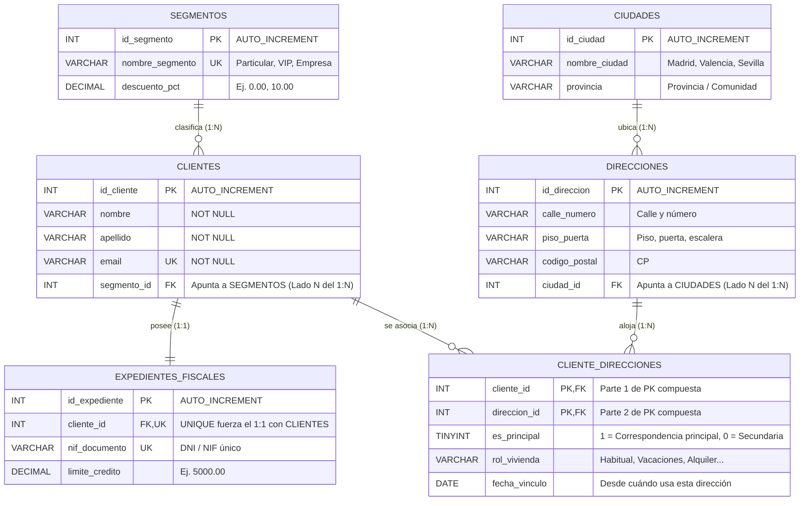

# Reflexión Didáctica: Cómo Modelar un Entidad-Relación (1:1, 1:N, N:M) y sus Implicaciones en SQL

> **El dilema real de clase:** Nada más empezar a hablar de SQL con los alumnos, planteamos un escenario aparentemente inocente: crear una tabla de `clientes` (nombre, apellido...) y otra de `direcciones` (calle, ciudad...).
>
> La primera gran pregunta que surgió en el aula fue: **«¿Dónde ponemos la Clave Foránea (FK)? ¿En la tabla `clientes` apuntando a una dirección, o en la tabla `direcciones` apuntando a un cliente?»**
>
> Al principio pensamos que era un **1:N** porque *"un cliente puede tener varias casas (residencia habitual, casa de verano...)"*, lo que nos llevaba a poner el `cliente_id` dentro de `direcciones`. Pero un segundo después alguien levantó la mano: *"¿Y qué pasa si en esa misma casa viven varios clientes de nuestra base de datos (una pareja, compañeros de piso, una familia)?"*. En ese instante nos dimos cuenta de que en una casa también puede haber **N** clientes. Estábamos ante una relación **N:M (Muchos a Muchos)**. Y no solo eso: al crear la tabla intermedia para unir clientes con casas, descubrimos que necesitábamos una columna extra (un *flag* o indicador booleano) para saber cuál de todas sus casas es la **dirección principal** a la que enviar la correspondencia, evitando que salgan filas duplicadas cuando hacemos un listado de envíos postales.

En este documento vamos a desgranar paso a paso esta reflexión, sin dar absolutamente nada por sentado: desde qué es una **PK** y una **FK**, pasando por ejemplos triviales de relaciones **1:1** y **1:N**, hasta llegar al diseño completo **N:M** en MySQL con datos reales, consultas `JOIN`, el problema de la multiplicación de filas ("duplicados") y cómo resolverlo con elegancia.

---

## 📌 Índice

1. [Conceptos Fundamentales: No demos nada por sabido](#1-conceptos-fundamentales-no-demos-nada-por-sabido)
   - [¿Qué es una Entidad, una Tabla y una Tupla (Fila)?](#qué-es-una-entidad-una-tabla-y-una-tupla-fila)
   - [¿Qué es una PK (Primary Key / Clave Primaria)?](#qué-es-una-pk-primary-key--clave-primaria)
   - [¿Qué es una FK (Foreign Key / Clave Foránea o Ajena)?](#qué-es-una-fk-foreign-key--clave-foránea-o-ajena)
   - [¿Qué es la Cardinalidad?](#qué-es-la-cardinalidad)
2. [La Evolución del Pensamiento en Clase: El Dilema Clientes-Direcciones](#2-la-evolución-del-pensamiento-en-clase-el-dilema-clientes-direcciones)
   - [Intento 1: Todo en una sola tabla (El caos de la desnormalización)](#intento-1-todo-en-una-sola-tabla-el-caos-de-la-desnormalización)
   - [Intento 2: La FK en `clientes` (1 Dirección -> N Clientes)](#intento-2-la-fk-en-clientes-1-dirección---n-clientes)
   - [Intento 3: La FK en `direcciones` (1 Cliente -> N Direcciones)](#intento-3-la-fk-en-direcciones-1-cliente---n-direcciones)
   - [La Revelación: Relación N:M con atributos en la relación (`es_principal`)](#la-revelación-relación-nm-con-atributos-en-la-relación-es_principal)
3. [Los 3 Tipos de Relaciones en el Modelo Entidad-Relación (MER)](#3-los-3-tipos-de-relaciones-en-el-modelo-entidad-relación-mer)
   - [Caso A: Relación 1:1 (Uno a Uno) Trivial — `clientes` y `expedientes_fiscales`](#caso-a-relación-11-uno-a-uno-trivial--clientes-y-expedientes_fiscales)
   - [Caso B: Relación 1:N (Uno a Muchos) Trivial — `segmentos` y `clientes`](#caso-b-relación-1n-uno-a-muchos-trivial--segmentos-y-clientes)
   - [Caso C: Relación N:M (Muchos a Muchos) — `clientes` y `direcciones` a través de `cliente_direcciones`](#caso-c-relación-nm-muchos-a-muchos--clientes-y-direcciones-a-través-de-cliente_direcciones)
   - [Diagrama Entidad-Relación Completo](#diagrama-entidad-relación-completo)
4. [Laboratorio Práctico en MySQL: Definición del Esquema (DDL)](#4-laboratorio-práctico-en-mysql-definición-del-esquema-ddl)
5. [Poblando la Base de Datos (DML): Clientes, Dimensiones y Casas](#5-poblando-la-base-de-datos-dml-clientes-dimensiones-y-casas)
6. [Consultas SQL (`JOIN`), el Problema de los Duplicados y Cómo Resolverlo](#6-consultas-sql-join-el-problema-de-los-duplicados-y-cómo-resolverlo)
   - [Query 1: Cruce básico 1:1 y 1:N (Perfil completo del cliente)](#query-1-cruce-básico-11-y-1n-perfil-completo-del-cliente)
   - [Query 2: El "Problema de los Duplicados" al cruzar con N:M sin filtrar](#query-2-el-problema-de-los-duplicados-al-cruzar-con-nm-sin-filtrar)
   - [Query 3: La Solución — Obtener una única fila por cliente usando el flag `es_principal`](#query-3-la-solución--obtener-una-única-fila-por-cliente-usando-el-flag-es_principal)
   - [Query 4: ¿Quiénes conviven en la misma dirección? (Explotando el lado inverso del N:M)](#query-4-quiénes-conviven-en-la-misma-dirección-explotando-el-lado-inverso-del-nm)
   - [Query 5: Auditoría de integridad — ¿Hay algún cliente sin dirección principal o con más de una?](#query-5-auditoría-de-integridad--hay-algún-cliente-sin-dirección-principal-o-con-más-de-una)
7. [Bonus Avanzado: Cómo blindar el flag `es_principal` en MySQL para que sea imposible equivocarse](#7-bonus-avanzado-cómo-blindar-el-flag-es_principal-en-mysql-para-que-sea-imposible-equivocarse)

---

## 1. Conceptos Fundamentales: No demos nada por sabido

Antes de escribir ni una sola línea de SQL o decidir dónde va una columna, necesitamos hablar el mismo idioma. Cuando diseñamos bases de datos relacionales, utilizamos cuatro piezas clave:

### ¿Qué es una Entidad, una Tabla y una Tupla (Fila)?
* **Entidad:** Es cualquier objeto o concepto del mundo real sobre el que queremos guardar información (por ejemplo: un *Cliente*, una *Dirección física*, un *Segmento comercial*).
* **Tabla (o Relación):** Es la traducción de esa entidad a una cuadrícula de filas y columnas dentro de MySQL.
* **Atributo (o Columna / Campo):** Es cada característica que describimos de la entidad (por ejemplo: `nombre`, `apellido`, `calle`, `codigo_postal`).
* **Tupla (o Fila / Registro):** Es una ocurrencia concreta e individual dentro de la tabla. Por ejemplo, la fila donde vive *"Ana García, nacida en 1990"* es una tupla de la tabla `clientes`.

### ¿Qué es una PK (Primary Key / Clave Primaria)?
Una **Clave Primaria (PK)** es una columna (o conjunto de columnas) cuyo valor **identifica de manera única e irrepetible a cada fila de una tabla**.

> [!IMPORTANT]
> **Las 2 reglas de oro de toda Primary Key (PK):**
> 1. **Unicidad absoluta (`UNIQUE`):** Jamás puede haber dos filas con el mismo valor de PK en la misma tabla.
> 2. **Obligatoriedad (`NOT NULL`):** Ninguna fila puede tener su PK vacía o nula (`NULL`).

* **¿Por qué usamos un número artificial (`id_cliente = 1, 2, 3...`) en vez del nombre o el DNI?**
  * Dos personas pueden llamarse exactamente igual (*"Juan Pérez"*).
  * Incluso el DNI/Pasaporte puede cambiar (extranjeros que obtienen nacionalidad, errores de tipeo al dar de alta al cliente, o clientes menores sin documento).
  * Por eso en SQL solemos crear una **clave subrogada** (*surrogate key*): un número entero (`INT AUTO_INCREMENT`) generado por MySQL que no significa nada en el mundo real, pero que garantiza al 100% que el cliente `1` siempre será el cliente `1`.
* **¿Qué es una PK Compuesta?**
  * A veces, la identidad de una fila no depende de un solo número, sino de la **combinación de dos columnas**. Por ejemplo, en una tabla que une clientes y casas, la pareja `(cliente_id = 1, direccion_id = 10)` es la PK compuesta: el cliente `1` puede repetirse (con otra casa), y la casa `10` puede repetirse (con otro cliente), pero **la pareja `(1, 10)` no puede repetirse dos veces**.

### ¿Qué es una FK (Foreign Key / Clave Foránea o Ajena)?
Una **Clave Foránea (FK)** es una columna en una tabla que **guarda el valor de la PK de otra tabla** para establecer un puente o vínculo entre ambas.

* No es un simple número suelto: cuando declaramos en MySQL `FOREIGN KEY (segmento_id) REFERENCES segmentos(id_segmento)`, el motor activa un "guardia de seguridad" llamado **Integridad Referencial**:
  1. **Impide datos fantasma:** No te dejará insertar un cliente con `segmento_id = 99` si el segmento `99` no existe previamente en la tabla `segmentos`.
  2. **Protege contra borrados accidentales:** No te dejará borrar una dirección o un segmento si todavía hay clientes apuntando a él (a menos que configures explícitamente qué hacer mediante `ON DELETE CASCADE` o `ON DELETE RESTRICT`).

### ¿Qué es la Cardinalidad?
Es la regla de negocio que responde a dos preguntas simétricas entre dos tablas **A** y **B**:
1. *Un elemento de **A**, ¿con cuántos elementos de **B** puede relacionarse como mínimo y como máximo?*
2. *Un elemento de **B**, ¿con cuántos elementos de **A** puede relacionarse como mínimo y como máximo?*

Dependiendo de las respuestas máximas a esas dos preguntas, existen **tres grandes familias de relaciones**:
* **1:1 (Uno a Uno):** Un elemento de A se relaciona con máximo 1 de B, y uno de B con máximo 1 de A.
* **1:N (Uno a Muchos):** Un elemento de A se relaciona con muchos (N) de B, pero un elemento de B solo pertenece a 1 de A.
* **N:M (Muchos a Muchos, también llamado N:N):** Un elemento de A puede relacionarse con muchos (M) de B, y un elemento de B también puede relacionarse con muchos (N) de A.

---

## 2. La Evolución del Pensamiento en Clase: El Dilema Clientes-Direcciones

Reconstruyamos exactamente el viaje mental que hicimos en clase. Ver por qué fallan las primeras ideas es la mejor manera de entender por qué existe el diseño relacional.

### Intento 1: Todo en una sola tabla (El caos de la desnormalización)
Alguien podría pensar: *"¿Para qué complicarnos con dos tablas? ¡Metamos la dirección dentro de la tabla `clientes`!"*.
* **Problema 1:** Si Ana tiene dos casas (su piso en Madrid y su apartamento en Valencia), ¿qué hacemos? ¿Creamos columnas `calle_1`, `calle_2`, `calle_3`? ¿Y si un cliente compra una cuarta casa? Tendríamos que modificar la estructura de la tabla (`ALTER TABLE`).
* **Problema 2:** ¿Duplicamos la fila de Ana dos veces con distinto domicilio? Si hacemos eso, tendríamos dos "Anas" con distinto `id_cliente`, o romperíamos la clave primaria.
* **Conclusión:** `clientes` y `direcciones` son **dos entidades distintas** y deben vivir en tablas separadas.

---

### Intento 2: La FK en `clientes` (1 Dirección -> N Clientes)
Primera propuesta en clase: *"Pongamos una columna `direccion_id` (FK) dentro de la tabla `clientes` apuntando a la tabla `direcciones`"*.

Veamos cómo quedaría visualmente la tabla `clientes`:

| id_cliente (PK) | nombre | apellido | direccion_id (FK) |
| :---: | :--- | :--- | :---: |
| 1 | Ana | García | 100 |
| 2 | Luis | Pérez | 100 |

* **¿Qué permite este diseño?**
  * Como `direccion_id` está en `clientes`, tanto Ana (`id=1`) como su pareja Luis (`id=2`) pueden apuntar a la misma casa (`direccion_id = 100`). Es decir: **en 1 dirección pueden vivir N clientes**.
* **¿Dónde se rompe este diseño?**
  * ¿Cómo guardamos ahora que Ana (`id=1`) **también** tiene una segunda residencia en la playa (`direccion_id = 200`)?
  * ¡No podemos! En la fila `id_cliente = 1` solo cabe un único número dentro de la celda `direccion_id`. Si intentamos meter otra fila con `id_cliente = 1` y `direccion_id = 200`, MySQL nos gritará: `ERROR 1062 (23000): Duplicate entry '1' for key 'clientes.PRIMARY'`.
* **Lección clave:**
  > **La tabla que lleva la columna FK es SIEMPRE el lado "Muchos" (N), y la tabla apuntada es el lado "Uno" (1).** Si pones `direccion_id` en `clientes`, estás diciendo que **un cliente solo puede tener 1 dirección**.

---

### Intento 3: La FK en `direcciones` (1 Cliente -> N Direcciones)
Al ver que un cliente podía tener varias casas, dimos un giro de timón en clase: *"¡Claro! Es un 1:N donde 1 cliente tiene N direcciones. Entonces la FK `cliente_id` tiene que ir en la tabla `direcciones`"*.

Veamos cómo quedaría ahora la tabla `direcciones`:

| id_direccion (PK) | calle | ciudad | cliente_id (FK) |
| :---: | :--- | :--- | :---: |
| 100 | Calle Mayor 10, 3ºA | Madrid | 1 (Ana) |
| 200 | Paseo Marítimo 45 | Valencia | 1 (Ana) |

* **¿Qué permite este diseño?**
  * ¡Ahora Ana (`id=1`) puede tener todas las casas que quiera! La casa `100` apunta a Ana y la casa `200` también apunta a Ana.
* **¿Dónde se rompe este diseño?**
  * Entra en escena Luis (`id=2`), que vive con Ana en el piso de *Calle Mayor 10, 3ºA* (`id_direccion = 100`).
  * ¿Cómo decimos que en la dirección `100` también vive el cliente `2`?
  * En la fila `id_direccion = 100` la celda `cliente_id` ya está ocupada por el `1` (Ana).
  * Si creamos una fila nueva `id_direccion = 101` escribiendo otra vez *"Calle Mayor 10, 3ºA, Madrid"* para poner `cliente_id = 2`, estamos **duplicando la misma casa física en la base de datos**. Si mañana el Ayuntamiento cambia el código postal o el nombre de la calle, actualizaríamos la fila `100` de Ana y olvidaríamos la `101` de Luis (**anomalía de actualización**). Además, para el sistema parecerían dos viviendas distintas en vez de una convivencia en el mismo hogar.

---

### La Revelación: Relación N:M con atributos en la relación (`es_principal`)
Aquí es donde hicimos clic en clase:
1. **Un cliente** puede tener **N direcciones** (vivienda habitual, casa de vacaciones, domicilio de trabajo...).
2. **En una dirección** pueden residir **N clientes** (parejas, hijos, compañeros de piso...).
3. Cuando en ambos sentidos la respuesta es "Muchos" (**N:M**), **la FK no puede ir ni en `clientes` ni en `direcciones`**.
4. **La solución obligatoria en SQL:** Crear una **tercera tabla intermedia** (también llamada *tabla puente*, *tabla asociativa* o *weak entity*), a la que llamaremos `cliente_direcciones`.

Pero surgió una reflexión todavía más profunda:
* Si Ana tiene asociadas 2 direcciones en esa tabla intermedia, cuando el departamento de marketing o facturación quiera enviarle una carta a Ana, **¿a cuál de las dos casas se la mandamos?**
* Y peor aún: si hacemos un `JOIN` en SQL entre `clientes` y sus `direcciones`, **Ana saldrá repetida 2 veces en el listado** (una por su casa de Madrid y otra por su casa de Valencia).
* ¿Dónde guardamos el indicador (*flag*) `es_principal = 1`?
  * ¿En `clientes`? No tiene sentido, porque un cliente es una persona, no una dirección.
  * ¿En `direcciones`? ¡Tampoco! Porque una misma casa (ej. la casa de la playa) podría ser la **segunda residencia** para Ana (`es_principal = 0`), pero ser la **residencia habitual principal** para su madre jubilada que vive allí todo el año (`es_principal = 1`).
  * **¡El flag `es_principal` es una propiedad del vínculo entre ESE cliente y ESA casa!** Por tanto, debe vivir como columna dentro de la tabla intermedia `cliente_direcciones`.

---

## 3. Los 3 Tipos de Relaciones en el Modelo Entidad-Relación (MER)

Para ver la diferencia con total nitidez, vamos a construir un modelo que incluya **los tres tipos de relaciones (1:1, 1:N y N:M)** alrededor de nuestra tabla `clientes`, además de una dimensión geográfica básica (`ciudades`) para las direcciones:

### Caso A: Relación 1:1 (Uno a Uno) Trivial — `clientes` y `expedientes_fiscales`
* **Regla de negocio:** Cada cliente tiene **un único** expediente fiscal/KYC (con su NIF/DNI, límite de crédito y fecha de verificación), y cada expediente fiscal pertenece a **un único** cliente.
* **¿Cómo se implementa en SQL?**
  * Ponemos la FK `cliente_id` en `expedientes_fiscales` apuntando a `clientes(id_cliente)`, **y además le añadimos la restricción `UNIQUE`** a esa FK (o directamente hacemos que `cliente_id` sea a la vez `PRIMARY KEY` y `FOREIGN KEY`).
  * Ese `UNIQUE` es el que impide que un mismo cliente tenga dos expedientes, convirtiendo lo que sería un 1:N en un **1:1 estricto**.

### Caso B: Relación 1:N (Uno a Muchos) Trivial — `segmentos` y `clientes`
* **Regla de negocio:** Clasificamos a los clientes en segmentos comerciales (`Particular`, `VIP`, `Empresa`).
  * **1 segmento** agrupa a **N clientes**.
  * **1 cliente** pertenece a **1 solo segmento** en cada momento.
* *(Nota: Aplicaremos exactamente la misma lógica 1:N para la dimensión geográfica: **1 ciudad** tiene **N direcciones**, pero **1 dirección** está en **1 sola ciudad**).*
* **¿Cómo se implementa en SQL?**
  * La FK `segmento_id` se coloca en el lado de la **N** (es decir, dentro de la tabla `clientes`), sin `UNIQUE`, permitiendo que muchos clientes compartan el mismo `segmento_id`.

### Caso C: Relación N:M (Muchos a Muchos) — `clientes` y `direcciones` a través de `cliente_direcciones`
* **Regla de negocio:**
  * **1 cliente** puede estar vinculado a **N direcciones**.
  * **1 dirección** puede albergar a **N clientes**.
* **¿Cómo se implementa en SQL?**
  * Tabla `clientes` (con su PK `id_cliente`, limpia de direcciones).
  * Tabla `direcciones` (con su PK `id_direccion`, limpia de clientes).
  * Tabla intermedia `cliente_direcciones` que contiene:
    * `cliente_id` (FK hacia `clientes`)
    * `direccion_id` (FK hacia `direcciones`)
    * **PK Compuesta:** `PRIMARY KEY (cliente_id, direccion_id)` -> Evita que asignemos exactamente la misma casa dos veces al mismo cliente.
    * **Atributos propios de la relación:** `es_principal` (`TINYINT(1)` / `BOOLEAN`), `tipo_uso` (`'Habitual'`, `'Vacaciones'`, `'Facturación'`), `fecha_alta`.

### Diagrama Entidad-Relación Completo



> [!TIP]
> **Observa cómo el motor SQL resuelve una relación N:M:**
> En realidad, el motor físico no sabe hacer enlaces "N:M" directos entre dos tablas. Lo que hace la tabla intermedia `CLIENTE_DIRECCIONES` es **romper una relación N:M en dos relaciones 1:N cuyos lados "Muchos" apuntan hacia el centro**:
> `CLIENTES (1) ---> (N) CLIENTE_DIRECCIONES (N) <--- (1) DIRECCIONES`.

---

## 4. Laboratorio Práctico en MySQL: Definición del Esquema (DDL)

A continuación tienes el script completo en **MySQL 8.0 / 8.4** para crear la base de datos y las 6 tablas. Puedes copiarlo y pegarlo directamente en tu terminal `mysql` o en MySQL Workbench / DBeaver.

```sql
-- =========================================================================
-- 1. CREACIÓN DE LA BASE DE DATOS DESDE CERO
-- =========================================================================
DROP DATABASE IF EXISTS reflexion_mer_sql;
CREATE DATABASE reflexion_mer_sql
  CHARACTER SET utf8mb4
  COLLATE utf8mb4_spanish_ci;

USE reflexion_mer_sql;

-- =========================================================================
-- 2. DIMENSIÓN COMERCIAL: TABLA SEGMENTOS (Lado "1" de la relación 1:N)
-- =========================================================================
CREATE TABLE segmentos (
    id_segmento INT AUTO_INCREMENT,
    nombre_segmento VARCHAR(50) NOT NULL,
    descuento_pct DECIMAL(5,2) NOT NULL DEFAULT 0.00,
    CONSTRAINT pk_segmentos PRIMARY KEY (id_segmento),
    CONSTRAINT uq_segmentos_nombre UNIQUE (nombre_segmento)
) ENGINE=InnoDB;

-- =========================================================================
-- 3. ENTIDAD CENTRAL: TABLA CLIENTES (Lado "N" respecto a SEGMENTOS)
-- =========================================================================
CREATE TABLE clientes (
    id_cliente INT AUTO_INCREMENT,
    nombre VARCHAR(60) NOT NULL,
    apellido VARCHAR(80) NOT NULL,
    email VARCHAR(120) NOT NULL,
    segmento_id INT NOT NULL,
    CONSTRAINT pk_clientes PRIMARY KEY (id_cliente),
    CONSTRAINT uq_clientes_email UNIQUE (email),
    -- FK del 1:N -> Muchos clientes pueden apuntar al mismo id_segmento
    CONSTRAINT fk_clientes_segmento
        FOREIGN KEY (segmento_id) REFERENCES segmentos(id_segmento)
        ON UPDATE CASCADE
        ON DELETE RESTRICT
) ENGINE=InnoDB;

-- =========================================================================
-- 4. RELACIÓN 1:1 TRIVIAL: EXPEDIENTES FISCALES
--    Observa el UNIQUE sobre cliente_id: eso transforma un 1:N en un 1:1
-- =========================================================================
CREATE TABLE expedientes_fiscales (
    id_expediente INT AUTO_INCREMENT,
    cliente_id INT NOT NULL,
    nif_documento VARCHAR(20) NOT NULL,
    limite_credito DECIMAL(10,2) NOT NULL DEFAULT 1000.00,
    verificado TINYINT(1) NOT NULL DEFAULT 1,
    CONSTRAINT pk_expedientes PRIMARY KEY (id_expediente),
    CONSTRAINT uq_expedientes_cliente UNIQUE (cliente_id), -- ¡CLAVE DEL 1:1!
    CONSTRAINT uq_expedientes_nif UNIQUE (nif_documento),
    CONSTRAINT fk_expedientes_cliente
        FOREIGN KEY (cliente_id) REFERENCES clientes(id_cliente)
        ON UPDATE CASCADE
        ON DELETE CASCADE
) ENGINE=InnoDB;

-- =========================================================================
-- 5. DIMENSIÓN GEOGRÁFICA: CIUDADES (Lado "1" de 1:N con DIRECCIONES)
-- =========================================================================
CREATE TABLE ciudades (
    id_ciudad INT AUTO_INCREMENT,
    nombre_ciudad VARCHAR(80) NOT NULL,
    provincia VARCHAR(80) NOT NULL,
    CONSTRAINT pk_ciudades PRIMARY KEY (id_ciudad)
) ENGINE=InnoDB;

-- =========================================================================
-- 6. ENTIDAD DIRECCIONES (Físicas, independientes de quién viva en ellas)
-- =========================================================================
CREATE TABLE direcciones (
    id_direccion INT AUTO_INCREMENT,
    calle_numero VARCHAR(150) NOT NULL,
    piso_puerta VARCHAR(40) NULL,
    codigo_postal VARCHAR(10) NOT NULL,
    ciudad_id INT NOT NULL,
    CONSTRAINT pk_direcciones PRIMARY KEY (id_direccion),
    CONSTRAINT fk_direcciones_ciudad
        FOREIGN KEY (ciudad_id) REFERENCES ciudades(id_ciudad)
        ON UPDATE CASCADE
        ON DELETE RESTRICT
) ENGINE=InnoDB;

-- =========================================================================
-- 7. TABLA INTERMEDIA N:M: CLIENTE_DIRECCIONES
--    Une clientes con direcciones y guarda el flag 'es_principal'
-- =========================================================================
CREATE TABLE cliente_direcciones (
    cliente_id INT NOT NULL,
    direccion_id INT NOT NULL,
    es_principal TINYINT(1) NOT NULL DEFAULT 0, -- 1 = Principal, 0 = Secundaria
    rol_vivienda VARCHAR(40) NOT NULL DEFAULT 'Habitual',
    fecha_vinculo DATE NOT NULL,
    -- PK Compuesta: El mismo cliente no puede vincularse 2 veces a la misma casa
    CONSTRAINT pk_cliente_direcciones PRIMARY KEY (cliente_id, direccion_id),
    CONSTRAINT fk_cd_cliente
        FOREIGN KEY (cliente_id) REFERENCES clientes(id_cliente)
        ON UPDATE CASCADE
        ON DELETE CASCADE,
    CONSTRAINT fk_cd_direccion
        FOREIGN KEY (direccion_id) REFERENCES direcciones(id_direccion)
        ON UPDATE CASCADE
        ON DELETE RESTRICT,
    CONSTRAINT chk_es_principal CHECK (es_principal IN (0, 1))
) ENGINE=InnoDB;
```

---

## 5. Poblando la Base de Datos (DML): Clientes, Dimensiones y Casas

Vamos a insertar un juego de datos pequeño pero pensado al milímetro para demostrar todas las casuísticas de clase:
* **3 Segmentos:** `Particular`, `VIP` y `Empresa`.
* **3 Ciudades:** `Madrid`, `Valencia` y `Sevilla`.
* **3 Clientes:**
  1. **Ana García** (`VIP`): Vive habitualmente en **Madrid** (su dirección principal) y además tiene un apartamento de verano en **Valencia** (dirección secundaria).
  2. **Luis Pérez** (`VIP`): Es pareja de Ana. Vive con ella en el mismo piso de **Madrid** (para Luis es su dirección principal), comparte con ella el apartamento de **Valencia** (secundaria para Luis), y además tiene la casa familiar de sus padres en **Sevilla** (también secundaria).
  3. **Marta López** (`Particular`): Es la hermana de Ana. Vive todo el año en el apartamento de **Valencia** (¡fíjate qué interesante!: la misma casa de Valencia que para Ana y Luis es secundaria `es_principal = 0`, para Marta es su vivienda única y **principal** `es_principal = 1`).

```sql
-- 1. Poblar dimensión de segmentos (1:N)
INSERT INTO segmentos (id_segmento, nombre_segmento, descuento_pct) VALUES
(1, 'Particular', 0.00),
(2, 'VIP', 15.00),
(3, 'Empresa', 20.00);

-- 2. Poblar tabla de clientes
INSERT INTO clientes (id_cliente, nombre, apellido, email, segmento_id) VALUES
(1, 'Ana',   'García', 'ana.garcia@email.com',  2), -- VIP
(2, 'Luis',  'Pérez',  'luis.perez@email.com',  2), -- VIP (mismo segmento que Ana -> 1:N)
(3, 'Marta', 'López',  'marta.lopez@email.com', 1); -- Particular

-- 3. Poblar relación 1:1 de expedientes fiscales (1 por cliente)
INSERT INTO expedientes_fiscales (id_expediente, cliente_id, nif_documento, limite_credito, verificado) VALUES
(10, 1, '12345678A', 12000.00, 1),
(11, 2, '87654321B',  9500.00, 1),
(12, 3, '11223344C',  3000.00, 1);

-- 4. Poblar dimensión geográfica de ciudades (1:N)
INSERT INTO ciudades (id_ciudad, nombre_ciudad, provincia) VALUES
(1, 'Madrid',   'Madrid'),
(2, 'Valencia', 'Valencia'),
(3, 'Sevilla',  'Sevilla');

-- 5. Poblar catálogo de direcciones físicas (¡sin repetir ninguna vivienda!)
INSERT INTO direcciones (id_direccion, calle_numero, piso_puerta, codigo_postal, ciudad_id) VALUES
(100, 'Calle Mayor 10',       '3º A',      '28013', 1), -- Piso en Madrid
(200, 'Paseo Marítimo 45',    'Ático 2',   '46011', 2), -- Apartamento en Valencia
(300, 'Avenida Constitución 8', 'Bajo Izq', '41001', 3); -- Casa en Sevilla

-- 6. Poblar tabla intermedia N:M (cliente_direcciones) con el flag es_principal
INSERT INTO cliente_direcciones (cliente_id, direccion_id, es_principal, rol_vivienda, fecha_vinculo) VALUES
-- Casas de Ana (Cliente 1): Madrid es principal (1), Valencia es vacaciones (0)
(1, 100, 1, 'Habitual',   '2021-03-15'),
(1, 200, 0, 'Vacaciones', '2023-07-01'),

-- Casas de Luis (Cliente 2): Comparte Madrid (principal=1) y Valencia (0), y tiene Sevilla (0)
(2, 100, 1, 'Habitual',   '2022-01-10'),
(2, 200, 0, 'Vacaciones', '2023-07-01'),
(2, 300, 0, 'Familiar',   '2018-09-01'),

-- Casa de Marta (Cliente 3): Vive en el apartamento de Valencia, y para ella SÍ es principal (1)
(3, 200, 1, 'Habitual',   '2024-02-01');
```

---

## 6. Consultas SQL (`JOIN`), el Problema de los Duplicados y Cómo Resolverlo

Ahora que tenemos las tablas pobladas, vamos a lanzar las consultas en MySQL y observar **qué ocurre exactamente con las filas devueltas**.

### Query 1: Cruce básico 1:1 y 1:N (Perfil completo del cliente)
Primero crucemos `clientes` con su segmento (`1:N`) y su expediente fiscal (`1:1`). Como un cliente solo tiene **1 segmento** y **1 expediente fiscal**, este `JOIN` jamás multiplica ni duplica las filas de clientes: salen exactamente 3 filas (una por cliente).

```sql
SELECT
    c.id_cliente,
    CONCAT(c.nombre, ' ', c.apellido) AS cliente,
    s.nombre_segmento AS segmento,
    s.descuento_pct,
    ef.nif_documento AS nif,
    ef.limite_credito
FROM clientes c
INNER JOIN segmentos s
    ON c.segmento_id = s.id_segmento
INNER JOIN expedientes_fiscales ef
    ON c.id_cliente = ef.cliente_id
ORDER BY c.id_cliente;
```

**Resultado aproximado en MySQL:**
```text
+------------+--------------+------------+---------------+-----------+----------------+
| id_cliente | cliente      | segmento   | descuento_pct | nif       | limite_credito |
+------------+--------------+------------+---------------+-----------+----------------+
|          1 | Ana García   | VIP        |         15.00 | 12345678A |       12000.00 |
|          2 | Luis Pérez   | VIP        |         15.00 | 87654321B |        9500.00 |
|          3 | Marta López  | Particular |          0.00 | 11223344C |        3000.00 |
+------------+--------------+------------+---------------+-----------+----------------+
3 rows in set (0.00 sec)
```

---

### Query 2: El "Problema de los Duplicados" al cruzar con N:M sin filtrar
Supongamos ahora que queremos sacar un listado de nuestros clientes con su dirección postal para enviarles una carta comercial, y hacemos el `JOIN` pasando por `cliente_direcciones` y `direcciones` **olvidando filtrar por `es_principal`**:

```sql
SELECT
    c.id_cliente,
    CONCAT(c.nombre, ' ', c.apellido) AS cliente,
    cd.rol_vivienda,
    cd.es_principal,
    d.calle_numero,
    d.piso_puerta,
    ci.nombre_ciudad AS ciudad
FROM clientes c
INNER JOIN cliente_direcciones cd
    ON c.id_cliente = cd.cliente_id
INNER JOIN direcciones d
    ON cd.direccion_id = d.id_direccion
INNER JOIN ciudades ci
    ON d.ciudad_id = ci.id_ciudad
ORDER BY c.id_cliente, cd.es_principal DESC;
```

**Resultado aproximado en MySQL:**
```text
+------------+--------------+--------------+--------------+------------------------+-------------+----------+
| id_cliente | cliente      | rol_vivienda | es_principal | calle_numero           | piso_puerta | ciudad   |
+------------+--------------+--------------+--------------+------------------------+-------------+----------+
|          1 | Ana García   | Habitual     |            1 | Calle Mayor 10         | 3º A        | Madrid   |
|          1 | Ana García   | Vacaciones   |            0 | Paseo Marítimo 45      | Ático 2     | Valencia |
|          2 | Luis Pérez   | Habitual     |            1 | Calle Mayor 10         | 3º A        | Madrid   |
|          2 | Luis Pérez   | Vacaciones   |            0 | Paseo Marítimo 45      | Ático 2     | Valencia |
|          2 | Luis Pérez   | Familiar     |            0 | Avenida Constitución 8 | Bajo Izq    | Sevilla  |
|          3 | Marta López  | Habitual     |            1 | Paseo Marítimo 45      | Ático 2     | Valencia |
+------------+--------------+--------------+--------------+------------------------+-------------+----------+
6 rows in set (0.00 sec)
```

> [!WARNING]
> **¡Cuidado con este efecto multiplicador (`Fan-out` o falsos duplicados)!**
> * Tenemos solo **3 clientes**, pero la consulta devuelve **6 filas** (Ana aparece 2 veces y Luis aparece 3 veces).
> * Si a partir de esta consulta sumáramos el `limite_credito` de los clientes con un `SUM(ef.limite_credito)`, estaríamos sumando el crédito de Ana 2 veces y el de Luis 3 veces, inflando las cuentas de la empresa.
> * Y si usáramos un simple `SELECT DISTINCT`, ¡no se arreglaría!, porque como las columnas de la dirección cambian en cada fila (Madrid vs Valencia vs Sevilla), para SQL las filas enteras son distintas.

---

### Query 3: La Solución — Obtener una única fila por cliente usando el flag `es_principal`
Para que cada cliente aparezca **una sola vez** junto con la dirección exacta a la que debemos mandar la correspondencia, filtramos por `cd.es_principal = 1`.

Además, usamos `LEFT JOIN` (en lugar de `INNER JOIN`) poniendo la condición `cd.es_principal = 1` dentro del `ON`. ¿Por qué? Porque si el día de mañana damos de alta a un cliente nuevo (`id=4`) que todavía no ha registrado ninguna dirección, con `LEFT JOIN` ese cliente seguirá apareciendo en nuestro informe (con la dirección a `NULL`) en vez de desaparecer silenciosamente.

```sql
SELECT
    c.id_cliente,
    CONCAT(c.nombre, ' ', c.apellido) AS cliente,
    s.nombre_segmento AS segmento,
    ef.nif_documento AS nif,
    d.calle_numero AS direccion_correspondencia,
    d.piso_puerta,
    d.codigo_postal,
    ci.nombre_ciudad AS ciudad
FROM clientes c
INNER JOIN segmentos s
    ON c.segmento_id = s.id_segmento
INNER JOIN expedientes_fiscales ef
    ON c.id_cliente = ef.cliente_id
LEFT JOIN cliente_direcciones cd
    ON c.id_cliente = cd.cliente_id
   AND cd.es_principal = 1          -- ¡Aquí deshacemos la multiplicación de filas!
LEFT JOIN direcciones d
    ON cd.direccion_id = d.id_direccion
LEFT JOIN ciudades ci
    ON d.ciudad_id = ci.id_ciudad
ORDER BY c.id_cliente;
```

**Resultado aproximado en MySQL:**
```text
+------------+--------------+------------+-----------+---------------------------+-------------+---------------+----------+
| id_cliente | cliente      | segmento   | nif       | direccion_correspondencia | piso_puerta | codigo_postal | ciudad   |
+------------+--------------+------------+-----------+---------------------------+-------------+---------------+----------+
|          1 | Ana García   | VIP        | 12345678A | Calle Mayor 10            | 3º A        | 28013         | Madrid   |
|          2 | Luis Pérez   | VIP        | 87654321B | Calle Mayor 10            | 3º A        | 28013         | Madrid   |
|          3 | Marta López  | Particular | 11223344C | Paseo Marítimo 45         | Ático 2     | 46011         | Valencia |
+------------+--------------+------------+-----------+---------------------------+-------------+---------------+----------+
3 rows in set (0.00 sec)
```

¡Ahora sí! Volvemos a tener **exactamente 3 filas para nuestros 3 clientes**, sin duplicados, y fíjate en la belleza del modelo N:M:
1. **Ana y Luis** reciben su correo en el mismo domicilio físico (`Calle Mayor 10, 3º A, Madrid`), que está almacenado **una sola vez** en la tabla `direcciones` (`id_direccion = 100`).
2. **Marta** recibe su correo en `Paseo Marítimo 45, Ático 2, Valencia` (`id_direccion = 200`), que es la misma vivienda que Ana y Luis tienen como secundaria de vacaciones.

---

### Query 4: ¿Quiénes conviven en la misma dirección? (Explotando el lado inverso del N:M)
Gracias a haber modelado una relación **N:M** en vez de meter direcciones repetidas como texto suelto, podemos hacer la pregunta inversa con una facilidad pasmosa: *«Para cada vivienda física de nuestra base de datos, ¿cuántos clientes están vinculados a ella y quiénes son?»*

```sql
SELECT
    d.id_direccion,
    CONCAT(d.calle_numero, ', ', d.piso_puerta, ' (', ci.nombre_ciudad, ')') AS vivienda,
    COUNT(cd.cliente_id) AS total_clientes_vinculados,
    GROUP_CONCAT(
        CONCAT(c.nombre, ' ', c.apellido, ' [', cd.rol_vivienda,
               IF(cd.es_principal = 1, ' - PRINCIPAL', ''), ']')
        ORDER BY c.id_cliente
        SEPARATOR ' | '
    ) AS detalle_residentes
FROM direcciones d
INNER JOIN ciudades ci
    ON d.ciudad_id = ci.id_ciudad
LEFT JOIN cliente_direcciones cd
    ON d.id_direccion = cd.direccion_id
LEFT JOIN clientes c
    ON cd.cliente_id = c.id_cliente
GROUP BY d.id_direccion, d.calle_numero, d.piso_puerta, ci.nombre_ciudad
ORDER BY total_clientes_vinculados DESC;
```

**Resultado aproximado en MySQL:**
```text
+--------------+--------------------------------------------+---------------------------+----------------------------------------------------------------------------------------------------------+
| id_direccion | vivienda                                   | total_clientes_vinculados | detalle_residentes                                                                                       |
+--------------+--------------------------------------------+---------------------------+----------------------------------------------------------------------------------------------------------+
|          200 | Paseo Marítimo 45, Ático 2 (Valencia)      |                         3 | Ana García [Vacaciones] | Luis Pérez [Vacaciones] | Marta López [Habitual - PRINCIPAL]                   |
|          100 | Calle Mayor 10, 3º A (Madrid)              |                         2 | Ana García [Habitual - PRINCIPAL] | Luis Pérez [Habitual - PRINCIPAL]                                    |
|          300 | Avenida Constitución 8, Bajo Izq (Sevilla) |                         1 | Luis Pérez [Familiar]                                                                                    |
+--------------+--------------------------------------------+---------------------------+----------------------------------------------------------------------------------------------------------+
3 rows in set (0.00 sec)
```

---

### Query 5: Auditoría de integridad — ¿Hay algún cliente sin dirección principal o con más de una?
¿Qué ocurriría si por un error humano alguien inserta en `cliente_direcciones` dos casas marcadas con `es_principal = 1` para el mismo cliente, o ninguna con `1`? Podemos auditarlo con `GROUP BY` y `HAVING`:

```sql
SELECT
    c.id_cliente,
    CONCAT(c.nombre, ' ', c.apellido) AS cliente,
    COUNT(cd.direccion_id) AS total_casas,
    COALESCE(SUM(cd.es_principal), 0) AS total_principales,
    CASE
        WHEN COALESCE(SUM(cd.es_principal), 0) = 1 THEN 'OK: Exactamente 1 principal'
        WHEN COALESCE(SUM(cd.es_principal), 0) = 0 THEN 'ALERTA: Sin dirección principal'
        ELSE 'ERROR: Múltiples direcciones principales'
    END AS estado_integridad
FROM clientes c
LEFT JOIN cliente_direcciones cd
    ON c.id_cliente = cd.cliente_id
GROUP BY c.id_cliente, c.nombre, c.apellido;
```

**Resultado aproximado en MySQL:**
```text
+------------+--------------+-------------+-------------------+-----------------------------+
| id_cliente | cliente      | total_casas | total_principales | estado_integridad           |
+------------+--------------+-------------+-------------------+-----------------------------+
|          1 | Ana García   |           2 |                 1 | OK: Exactamente 1 principal |
|          2 | Luis Pérez   |           3 |                 1 | OK: Exactamente 1 principal |
|          3 | Marta López  |           1 |                 1 | OK: Exactamente 1 principal |
+------------+--------------+-------------+-------------------+-----------------------------+
3 rows in set (0.00 sec)
```

---

## 7. Bonus Avanzado: Cómo blindar el flag `es_principal` en MySQL para que sea imposible equivocarse

En clase siempre surge la pregunta del millón:
> *«Profe, si ponemos `UNIQUE (cliente_id, es_principal)` en la tabla intermedia para evitar que un cliente tenga dos direcciones principales (`1`), ¿qué pasa cuando ese cliente como Luis tiene **dos direcciones secundarias (`0`)**?»*

¡Excelente trampa!
* Si pusiéramos `UNIQUE (cliente_id, es_principal)`, Luis no podría tener dos casas secundarias, porque la pareja `(cliente_id = 2, es_principal = 0)` se repetiría en su casa de Valencia y en su casa de Sevilla, y MySQL daría error de duplicado.
* ¿Por qué? Porque queremos que el `1` sea único por cliente, pero que el `0` pueda repetirse todas las veces que haga falta.

### ¿Cómo se resuelve esto en MySQL 8.0 / 8.4?
En SQL existe una propiedad mágica de las restricciones `UNIQUE`: **el valor `NULL` nunca se considera igual a otro `NULL`**, por lo que en una columna `UNIQUE` pueden coexistir infinitos `NULL`, pero solo un valor concreto no nulo.

Podemos añadir una **columna generada automáticamente (`GENERATED ALWAYS AS`)** que valga `cliente_id` cuando `es_principal = 1`, y valga `NULL` cuando `es_principal = 0`, y aplicarle un índice `UNIQUE`:

```sql
ALTER TABLE cliente_direcciones
ADD COLUMN cliente_principal_unico INT GENERATED ALWAYS AS (
    CASE WHEN es_principal = 1 THEN cliente_id ELSE NULL END
) VIRTUAL,
ADD CONSTRAINT uq_un_solo_principal_por_cliente UNIQUE (cliente_principal_unico);
```

**¿Qué conseguimos con estas 5 líneas?**
1. Si un cliente tiene 5 casas secundarias (`es_principal = 0`), la columna calculada vale `NULL` en las 5 filas -> **MySQL lo permite sin quejarse.**
2. En cuanto intentas marcar una **segunda** casa como `es_principal = 1` para Ana (`cliente_id = 1`), la columna calculada toma el valor `1` por segunda vez y MySQL bloquea el `INSERT`/`UPDATE` al instante:

```sql
-- Prueba de fuego: Intentamos decir que la casa de Valencia (200) TAMBIÉN es principal para Ana (1)
UPDATE cliente_direcciones
SET es_principal = 1
WHERE cliente_id = 1 AND direccion_id = 200;
```

**Respuesta de MySQL:**
```text
ERROR 1062 (23000): Duplicate entry '1' for key 'cliente_direcciones.uq_un_solo_principal_por_cliente'
```

---

## 🎯 Resumen Ejecutivo para llevar a Clase

| Tipo de Relación | Ejemplo de nuestro caso | ¿Dónde va la Clave Foránea (FK)? | ¿Cómo se evitan duplicados en `JOIN`? |
| :--- | :--- | :--- | :--- |
| **1:1 (Uno a Uno)** | `clientes` ↔ `expedientes_fiscales` | En cualquiera de las dos (habitualmente en la subordinada `expedientes_fiscales`) **acompañada de `UNIQUE`**. | Por definición nunca duplica filas (1 cliente = máx. 1 expediente). |
| **1:N (Uno a Muchos)** | `segmentos` (1) → `clientes` (N)<br>`ciudades` (1) → `direcciones` (N) | **Siempre en la tabla del lado `N`** (`clientes.segmento_id`, `direcciones.ciudad_id`), sin `UNIQUE`. | Al consultar desde el lado `N` (`clientes`) hacia el `1` (`segmentos`), nunca duplica filas. |
| **N:M (Muchos a Muchos)** | `clientes` (N) ↔ `direcciones` (M) | **En ninguna de las dos.** Se crea una **tabla intermedia** (`cliente_direcciones`) con las dos FKs formando una **PK compuesta** `(cliente_id, direccion_id)`. | El `JOIN` multiplica las filas de un cliente por su número de casas. Se desambigua añadiendo un atributo en la tabla intermedia (`es_principal = 1`) y filtrando por él en el `JOIN` o `WHERE`. |

