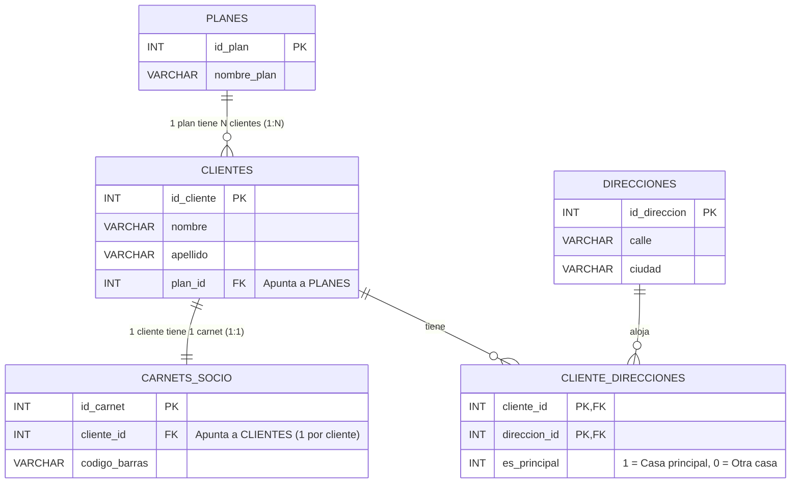

# Guía Sencilla: Cómo pensar una Base de Datos paso a paso (1:1, 1:N y N:N) sin miedo al SQL

> **Lo que nos pasó en clase:**
> El primer día de SQL dijimos: *"Vamos a hacer una tabla de `clientes` y otra de `direcciones`"*. Parecía facilísimo hasta que alguien preguntó:
> **«¿Dónde ponemos la columna que conecta las dos tablas? ¿Ponemos el número de dirección dentro del cliente, o ponemos el número de cliente dentro de la dirección?»**
>
> Al principio pensamos: *"Un cliente puede tener varias casas (la de diario y la de la playa), así que ponemos el cliente dentro de la dirección"*. Pero enseguida caímos en otra cosa: *"¡Espera! En una misma casa también pueden vivir varios clientes (una pareja, hermanos, compañeros de piso)"*.
>
> Ahí descubrimos que estábamos ante una relación **Muchos a Muchos (N:N)** y que hacía falta una **tabla intermedia** con una marca (`es_principal`) para saber a qué casa mandarle las cartas a cada cliente sin volvernos locos con clientes repetidos.

En esta versión vamos a ver toda esa reflexión **de la forma más limpia, visual y sencilla posible**, quitando todo el "ruido" del código SQL para centrarnos al 100% en entender la lógica.

---

## 📌 Índice

1. [El diccionario básico en 2 minutos (Tablas, Filas, PK y FK)](#1-el-diccionario-básico-en-2-minutos-tablas-filas-pk-y-fk)
2. [El dilema de clase: ¿Dónde ponemos el enlace entre Clientes y Casas?](#2-el-dilema-de-clase-dónde-ponemos-el-enlace-entre-clientes-y-casas)
3. [Los 3 tipos de relaciones explicados con ejemplos cotidianos](#3-los-3-tipos-de-relaciones-explicados-con-ejemplos-cotidianos)
4. [El SQL más limpio posible: Creando nuestras tablas "maquilladas"](#4-el-sql-más-limpio-posible-creando-nuestras-tablas-maquilladas)
   - [⚠️ Qué hemos quitado del código para que no asuste (y por qué es peligroso en la vida real)](#️-qué-hemos-quitado-del-código-para-que-no-asuste-y-por-qué-es-peligroso-en-la-vida-real)
5. [Metiendo datos de prueba (Ana, Luis y sus casas)](#5-metiendo-datos-de-prueba-ana-luis-y-sus-casas)
6. [Haciendo preguntas a la Base de Datos (`JOIN`) y el truco de los duplicados](#6-haciendo-preguntas-a-la-base-de-datos-join-y-el-truco-de-los-duplicados)

---

## 1. El diccionario básico en 2 minutos (Tablas, Filas, PK y FK)

Imagina que una base de datos es como un archivo de hojas de cálculo (Excel), donde cada pestaña es una **Tabla**:

* **Tabla (Entidad):** Una lista de cosas del mismo tipo. Por ejemplo, la tabla `clientes` o la tabla `direcciones`.
* **Fila (o Tupla / Registro):** Cada línea horizontal de la tabla. Por ejemplo, la fila donde están los datos de *"Ana García"*.
* **Columna (o Campo):** Cada dato concreto que guardamos (`nombre`, `apellido`, `calle`, `ciudad`).

Para conectar unas tablas con otras solo necesitas entender dos siglas: **PK** y **FK**.

### 🔑 ¿Qué es una PK (Primary Key / Clave Primaria)?
Es el **"carné de identidad"** de cada fila dentro de su tabla.
* En la tabla `clientes`, ponemos una columna llamada `id_cliente` con números `1, 2, 3...`.
* **¿Por qué un número y no el nombre?** Porque puede haber dos personas llamadas *"Juan Pérez"*, pero nunca habrá dos clientes con el `id_cliente = 1`.
* La PK **nunca se puede repetir** en su tabla ni puede quedarse en blanco.

### 🔗 ¿Qué es una FK (Foreign Key / Clave Foránea)?
Es un **"número que apunta al carné de identidad (PK) de otra tabla"**.
* Si queremos decir que Ana pertenece al plan "VIP" (que es el número `2` en la tabla `planes`), dentro de la fila de Ana ponemos una columna `plan_id` con un `2`. Ese `2` es una **FK**.

---

## 2. El dilema de clase: ¿Dónde ponemos el enlace entre Clientes y Casas?

Vamos a revivir las tres ideas que tuvimos en clase con ejemplos de tablas pequeñitas:

### ❌ Idea 1: Poner la FK `direccion_id` dentro de `clientes`
Pensamos: *"A cada cliente le ponemos una columna con el número de su casa"*.

| id_cliente (PK) | nombre | direccion_id (FK) |
| :---: | :--- | :---: |
| 1 | Ana | 100 (Piso de Madrid) |
| 2 | Luis | 100 (Piso de Madrid) |

* **Lo bueno:** Ana y Luis pueden vivir juntos en el piso `100`.
* **El problema:** ¿Y si Ana se compra una segunda casa en la playa (la casa `200`)? En la casilla `direccion_id` de Ana ya está escrito el `100`. No caben dos números en una casilla, ni podemos crear otra fila con `id_cliente = 1` porque el `1` es su PK y no se puede repetir.

---

### ❌ Idea 2: Poner la FK `cliente_id` dentro de `direcciones`
Dijimos: *"¡Vale, pues al revés! A cada casa le ponemos quién es su dueño"*.

| id_direccion (PK) | calle | ciudad | cliente_id (FK) |
| :---: | :--- | :--- | :---: |
| 100 | Calle Mayor 10 | Madrid | 1 (Ana) |
| 200 | Paseo Marítimo 45 | Valencia | 1 (Ana) |

* **Lo bueno:** ¡Ahora Ana puede tener 2, 3 o 20 casas! Todas llevan el `1` en `cliente_id`.
* **El problema:** Ahora viene Luis (`id=2`), que vive con Ana en *Calle Mayor 10* (`id=100`). ¿Dónde metemos a Luis? La casilla `cliente_id` de la casa `100` ya está ocupada por Ana (`1`). Si creamos una casa `101` escribiendo otra vez *"Calle Mayor 10, Madrid"* para ponérsela a Luis, estaremos **duplicando la misma casa física** en nuestra base de datos.

---

### ✅ Idea 3 (La buena): Ni en una ni en otra -> ¡Una tabla puente en medio!
Nos dimos cuenta de la realidad:
* **1 cliente** puede tener **muchas casas (N)**.
* En **1 casa** pueden vivir **muchos clientes (N)**.

Cuando pasa esto (**relación N:N**), dejamos la tabla `clientes` tranquila, dejamos la tabla `direcciones` tranquila, y creamos una **tercera tabla en medio** llamada `cliente_direcciones` que solo sirve para emparejar números:

| cliente_id (FK) | direccion_id (FK) | es_principal |
| :---: | :---: | :---: |
| 1 (Ana) | 100 (Madrid) | **1 (Sí)** |
| 1 (Ana) | 200 (Valencia) | 0 (No) |
| 2 (Luis) | 100 (Madrid) | **1 (Sí)** |
| 2 (Luis) | 200 (Valencia) | 0 (No) |

Y fíjate en la columna `es_principal`: ahí guardamos un `1` (Sí) o un `0` (No) para saber **a cuál de las casas de cada persona hay que mandarle las cartas**.

---

## 3. Los 3 tipos de relaciones explicados con ejemplos cotidianos

Para ver el mapa completo, vamos a usar **los 3 tipos de relaciones que existen en SQL** en nuestro ejemplo:

1. **Relación 1:1 (Uno a Uno) — `clientes` y `carnets_socio`:**
   * Cada cliente tiene **1 solo** carnet de socio, y cada carnet pertenece a **1 solo** cliente.
2. **Relación 1:N (Uno a Muchos) — `planes` y `clientes`:**
   * Tenemos planes de tarifa (`Básico`, `VIP`). **1 plan** lo pueden tener **muchos clientes**, pero **cada cliente** tiene contratado **1 solo plan**.
   * *Truco fácil:* En un **1:N**, la columna FK (`plan_id`) va siempre en la tabla del lado **"Muchos"** (`clientes`).
3. **Relación N:N (Muchos a Muchos) — `clientes` y `direcciones`:**
   * Un cliente tiene varias casas y en una casa viven varios clientes. Se unen con la tabla intermedia `cliente_direcciones`.

Así queda nuestro dibujo (Modelo Entidad-Relación):



---

## 4. El SQL más limpio posible: Creando nuestras tablas "maquilladas"

Aquí tienes el código para crear las tablas en MySQL reducido a su mínima expresión para que se lea casi como si fuera español o inglés básico:

```sql
DROP DATABASE IF EXISTS clase_sencilla_sql;
CREATE DATABASE clase_sencilla_sql;
USE clase_sencilla_sql;

-- 1. Tabla de PLANES (Lado 1 de la relación 1:N)
CREATE TABLE planes (
    id_plan INT PRIMARY KEY,
    nombre_plan VARCHAR(50)
);

-- 2. Tabla de CLIENTES (Lleva plan_id para saber qué plan tiene cada cliente)
CREATE TABLE clientes (
    id_cliente INT PRIMARY KEY,
    nombre VARCHAR(50),
    apellido VARCHAR(50),
    plan_id INT
);

-- 3. Tabla de CARNETS DE SOCIO (Relación 1:1 con clientes)
CREATE TABLE carnets_socio (
    id_carnet INT PRIMARY KEY,
    cliente_id INT,
    codigo_barras VARCHAR(30)
);

-- 4. Tabla de DIRECCIONES (Solo las casas físicas, sin nombres de personas)
CREATE TABLE direcciones (
    id_direccion INT PRIMARY KEY,
    calle VARCHAR(100),
    ciudad VARCHAR(50)
);

-- 5. Tabla intermedia CLIENTE_DIRECCIONES (Relación N:N + el flag es_principal)
CREATE TABLE cliente_direcciones (
    cliente_id INT,
    direccion_id INT,
    es_principal INT,
    PRIMARY KEY (cliente_id, direccion_id)
);
```

### ⚠️ Qué hemos quitado del código para que no asuste (y por qué es peligroso en la vida real)

Para que el bloque de arriba quede así de limpio y "maquillado", hemos quitado dos cosas con respecto a un código profesional (como el del documento 5):

1. **Hemos quitado `ENGINE=InnoDB` al final de cada tabla:**
   * **¿Por qué funciona igual?** Porque en MySQL moderno, `InnoDB` ya es el motor **por defecto (default)**. Si no escribes nada, MySQL lo pone solo por detrás.
2. **Hemos quitado todas las líneas `CONSTRAINT ... FOREIGN KEY ...` y `UNIQUE`:**
   * **¿Por qué lo hemos hecho?** Porque visualmente meten muchas líneas de código que al principio asustan y distraen de lo importante (entender qué columnas tiene cada tabla).
   * **🚨 ¿Por qué es MUY PELIGROSO quitar los `CONSTRAINT` en un trabajo real?**
     Cuando quitas la instrucción `FOREIGN KEY` o `UNIQUE`, **le estás diciendo a MySQL que deje de vigilar tus datos**. Las consultas `SELECT` con `JOIN` van a funcionar exactamente igual si tú metes los números bien, **PERO MySQL ya no te protegerá de tus propios errores**:
     * **Peligro 1 (Datos fantasma):** Si solo existen el plan `1` y el plan `2`, y por error de dedo insertas un cliente con `plan_id = 999`, ¡MySQL se lo traga sin protestar! Tendrás un cliente apuntando a un plan que no existe.
     * **Peligro 2 (Hijos huérfanos):** Si borras la casa `100` de la tabla `direcciones`, en la tabla intermedia `cliente_direcciones` seguirá apareciendo que Ana vive en la casa `100`, aunque esa casa ya haya desaparecido.
     * **Peligro 3 (Se rompe el 1:1):** Sin un `UNIQUE` vigilando `cliente_id` en `carnets_socio`, podrías darle 5 carnets distintos al mismo cliente sin que MySQL te dé ningún aviso.

> [!TIP]
> **Resumen para clase:** Quitar los `CONSTRAINT` es como **quitarle los guardarraíles a una carretera de montaña** para que se vea mejor el paisaje en la foto. Si conduces perfecto sin salirte del carril (como haremos nosotros ahora metiendo los datos a mano con cuidado), llegas igual al destino; pero en una empresa real, tarde o temprano alguien gira mal el volante y sin guardarraíles los datos se despeñan.

---

## 5. Metiendo datos de prueba (Ana, Luis y sus casas)

Vamos a meter unos pocos datos muy fáciles de seguir de cabeza:
* **Ana (`id = 1`)** y **Luis (`id = 2`)** son pareja: viven juntos en **Madrid** (su casa principal) y veranean juntos en **Valencia** (su casa secundaria).
* **Marta (`id = 3`)** vive todo el año en ese mismo apartamento de **Valencia** (para Marta, Valencia sí es su casa principal `es_principal = 1`).

```sql
-- 1. Metemos dos planes
INSERT INTO planes VALUES (1, 'Básico');
INSERT INTO planes VALUES (2, 'VIP');

-- 2. Metemos tres clientes (Ana y Luis son VIP=2, Marta es Básico=1)
INSERT INTO clientes VALUES (1, 'Ana',   'García', 2);
INSERT INTO clientes VALUES (2, 'Luis',  'Pérez',  2);
INSERT INTO clientes VALUES (3, 'Marta', 'López',  1);

-- 3. Metemos un carnet por cada cliente (Relación 1:1)
INSERT INTO carnets_socio VALUES (10, 1, 'SOCIO-0001');
INSERT INTO carnets_socio VALUES (20, 2, 'SOCIO-0002');
INSERT INTO carnets_socio VALUES (30, 3, 'SOCIO-0003');

-- 4. Metemos las casas físicas (¡fíjate que cada casa se escribe UNA sola vez!)
INSERT INTO direcciones VALUES (100, 'Calle Mayor 10',    'Madrid');
INSERT INTO direcciones VALUES (200, 'Paseo Marítimo 45', 'Valencia');

-- 5. Unimos clientes con casas en la tabla puente (es_principal: 1 = Sí, 0 = No)
-- Ana (1) tiene Madrid como principal (1) y Valencia como secundaria (0)
INSERT INTO cliente_direcciones VALUES (1, 100, 1);
INSERT INTO cliente_direcciones VALUES (1, 200, 0);

-- Luis (2) también tiene Madrid como principal (1) y Valencia como secundaria (0)
INSERT INTO cliente_direcciones VALUES (2, 100, 1);
INSERT INTO cliente_direcciones VALUES (2, 200, 0);

-- Marta (3) solo tiene la casa de Valencia, y para ella SÍ es la principal (1)
INSERT INTO cliente_direcciones VALUES (3, 200, 1);
```

---

## 6. Haciendo preguntas a la Base de Datos (`JOIN`) y el truco de los duplicados

Ahora viene la magia: cómo juntamos las piezas con `JOIN` para sacar información útil.

### Consulta 1: Cruzar las relaciones sencillas (1:1 y 1:N)
Queremos ver a cada cliente con su nombre de plan (`1:N`) y su carnet de socio (`1:1`).

```sql
SELECT
    c.id_cliente,
    c.nombre,
    c.apellido,
    p.nombre_plan,
    cs.codigo_barras
FROM clientes c
JOIN planes p         ON c.plan_id = p.id_plan
JOIN carnets_socio cs ON c.id_cliente = cs.cliente_id;
```

**Resultado en MySQL:**
```text
+------------+--------+----------+-------------+---------------+
| id_cliente | nombre | apellido | nombre_plan | codigo_barras |
+------------+--------+----------+-------------+---------------+
|          1 | Ana    | García   | VIP         | SOCIO-0001    |
|          2 | Luis   | Pérez    | VIP         | SOCIO-0002    |
|          3 | Marta  | López    | Básico      | SOCIO-0003    |
+------------+--------+----------+-------------+---------------+
3 rows in set (0.00 sec)
```
*Aquí nunca hay clientes repetidos porque cada cliente solo tiene 1 plan y 1 carnet.*

---

### Consulta 2: El problema de los "duplicados" al juntar Clientes con Casas (N:N)
Ahora queremos ver a los clientes con su dirección. Como para ir de `clientes` a `direcciones` hay que pasar por el puente `cliente_direcciones`, hacemos dos `JOIN`:

```sql
SELECT
    c.id_cliente,
    c.nombre,
    d.calle,
    d.ciudad,
    cd.es_principal
FROM clientes c
JOIN cliente_direcciones cd ON c.id_cliente = cd.cliente_id
JOIN direcciones d          ON cd.direccion_id = d.id_direccion;
```

**Resultado en MySQL:**
```text
+------------+--------+-------------------+----------+--------------+
| id_cliente | nombre | calle             | ciudad   | es_principal |
+------------+--------+-------------------+----------+--------------+
|          1 | Ana    | Calle Mayor 10    | Madrid   |            1 |
|          1 | Ana    | Paseo Marítimo 45 | Valencia |            0 |
|          2 | Luis   | Calle Mayor 10    | Madrid   |            1 |
|          2 | Luis   | Paseo Marítimo 45 | Valencia |            0 |
|          3 | Marta  | Paseo Marítimo 45 | Valencia |            1 |
+------------+--------+-------------------+----------+--------------+
5 rows in set (0.00 sec)
```

> [!WARNING]
> **¡Mira lo que ha pasado!**
> Solo tenemos **3 clientes**, pero nos han salido **5 filas**. Ana sale dos veces y Luis sale dos veces porque tienen dos casas cada uno. Si le pasamos esta lista a Correos para mandar una carta por cliente, ¡Ana y Luis recibirán dos cartas repetidas!

---

### Consulta 3: La Solución — Quedarnos solo con la residencia principal de cada cliente
¿Cómo quitamos esos duplicados para que salga **exactamente una fila por cliente** con la casa donde quiere recibir las cartas?
¡Usando la columna `es_principal = 1` que pusimos en nuestra tabla intermedia!

```sql
SELECT
    c.id_cliente,
    c.nombre,
    c.apellido,
    d.calle AS direccion_envio,
    d.ciudad
FROM clientes c
JOIN cliente_direcciones cd ON c.id_cliente = cd.cliente_id
JOIN direcciones d          ON cd.direccion_id = d.id_direccion
WHERE cd.es_principal = 1;
```

**Resultado en MySQL:**
```text
+------------+--------+----------+-------------------+----------+
| id_cliente | nombre | apellido | direccion_envio   | ciudad   |
+------------+--------+----------+-------------------+----------+
|          1 | Ana    | García   | Calle Mayor 10    | Madrid   |
|          2 | Luis   | Pérez    | Calle Mayor 10    | Madrid   |
|          3 | Marta  | López    | Paseo Marítimo 45 | Valencia |
+------------+--------+----------+-------------------+----------+
3 rows in set (0.00 sec)
```
**¡Solucionado!** Ahora tenemos 3 clientes y 3 filas limpias. Cada uno con su residencia principal.

---

### Consulta 4: Pregunta al revés — ¿Quiénes viven o usan la casa de Valencia?
Como hemos hecho bien el modelo N:N, también podemos preguntar por una casa concreta (por ejemplo, la de `Valencia`) y ver de un vistazo todas las personas vinculadas a ella y si es su casa principal o no:

```sql
SELECT
    d.calle,
    d.ciudad,
    c.nombre,
    c.apellido,
    cd.es_principal
FROM direcciones d
JOIN cliente_direcciones cd ON d.id_direccion = cd.direccion_id
JOIN clientes c             ON cd.cliente_id = c.id_cliente
WHERE d.ciudad = 'Valencia';
```

**Resultado en MySQL:**
```text
+-------------------+----------+--------+----------+--------------+
| calle             | ciudad   | nombre | apellido | es_principal |
+-------------------+----------+--------+----------+--------------+
| Paseo Marítimo 45 | Valencia | Ana    | García   |            0 |
| Paseo Marítimo 45 | Valencia | Luis   | Pérez    |            0 |
| Paseo Marítimo 45 | Valencia | Marta  | López    |            1 |
+-------------------+----------+--------+----------+--------------+
3 rows in set (0.00 sec)
```
Aquí se ve clarísimo por qué el flag `es_principal` tenía que estar en la tabla intermedia: ¡para el mismo piso de Valencia, para Ana y Luis vale `0` (vacaciones), pero para Marta vale `1` (su casa habitual)!

---

## 🎯 Chuleta final de 3 líneas para no dudar nunca en clase

1. **Relación 1:1** (`clientes` - `carnets_socio`): Pon la columna FK (`cliente_id`) en cualquiera de las dos tablas.
2. **Relación 1:N** (`planes` - `clientes`): Pon **siempre** la columna FK (`plan_id`) en la tabla del lado **"Muchos"** (`clientes`).
3. **Relación N:N** (`clientes` - `direcciones`): **No pongas la FK ni en una ni en otra.** Crea una **tabla intermedia** con las dos columnas (`cliente_id`, `direccion_id`) y añade ahí cualquier detalle extra como `es_principal`.

