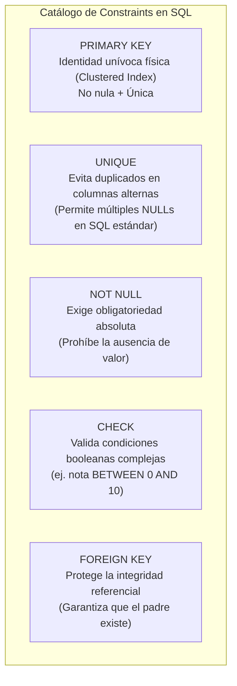
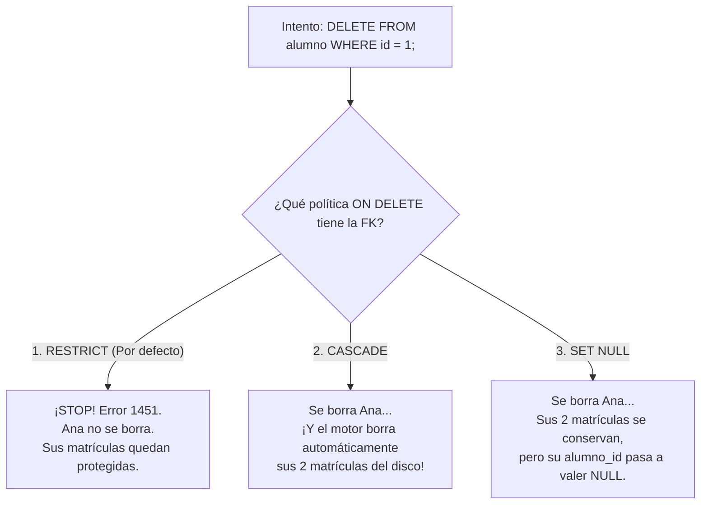
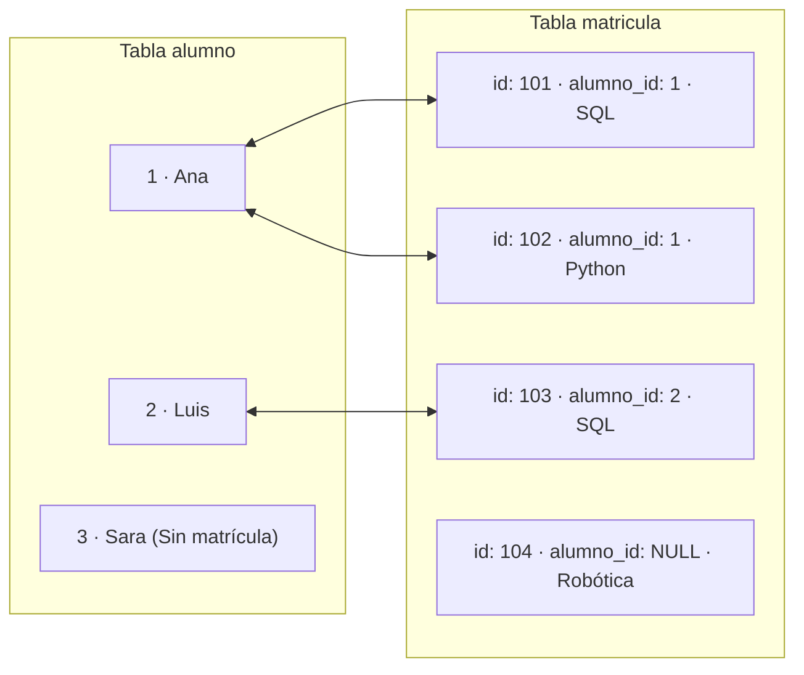
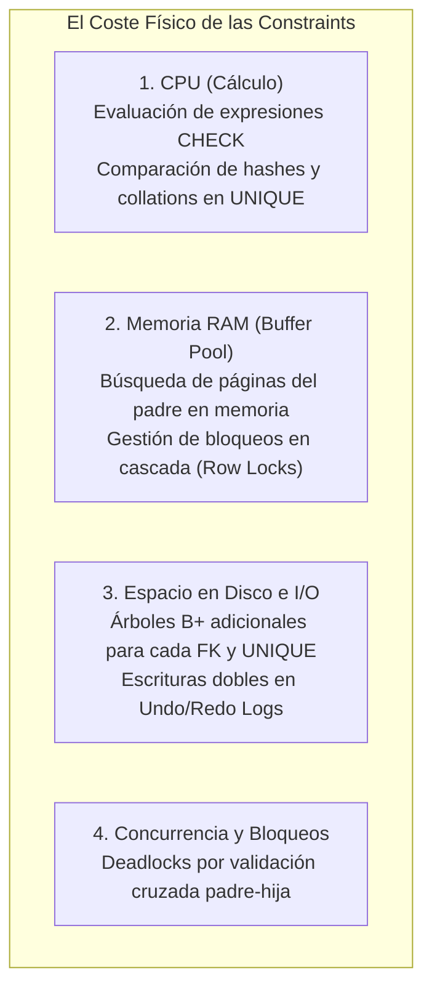
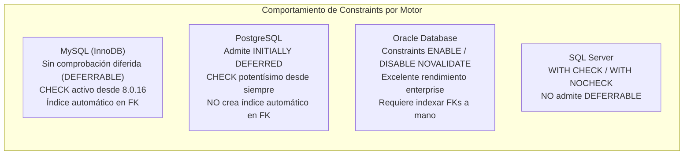

# 🛡️ Manual Maestro de Constraints e Integridad Referencial en Bases de Datos
### Del Frontend a InnoDB: Arquitectura de Reglas, Álgebra de JOINs, Transacciones y Rollbacks, Coste Físico de Recursos y Comparativa Multi-Motor (MySQL, PostgreSQL, Oracle, MariaDB, SQL Server)

> **Basado en la colección de 12 infografías visuales de la carpeta `CONSTRAINTS`**  
> *Entorno de referencia:* MySQL 8.0.16+ / 8.4 LTS (Motor InnoDB) · PostgreSQL 16+ · Oracle Database 23c · MariaDB 11+ · Microsoft SQL Server 2022  
> *Referencias formales:* Estándar ANSI/ISO SQL:2016 / SQL:2023 · Documentación Oficial MySQL Server Internals.

---

## 🧭 Prólogo: La Ilusión del Frontend y la Verdad Incorruptible

En la era moderna del desarrollo de software, existe una tentación peligrosa: **creer que la calidad del dato se puede garantizar en el Frontend o en la capa de aplicación**.

Muchos desarrolladores noveles razonan así:
> *"He puesto un validador en React con TypeScript que prohíbe introducir notas mayores a 10. Además, mi backend en Python/Node.js comprueba que el alumno existe antes de insertarlo. ¿Para qué necesito ensuciar mis sentencias SQL con `CHECK`, `NOT NULL`, `UNIQUE` o `FOREIGN KEY`? Las constraints solo hacen que las consultas vayan más lentas."*

Este razonamiento es el responsable directo de los mayores desastres de corrupción de datos en la industria. La realidad del ciclo de vida de un sistema es que el Frontend y el Backend **son solo dos de las múltiples puertas de entrada**:
1. Un script de migración masiva ejecutado de madrugada por un administrador desde la terminal.
2. Un microservicio nuevo desarrollado por otro equipo que se salta las validaciones del primer backend.
3. Una herramienta de analítica (BI o ETL) que carga datos directamente mediante conectores JDBC/ODBC.
4. Una condición de carrera (*race condition*) donde dos peticiones concurrentes validan que un email no existe y lo insertan a la vez en el mismo milisegundo.

Si el motor de la base de datos no tiene **reglas declarativas duras (Constraints)**, los datos se corromperán irremisiblemente: aparecerán facturas sin cliente, notas de examen de `-45` o matrículas vinculadas al alumno `999` que jamás existió.

Sin embargo, como el usuario bien intuye, **la integridad perfecta no es gratis**: verificar un `FOREIGN KEY` exige lecturas adicionales de índices; garantizar `UNIQUE` obliga a recorrer árboles B+; mantener `ON DELETE CASCADE` puede disparar bloqueos de filas y consumo de memoria en el *Buffer Pool*, y cada comprobación consume ciclos de CPU, I/O de disco y memoria RAM.

A lo largo de este manual maestro, desgranaremos las 12 infografías de la carpeta `CONSTRAINTS` y ampliaremos el horizonte con sentencias SQL reales, comportamiento en transacciones (`ACID`), álgebra de consultas (`INNER`, `LEFT`, `RIGHT`, `FULL`), impacto físico en el hardware y una exhaustiva comparativa con **PostgreSQL, Oracle, MariaDB y SQL Server**.

---

## 📑 Índice de Contenidos

1. [Acto 1: MySQL, el Guardián de los Datos — Tipología Completa de Constraints](#acto-1-mysql-el-guardián-de-los-datos--tipología-completa-de-constraints)
2. [Acto 2: Anatomía de la Relación Padre-Hija y Claves Foráneas](#acto-2-anatomía-de-la-relación-padre-hija-y-claves-foráneas)
3. [Acto 3: El Guardián en Acción — ¿Puedo guardar esta matrícula? (Validación en Inserción)](#acto-3-el-guardián-en-acción--puedo-guardar-esta-matrícula-validación-en-inserción)
4. [Acto 4: La Tríada Sagrada del Borrado — ON DELETE RESTRICT, CASCADE y SET NULL](#acto-4-la-tríada-sagrada-del-borrado--on-delete-restrict-cascade-y-set-null)
5. [Acto 5: Cambio de Identidad — ON UPDATE CASCADE vs RESTRICT](#acto-5-cambio-de-identidad--on-update-cascade-vs-restrict)
6. [Acto 6: El DDL en la Tabla Hija y la Configuración Visual en Workbench](#acto-6-el-ddl-en-la-tabla-hija-y-la-configuración-visual-en-workbench)
7. [Acto 7: La Trampa de los Nombres Parecidos — Un Nombre NO crea una Foreign Key](#acto-7-la-trampa-de-los-nombres-parecidos--un-nombre-no-crea-una-foreign-key)
8. [Acto 8: Consultas Cruzadas (JOINs) y su Interacción con las FKs](#acto-8-consultas-cruzadas-joins-y-su-interacción-con-las-fks)
9. [Acto 9: Constraints y Transacciones ACID — Savepoints, Fallos y Rollback](#acto-9-constraints-y-transacciones-acid--savepoints-fallos-y-rollback)
10. [Acto 10: La Física Oculta de la Integridad — El Coste de CPU, RAM, Índices y Disco](#acto-10-la-física-oculta-de-la-integridad--el-coste-de-cpu-ram-índices-y-disco)
11. [Acto 11: Panorama Competitivo — ¿Cómo lo resuelven PostgreSQL, Oracle, MariaDB y SQL Server?](#acto-11-panorama-competitivo--cómo-lo-resuelven-postgresql-oracle-mariadb-y-sql-server)
12. [Acto 12: Laboratorio Práctico Integral de Demostración Forense](#acto-12-laboratorio-práctico-integral-de-demostración-forense)

---

## Acto 1: MySQL, el Guardián de los Datos — Tipología Completa de Constraints

<p align="center">
  
</p>

### La historia detrás de la lámina
En la entrada de la base de datos se encuentra un centinela implacable: el **motor InnoDB**. A este guardián no le importa si la orden viene de un script en Python, de una consola de comandos `mysql`, de una aplicación web o de MySQL Workbench. Todas las consultas son sometidas al mismo filtro riguroso.

Una **Constraint (Restricción)** es una regla declarativa registrada formalmente en el diccionario de datos del gestor que define el estado válido de la información. Si una operación intenta llevar a la base de datos a un estado no válido, el motor **aborta la operación de inmediato**.

### El catálogo esencial de restricciones



| Restricción | Propósito Fundamental | Ejemplo Académico | ¿Qué ocurre si se viola? |
|---|---|---|---|
| **`PRIMARY KEY`** | Identifica unívocamente cada fila de la tabla. En InnoDB genera el índice agrupado físico (*Clustered Index*). | `id INT PRIMARY KEY` | Rechazo con `Error 1062: Duplicate entry`. |
| **`NOT NULL`** | Prohíbe que el atributo quede sin definir. `NULL` representa "desconocido". | `nombre VARCHAR(80) NOT NULL` | Rechazo con `Error 1048: Column cannot be null`. |
| **`UNIQUE`** | Impide que existan dos valores idénticos en la misma columna. | `email VARCHAR(120) UNIQUE` | Rechazo con `Error 1062: Duplicate entry`. |
| **`CHECK`** | Valida expresiones lógicas arbitrarias evaluadas por fila. | `CHECK (nota >= 0 AND nota <= 10)` | Rechazo con `Error 3819: Check constraint violated`. |
| **`FOREIGN KEY`** | Conecta una fila hija con una fila padre existente en otra tabla. | `FOREIGN KEY (alumno_id) REFERENCES alumno(id)` | Rechazo con `Error 1452` (insert) o `Error 1451` (delete). |

> [!IMPORTANT]
> **No basta con dibujarlo:**  
> Guardar un modelo en un diagrama `.mwb` o hacer un dibujo en una pizarra no protege tus datos. Las reglas deben estar formalmente declaradas en el servidor con sentencias `CREATE TABLE` o `ALTER TABLE`.

---

## Acto 2: Anatomía de la Relación Padre-Hija y Claves Foráneas

<p align="center">
  
</p>
<p align="center">
  
</p>

### La historia detrás de las láminas
Para entender una clave foránea, debemos distinguir dos roles inmutables:
1. **La Tabla Padre (Referenciada):** Posee los datos maestros y define la clave primaria original. En nuestro caso: `alumno (id, nombre)`.
2. **La Tabla Hija (Referenciadora):** Posee el atributo que "apunta" hacia el padre. En nuestro caso: `matricula (id, alumno_id, curso)`.

```
TABLA PADRE: alumno                     TABLA HIJA: matricula
┌────┬────────┐                         ┌─────┬───────────┬────────┐
│ id │ nombre │                         │ id  │ alumno_id │ curso  │
├────┼────────┤                         ├─────┼───────────┼────────┤
│  1 │ Ana    │◄────────────────────────┼─101 │     1     │ SQL    │
│  2 │ Luis   │◄──────────┐             ├─────┼───────────┼────────┤
└────┴────────┘           │             │ 102 │     1     │ Python │
                          │             ├─────┼───────────┼────────┤
                          └─────────────┼─103 │     2     │ SQL    │
                                        └─────┴───────────┴────────┘
                                              ▲
                                              │ FOREIGN KEY
```

### Conceptos clave que un novato suele confundir:
- **El ID de la matrícula no es el ID del alumno:** La matrícula `101` pertenece al alumno `1`. La matrícula tiene su propia identidad independiente como evento de inscripción.
- **Relación $1:N$:** Un único alumno puede tener muchas ($N$) matrículas en diferentes cursos; pero cada matrícula individual apunta a un único alumno.
- **¿Dónde reside físicamente la FK?** La clave foránea **siempre se declara en la tabla hija**. Nunca se declara una lista de IDs de matrícula dentro del alumno (eso violaría la Primera Forma Normal).

---

## Acto 3: El Guardián en Acción — ¿Puedo guardar esta matrícula? (Validación en Inserción)

<p align="center">
  
</p>

### La historia detrás de la lámina
Cuando una aplicación lanza un `INSERT` o un `UPDATE` sobre la tabla hija, el guardián de InnoDB detiene el proceso y hace una comprobación de existencia en la tabla padre:

$$\text{Si } alumno\_id \notin \text{alumno.id } \implies \mathbf{RECHAZO}$$

### Los cuatro escenarios de inserción y modificación

#### Escenario A: El alumno existe (Inserción aceptada)
```sql
-- Ana existe con ID = 1. Insertamos su matrícula en Redes:
INSERT INTO matricula (id, alumno_id, curso) VALUES (104, 1, 'Redes');
-- Resultado: OK (Fila insertada en 0.001 seg).
```

#### Escenario B: El alumno no existe (Violación de FK)
```sql
-- Intentamos matricular al alumno 999 (que no existe):
INSERT INTO matricula (id, alumno_id, curso) VALUES (105, 999, 'SQL');
```
*Respuesta de InnoDB:*
```text
Error Code: 1452. Cannot add or update a child row: a foreign key constraint fails
(`academia`.`matricula`, CONSTRAINT `fk_matricula_alumno` FOREIGN KEY (`alumno_id`) REFERENCES `alumno` (`id`))
```

#### Escenario C: Actualizar una matrícula hacia un alumno fantasma
```sql
-- Intentamos cambiar la matrícula 101 para asignársela al alumno 999:
UPDATE matricula SET alumno_id = 999 WHERE id = 101;
-- Resultado: ¡Rechazado con el mismo Error 1452! El UPDATE sobre la FK se valida igual que el INSERT.
```

#### Escenario D: Matrícula sin alumno asignado (`NULL`)
```sql
-- ¿Podemos guardar una matrícula con alumno_id = NULL?
INSERT INTO matricula (id, alumno_id, curso) VALUES (106, NULL, 'SQL');
```
> [!IMPORTANT]
> **¿Admite NULL una Clave Foránea?**  
> **Sí, siempre y cuando la columna en la tabla hija no tenga la restricción `NOT NULL`.**  
> `NULL` en SQL no significa cero ni cadena vacía: significa **"ausencia de vínculo o valor desconocido"** (por ejemplo, una plaza reservada en un curso pero aún no asignada a ningún estudiante concreto). Las claves foráneas permiten `NULL` por defecto a menos que tú explícitamente declares `alumno_id INT NOT NULL`.

---

## Acto 4: La Tríada Sagrada del Borrado — ON DELETE RESTRICT, CASCADE y SET NULL

<p align="center">
  
</p>
<p align="center">
  
</p>
<p align="center">
  
</p>
<p align="center">
  
</p>

### La historia detrás de las láminas
¿Qué ocurre si un administrador decide borrar a Ana (`id = 1`), sabiendo que tiene dos matrículas registradas en la tabla `matricula`?  
Aquí es donde el analista de bases de datos debe elegir una de las **tres políticas de borrado referencial**. No hay una política "mejor": depende exclusivamente de la **regla de negocio**.



### Análisis detallado de las 3 políticas

#### 1. ON DELETE RESTRICT (La política de máxima protección)
- **Comportamiento:** Si la fila padre tiene al menos una fila hija asociada, el borrado se bloquea tajantemente.
- **SQL que lo genera:**
  ```sql
  CONSTRAINT fk_alumno FOREIGN KEY (alumno_id) REFERENCES alumno(id) ON DELETE RESTRICT
  ```
- **Caso de uso idóneo:** Historiales académicos, facturación, expedientes médicos. Jamás debes borrar a un paciente si tiene recetas registradas, ni a un cliente si tiene facturas emitidas.
- **En InnoDB:** Si no especificas nada, MySQL aplica `RESTRICT` por defecto. `NO ACTION` en MySQL funciona exactamente igual que `RESTRICT`.

#### 2. ON DELETE CASCADE (La demolición en cadena)
- **Comportamiento:** Al borrar al padre, el motor localiza todas las filas hijas vinculadas y las borra en cascada automáticamente.
- **SQL que lo genera:**
  ```sql
  CONSTRAINT fk_alumno FOREIGN KEY (alumno_id) REFERENCES alumno(id) ON DELETE CASCADE
  ```
- **Caso de uso idóneo:** Relaciones de composición pura donde el hijo no tiene sentido sin el padre.  
  *Ejemplo:* Un carrito de compra y sus líneas de ítems temporales; un artículo de blog y sus comentarios.
- **La regla unidireccional:**  
  > [!WARNING]
  > **La cascada va siempre del PADRE hacia los HIJOS.**  
  > Si borras una matrícula con `DELETE FROM matricula WHERE id = 101;`, Ana **sigue existiendo intacta**. Borrar a un hijo nunca borra al padre.

#### 3. ON DELETE SET NULL (Desvinculación pacífica)
- **Comportamiento:** El padre es eliminado del sistema, pero las filas hijas se conservan, sustituyendo el valor de la clave foránea por `NULL`.
- **SQL que lo genera:**
  ```sql
  CONSTRAINT fk_alumno FOREIGN KEY (alumno_id) REFERENCES alumno(id) ON DELETE SET NULL
  ```
- **Requisito técnico indispensable:**  
  La columna `alumno_id` en la tabla hija **debe admitir valores nulos (`NULL`)**. Si intentas definir `ON DELETE SET NULL` sobre una columna que tiene la restricción `NOT NULL` o que forma parte de la `PRIMARY KEY`, el gestor rechazará la creación de la tabla.
- **Caso de uso idóneo:** Asignaciones temporales. Si se borra a un empleado que actuaba como *Jefe de Proyecto*, los proyectos siguen existiendo con `jefe_id = NULL` hasta nombrar un sustituto.

---

## Acto 5: Cambio de Identidad — ON UPDATE CASCADE vs RESTRICT

<p align="center">
  
</p>

### La historia detrás de la lámina
Cambiar la clave primaria del padre **no es borrar una fila**: es cambiar su documento de identidad.  
Supongamos que por una reorganización interna, el ID de Ana cambia del número `1` al número `10`.

```sql
UPDATE alumno SET id = 10 WHERE id = 1;
```

*¿Qué ocurre con las matrículas 101 y 102 que apuntaban al número 1?*

```
ANTES DEL UPDATE:
alumno (id=1: Ana) ◄─── matricula (id=101, alumno_id=1, curso='SQL')
alumno (id=1: Ana) ◄─── matricula (id=102, alumno_id=1, curso='Python')

TRAS: UPDATE alumno SET id = 10 WHERE id = 1; (con ON UPDATE CASCADE)
alumno (id=10: Ana) ◄─── matricula (id=101, alumno_id=10, curso='SQL')
alumno (id=10: Ana) ◄─── matricula (id=102, alumno_id=10, curso='Python')
```

- **Si configuramos `ON UPDATE CASCADE`:** InnoDB propaga automáticamente el cambio: los `alumno_id` de las matrículas pasan de `1` a `10`. Los IDs propios de las matrículas (`101` y `102`) permanecen intactos.
- **Si configuramos `ON UPDATE RESTRICT`:** La operación es bloqueada con `Error 1451`: el motor te prohíbe cambiar el ID de Ana mientras tenga matrículas enlazadas.
- **Matiz vital:** Cambiar el *nombre* de Ana (`UPDATE alumno SET nombre = 'Ana María' WHERE id = 1;`) **no activa ninguna cascada de clave foránea**, porque la clave foránea referencia exclusivamente a la columna `id`, no a la columna `nombre`.

---

## Acto 6: El DDL en la Tabla Hija y la Configuración Visual en Workbench

<p align="center">
  
</p>
<p align="center">
  
</p>

### El orden riguroso de creación en DDL
No puedes construir el tejado de una casa antes de levantar los cimientos. Del mismo modo, en SQL **debes crear siempre la tabla padre antes de crear la tabla hija**.

```sql
-- 1. PRIMERO: La tabla padre
CREATE TABLE alumno (
  id INT PRIMARY KEY AUTO_INCREMENT,
  nombre VARCHAR(80) NOT NULL
) ENGINE=InnoDB;

-- 2. SEGUNDO: La tabla hija con su restricción de integridad
CREATE TABLE matricula (
  id INT PRIMARY KEY AUTO_INCREMENT,
  alumno_id INT NULL,                      -- Debe coincidir en tipo exacto (INT)
  curso VARCHAR(80) NOT NULL,
  CONSTRAINT fk_matricula_alumno
    FOREIGN KEY (alumno_id)
    REFERENCES alumno(id)
    ON DELETE RESTRICT
    ON UPDATE CASCADE
) ENGINE=InnoDB;
```

### Reglas de compatibilidad de tipos entre Padre e Hija:
- **Mismo tipo base:** Si el padre es `INT`, la hija debe ser `INT`. No puedes referenciar un `BIGINT` desde un `SMALLINT`.
- **Mismo signo:** Si en el padre declaraste `id INT UNSIGNED`, en la hija **debes** declarar obligatoriamente `alumno_id INT UNSIGNED`. Una discordancia de signo provocará el críptico `Error 150: Foreign key constraint is incorrectly formed`.
- **Juego de caracteres en strings:** Si la clave referenciada es un `VARCHAR`, ambos campos deben compartir exactamente el mismo `CHARACTER SET` y `COLLATION` (ej. `utf8mb4_0900_ai_ci`).

### Configuración visual en MySQL Workbench:
1. En el árbol de esquemas, despliega `academia` ➔ haz clic derecho sobre `matricula` ➔ selecciona **Alter Table...**.
2. En la parte inferior, haz clic en la pestaña **Foreign Keys**.
3. En la columna *Foreign Key Name*, escribe `fk_matricula_alumno`.
4. En *Referenced Table*, selecciona `alumno`.
5. En la cuadrícula central, marca la casilla correspondiente a la columna hija (`alumno_id`) y emparéjala con la columna referenciada (`id`).
6. A la derecha, en los menús desplegables, elige:
   - **On Delete:** `RESTRICT`
   - **On Update:** `CASCADE`
7. Haz clic en el botón **Apply** abajo a la derecha. Workbench generará el `ALTER TABLE` y lo enviará al servidor.

---

## Acto 7: La Trampa de los Nombres Parecidos — Un Nombre NO crea una Foreign Key

<p align="center">
  
</p>

### La historia detrás de la lámina
Este es el error conceptual número uno entre programadores que aprenden SQL de forma autodidacta:  
Crear una tabla con una columna llamada `alumno_id` y suponer que, como se llama igual que en la otra tabla, el motor sabrá lo que tiene que hacer.

### Experimento comparativo: ¿Qué ocurre con y sin FK declarada?

```sql
-- CASO 1: Tabla SIN Foreign Key declarada
CREATE TABLE matricula_sin_fk (
  id INT PRIMARY KEY,
  alumno_id INT, -- ¡Es un simple número entero decorativo!
  curso VARCHAR(50)
);

-- Insertamos un alumno fantasma 999:
INSERT INTO matricula_sin_fk VALUES (105, 999, 'SQL');
-- RESULTADO: ¡Aceptado! InnoDB no tiene ninguna regla que le obligue a comprobar nada.
-- CONSECUENCIA: Acabas de crear un dato huérfano y corrupto en el sistema.
```

```sql
-- CASO 2: Tabla CON Foreign Key declarada
CREATE TABLE matricula_con_fk (
  id INT PRIMARY KEY,
  alumno_id INT,
  curso VARCHAR(50),
  CONSTRAINT fk_segura FOREIGN KEY (alumno_id) REFERENCES alumno(id)
);

-- Insertamos el mismo alumno fantasma 999:
INSERT INTO matricula_con_fk VALUES (105, 999, 'SQL');
-- RESULTADO: ¡RECHAZADO con Error 1452! El guardián protege la base de datos.
```

> [!CAUTION]
> **El comando para verificar la verdad desnuda:**  
> Nunca te fíes de los diagramas gráficos si sospechas de una base de datos legada. Ejecuta siempre en consola:
> ```sql
> SHOW CREATE TABLE matricula;
> ```
> Si en la salida no aparece la cláusula `CONSTRAINT ... FOREIGN KEY ... REFERENCES`, **no existe ninguna protección referencial**, por mucho que las columnas se llamen parecido o que un JOIN funcione bien.

---

## Acto 8: Consultas Cruzadas (JOINs) y su Interacción con las FKs

Muchos principiantes confunden dos mundos:
- **`FOREIGN KEY` (Tiempo de Escritura - DDL/DML):** Es una restricción que impide que entren datos incoherentes al insertar, actualizar o borrar.
- **`JOIN` (Tiempo de Lectura - DQL):** Es una operación relacional que combina filas de dos o más tablas basándose en una condición lógica.

*¿Se puede hacer un `JOIN` entre dos tablas que no tienen clave foránea declarada?*  
**Sí, por supuesto.** El `JOIN` solo compara valores en el momento de la consulta. Sin embargo, tener claves foráneas declaradas con índices asociados permite que el optimizador de MySQL ejecute los `JOINs` hasta **100 veces más rápido**.

### Los 4 tipos de cruce de tablas explicados con nuestra academia

Tomemos los siguientes datos de partida:
- **Alumnos:** Ana (`id=1`), Luis (`id=2`), Sara (`id=3`, *sin matrículas*).
- **Matrículas:** Ana en SQL (`nota 8.5`), Ana en Python (`nota 9.0`), Luis en SQL (`nota 7.0`), y una matrícula huérfana temporal de Robótica (`alumno_id=NULL` o alumno desaparecido).



---

#### 1. INNER JOIN (La intersección estricta)
Devuelve únicamente las filas donde **hay coincidencia exacta en ambos lados**.
- Si un alumno no tiene matrículas (Sara), **desaparece del resultado**.
- Si una matrícula no tiene alumno asignado, **desaparece del resultado**.

```sql
SELECT a.id, a.nombre, m.curso, m.nota
FROM alumno AS a
INNER JOIN matricula AS m ON a.id = m.alumno_id;
```
*Resultado:*
| id | nombre | curso | nota |
|:---|:---|:---|:---|
| 1 | Ana | SQL | 8.5 |
| 1 | Ana | Python | 9.0 |
| 2 | Luis | SQL | 7.0 |
*(3 filas devueltas. Sara no aparece).*

---

#### 2. LEFT JOIN (Preservar a todos los padres)
Devuelve **todas las filas de la tabla de la izquierda (`alumno`)**, hayan o no coincidencias en la tabla derecha (`matricula`). Si un alumno no tiene matrícula, las columnas de la derecha se rellenan con `NULL`.

```sql
SELECT a.id, a.nombre, m.curso, m.nota
FROM alumno AS a
LEFT JOIN matricula AS m ON a.id = m.alumno_id;
```
*Resultado:*
| id | nombre | curso | nota |
|:---|:---|:---|:---|
| 1 | Ana | SQL | 8.5 |
| 1 | Ana | Python | 9.0 |
| 2 | Luis | SQL | 7.0 |
| 3 | **Sara** | **NULL** | **NULL** |

*El truco analítico del LEFT JOIN:*  
¿Cómo saber qué alumnos no se han matriculado en ningún curso todavía?
```sql
SELECT a.nombre
FROM alumno AS a
LEFT JOIN matricula AS m ON a.id = m.alumno_id
WHERE m.id IS NULL; -- Filtra aquellos donde no hubo coincidencia
-- Devuelve: Sara
```

---

#### 3. RIGHT JOIN (Preservar a todos los hijos)
Devuelve **todas las filas de la tabla derecha (`matricula`)**, incluso si no tienen padre asociado.

```sql
SELECT a.nombre, m.curso
FROM alumno AS a
RIGHT JOIN matricula AS m ON a.id = m.alumno_id;
```
*(En buenas prácticas de diseño con FKs no anulables, el `RIGHT JOIN` rara vez se usa, ya que suele reescribirse como `LEFT JOIN` invirtiendo el orden de las tablas).*

---

#### 4. FULL OUTER JOIN (La unión total)
Devuelve todas las filas de ambas tablas, asociando las que coinciden y rellenando con `NULL` cuando no hay pareja en cualquiera de los dos lados.
> [!NOTE]
> **MySQL no soporta la sintaxis nativa `FULL OUTER JOIN`.**  
> Para lograrlo en MySQL, se realiza la unión de un `LEFT JOIN` y un `RIGHT JOIN` mediante el operador `UNION`:
> ```sql
> SELECT a.nombre, m.curso FROM alumno a LEFT JOIN matricula m ON a.id = m.alumno_id
> UNION
> SELECT a.nombre, m.curso FROM alumno a RIGHT JOIN matricula m ON a.id = m.alumno_id;
> ```

---

## Acto 9: Constraints y Transacciones ACID — Savepoints, Fallos y Rollback

<p align="center">
  
</p>

### La historia detrás de la lámina
Una transacción agrupa múltiples sentencias SQL bajo el principio de **Atomicidad**: o todo se confirma con éxito (`COMMIT`), o nada de lo realizado surte efecto (`ROLLBACK`).

¿Qué ocurre cuando una sentencia dentro de una transacción viola una constraint? ¿Y cómo interactúa `ON DELETE CASCADE` con un `ROLLBACK`?

### Experimento 1: El ensayo seguro de borrado en cascada con ROLLBACK
Supón que tienes configurado `ON DELETE CASCADE` y quieres verificar cuántas filas se borrarían al dar de baja a Ana, pero **sin alterar los datos reales**:

```sql
-- 1. Abrimos una transacción explícita
START TRANSACTION;

-- 2. Ejecutamos el borrado del padre
DELETE FROM alumno WHERE id = 1;

-- 3. Inspeccionamos la tabla hija dentro de la transacción
SELECT * FROM matricula;
-- ¡Comprobamos que las matrículas de Ana han desaparecido!

-- 4. Nos arrepentimos y deshacemos todo:
ROLLBACK;

-- 5. Comprobamos la realidad:
SELECT * FROM alumno WHERE id = 1;    -- Ana sigue viva
SELECT * FROM matricula WHERE alumno_id = 1; -- Sus matrículas están intactas
```
*En InnoDB, el motor utiliza los registros del **Undo Log** para revertir no solo la fila de Ana, sino también todas las filas hijas eliminadas automáticamente por la cascada.*

---

### Experimento 2: Fallo de Constraint dentro de una transacción y uso de SAVEPOINT
Cuando una orden viola una constraint (por ejemplo, insertar un alumno duplicado), MySQL devuelve un error. Pero **¡cuidado!**: en MySQL, un error de constraint dentro de una transacción **no cancela automáticamente toda la transacción**: cancela únicamente la sentencia infractora, dejando la transacción abierta.

Para tener control quirúrgico en procesos batch complejos, se utilizan **Savepoints (Puntos de Salvaguarda)**:

```mermaid
sequenceDiagram
    autonumber
    actor App as Aplicación Backend
    participant DB as Motor InnoDB

    App->>DB: START TRANSACTION;
    App->>DB: INSERT INTO alumno (id, nombre) VALUES (10, 'Carlos'); -- OK
    App->>DB: SAVEPOINT punto1;
    
    Note over App,DB: Intentamos una operación arriesgada
    App->>DB: INSERT INTO matricula VALUES (200, 999, 'SQL'); -- Alumno 999 NO EXISTE
    DB-->>App: ERROR 1452: Foreign key constraint fails
    
    Note over App,DB: Rescatamos la transacción volviendo al Savepoint
    App->>DB: ROLLBACK TO SAVEPOINT punto1;
    
    App->>DB: INSERT INTO matricula VALUES (200, 10, 'SQL'); -- Asociado a Carlos (OK)
    App->>DB: COMMIT;
    Note over DB: Carlos y su matrícula 200 quedan guardados definitivamente.
```

---

## Acto 10: La Física Oculta de la Integridad — El Coste de CPU, RAM, Índices y Disco

Aquí llegamos a la gran cuestión de ingeniería planteada por el usuario:  
**¿Por qué muchas arquitecturas de Big Data o sistemas de ultra-alta velocidad prescinden de las claves foráneas si son tan maravillosas?**

La integridad de datos es una garantía lógica que se apoya en un coste físico real sobre los cuatro recursos del servidor:



### 1. El coste de CPU: Comprobaciones en caliente
- Cada vez que insertas en `matricula`, la CPU debe interrumpir el flujo para ejecutar una búsqueda por árbol B+ en la tabla `alumno`.
- Si tienes 10 claves foráneas en una misma tabla (caso típico de un modelo relacional normalizado), un solo `INSERT` dispara **10 lecturas de índices secundarias**.
- Las constraints `CHECK` con expresiones complejas (ej. validación de formato de DNI mediante expresiones regulares `REGEXP`) son evaluadas por la CPU fila por fila.

### 2. El coste de Disco y Almacenamiento: Índices Obligatorios
- **Regla de hierro en MySQL InnoDB:** Toda clave foránea exige que la columna hija esté **indexada**. Si no creas el índice manualmente, InnoDB **creará automáticamente un índice secundario en disco**.
- Cada índice es una estructura física en árbol B+ que ocupa espacio en el archivo `.ibd`. En tablas con 100 millones de filas, el índice de una FK puede ocupar fácilmente varios gigabytes adicionales.

### 3. El coste en Memoria RAM (Buffer Pool)
- Para verificar que el padre existe, el motor necesita que la página de datos o el índice del padre esté cargado en la memoria RAM (**Buffer Pool**).
- Si la tabla padre es gigantesca y no cabe entera en RAM, la inserción en la tabla hija obligará al motor a realizar una **lectura física de disco (I/O)** para traer la página del padre, aumentando la latencia de microsegundos a milisegundos.

### 4. Concurrencia, Bloqueos y Deadlocks (El peligro invisible)
- Al insertar en la tabla hija, InnoDB adquiere un bloqueo compartido (*Shared Lock - S-lock*) sobre la fila del padre para garantizar que nadie la borre mientras se inserta el hijo.
- Si dos transacciones concurrentes intentan actualizar e insertar registros cruzados entre padre e hija, se pueden producir **interbloqueos (*Deadlocks*)**, obligando al motor a matar una de las dos transacciones.

> [!TIP]
> **Balance de Arquitectura:**  
> En bases de datos transaccionales (**OLTP**: bancos, comercio electrónico, ERPs), **el coste de las constraints vale totalmente la pena**: es infinitamente más barato pagar un 10% más de CPU y memoria que asumir el coste empresarial de facturas perdidas o clientes desvinculados.  
> En bases de datos analíticas masivas (**OLAP** / Data Warehouses como ClickHouse, Snowflake o BigQuery), las constraints a menudo se desactivan o se marcan como *informativas*, delegando la limpieza en pipelines previos de ETL.

---

## Acto 11: Panorama Competitivo — ¿Cómo lo resuelven PostgreSQL, Oracle, MariaDB y SQL Server?

Aunque el estándar SQL define las constraints, cada motor de base de datos ha implementado peculiaridades históricas y de rendimiento fascinantes:



### Tabla Comparativa Exhaustiva entre Gestores

| Característica / Motor | **MySQL (InnoDB)** | **PostgreSQL** | **Oracle Database** | **MariaDB** | **Microsoft SQL Server** |
|---|---|---|---|---|---|
| **Comprobaciones Diferidas (`DEFERRABLE`)** | ❌ **No soportado.** Se comprueba en el milisegundo de ejecución. | ✅ **Totalmente soportado.** Permite violar FK hasta el `COMMIT`. | ✅ **Totalmente soportado.** | ❌ **No soportado** en InnoDB. | ❌ **No soportado.** Comprobación inmediata. |
| **Índice automático en columna FK** | ✅ **Sí.** Lo crea automáticamente si no existe. | ❌ **No.** Debes crearlo a mano o los `DELETE` del padre serán lentos. | ❌ **No.** Si no indexas la FK a mano, el padre sufre bloqueos de tabla entera. | ✅ **Sí.** Igual que MySQL. | ❌ **No.** Debes indexar manualmente la columna hija. |
| **Soporte de `CHECK`** | 🟡 Ignorado hasta MySQL 8.0.15; **activo desde 8.0.16**. | ✅ Soportado y optimizado desde sus orígenes. | ✅ Extremadamente maduro. | 🟡 Activo desde MariaDB 10.2.1+. | ✅ Totalmente soportado. |
| **Desactivar temporalmente constraints** | 🟡 Solo a nivel global de sesión: `SET foreign_key_checks=0;`. | 🟡 `ALTER TABLE ... DISABLE TRIGGER ALL;`. | ✅ Granular: `ALTER TABLE ... DISABLE CONSTRAINT;`. | 🟡 `SET foreign_key_checks=0;`. | ✅ Granular: `ALTER TABLE ... NOCHECK CONSTRAINT;`. |
| **Validar datos sin bloquear escritura** | ❌ No disponible. | ✅ `VALIDATE CONSTRAINT` asíncrono. | ✅ `ENABLE NOVALIDATE` (valida nuevos, respeta viejos). | ❌ No disponible. | ✅ `WITH NOCHECK`. |

---

### La gran joya de PostgreSQL y Oracle: Claves Foráneas Diferidas (`DEFERRABLE`)

¿Qué pasa si tienes una referencia circular?  
*Ejemplo:* Un `departamento` tiene un `director_id` (apuntando a `empleado`), y el `empleado` tiene un `departamento_id` (apuntando a `departamento`).

En MySQL esto es un dolor de cabeza: no puedes insertar el departamento porque no existe el director, y no puedes insertar el director porque no existe el departamento. Te obliga a insertar uno con `NULL` y luego hacer un `UPDATE`.

**En PostgreSQL y Oracle se resuelve con elegancia mediante `DEFERRABLE`:**
```sql
-- Código válido en PostgreSQL / Oracle:
ALTER TABLE matricula 
ADD CONSTRAINT fk_alumno 
FOREIGN KEY (alumno_id) REFERENCES alumno(id)
DEFERRABLE INITIALLY DEFERRED;
```
*Significado:* Dentro de una transacción, puedes insertar la matrícula de un alumno que todavía no existe. El motor no se quejará durante los `INSERT`. La comprobación se pospone hasta el momento exacto en que ejecutas **`COMMIT;`**. Si al confirmar el alumno ya fue insertado, la transacción se guarda con éxito.

---

## Acto 12: Laboratorio Práctico Integral de Demostración Forense

Para fijar todos los conceptos del manual, ejecuta este script completo en tu cliente MySQL o Workbench. Incluye pruebas de todos los errores y comportamientos estudiados:

```sql
-- =====================================================================
-- LABORATORIO MAESTRO DE CONSTRAINTS, JOINS Y INTEGRIDAD REFERENCIAL
-- Entorno probado: MySQL 8.0.16+ / 8.4 LTS (InnoDB)
-- =====================================================================

DROP DATABASE IF EXISTS lab_constraints_master;
CREATE DATABASE lab_constraints_master CHARACTER SET utf8mb4;
USE lab_constraints_master;

-- 1. TABLA PADRE
CREATE TABLE alumno (
  id INT PRIMARY KEY AUTO_INCREMENT,
  nombre VARCHAR(80) NOT NULL,
  email VARCHAR(120) NOT NULL UNIQUE
) ENGINE=InnoDB;

-- 2. TABLA HIJA CON DIFERENTES POLÍTICAS
CREATE TABLE curso (
  id INT PRIMARY KEY AUTO_INCREMENT,
  titulo VARCHAR(100) NOT NULL
) ENGINE=InnoDB;

CREATE TABLE matricula (
  id INT PRIMARY KEY AUTO_INCREMENT,
  alumno_id INT NULL,
  curso_id INT NOT NULL,
  nota DECIMAL(3,1) NOT NULL,
  CONSTRAINT fk_mat_alumno FOREIGN KEY (alumno_id) 
    REFERENCES alumno(id) ON DELETE RESTRICT ON UPDATE CASCADE,
  CONSTRAINT fk_mat_curso FOREIGN KEY (curso_id) 
    REFERENCES curso(id) ON DELETE CASCADE,
  CONSTRAINT ck_nota_valida CHECK (nota BETWEEN 0.0 AND 10.0)
) ENGINE=InnoDB;

-- 3. POBLACIÓN DE DATOS VÁLIDOS
INSERT INTO alumno (id, nombre, email) VALUES
  (1, 'Ana García', 'ana@example.com'),
  (2, 'Luis Ramos', 'luis@example.com'),
  (3, 'Sara Morales', 'sara@example.com');

INSERT INTO curso (id, titulo) VALUES
  (10, 'Bases de Datos Relacionales'),
  (20, 'Programación en Python');

INSERT INTO matricula (id, alumno_id, curso_id, nota) VALUES
  (101, 1, 10, 8.5),
  (102, 1, 20, 9.0),
  (103, 2, 10, 7.0);

-- =====================================================================
-- 4. BATERÍA DE PRUEBAS DE INTEGRIDAD (EL GUARDIÁN EN ACCIÓN)
-- =====================================================================

-- PRUEBA 1: Violación de NOT NULL (Falla con Error 1048)
-- INSERT INTO alumno (nombre, email) VALUES (NULL, 'error@test.com');

-- PRUEBA 2: Violación de UNIQUE (Falla con Error 1062)
-- INSERT INTO alumno (nombre, email) VALUES ('Otro Luis', 'luis@example.com');

-- PRUEBA 3: Violación de CHECK (Falla con Error 3819 en MySQL 8.0.16+)
-- INSERT INTO matricula (alumno_id, curso_id, nota) VALUES (1, 10, 11.5);

-- PRUEBA 4: Violación de FK en inserción (Falla con Error 1452)
-- INSERT INTO matricula (alumno_id, curso_id, nota) VALUES (999, 10, 8.0);

-- PRUEBA 5: Violación de ON DELETE RESTRICT (Falla con Error 1451)
-- DELETE FROM alumno WHERE id = 1; -- Ana tiene matrículas activas

-- =====================================================================
-- 5. DEMOSTRACIÓN DE ON UPDATE CASCADE
-- =====================================================================
-- Cambiamos el ID de Ana de 1 a 100:
UPDATE alumno SET id = 100 WHERE id = 1;

-- Comprobamos cómo sus matrículas se han actualizado solas a 100:
SELECT id, alumno_id, curso_id, nota FROM matricula WHERE alumno_id = 100;

-- =====================================================================
-- 6. DEMOSTRACIÓN DE CONSULTAS AVANZADAS (JOINS)
-- =====================================================================

-- Consulta A: Alumnos con sus cursos (INNER JOIN: Sara no sale porque no tiene cursos)
SELECT a.nombre, c.titulo, m.nota
FROM matricula m
JOIN alumno a ON a.id = m.alumno_id
JOIN curso c ON c.id = m.curso_id;

-- Consulta B: Todos los alumnos y cuántos cursos tienen (LEFT JOIN: Sara sale con 0)
SELECT a.id, a.nombre, COUNT(m.id) AS total_matriculas
FROM alumno a
LEFT JOIN matricula m ON m.alumno_id = a.id
GROUP BY a.id, a.nombre;

-- =====================================================================
-- 7. DEMOSTRACIÓN TRANSACCIONAL Y ROLLBACK
-- =====================================================================
START TRANSACTION;
-- Borramos el curso 10 (con ON DELETE CASCADE: se borrarán también sus matrículas)
DELETE FROM curso WHERE id = 10;
SELECT COUNT(*) AS matriculas_tras_borrado FROM matricula; -- Valdrá 1 (solo queda Python)
ROLLBACK;

-- Tras el ROLLBACK, el curso 10 y sus matrículas han resucitado:
SELECT COUNT(*) AS matriculas_recuperadas FROM matricula; -- Vuelve a valer 3
```

---

## 🏁 Conclusión y Principios de Oro para el Desarrollador

1. **La base de datos es la última línea de defensa:** Valida en el frontend para mejorar la experiencia de usuario (*UX*), valida en el backend para la lógica de negocio, pero **blinda la base de datos con Constraints para proteger la vida de la empresa**.
2. **Los nombres no son reglas:** Una columna llamada `usuario_id` es solo texto y números si no está respaldada por una sentencia `FOREIGN KEY ... REFERENCES`.
3. **Mide el coste con sabiduría:** En entornos transaccionales, el consumo de CPU y memoria de una constraint es insignificante comparado con el valor de la consistencia.
4. **Cuidado con CASCADE en producción:** El borrado en cascada es potente pero peligroso; úsalo solo cuando la regla de negocio exija la destrucción conjunta de los registros hijos.

