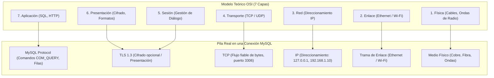
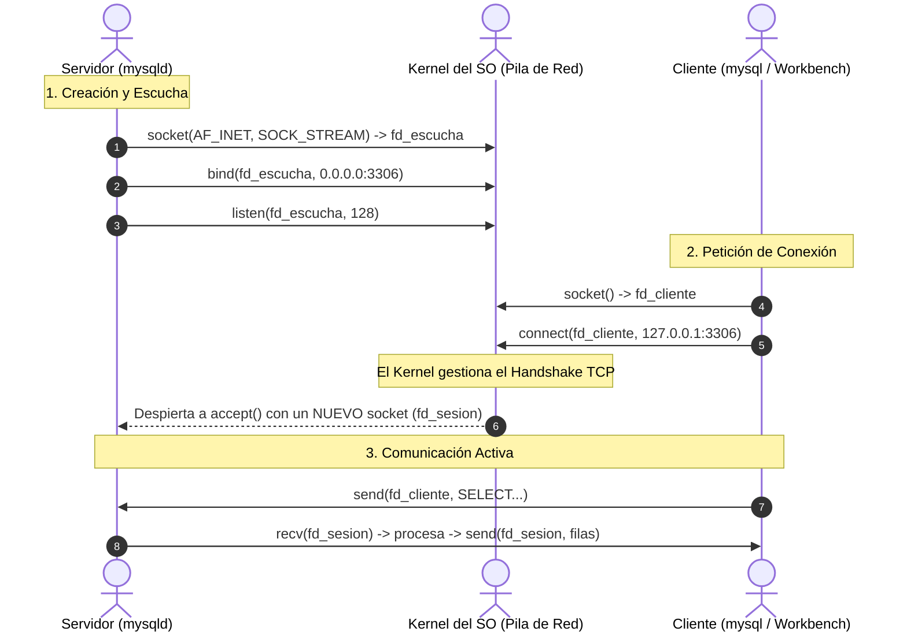
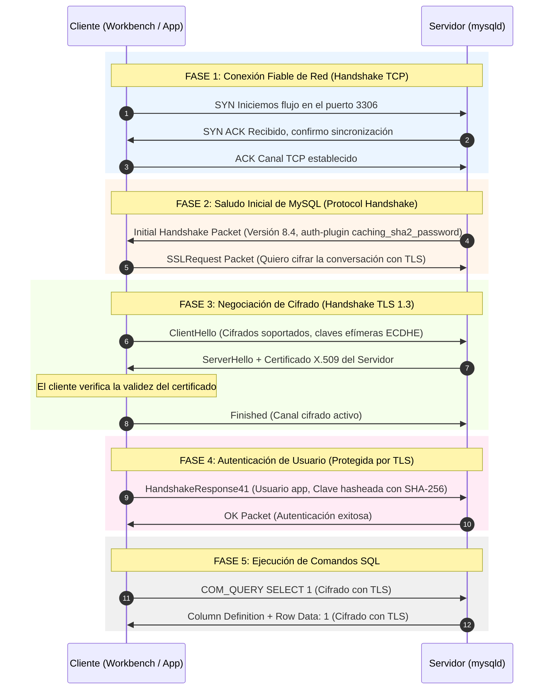
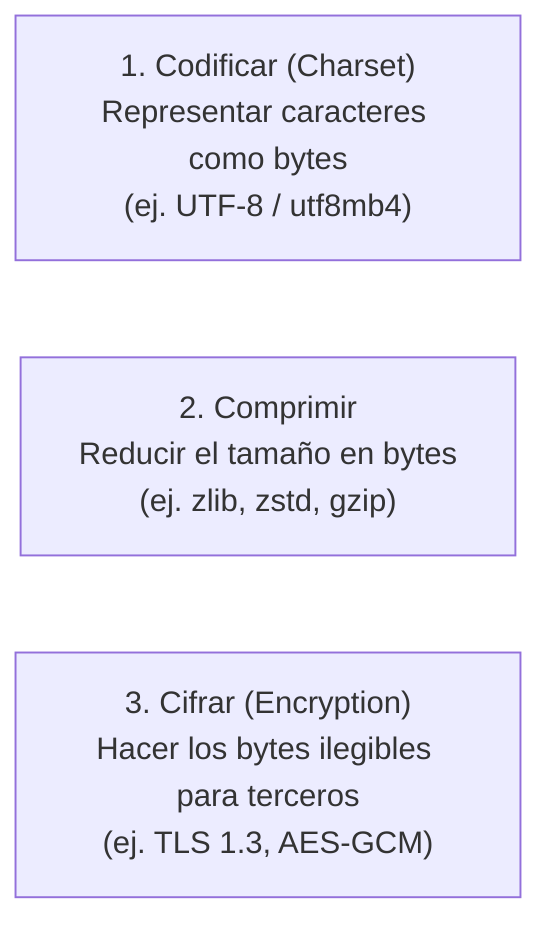
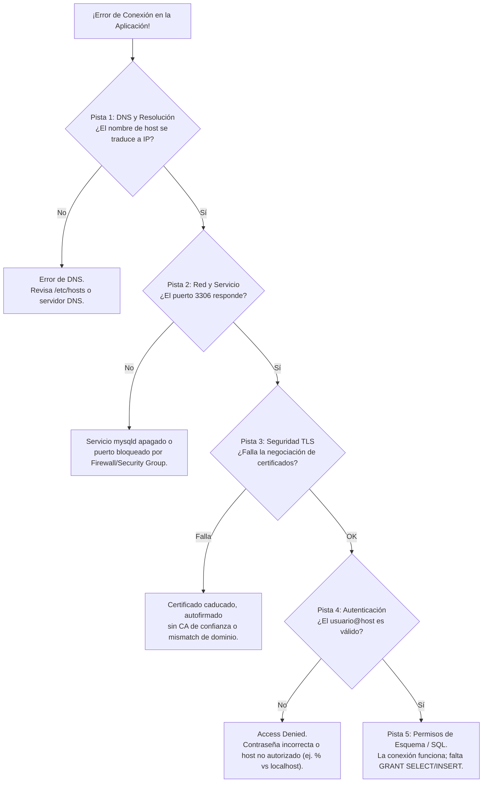
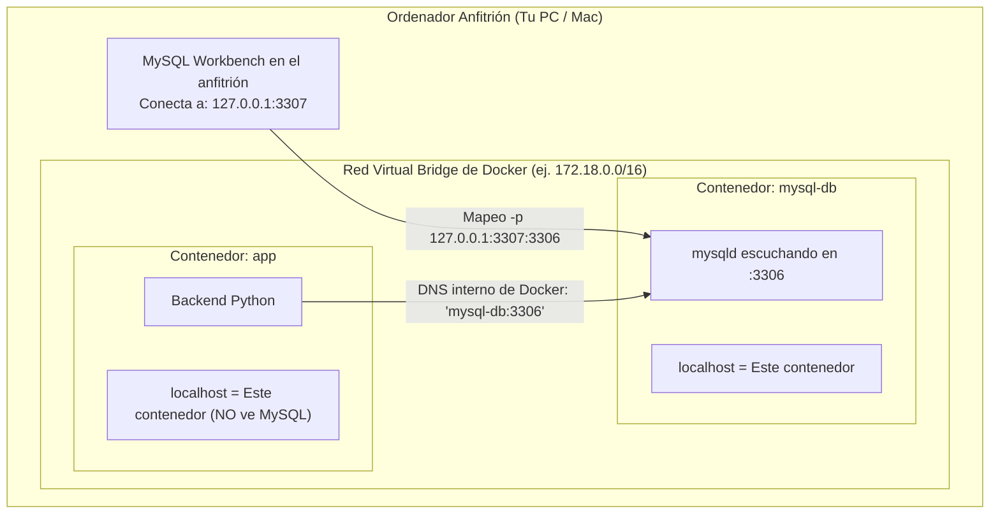
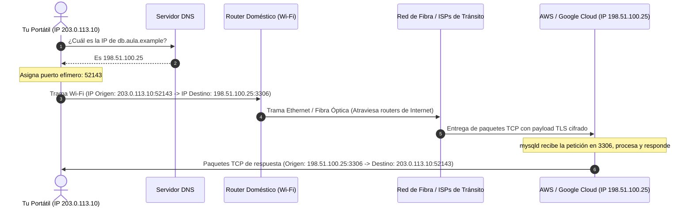

# 🌐 Manual Didáctico de Redes, Protocolos de Comunicación y el Viaje de una Consulta MySQL
### Del cable al byte: Modelo OSI, TCP/IP, Sockets Unix vs TCP, Handshakes, Análisis Forense de Paquetes, Docker y la Nube

> **Basado en la colección de infografías visuales de `Protocolos_Comunicaciones_Infografia`**  
> *Referencias técnicas:* RFC 1122 (Host Requirements), RFC 9293 (TCP), RFC 8446 (TLS 1.3), RFC 9110/9114 (HTTP/1.1 a HTTP/3), Documentación Oficial de MySQL Internals (Client/Server Protocol).

---

## 🧭 Prólogo: ¿Qué ocurre realmente entre el teclado y el disco?

Cuando un programador escribe en su aplicación:
```python
cursor.execute("SELECT nombre FROM alumno WHERE id = 1;")
```
...y un milisegundo después recibe el resultado en una variable, la sensación es de inmediatez mágica. Parece que la consulta se teletransporta directamente a la tabla.

Sin embargo, para que esa simple frase de texto en SQL viaje desde tu código hasta el motor `mysqld`, atraviese el sistema operativo, viaje por cables de cobre o pulsos de luz de fibra óptica, se proteja contra espías, se convierta en una estructura binaria con cabeceras de longitud y bytes de secuencia, y devuelva las filas formateadas, **deben coordinarse decenas de tecnologías inventadas durante los últimos cincuenta años de historia de la computación.**

Este manual tiene un objetivo: **abrir la caja negra**. A lo largo de 12 capítulos didácticos acompañados de sus infografías visuales, aprenderás:
1. Cómo se mapea el modelo teórico de 7 capas OSI a la realidad práctica de TCP/IP en bases de datos.
2. El viaje y la encapsulación de un paquete: cómo viaja un mensaje dentro de múltiples envoltorios.
3. Qué es exactamente un **Socket** en el sistema operativo y la diferencia crucial entre un **Socket Unix local** y una conexión **TCP de red**.
4. La anatomía previa al `SELECT`: los 3 handshakes consecutivos que ocurren antes de que MySQL ejecute una sola línea de SQL.
5. El análisis a nivel de byte con lupa: destripando la cabecera binaria de un paquete MySQL (`COM_QUERY`).
6. Codificación, compresión y cifrado: por qué `utf8mb4`, `zlib` y `TLS` son tres cosas totalmente distintas.
7. Técnicas de detective: herramientas de inspección en vivo (`ss`, `netstat`, variables de sesión y captura con Wireshark).
8. El laberinto de redes en **Docker** y el salto a la **Nube** pública.

---

## 📑 Índice de Contenidos

1. [Capítulo 1: El Mapa de las 7 Capas — Para no perderse en la red](#capítulo-1-el-mapa-de-las-7-capas--para-no-perderse-en-la-red)
2. [Capítulo 2: El Viaje de una Consulta — La Matrioshka de la Encapsulación](#capítulo-2-el-viaje-de-una-consulta--la-matrioshka-de-la-encapsulación)
3. [Capítulo 3: Protocolos Distintos, Trabajos Distintos — La Estación de Comunicaciones](#capítulo-3-protocolos-distintos-trabajos-distintos--la-estación-de-comunicaciones)
4. [Capítulo 4: Sockets — El Enchufe que Ofrece el Sistema Operativo](#capítulo-4-sockets--el-enchufe-que-ofrece-el-sistema-operativo)
5. [Capítulo 5: Dos Caminos Locales — TCP Loopback vs Socket Unix (AF_UNIX)](#capítulo-5-dos-caminos-locales--tcp-loopback-vs-socket-unix-af_unix)
6. [Capítulo 6: Antes del SELECT — Los Tres Handshakes Consecutivos](#capítulo-6-antes-del-select--los-tres-handshakes-consecutivos)
7. [Capítulo 7: Con la Lupa en el Paquete — Anatomía Binaria de un Mensaje MySQL](#capítulo-7-con-la-lupa-en-el-paquete--anatomía-binaria-de-un-mensaje-mysql)
8. [Capítulo 8: Texto, Binario y Unicode — Codificar, Comprimir y Cifrar](#capítulo-8-texto-binario-y-unicode--codificar-comprimir-y-cifrar)
9. [Capítulo 9: Detectives de Conexiones — Laboratorio Forense en Linux y Wireshark](#capítulo-9-detectives-de-conexiones--laboratorio-forense-en-linux-y-wireshark)
10. [Capítulo 10: Redes en Docker — Varias Casas en el Mismo Edificio](#capítulo-10-redes-en-docker--varias-casas-en-el-mismo-edificio)
11. [Capítulo 11: Hasta la Nube — Del Nombre de Dominio a la IP del Servidor](#capítulo-11-hasta-la-nube--del-nombre-de-dominio-a-la-ip-del-servidor)
12. [Capítulo 12: Comprimir, Cifrar y Tunelizar — El Dilema de la CPU vs la Red](#capítulo-12-comprimir-cifrar-y-tunelizar--el-dilema-de-la-cpu-vs-la-red)
13. [Guía Rápida de Diagnóstico de Redes para Administradores de Bases de Datos](#guía-rápida-de-diagnóstico-de-redes-para-administradores-de-bases-de-datos)

---

## Capítulo 1: El Mapa de las 7 Capas — Para no perderse en la red

<p align="center">
  
</p>

### La historia detrás de la lámina
En 1984, la Organización Internacional de Normalización (ISO) publicó el estándar **OSI (Open Systems Interconnection)** con sus célebres 7 capas. Muchos estudiantes memorizan las 7 capas como si fueran 7 programas ejecutables que corren en el ordenador. 

La lámina nos recuerda una gran verdad: **el modelo OSI es un mapa conceptual para entender responsabilidades, no siete programas obligatorios.** En la práctica, Internet y las bases de datos funcionan con el modelo **TCP/IP** (RFC 1122), que simplifica estas capas.

### Comparativa: Modelo OSI vs la Realidad de MySQL



### ¿Dónde encaja cada pieza?
1. **Capa de Aplicación:** Es donde habla MySQL. Aquí se generan los comandos de texto (`SELECT * FROM alumno;`) y se reciben las filas tabulares.
2. **Capa de Presentación y Sesión (TLS):** En TCP/IP no existen dos procesos separados para esto. Bibliotecas como OpenSSL se integran entre la aplicación y el transporte. **TLS (Transport Layer Security)** cifra las consultas y verifica la autenticidad del servidor mediante certificados.
3. **Capa de Transporte (TCP):** Convierte el torrente de datos en un flujo continuo y ordenado de bytes, garantizando que si un paquete se pierde en el camino, se retransmita automáticamente.
4. **Capa de Red (IP):** Coloca la dirección IP de origen y destino para que los routers sepan hacia qué red encaminar el paquete.
5. **Capa de Enlace y Física:** El paquete se empaqueta en tramas Ethernet o Wi-Fi y se modula en voltajes eléctricos, ondas de radio o destellos luminosos.

---

## Capítulo 2: El Viaje de una Consulta — La Matrioshka de la Encapsulación

<p align="center">
  
</p>

### La historia detrás de la lámina
Cuando una consulta sale de MySQL Workbench, no viaja desnuda por el cable. Sufre un proceso fascinante llamado **encapsulación**, exactamente como una muñeca rusa (*Matrioshka*): cada capa toma el mensaje de la capa superior, le añade su propia cabecera con instrucciones de entrega y lo mete dentro de un envoltorio más grande.

```
┌────────────────────────────────────────────────────────────────────────┐
│ Trama Ethernet / Wi-Fi (MAC Origen, MAC Destino)                      │
│  ┌──────────────────────────────────────────────────────────────────┐  │
│  │ Paquete IPv4 / IPv6 (IP Origen, IP Destino: 3306)                │  │
│  │  ┌────────────────────────────────────────────────────────────┐  │  │
│  │  │ Segmento TCP (Secuencia, ACK, Ventana, Puerto 3306)        │  │  │
│  │  │  ┌──────────────────────────────────────────────────────┐  │  │  │
│  │  │  │ Registro TLS (Opcional: Cifrado AES-GCM)             │  │  │  │
│  │  │  │  ┌────────────────────────────────────────────────┐  │  │  │  │
│  │  │  │  │ Mensaje MySQL (Longitud, Seq ID, COM_QUERY)     │  │  │  │  │
│  │  │  │  │  ┌──────────────────────────────────────────┐  │  │  │  │  │
│  │  │  │  │  │ "SELECT * FROM alumno;"                  │  │  │  │  │  │
│  │  │  │  │  └──────────────────────────────────────────┘  │  │  │  │  │
│  │  │  │  └────────────────────────────────────────────────┘  │  │  │  │
│  │  │  └──────────────────────────────────────────────────────┘  │  │  │
│  │  └────────────────────────────────────────────────────────────┘  │  │
│  └──────────────────────────────────────────────────────────────────┘  │
└────────────────────────────────────────────────────────────────────────┘
```

### El gran principio: Un mensaje MySQL no equivale a un segmento TCP
Un error muy habitual es pensar: *"Si envío un `SELECT`, viaja exactamente en un paquete TCP"*.  
**Falso.**

- **TCP es un protocolo de flujo de bytes (*stream*):** No tiene el concepto de "mensajes" ni "frases". Solo ve una tubería infinita de bytes. Si la red lo considera óptimo, TCP puede partir un mensaje largo de MySQL en tres segmentos TCP pequeños, o juntar dos mensajes cortos de MySQL dentro del mismo segmento.
- **La capa de aplicación (MySQL) es la responsable de delimitar:** Por eso, como veremos en el Capítulo 7, todo paquete MySQL empieza con **3 bytes que indican su longitud exacta**. Así, cuando el servidor lee del socket TCP, sabe exactamente cuántos bytes debe esperar antes de procesar el comando completo.

### Un vistazo al peso de las cabeceras (Sobrecarga de red)
- **Cabecera Ethernet:** 14 bytes (+ 4 bytes de verificación CRC).
- **Cabecera IPv4 (sin opciones):** 20 bytes.
- **Cabecera TCP (sin opciones):** 20 bytes.
- **Cabecera de Registro TLS (si hay cifrado):** 5 bytes (+ tag de autenticación).
- **Cabecera MySQL:** 4 bytes.

> [!NOTE]
> Para enviar una consulta de 10 bytes de texto como `SELECT 1;`, se necesitan al menos **63 bytes de envoltorios de red**. ¡El envoltorio pesa 6 veces más que el propio mensaje!

---

## Capítulo 3: Protocolos Distintos, Trabajos Distintos — La Estación de Comunicaciones

<p align="center">
  
</p>

### La historia detrás de la lámina
En una misma estación central de ferrocarril circulan trenes de mercancías, cercanías de pasajeros y convoyes de alta velocidad. En tu tarjeta de red ocurre exactamente lo mismo: **diferentes protocolos comparten el mismo cable para tareas totalmente distintas.**

### Comparativa de protocolos habituales

| Protocolo | Propósito Principal | Puerto Habitual | Transporte | ¿Cómo maneja la sesión? |
|---|---|---|---|---|
| **MySQL Clásico** | Consultas SQL y entrega de conjuntos de filas tabulares. | `3306` | TCP | Sesión persistente con estado autenticado (conexión viva). |
| **HTTP/1.1 y HTTP/2** | Transferencia de hipertexto, APIs REST y recursos web. | `80` (HTTP) / `443` (HTTPS) | TCP | Históricamente sin estado (*stateless*); uso de cookies y tokens. |
| **HTTP/3** | La evolución moderna de la web. | `443` | **QUIC (UDP)** | Multiplexación sin bloqueo de cabeza de línea (*Head-of-Line Blocking*). |
| **FTP** | Transferencia de ficheros de gran tamaño. | `21` (Control) + datos dinámicos | TCP | **Doble conexión:** una para órdenes y otra para transmitir los bytes. |
| **SSH** | Administración remota de servidores y túneles cifrados. | `22` | TCP | Canal seguro autenticado por clave pública/privada. |
| **TLS** | Capa de seguridad criptográfica transversal. | Mismo puerto del protocolo base | TCP | Cifra, asegura integridad y valida certificados. |

> [!IMPORTANT]
> **TLS no sustituye a los demás protocolos, los protege:**  
> `HTTPS` no es un protocolo nuevo: es simplemente `HTTP` viajando dentro de un túnel `TLS`.  
> Del mismo modo, `MySQL + TLS` sigue siendo el protocolo clásico de MySQL, pero con sus bytes cifrados para que ningún intermediario en la red pueda leer contraseñas ni datos personales.

---

## Capítulo 4: Sockets — El Enchufe que Ofrece el Sistema Operativo

<p align="center">
  
</p>

### La historia detrás de la lámina
Muchos programadores usan la palabra "socket" como sinónimo de cable o de dirección web. En realidad, en la arquitectura de sistemas tipo Unix y Linux:  
**Un Socket es un descriptor de archivo (`int fd = 3;`) proporcionado por el kernel que sirve como extremo de comunicación bidireccional.**

Es el "enchufe" por el que un programa de usuario (como MySQL Workbench o `mysqld`) lee y escribe bytes sin tener que preocuparse de cómo funciona la tarjeta de red física.



### Las dos grandes familias de Sockets:
1. **`AF_INET` / `AF_INET6` (Sockets de Red):**
   - Comunican procesos a través de una red IP (o en la misma máquina mediante la interfaz loopback `127.0.0.1`).
   - La dirección se compone obligatoriamente de **IP + Puerto** (ej. `192.168.1.10:3306`).
   - Atraviesa la pila completa de protocolos TCP/IP del kernel.
2. **`AF_UNIX` (Sockets de Dominio Unix):**
   - Diseñados **exclusivamente para comunicación interproceso (IPC) dentro de la misma máquina física**.
   - No usan direcciones IP ni números de puerto.
   - La dirección es una ruta en el sistema de archivos (ej. `/var/run/mysqld/mysqld.sock`).
   - El intercambio de datos se realiza en memoria RAM gestionada directamente por el kernel, evitando por completo la sobrecarga de TCP e IP.

---

## Capítulo 5: Dos Caminos Locales — TCP Loopback vs Socket Unix (AF_UNIX)

<p align="center">
  
</p>
<p align="center">
  
</p>

### La historia detrás de las láminas
Cuando ejecutas el cliente `mysql` en tu propio ordenador donde corre el servidor, tienes dos formas totalmente distintas de hablar con él. Entender la diferencia te ahorrará horas de depuración en Linux y macOS.

### Camino A: Conexión TCP Loopback (`127.0.0.1:3306`)
- Ejecutas:
  ```bash
  mysql --protocol=TCP -h 127.0.0.1 -P 3306 -u root -p
  ```
- **Cómo viaja:** La consulta desciende por la capa de transporte (TCP), pasa por la capa de red (IPv4) y llega a la interfaz virtual de red `lo` (*loopback*). El kernel detecta que la IP de destino es él mismo, da media vuelta al paquete en memoria y se lo entrega a `mysqld`.
- **Ventaja:** Funciona de forma idéntica en Windows, Linux y macOS. Es el estándar que utiliza **MySQL Workbench** en su método de conexión *Standard (TCP/IP)*.

### Camino B: Conexión por Socket Unix (`AF_UNIX`)
- Ejecutas:
  ```bash
  mysql --protocol=SOCKET --socket=/var/run/mysqld/mysqld.sock -u root -p
  ```
- **Cómo viaja:** No hay paquetes TCP, ni números de secuencia, ni cabeceras IP, ni checksums. El kernel copia directamente los bytes de memoria del proceso cliente a la cola de recepción del proceso `mysqld`.
- **Rendimiento:** Es entre un **15% y un 25% más rápido** en latencia y consume menos CPU que una conexión TCP local.
- **La gran confusión del archivo `.sock`:**  
  El archivo `/var/run/mysqld/mysqld.sock` tiene tamaño 0 bytes. **No guarda datos ni consultas.** Es únicamente un punto de encuentro en el árbol de directorios para que el cliente y el servidor enlacen sus colas de memoria.

> [!TIP]
> **El comportamiento oculto de `localhost` en la terminal de Linux:**  
> En los clientes de consola tipo Unix, si escribes `-h localhost`, el cliente asume automáticamente que quieres usar el **Socket Unix**. Si escribes `-h 127.0.0.1`, fuerzas al cliente a usar **TCP de red**.  
> Para saber la ruta exacta del socket en tu servidor MySQL, ejecuta:
> ```sql
> SHOW VARIABLES LIKE 'socket';
> ```

---

## Capítulo 6: Antes del SELECT — Los Tres Handshakes Consecutivos

<p align="center">
  
</p>

### La historia detrás de la lámina
Antes de que puedas ejecutar un inocente `SELECT 1;`, cliente y servidor deben mantener **tres conversaciones preliminares obligatorias** para acordar cómo van a hablar y comprobar si tienen permiso para hacerlo.



### Las 4 fases explicadas:
1. **Fase 1 (TCP Handshake de 3 vías):** `SYN` ➔ `SYN-ACK` ➔ `ACK`. Abre el canal de bytes. Todavía nadie sabe nada de MySQL ni de SQL.
2. **Fase 2 (Saludo MySQL y solicitud TLS):** En la mayoría de los protocolos de Internet el cliente habla primero (ej. HTTP). **En MySQL el servidor saluda primero**: le dice al cliente qué versión es, qué capacidades técnicas soporta y qué plugin de autenticación espera. El cliente responde con `SSLRequest` solicitando activar cifrado.
3. **Fase 3 (TLS Handshake):** Se intercambian certificados criptográficos y se calculan claves simétricas efímeras. A partir de este momento, ningún paquete que viaje por el cable podrá ser leído por un tercero.
4. **Fase 4 (Autenticación de credenciales):** El cliente envía el nombre de usuario y el hash de la contraseña protegido dentro de la capa TLS. Si todo es correcto, el servidor responde con un `OK Packet`.

---

## Capítulo 7: Con la Lupa en el Paquete — Anatomía Binaria de un Mensaje MySQL

<p align="center">
  
</p>
<p align="center">
  
</p>

### La historia detrás de las láminas
¿Qué aspecto tienen exactamente los bytes de un `SELECT 1;` cuando viajan por el protocolo clásico de MySQL? Si congelamos el tráfico en un analizador hexadecimal, encontramos una estructura matemática de una precisión asombrosa.

### La cabecera clásica de 4 bytes de MySQL

Cualquier mensaje en el protocolo clásico de MySQL comienza siempre con **4 bytes obligatorios**:

```
 0               1               2               3
+---------------+---------------+---------------+---------------+
|       Longitud del Payload (3 bytes, Little-Endian)   | Secuencia (1B)|
+---------------+---------------+---------------+---------------+
| Tipo Comando  | Cadena SQL o datos del Payload...             |
+---------------+---------------+---------------+---------------+
```

1. **Bytes 0, 1 y 2 (Longitud del Payload - 3 bytes):**
   - Indican cuántos bytes de contenido vienen a continuación.
   - Al usar 3 bytes, el tamaño máximo de un único paquete MySQL es:
     $$2^{24} - 1 = 16.777.215 \text{ bytes} \approx 16 \text{ MB}$$
     *(Si una consulta o resultado supera los 16 MB, MySQL divide los datos en múltiples paquetes consecutivos).*
   - Se codifica en **Little-Endian** (el byte menos significativo va primero).
2. **Byte 3 (Número de Secuencia - 1 byte):**
   - Comienza en `0x00` al iniciar un nuevo comando del cliente y se incrementa en `1` con cada paquete de respuesta. Sirve para que cliente y servidor sincronicen el orden de los mensajes en caso de respuestas fragmentadas.

---

### Disección byte a byte de la petición: `SELECT 1`

Analicemos la tira de bytes hexadecimales que muestra la infografía:

$$\mathbf{09 \ 00 \ 00 \ 00 \ 03 \ 53 \ 45 \ 4C \ 45 \ 43 \ 54 \ 20 \ 31}$$

```
Byte 0..2 : 09 00 00  --> Longitud = 9 bytes (0x000009 en little-endian)
Byte 3    : 00        --> Número de secuencia = 0 (inicio de comando)
Byte 4    : 03        --> Código de comando: COM_QUERY (indica sentencia SQL en texto)
Byte 5..12: 53 45 4C 45 43 54 20 31 
            S  E  L  E  C  T     1  --> Texto ASCII/UTF-8 de la consulta
```
**Total:** 4 bytes de cabecera + 9 bytes de payload = **13 bytes de mensaje MySQL**.

---

### La respuesta del servidor: ¿Por qué requiere varios mensajes?
Cuando el servidor procesa `SELECT 1;`, no responde con un simple número `1`. Debe enviar una estructura tabular completa para que Workbench pueda pintar la rejilla:
1. **Mensaje 1 (Metadatos):** Indica cuántas columnas vienen en el resultado (en este caso, 1 columna), el tipo de dato (`MYSQL_TYPE_LONGLONG`), el nombre de la columna (`1`) y la codificación de caracteres.
2. **Mensaje 2 (Fila de datos):** El valor real formateado.
3. **Mensaje 3 (Fin de resultado):** Paquete `EOF` o paquete `OK` con la marca que indica que no hay más filas que leer.

---

## Capítulo 8: Texto, Binario y Unicode — Codificar, Comprimir y Cifrar

<p align="center">
  
</p>
<p align="center">
  
</p>

### La historia detrás de las láminas
En informática suele haber una tremenda confusión entre tres conceptos que suenan parecidos pero resuelven problemas completamente distintos:



### 1. Unicode y el estándar utf8mb4
- En el código ASCII tradicional, cada letra ocupaba exactamente 1 byte (del 0 al 127).
- En el mundo globalizado existen letras con tildes (`á`), eñes (`ñ`), alfabetos cirílicos, caracteres chinos y emojis (`🚀`).
- **`utf8mb4` en MySQL:** Es la codificación recomendada. Puede ocupar **entre 1 y 4 bytes por cada carácter**.  
  *Peligro histórico:* En versiones antiguas de MySQL existía un conjunto llamado `utf8` (que en realidad era `utf8mb3`), el cual solo permitía hasta 3 bytes por carácter. Si un usuario intentaba insertar un emoji de 4 bytes, la consulta fallaba o truncaba el texto. ¡Usa siempre `utf8mb4`!

### 2. Protocolo de Texto vs Protocolo de Sentencias Preparadas (Prepared Statements)
MySQL soporta dos formas de transportar consultas y resultados:

| Característica | Protocolo de Texto Clásico (`COM_QUERY`) | Protocolo Binario Nativo (`COM_STMT_EXECUTE`) |
|---|---|---|
| **Formato de la consulta** | Cadena de texto concatenada (`SELECT * FROM alumno WHERE id=1;`). | Sentencia parametrizada compilada (`SELECT * FROM alumno WHERE id=?;`). |
| **Formato de los resultados** | **Todo se envía como cadenas de caracteres.** Si devuelves el entero `42`, viaja como `"42"` (los caracteres ASCII `0x34` y `0x32`). | **Los datos viajan en su representación binaria nativa.** El entero `42` viaja como un entero de 4 bytes en memoria (`0x2A 0x00 0x00 0x00`). |
| **Seguridad (Inyección SQL)** | Vulnerable si no escapas parámetros a mano. | **Inmune por diseño a SQL Injection** (los parámetros viajan separados del árbol sintáctico). |
| **Eficiencia de parsing** | El servidor debe parsear y compilar el SQL cada vez. | Se compila una sola vez con `PREPARE` y se ejecuta $N$ veces rápidamente. |

### 3. Las variables de Character Set y Collation
Para inspeccionar cómo interpreta el texto tu sesión de MySQL:

```sql
SHOW VARIABLES LIKE 'character_set%';
```
- **`character_set_client`:** En qué codificación escribe tu cliente (ej. `utf8mb4`).
- **`character_set_connection`:** A qué codificación traduce el servidor los literales antes de evaluar las consultas.
- **`character_set_results`:** En qué codificación quieres que el servidor te devuelva las respuestas.
- **`collation`:** La regla que decide **cómo comparar y ordenar**. Por ejemplo, `utf8mb4_0900_ai_ci` significa que ignora acentos (*accent-insensitive: ai*) e ignora mayúsculas/minúsculas (*case-insensitive: ci*): para esta collation, `'Ána'` y `'ana'` se consideran iguales en un `WHERE` o un índice `UNIQUE`.

---

## Capítulo 9: Detectives de Conexiones — Laboratorio Forense en Linux y Wireshark

<p align="center">
  
</p>

### La historia detrás de la lámina
Cuando una aplicación lanza el temido mensaje: *"Error: Can't connect to MySQL server"*, un mal desarrollador se limita a reiniciar cosas al azar. Un ingeniero sénior se convierte en un **detective forense** y utiliza herramientas de diagnóstico para aislar exactamente en qué capa de la red está el fallo.

### Herramienta 1: ¿Quién está escuchando en el servidor Linux? (`ss`)
El comando moderno que sustituye al antiguo `netstat` es **`ss`** (Socket Statistics):

```bash
# 1. Comprobar escuchas TCP en el puerto 3306
ss -ltnp '( sport = :3306 )'
# Muestra: LISTEN 0 128 0.0.0.0:3306 (escuchando en todas las interfaces)
# Proceso: mysqld (pid 1234)

# 2. Comprobar sockets Unix activos de MySQL
ss -lxnp | grep mysqld.sock
# Muestra: LISTEN 0 128 /var/run/mysqld/mysqld.sock
```

### Herramienta 2: Radiografía desde el propio cliente MySQL
Una vez conectado al cliente de consola, puedes interrogar a la sesión:

```sql
-- Resumen completo de transporte, versión y SSL
\s

-- ¿Qué algoritmo de cifrado TLS estamos usando exactamente?
SHOW SESSION STATUS LIKE 'Ssl_cipher';
-- Valor: TLS_AES_256_GCM_SHA384 (Cifrado militar autenticado)

-- ¿Está activa la compresión de paquetes?
SHOW SESSION STATUS LIKE 'Compression';
-- Valor: OFF (o ON si se negoció zlib/zstd)
```

### Herramienta 3: Inspección visual de paquetes con Wireshark
Si capturas el tráfico de red con **Wireshark** o **tcpdump**:
- Filtro de visualización: `tcp.port == 3306 || tcp.port == 3307`
- Verás claramente las banderas TCP: `[SYN]`, `[SYN, ACK]`, `[ACK]`.
- **Si la conexión usa TLS:** Los paquetes aparecerán etiquetados como `Application Data` y su contenido será ruido hexadecimal indescifrable (`17 03 03...`). ¡El cifrado funciona!
- **Si conectaste por Socket Unix (`/var/run/mysqld/mysqld.sock`):** Wireshark **no capturará absolutamente nada**, porque el tráfico jamás pasa por la tarjeta de red ni por la interfaz loopback.

---

### 🔍 Las 5 Pistas del Detective para Resolver Errores de Conexión



---

## Capítulo 10: Redes en Docker — Varias Casas en el Mismo Edificio

<p align="center">
  
</p>

### La historia detrás de la lámina
La metáfora de la lámina es perfecta: **los contenedores Docker son como diferentes apartamentos dentro del mismo edificio.**  
Cada apartamento tiene su propia cocina, su propio baño y su propia puerta de entrada.

### La trampa mortal de `localhost` en Docker
Imagina que despliegas dos contenedores:
1. Contenedor **`app`** (tu backend en Python o Node.js).
2. Contenedor **`mysql-db`** (tu base de datos MySQL).

En el archivo de configuración de tu aplicación en Python escribes:
```python
DB_HOST = "localhost"
DB_PORT = 3306
```
Arrancas la aplicación y... **¡CRASH! Connection Refused.**

*¿Por qué falla?*  
Porque dentro del contenedor `app`, **`localhost` significa "yo mismo"** (el espacio de red aislado de ese contenedor). Y dentro de ese contenedor no hay ningún servidor MySQL ejecutándose; MySQL vive en el contenedor de al lado.



### Las dos reglas sagradas del Networking en Docker:
1. **Para conectar desde tu ordenador anfitrión (ej. Workbench):**  
   Debes publicar el puerto al arrancar el contenedor:
   ```bash
   docker run -d --name mysql-db \
     -p 127.0.0.1:3307:3306 \
     -e MYSQL_ROOT_PASSWORD='secret' \
     mysql:8.4
   ```
   En Workbench te conectas a `127.0.0.1` en el puerto **`3307`**. Docker redirigirá el tráfico hacia el puerto `3306` interno del contenedor.
2. **Para comunicar dos contenedores entre sí (ej. con Docker Compose):**  
   Debes conectarlos a la misma red virtual de Docker. **Utiliza el nombre del servicio como Hostname**:
   ```yaml
   services:
     app:
       build: .
       environment:
         - DB_HOST=mysql-db    # El DNS interno de Docker resolverá la IP
         - DB_PORT=3306        # ¡Aquí sí usamos el puerto interno 3306!
     mysql-db:
       image: mysql:8.4
   ```

---

## Capítulo 11: Hasta la Nube — Del Nombre de Dominio a la IP del Servidor

<p align="center">
  
</p>
<p align="center">
  
</p>

### La historia detrás de las láminas
¿Qué ocurre cuando la base de datos no está en tu portátil ni en un contenedor, sino en un centro de datos en la nube (AWS RDS, Google Cloud SQL o Azure Database for MySQL)?

El paquete atraviesa un viaje transcontinental donde cada capa física y lógica cumple su misión:



### Los tres conceptos clave del viaje a la nube:
1. **Resolución DNS previa:** Antes del primer paquete TCP, el sistema operativo consulta al DNS para traducir el nombre amigable (`db.aula.example`) a una dirección IP enrutable (`198.51.100.25`).
2. **Puertos Efímeros del Cliente:** Mientras que el servidor siempre escucha en un puerto fijo (`3306`), tu sistema operativo asigna a Workbench un **puerto temporal aleatorio** (ej. `52143`) para poder distinguir la respuesta de MySQL de otras pestañas o programas abiertos.
3. **El coste de la latencia (RTT - Round Trip Time):** En tu propia máquina local, un paquete tarda menos de $0.1 \text{ ms}$ en ir y volver. En la nube, cada ida y vuelta puede tardar entre $20 \text{ ms}$ y $80 \text{ ms}$.  
   *Consecuencia para el desarrollador:* **Reutiliza conexiones mediante Pools de Conexiones** (evitas repetir el TCP y TLS handshake en cada petición) y **evita el problema de las consultas $N+1$** (hacer 100 consultas `SELECT` individuales a la nube destruirá el rendimiento de tu aplicación por pura latencia de red).

---

## Capítulo 12: Comprimir, Cifrar y Tunelizar — El Dilema de la CPU vs la Red

<p align="center">
  
</p>

### La historia detrás de la lámina
Cuando transportamos datos por redes públicas, queremos que viajen **rápido** (comprimiendo) y **seguros** (cifrando o tunelizando). Pero cada una de estas capas introduce compromisos técnicos que conviene medir con rigor.

### 1. La regla de oro: Primero comprimir, después cifrar
¿Por qué se debe comprimir **antes** de cifrar?
- Un buen algoritmo de cifrado moderno (como AES-256) transforma los datos en una secuencia que es matemáticamente indistinguible de ruido completamente aleatorio.
- Los algoritmos de compresión (como `zlib` o `zstd`) se basan en encontrar repeticiones y patrones en los datos para reducir su tamaño.
- **Si intentas comprimir datos ya cifrados, la compresión no reducirá ni un solo byte**, consumiendo CPU inútilmente. Por eso, MySQL comprime primero el mensaje SQL y luego se lo entrega a la capa TLS para su cifrado.

### 2. Anatomía de las cabeceras de compresión
- **Cabecera de Compresión de MySQL:** Ocupa **7 bytes**:
  - 3 bytes: Longitud de los datos comprimidos.
  - 1 byte: Número de secuencia.
  - 3 bytes: Longitud de los datos originales sin comprimir (para que el receptor sepa cuánta memoria reservar al descomprimir).
- **Cabecera de Registro TLS:** Ocupa **5 bytes** (Tipo de contenido, Versión, Longitud) más el código MAC de autenticación.

### 3. El Túnel SSH y el Servidor Bastión
Muchas empresas prohíben exponer el puerto 3306 de sus bases de datos a Internet. La solución estándar es utilizar un **túnel SSH a través de un servidor bastión**:

```
[ Tu Portátil ] ═══════════ Túnel SSH (Puerto 22) ═══════════► [ Servidor Bastión ]
   (Workbench)                                                      │
                                                              Red Interna (VPC)
                                                            (Puerto 3306 sin cifrar)
                                                                    │
                                                                    ▼
                                                            [ MySQL Server ]
```

> [!CAUTION]
> **La falsa sensación de seguridad del Túnel SSH:**  
> Como muestra la infografía, el túnel SSH cifra el tráfico únicamente **entre tu portátil y el servidor bastión**. El tramo de red interna entre el bastión y el servidor MySQL final viaja desprotegido a menos que actives también **TLS dentro de MySQL**. No supongas que SSH protege todo el recorrido si no controlas el último tramo.

---

## Guía Rápida de Diagnóstico de Redes para Administradores de Bases de Datos

Guarda esta tabla como referencia rápida para cuando una conexión con MySQL no funcione:

| Síntoma o Error | Capa OSI Afectada | Causa Raíz Probable | Comando de Verificación |
|---|---|---|---|
| `Unknown MySQL server host 'db.empresa.com'` | Capa 7 (DNS) | El nombre no se puede resolver a una IP válida. | `nslookup db.empresa.com` o `dig db.empresa.com` |
| `Can't connect to MySQL server on '...' (10061 / 61)` | Capa 4 (Transporte TCP) | `mysqld` no está arrancado o el puerto 3306 está cerrado en el cortafuegos. | `nc -zv <IP> 3306` o `telnet <IP> 3306` |
| `SSL connection error: certificate verify failed` | Capa 6 (Presentación / TLS) | Certificado autofirmado no reconocido o el nombre del host no coincide con el CN/SAN. | `openssl s_client -connect <IP>:3306 -starttls mysql` |
| `Access denied for user 'app'@'192.168.1.5'` | Capa 7 (Autenticación MySQL) | La contraseña es errónea o el usuario no tiene permiso para conectar desde esa IP concreta. | Revisar `SELECT user, host FROM mysql.user;` |
| `Connection timed out` en la nube | Capa 3 (Enrutamiento IP) | Las tablas de rutas de la nube o el Security Group no tienen regla de entrada (*Ingress*) para tu IP pública. | `traceroute <IP>` o revisar consola de AWS/GCP |
| En Docker: `Connection refused` a `localhost` | Red de Contenedores | Tu backend intenta buscar MySQL dentro de su propio contenedor en vez de usar el nombre de servicio. | Cambiar `localhost` por el nombre del contenedor en el `docker-compose.yml` |
| Rendimiento lento con muchas consultas pequeñas | Latencia de Red (RTT) | Demasiadas idas y vueltas a un servidor remoto lejano (problema $N+1$). | Implementar *Connection Pooling* y agrupar consultas con `JOIN` |

