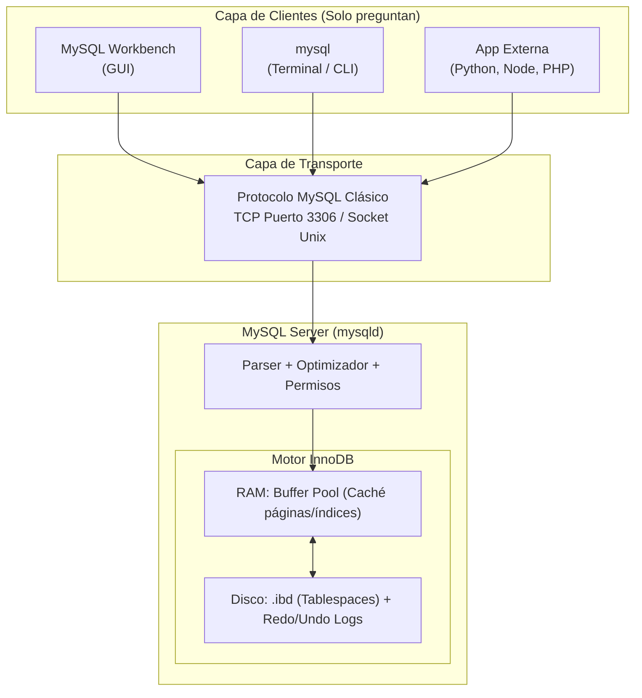
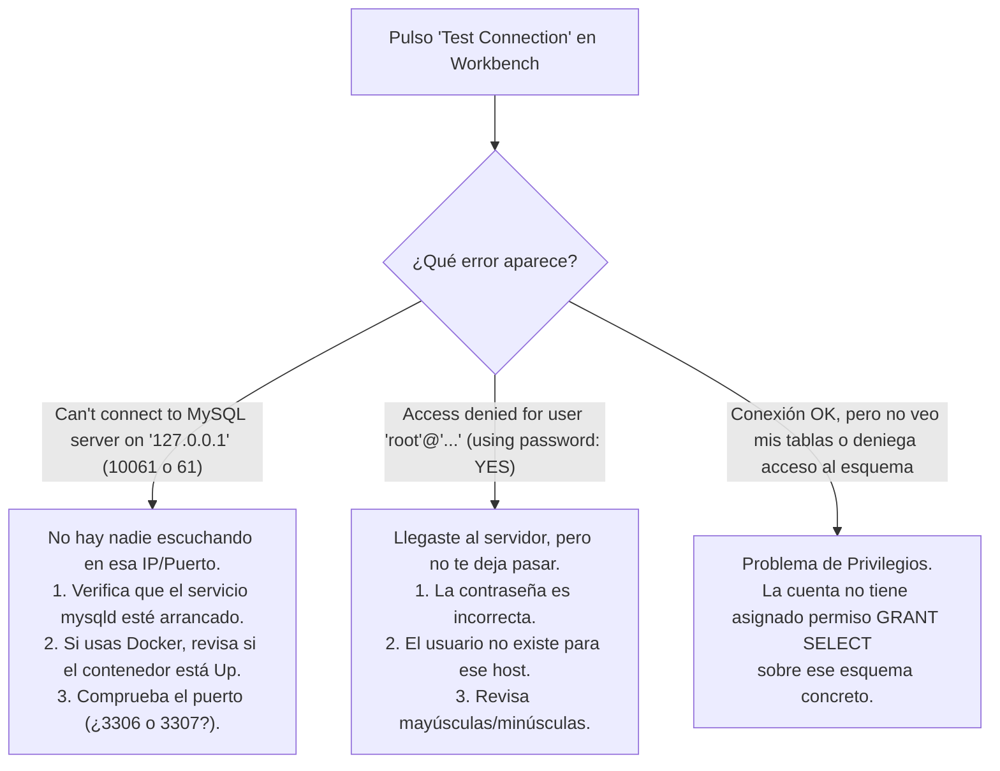
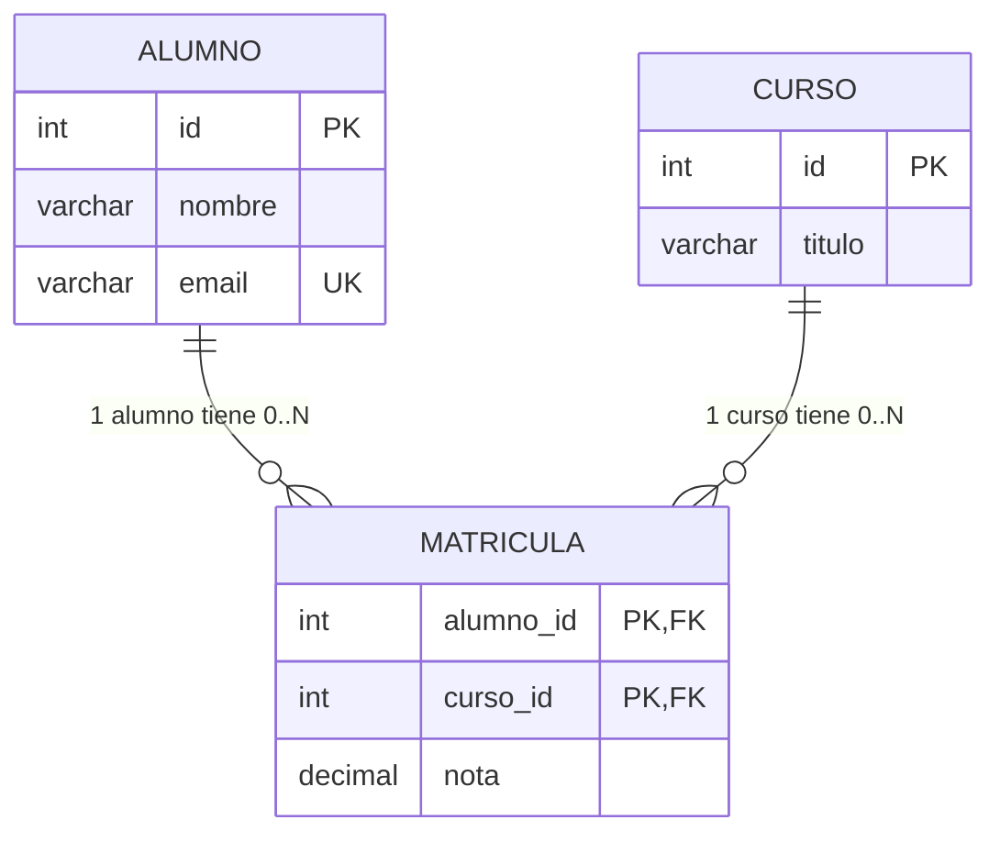
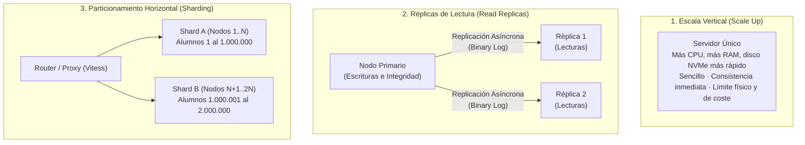
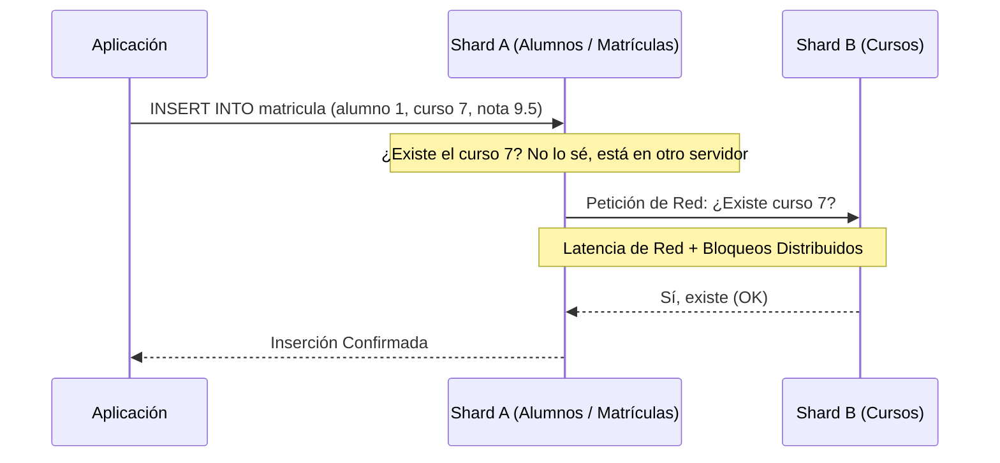

# 📘 Manual Visual de MySQL Workbench, Arquitectura y Constraints
### Storytelling didáctico, ingeniería inversa de modelos EER y guía técnica profunda de integridad referencial

> **Basado en la infografía visual de 12 láminas y el laboratorio práctico `academia_practica.sql`**  
> *Entorno de referencia:* MySQL 8.0.16+ / 8.4 LTS · Motor de almacenamiento InnoDB · MySQL Workbench 8.0

---

## 🧭 Prólogo: La perspectiva completa de MySQL

Cuando abrimos **MySQL Workbench** por primera vez, es muy fácil caer en una ilusión común: pensar que Workbench *es* la base de datos. Vemos un formulario para conectarnos, unas tablas a la izquierda, un editor en blanco y un botón con un rayo para ejecutar consultas. Si algo falla o no se guarda, culpamos a la ventana.

La realidad de la ingeniería de software es muy distinta: **Workbench es únicamente el mando a distancia; el televisor y la emisora están en otro lugar.**

A lo largo de este manual vamos a recorrer las 12 láminas de la infografía visual de la carpeta `Workbench`, tejiendo un relato técnico que te permitirá entender:
1. Qué piezas de software y hardware se mueven en cada consulta.
2. Cómo trabaja el protocolo de comunicaciones de MySQL y en qué se diferencia del protocolo web HTTP.
3. Cómo sacarle el máximo partido a MySQL Workbench para **diseñar, extraer y visualizar diagramas EER (Entidad-Relación Extendido)** mediante ingeniería inversa (*Reverse Engineering*).
4. El papel fundamental de las **Constraints (Restricciones)**, con especial atención a las claves foráneas (**Foreign Keys**) y reglas como `ON DELETE RESTRICT`, `CASCADE` y `SET NULL`.
5. La administración segura: usuarios, privilegios, transacciones y copias de seguridad.
6. Qué ocurre cuando salimos de nuestro ordenador hacia Docker, la nube y los retos de la escalabilidad horizontal (*Sharding*).

Para que todo sea tangible, nos acompañará un caso de estudio real: una pequeña **Academia** universitaria que gestiona **alumnos**, **cursos** y **matrículas**.

---

## 📑 Índice de Contenidos

1. [Acto 1: El Mapa y la Separación de Poderes (Workbench vs mysqld)](#acto-1-el-mapa-y-la-separación-de-poderes-workbench-vs-mysqld)
2. [Acto 2: La Conversación — Dos Rutas: HTTP y el Protocolo MySQL](#acto-2-la-conversación--dos-rutas-http-y-el-protocolo-mysql)
3. [Acto 3: Conectarse es Elegir una Puerta](#acto-3-conectarse-es-elegir-una-puerta)
4. [Acto 4: Tu Primera Consulta y los Secretos del Editor SQL](#acto-4-tu-primera-consulta-y-los-secretos-del-editor-sql)
5. [Acto 5: El Diagrama EER — De las Tablas al Modelo Visual (Guía Paso a Paso)](#acto-5-el-diagrama-eer--de-las-tablas-al-modelo-visual-guía-paso-a-paso)
6. [Acto 6: Diseña Reglas, no solo Tablas — Las Casillas Sagradas de Workbench](#acto-6-diseña-reglas-no-solo-tablas--las-casillas-sagradas-de-workbench)
7. [Acto 7: EL GUARDIÁN DE LA INTEGRIDAD — Guía Profunda de Constraints](#acto-7-el-guardián-de-la-integridad--guía-profunda-de-constraints)
   - [7.1. ¿Dónde vive la restricción y por qué no depende del cliente?](#71-dónde-vive-la-restricción-y-por-qué-no-depende-del-cliente)
   - [7.2. Constraints de columna y tabla (PK, NOT NULL, UNIQUE, CHECK)](#72-constraints-de-columna-y-tabla-pk-not-null-unique-check)
   - [7.3. Integridad Referencial y Foreign Keys](#73-integridad-referencial-y-foreign-keys)
   - [7.4. Anatomía de las Acciones Referenciales: ON DELETE / ON UPDATE](#74-anatomía-de-las-acciones-referenciales-on-delete--on-update)
   - [7.5. Laboratorio Práctico de Errores y Comportamientos](#75-laboratorio-práctico-de-errores-y-comportamientos)
8. [Acto 8: Usuarios y Privilegios — La Misma Puerta, Distintas Llaves](#acto-8-usuarios-y-privilegios--la-misma-puerta-distintas-llaves)
9. [Acto 9: Contraseñas, Transacciones y Marcha Atrás](#acto-9-contraseñas-transacciones-y-marcha-atrás)
10. [Acto 10: Cuidar el Servidor — Salud, Diagnóstico y Copias de Seguridad](#acto-10-cuidar-el-servidor--salud-diagnóstico-y-copias-de-seguridad)
11. [Acto 11: Otra Ubicación — Local, Docker y la Nube](#acto-11-otra-ubicación--local-docker-y-la-nube)
12. [Acto 12: Escalar — Crecer no Siempre es Repartir (El Coste Oculto de las FKs)](#acto-12-escalar--crecer-no-siempre-es-repartir-el-coste-oculto-de-las-fks)
13. [Resumen Ejecutivo y Chuleta de Diagnóstico](#resumen-ejecutivo-y-chuleta-de-diagnóstico)

---

## Acto 1: El Mapa y la Separación de Poderes (Workbench vs mysqld)

<p align="center">
  
</p>

### La historia detrás de la lámina
Imagina que entras en una sala de control con pantallas panorámicas y botones de mando. Esa sala es **MySQL Workbench**. Puedes pulsar palancas y escribir órdenes, pero la maquinaria pesada —los generadores, las turbinas y los depósitos— no están dentro de las pantallas: están en el sótano del edificio. Ese sótano es el proceso **`mysqld`** (MySQL Daemon).

### Los tres niveles de la arquitectura
1. **El Cliente Gráfico (`MySQL Workbench`):**
   - Es una aplicación de escritorio escrita en C++ y Python.
   - Su único cometido es ofrecerte una interfaz visual cómoda: colorear código SQL, mostrar rejillas con datos, dibujar diagramas y gestionar conexiones.
   - **No almacena datos ni ejecuta SQL por su cuenta.** Se limita a enviar cadenas de texto por la red y renderizar las respuestas que recibe.
   - Exactamente al mismo nivel que Workbench se encuentra el cliente de terminal **`mysql` (CLI)**. Ambos son simples emisores de preguntas.
2. **El Servidor / Proceso (`mysqld`):**
   - Es el programa demonio que se ejecuta en segundo plano como un servicio del sistema operativo (en Windows, Linux o macOS).
   - Escucha en un puerto de red (por defecto `3306`), comprueba credenciales, analiza sintácticamente las consultas SQL (parser), genera planes de ejecución (optimizer) y delega el almacenamiento en un motor interno.
3. **El Motor de Almacenamiento y Disco (`InnoDB`):**
   - Es el músculo de MySQL. Gestiona la memoria RAM mediante el **Buffer Pool** (donde mantiene en caché las páginas de datos e índices más consultadas).
   - En disco, guarda la información en archivos binarios organizados en *tablespaces* (habitualmente archivos con extensión `.ibd`), acompañados de los registros de recuperación (**Redo Log** para asegurar durabilidad ante apagones y **Undo Log** para permitir transacciones y lecturas consistentes).



> [!IMPORTANT]
> **Cerrar la ventana ≠ Apagar MySQL**  
> Si cierras MySQL Workbench, el proceso `mysqld` sigue vivo en tu máquina consumiendo memoria y atendiendo peticiones. Del mismo modo, si `mysqld` está apagado, abrir Workbench no servirá de nada: la ventana no podrá conectarse porque nadie estará escuchando en el puerto.

### Comprobación práctica en SQL
Abre una conexión en Workbench o tu terminal y ejecuta:

```sql
-- 1. ¿Qué versión exacta de servidor nos responde?
SELECT VERSION();

-- 2. ¿En qué carpeta del disco duro guarda mysqld los datos reales?
SHOW VARIABLES LIKE 'datadir';

-- 3. ¿Qué bases de datos viven en este servidor?
SHOW DATABASES();
```

*Pregunta didáctica:* Si estás ejecutando MySQL dentro de un contenedor Docker o en una máquina virtual en la nube y ejecutas `SHOW VARIABLES LIKE 'datadir';`, ¿la ruta devuelta pertenece a tu Mac/PC local o a la máquina remota?  
*Respuesta:* Pertenece íntegramente a la máquina donde corre `mysqld`. El cliente local solo recibe el texto de la respuesta.

---

## Acto 2: La Conversación — Dos Rutas: HTTP y el Protocolo MySQL

<p align="center">
  
</p>

### La historia detrás de la lámina
Un error conceptual recurrente entre desarrolladores que empiezan en el desarrollo web es creer que cuando entran a `https://miacademia.com/alumnos`, su navegador web "le pide las filas a la base de datos". 

Como muestra la infografía, **no hablamos HTTP con MySQL**. Existen dos conversaciones totalmente separadas que nunca deben confundirse:

```mermaid
sequenceDiagram
    autonumber
    actor Usuario as Navegador Web (Cliente)
    participant Backend as Servidor Web (Django / Express / Spring)
    participant DB as MySQL Server (mysqld)

    Note over Usuario,Backend: Conversación 1: La Web (Capa de Aplicación HTTP)
    Usuario->>Backend: GET /alumnos (HTTP/HTTPS puerto 443)
    
    Note over Backend,DB: Conversación 2: Los Datos (Protocolo MySQL Binario)
    Backend->>DB: Handshake TCP + Auth (Puerto 3306)
    Backend->>DB: Query: "SELECT id, nombre FROM alumno;"
    DB-->>Backend: Filas en binario: [1, 'Ana'], [2, 'Luis']
    
    Note over Backend: El backend procesa las filas y las convierte en HTML o JSON
    Backend-->>Usuario: HTTP 200 OK (Cuerpo: JSON [{id:1, nombre:'Ana'}...])
```

### Las dos conversaciones explicadas
1. **Ruta 1: El Navegador y el Servidor Web (HTTP/HTTPS):**
   - El cliente (Google Chrome, Firefox, una app móvil) envía una petición de texto plano o comprimido: `GET /alumnos HTTP/1.1`.
   - El destinatario es un servidor web o backend (Node.js/Express, Python/Django, Java/Spring, PHP).
   - MySQL ni se entera de esta petición; no entiende de URLs, ni de cabeceras HTTP, ni de cookies.
2. **Ruta 2: El Backend y la Base de Datos (Protocolo MySQL nativo):**
   - El backend utiliza un *driver* o conector (por ejemplo `mysql2` en JavaScript, `mysqlclient` o `PyMySQL` en Python).
   - Abre un socket TCP hacia la IP de la base de datos en el puerto `3306`.
   - Se autentica mediante el protocolo de paquetes binarios de MySQL.
   - Envía la consulta SQL en texto (`SELECT * FROM alumno;`) y recibe paquetes binarios con las filas.
   - El backend transforma esas filas en objetos o JSON y se las devuelve al usuario final por HTTP.

> [!TIP]
> **¿Por qué MySQL Workbench se salta la Conversación 1?**  
> Porque MySQL Workbench **es** una herramienta de administración directa. Workbench se conecta directamente a la **Ruta 2**, hablando el protocolo nativo de MySQL con `mysqld`.

---

## Acto 3: Conectarse es Elegir una Puerta

<p align="center">
  
</p>

### La historia detrás de la lámina
Cuando pulsas el botón `+` en la pantalla de bienvenida de Workbench para crear una conexión (*Setup New Connection*), no estás "creando una base de datos": estás rellenando una **tarjeta de visita** para saber a qué timbre llamar.

### Los campos desmitificados

| Campo en Workbench | Para qué sirve | Error típico de novato |
|---|---|---|
| **Connection Name** | Una etiqueta visual en tu pantalla (ej. *Academia Local* o *Docker Laboratorio*). | Creer que debe coincidir con el nombre de la base de datos. Puedes poner el nombre que quieras. |
| **Connection Method** | El medio de transporte (habitualmente `Standard (TCP/IP)`). | Usar SSH cuando estás conectando a tu propio ordenador local. |
| **Hostname** | La dirección IP o nombre de red donde corre `mysqld`. Si es tu propia máquina, usa `127.0.0.1`. | Escribir `"localhost"` y encontrarse con problemas si el sistema intenta resolver sockets en lugar de TCP, o escribir el nombre del proveedor (ej. `"aws"`) en vez de la URL real. |
| **Port** | El puerto donde escucha MySQL. Por defecto `3306`. | Dejar 3306 cuando en Docker lo mapeamos al 3307 para no colisionar con otro MySQL. |
| **Username** | El nombre de usuario en MySQL (ej. `root` para administración inicial, o `app` para el día a día). | Confundir el usuario de MySQL con el usuario de tu cuenta de Windows o macOS. |
| **Password** | Permite guardarla en el llavero de claves (*Store in Keychain / Vault*). | Cambiar la clave aquí creyendo que eso cambia la clave dentro del servidor MySQL. |
| **Default Schema** | El esquema (`DATABASE`) sobre el que trabajarás nada más entrar (ej. `academia`). | Dejarlo vacío no es grave; simplemente tendrás que hacer `USE academia;` al empezar. |

### Guía de diagnóstico de errores de conexión



### El gemelo en consola
Cualquier conexión configurada en la interfaz gráfica tiene su traducción exacta en la terminal:

```bash
# Conectar por TCP forzado al puerto 3306 con el usuario root pidiendo contraseña (-p)
mysql --protocol=TCP -h 127.0.0.1 -P 3306 -u root -p
```

---

## Acto 4: Tu Primera Consulta y los Secretos del Editor SQL

<p align="center">
  
</p>
<p align="center">
  
</p>

### La historia detrás de las láminas
Una vez dentro de la sesión de trabajo, Workbench despliega su taller. Si no conoces los atajos y paneles, trabajarás a ciegas.

### Anatomía del taller de Workbench
1. **Navegador Izquierdo (Navigator / Schemas):**
   - Muestra el árbol de esquemas, tablas, vistas y procedimientos almacenados.
   - **Truco de oro:** Haz **doble clic sobre el nombre del esquema** (ej. `academia`). Al ponerse en negrita, queda establecido como el esquema por defecto. ¡Ya no necesitas escribir `USE academia;` en cada script!
   - El botón circular **Refresh** (flechitas en círculo) es imprescindible: si creas una tabla por SQL, el árbol visual no se actualiza solo.
2. **Editor SQL Central:**
   - Permite tener múltiples pestañas (`Query 1`, `Query 2`...).
   - Guardar un archivo `.sql` guarda **el texto de las órdenes**, jamás los datos de la base de datos.
3. **Los Botones del Rayo (Ejecución):**
   - ⚡ **Rayo simple (*Execute all or selection*):** Ejecuta todo el script o únicamente el fragmento de texto que tengas sombreado con el ratón. (Atajo: `Ctrl + Shift + Enter` en Windows/Linux, `Cmd + Shift + Enter` en Mac).
   - ⚡📍 **Rayo con cursor (*Execute current statement*):** Ejecuta únicamente la sentencia SQL donde se encuentra el cursor parpadeando, sin necesidad de seleccionarla toda. (Atajo: `Ctrl + Enter` en Windows/Linux, `Cmd + Enter` en Mac).
4. **Rejilla de Resultados (*Result Grid*):**
   - Muestra las filas devueltas por los `SELECT`.
   - **Truco visual:** Puedes hacer doble clic en una celda, editar el valor a mano y pulsar el botón **Apply** abajo a la derecha. Workbench generará y ejecutará el `UPDATE` correspondiente por ti.
5. **Panel de Salida (*Action Output*):**
   - Es el registro de auditoría en la parte inferior.
   - Si una orden tiene éxito, muestra un círculo verde, el número de filas afectadas y el tiempo de respuesta.
   - Si falla, muestra una cruz roja con el código de error numérico oficial de MySQL (ej. `Error Code: 1062` o `1451`) y la causa exacta. **Ignorar el Action Output es el error más grave de un aprendiz de bases de datos.**

### El susto del novato: "Safe Updates" (Error 1175)
Cuando intentas hacer esto en Workbench:
```sql
DELETE FROM matricula WHERE nota < 5;
```
Workbench suele escupir este error:
> `Error Code: 1175. You are using safe update mode and you tried to update a table without a WHERE that uses a KEY column...`

**¿Por qué ocurre?**  
Por defecto, Workbench activa una protección de seguridad para evitar que los desarrolladores borren o modifiquen accidentalmente millones de filas en producción por olvidar una clave en el `WHERE`. Te obliga a que el `WHERE` use una columna indexada por clave primaria (`id`).

*¿Cómo actuar con criterio profesional?*
- Si quieres borrar/actualizar usando la clave primaria: `DELETE FROM matricula WHERE alumno_id = 1 AND curso_id = 2;`.
- Si estás en un entorno de laboratorio y necesitas desactivarlo temporalmente:
  ```sql
  SET SQL_SAFE_UPDATES = 0;
  DELETE FROM matricula WHERE nota < 5;
  SET SQL_SAFE_UPDATES = 1; -- Vuélvelo a activar siempre
  ```

---

## Acto 5: El Diagrama EER — De las Tablas al Modelo Visual (Guía Paso a Paso)

<p align="center">
  
</p>

### La historia detrás de la lámina
Un diagrama **EER (Enhanced / Extended Entity-Relationship)** es el plano arquitectónico de tu base de datos. En él vemos las tablas con sus columnas, los tipos de datos y, sobre todo, las líneas que unen las tablas representando las relaciones entre ellas.

En el modelo de nuestra academia:
- Un **alumno** puede matricularse en muchos cursos ($0..N$).
- Un **curso** puede tener muchos alumnos inscritos ($0..N$).
- Como es una relación **Muchos a Muchos ($N:M$)**, la regla sagrada del modelo relacional nos obliga a crear una tabla intermedia: `matricula`.
- En `matricula`, cada fila representa la inscripción de un alumno en un curso. La pareja `(alumno_id, curso_id)` es la **Clave Primaria Compuesta** (no permitimos que el mismo alumno se matricule dos veces en el mismo curso).



---

### 🛠️ Tutorial Práctico: Trucos de uso en Workbench para sacar y explotar el EER

Workbench incluye uno de los mejores motores de ingeniería inversa y modelado gráfico del ecosistema relacional. Aquí tienes los tres métodos exactos para trabajar con diagramas:

#### Método 1: Ingeniería Inversa desde una base de datos real en el servidor (Reverse Engineering)
Este es el truco más útil cuando entras a trabajar en un proyecto nuevo y quieres entender cómo está diseñada la base de datos sin leer miles de líneas de SQL.

1. Abre Workbench y conecta con tu servidor.
2. En el menú superior, ve a **`Database` ➔ `Reverse Engineer...`** (o pulsa `Ctrl + R` / `Cmd + R`).
3. **Paso 1 (Connection):** Elige la conexión guardada donde está tu servidor y pulsa *Next*.
4. **Paso 2 (Connect to DBMS):** Workbench comprueba la conectividad y recupera la lista de esquemas. Pulsa *Next*.
5. **Paso 3 (Select Schemas):** Marca la casilla de la base de datos que quieres visualizar (por ejemplo, `academia`). Pulsa *Next*.
6. **Paso 4 (Retrieve Objects):** Workbench lee las tablas, vistas y claves foráneas del diccionario de datos. Pulsa *Next*.
7. **Paso 5 (Select Objects):** Asegúrate de que la casilla *Import MySQL Table Objects* esté marcada.
   > [!TIP]
   > Marca la opción **"Place imported objects on a diagram"**. Si no la marcas, las tablas se importarán al catálogo pero el lienzo aparecerá en blanco.
8. Pulsa *Execute* y luego *Finish*.
9. **¡Magia visual!** Workbench abrirá una pestaña llamada `EER Diagram` con las tablas perfectamente dibujadas y unidas por líneas de clave foránea.
10. Guarda el archivo con **`File ➔ Save Model As...`**; se guardará con extensión **`.mwb`** (MySQL Workbench Model).

#### Método 2: Ingeniería Inversa desde un archivo `.sql` sin necesidad de servidor
¿Qué pasa si un profesor o compañero te envía un script `.sql` (como el archivo `academia_practica.sql`) y ni siquiera tienes un servidor MySQL arrancado? Puedes sacar el diagrama igualmente:

1. En Workbench, ve a **`File` ➔ `New Model`**.
2. En la ventana del nuevo modelo, ve a **`File` ➔ `Import` ➔ `Reverse Engineer MySQL Create Script...`**.
3. Selecciona el archivo `academia_practica.sql` de tu disco.
4. Asegúrate de marcar **"Place imported objects on a diagram"**.
5. Pulsa *Execute*. Workbench interpretará las sentencias `CREATE TABLE` y `CONSTRAINT` y dibujará el diagrama al instante.

#### Método 3: Diseñar visualmente y crear la base de datos en el servidor (Forward Engineering)
Si estás empezando un proyecto desde cero, puedes dibujar primero y programar después:

1. **`File` ➔ `New Model` ➔ `Add Diagram`**.
2. En la barra de herramientas vertical izquierda, selecciona el icono de tabla (una pequeña cuadrícula azul) y haz clic sobre el lienzo en blanco.
3. Haz doble clic sobre la tabla para abrir el editor de columnas abajo.
4. Para relacionar tablas, usa las herramientas de relación:
   - **`1:n Non-Identifying Relationship` (Línea discontinua):** Cuando la FK en la tabla hija es una columna normal (no forma parte de su PK).
   - **`1:n Identifying Relationship` (Línea continua):** Cuando la FK en la tabla hija **forma parte de su clave primaria** (como ocurre en nuestra tabla `matricula`, donde `alumno_id` es PK y FK a la vez).
5. Cuando termines el diseño, ve a **`Database` ➔ `Forward Engineer...`**. Workbench te mostrará el script SQL completo generado automáticamente y lo ejecutará en el servidor para crear las tablas reales.

#### 💡 Trucos de experto para dominar el lienzo EER
- **Auto-Layout:** Si tienes 30 tablas y el diagrama es un plato de espaguetis, ve al menú superior **`Model` ➔ `Diagram` ➔ `Autolayout`** (o pulsa `Ctrl + G`). Workbench reorganizará las cajas para minimizar el cruce de líneas.
- **Capas visuales (*Layers*):** Puedes crear rectángulos de colores (herramienta *New Layer*) para agrupar tablas por módulos de negocio (ej. capa "Gestión Académica" en azul, capa "Facturación" en verde).
- **Exportar para documentación:** Ve a **`File` ➔ `Export` ➔ `Export as Single Page PDF...`** o **`Export as PNG...`**. Obtendrás una imagen vectorial de altísima resolución perfecta para adjuntar a la memoria técnica de tu proyecto.

> [!WARNING]
> **La falacia de los nombres parecidos:**  
> Mucha gente piensa que si en la tabla `alumno` hay una columna `id` y en la tabla `matricula` hay una columna llamada `alumno_id`, Workbench dibujará automáticamente la línea. **Falso.**  
> Workbench no adivina intenciones: **únicamente dibuja líneas si existe una restricción `FOREIGN KEY` formalmente declarada.** Si no declaras la FK en SQL, las tablas flotarán desconectadas en el diagrama aunque sus columnas se llamen igual.

---

## Acto 6: Diseña Reglas, no solo Tablas — Las Casillas Sagradas de Workbench

<p align="center">
  
</p>

### La historia detrás de la lámina
Al hacer doble clic sobre cualquier tabla en el editor de modelos de Workbench, se despliega una cuadrícula con casillas de verificación abreviadas con dos letras. Cada casilla representa una regla matemática que el motor de la base de datos impondrá sobre esa columna.

### El significado de las casillas

| Casilla | Nombre Completo | Significado técnico y SQL equivalente |
|---|---|---|
| **PK** | *Primary Key* | La clave primaria. Identifica unívocamente cada fila. Implica indexación clustered y obligatoriedad `NOT NULL`. |
| **NN** | *Not Null* | Prohíbe que el campo quede vacío. Si intentas insertar una fila sin valor, el motor lanza un error. |
| **UQ** | *Unique* | Crea un índice de unicidad. Prohíbe que existan dos valores idénticos en la misma columna. |
| **BIN** | *Binary* | Almacena datos binarios o cadenas donde las mayúsculas/minúsculas y acentos se comparan a nivel de byte exacto. |
| **UN** | *Unsigned* | Para números enteros. No admite números negativos, duplicando el rango positivo (ej. de 0 a 4.294.967.295 en un `INT`). |
| **ZF** | *Zero Fill* | Rellena con ceros a la izquierda hasta completar el ancho mostrado (obsoleto en las últimas versiones de SQL). |
| **AI** | *Auto Increment* | MySQL genera automáticamente el siguiente número entero secuencial en cada inserción (`1, 2, 3...`). |
| **G** | *Generated* | Columna generada/calculada a partir de una expresión matemática sobre otras columnas (ej. `precio_total AS (precio * 1.21)`). |

> [!CAUTION]
> **El error de novato con la casilla UQ en nombres de personas:**  
> Jamás marques la casilla `UQ` en la columna `nombre` de un alumno o cliente. En el mundo real hay cientos de personas llamadas *"Alejandro Gómez"*. Si marcas `UQ`, el primer Alejandro podrá matricularse, pero el segundo recibirá un error de violación de unicidad y el sistema se bloqueará.  
> La casilla `UQ` se reserva para identificadores únicos del mundo real: `email`, `dni`, `numero_seguridad_social` o `iban`.

### El SQL que materializa las reglas
El diseño de la lámina se plasma en este script DDL (`academia_practica.sql`):

```sql
CREATE DATABASE academia CHARACTER SET utf8mb4;
USE academia;

-- Tabla 1: Alumnos
CREATE TABLE alumno (
  id INT PRIMARY KEY AUTO_INCREMENT,          -- PK + AI
  nombre VARCHAR(80) NOT NULL,               -- NN
  email VARCHAR(120) NOT NULL UNIQUE         -- NN + UQ
) ENGINE=InnoDB;

-- Tabla 2: Cursos
CREATE TABLE curso (
  id INT PRIMARY KEY AUTO_INCREMENT,          -- PK + AI
  titulo VARCHAR(100) NOT NULL               -- NN
) ENGINE=InnoDB;

-- Tabla 3: Matrículas (Intermedia)
CREATE TABLE matricula (
  alumno_id INT NOT NULL,                    -- NN + Parte de PK + FK
  curso_id INT NOT NULL,                     -- NN + Parte de PK + FK
  nota DECIMAL(3,1) NOT NULL,                -- NN
  PRIMARY KEY (alumno_id, curso_id),         -- PK Compuesta
  CONSTRAINT fk_alumno FOREIGN KEY (alumno_id)
    REFERENCES alumno(id) ON DELETE RESTRICT,
  CONSTRAINT fk_curso FOREIGN KEY (curso_id)
    REFERENCES curso(id) ON DELETE RESTRICT,
  CONSTRAINT ck_nota CHECK (nota BETWEEN 0 AND 10) -- CHECK
) ENGINE=InnoDB;
```

---

## Acto 7: EL GUARDIÁN DE LA INTEGRIDAD — Guía Profunda de Constraints

<p align="center">
  
</p>

### 7.1. ¿Dónde vive la restricción y por qué no depende del cliente?
Muchos programadores cometen el gravísimo error de validar los datos **únicamente en el formulario de la página web** (con JavaScript) o en el backend (con validadores de Django, Laravel o Hibernate).

*¿Qué ocurre si alguien abre un terminal `mysql`, o si un script de migración en Python inserta datos sin pasar por el formulario web?* Si la base de datos no tiene restricciones, se llenará de datos corruptos: notas de examen de `-45`, alumnos matriculados en cursos que no existen y emails duplicados.

**Las Constraints son los guardianes de seguridad que viven en el núcleo del motor InnoDB.** No les importa de dónde viene la consulta: puede ser Workbench, un microservicio en Go, un endpoint de Node.js o una consola de comandos. Si la instrucción viola una restricción, el motor frena la operación en seco, devuelve un código de error numérico y revierte cualquier cambio pendiente.

---

### 7.2. Constraints de columna y tabla (PK, NOT NULL, UNIQUE, CHECK)

Analicemos en detalle cada una de las restricciones declarativas fundamentales:

#### 1. PRIMARY KEY (Clave Primaria)
- **Propósito:** Garantizar que cada fila tenga una identidad inequívoca.
- **En InnoDB:** La clave primaria no es un simple índice; determina el orden físico en el que las filas se almacenan en el disco duro (**Clustered Index** o índice agrupado). Buscar por PK es la operación más rápida posible en MySQL ($O(\log N)$ mediante árbol B+).
- **Error típico:** Insertar un valor que ya existe.  
  *Código MySQL:* `Error 1062 (23000): Duplicate entry '1-1' for key 'matricula.PRIMARY'`.

#### 2. NOT NULL (Obligatoriedad)
- **Propósito:** Prohibir la ausencia de valor.
- **Diferencia conceptual:** `NULL` no es un cero (`0`) ni una cadena vacía (`""`). `NULL` significa **"valor desconocido o inexistente"**. En un sistema académico, el nombre de un alumno no puede ser desconocido.
- **Error típico:** Omitir la columna en un `INSERT` o forzar un `UPDATE tabla SET columna = NULL`.  
  *Código MySQL:* `Error 1048 (23000): Column 'email' cannot be null`.

#### 3. UNIQUE (Unicidad)
- **Propósito:** Evitar duplicados en columnas secundarias (como el email).
- **El gran misterio de UNIQUE y los valores NULL:**  
  En el estándar SQL y en MySQL con InnoDB, **una columna con restricción `UNIQUE` permite múltiples valores `NULL`** (salvo que también la marques como `NOT NULL`).  
  *¿Por qué?* Porque según la lógica trivaluada de SQL, un valor desconocido no es igual a otro valor desconocido: `NULL = NULL` evalúa a `UNKNOWN` (desconocido), no a `TRUE`. Por tanto, dos filas con `email = NULL` no se consideran duplicadas entre sí.

#### 4. CHECK (Validación Lógica Declarativa)
- **Propósito:** Imponer condiciones booleanas complejas sobre los valores de una o varias columnas.
- En nuestra academia:
  ```sql
  CONSTRAINT ck_nota CHECK (nota BETWEEN 0 AND 10)
  ```
- **Lógica trivaluada:** La cláusula `CHECK` permite que la fila se inserte o actualice **si la condición evalúa a `TRUE` o a `UNKNOWN`**. Únicamente rechaza la fila si evalúa estrictamente a `FALSE`.  
  Por eso, si la columna `nota` admitiera `NULL` y alguien insertara `NULL`, el `CHECK` pasaría con éxito (porque `NULL BETWEEN 0 AND 10` resulta en `UNKNOWN`). Si quieres que sea obligatoria, **debes combinar `NOT NULL` con `CHECK`**.
- **Historia y compatibilidad:** Durante muchos años (versiones de MySQL 5.5, 5.6, 5.7 e incluso las primeras 8.0), MySQL aceptaba la sintaxis de `CHECK` pero **la ignoraba por completo** (la parseaba pero no hacía nada). **Desde MySQL 8.0.16 en adelante**, el motor InnoDB comprueba y aplica rigurosamente las restricciones `CHECK`.
- **Error típico:** Intentar poner una nota de `11.0` o `-1.0`.  
  *Código MySQL:* `Error 3819 (HY000): Check constraint 'ck_nota' is violated`.

---

### 7.3. Integridad Referencial y Foreign Keys

La **Integridad Referencial** es la garantía de que las relaciones entre tablas se mantienen siempre válidas y coherentes. Impide que existan "filas huérfanas" en la base de datos.

En toda relación con clave foránea existen siempre dos figuras:
1. **La Tabla Padre (Referenciada):** Posee la clave primaria original (ejemplo: `alumno` con su columna `id`).
2. **La Tabla Hija (Referenciadora):** Posee la columna que apunta al padre (ejemplo: `matricula` con su columna `alumno_id`).

```
TABLA PADRE (alumno)                    TABLA HIJA (matricula)
┌────┬────────┬───────────────────┐    ┌───────────┬──────────┬──────┐
│ id │ nombre │ email             │    │ alumno_id │ curso_id │ nota │
├────┼────────┼───────────────────┤    ├───────────┼──────────┼──────┤
│  1 │ Ana    │ ana@example.com   │◄───┤     1     │    1     │  8.5 │
│  2 │ Luis   │ luis@example.com  │◄───┤     2     │    1     │  7.0 │
│  3 │ Sara   │ sara@example.com  │    └───────────┴──────────┴──────┘
└────┴────────┴───────────────────┘         ▲
                                            │
               Intento de matricular al     │
               alumno inexistente 999 ──────┘
               ❌ ¡ERROR 1452! El guardián lo bloquea.
```

#### Las dos reglas de oro de la Integridad Referencial:
- **Regla en la Tabla Hija (Inserción / Modificación):**  
  No puedes insertar en `matricula` un `alumno_id` que no exista previamente en la tabla `alumno`.  
  *Código MySQL:* `Error 1452 (23000): Cannot add or update a child row: a foreign key constraint fails`.
- **Regla en la Tabla Padre (Borrado / Modificación):**  
  ¿Qué pasa si intentamos borrar de `alumno` al alumno `1` (Ana), cuando ya tiene dos matrículas registradas en la tabla `matricula`?  
  Aquí es donde entran en juego las **Acciones Referenciales**.

---

### 7.4. Anatomía de las Acciones Referenciales: ON DELETE / ON UPDATE

Cuando declaramos una `FOREIGN KEY`, podemos decidir el comportamiento ante el borrado (`ON DELETE`) o la actualización de la clave primaria (`ON UPDATE`) del padre:

$$\text{CONSTRAINT fk\_alumno FOREIGN KEY (alumno\_id) REFERENCES alumno(id) [ON DELETE ...] [ON UPDATE ...]}$$

Las cuatro acciones principales son:

#### 1. RESTRICT (La muralla infranqueable — Por defecto en MySQL)
- **Comportamiento:** Si intentas borrar (`DELETE`) o modificar el ID (`UPDATE`) de una fila padre que tiene aunque sea un solo hijo enlazado, **la operación es rechazada de inmediato**.
- **Mensaje de error:**  
  `Error 1451 (23000): Cannot delete or update a parent row: a foreign key constraint fails (`academia`.`matricula`, CONSTRAINT `fk_alumno` FOREIGN KEY (`alumno_id`) REFERENCES `alumno` (`id`) ON DELETE RESTRICT)`.
- **Caso de uso idóneo:** En nuestra academia, no podemos borrar a un alumno si tiene notas históricas o matrículas vigentes. Primero debemos gestionar administrativamente qué hacer con sus matrículas antes de eliminar su ficha de alumno.
- **Seguridad:** Es la opción más segura contra borrados accidentales en sistemas financieros, académicos y de facturación.

#### 2. NO ACTION (Equivalente en InnoDB)
- **En el estándar SQL:** `NO ACTION` difiere de `RESTRICT` en que permite comprobaciones diferidas (*deferred constraint checking*): podrías violar la restricción temporalmente dentro de una transacción siempre que al hacer `COMMIT` todo vuelva a estar en orden.
- **En MySQL / InnoDB:** InnoDB **no admite comprobaciones diferidas** de claves foráneas. Por tanto, en MySQL, **`NO ACTION` es exactamente idéntico a `RESTRICT`**: la comprobación se ejecuta en el milisegundo exacto en que se lanza la sentencia y falla de inmediato.

#### 3. CASCADE (La demolición en cadena)
- **Comportamiento:** Si borras una fila en la tabla padre, MySQL **busca automáticamente todas las filas hijas vinculadas y las borra también del disco duro**. Si modificas la clave primaria del padre (`UPDATE`), el cambio se propaga automáticamente a todos los hijos.
- **Caso de uso idóneo:** Relaciones de composición estricta. Por ejemplo: una factura y sus líneas de detalle. Si se destruye un borrador de factura, no tiene sentido conservar sus líneas de detalle huérfanas.
- **Peligro en producción:**  
  > [!CAUTION]
  > Un `DELETE FROM cliente WHERE id = 10;` en un sistema mal configurado con `ON DELETE CASCADE` puede provocar una reacción en cadena devastadora: borrar los pedidos del cliente, las facturas del cliente, los pagos asociados a esas facturas y los envíos logísticos. **Usa `CASCADE` únicamente si es una regla de negocio explícita y meditada.**

#### 4. SET NULL (El huérfano controlado)
- **Comportamiento:** Si se borra la fila padre, la fila hija **no se elimina**, pero el valor de su columna de clave foránea se actualiza automáticamente a `NULL`.
- **Requisito obligatorio:** Para que funcione, **la columna de clave foránea en la tabla hija NO puede tener la restricción `NOT NULL`**. Si la marcas como `NOT NULL` e intentas definir `ON DELETE SET NULL`, MySQL rechazará la creación de la tabla.
- **Caso de uso idóneo:** Un campo `tutor_id` o `departamento_id`. Si se da de baja un profesor o se disuelve un departamento, los alumnos siguen existiendo en la academia, simplemente quedan temporalmente con su tutor en `NULL` hasta que se les asigne uno nuevo.

#### Tabla comparativa resumen de Acciones Referenciales

| Acción Referencial | ¿Qué le pasa a la fila hija si borro al padre? | Requisitos en la columna hija | Nivel de riesgo |
|---|---|---|---|
| **RESTRICT** *(Por defecto)* | Nada. Se prohíbe el borrado del padre y se lanza el Error 1451. | Ninguno. | 🟢 Seguro (Máxima protección de datos) |
| **NO ACTION** | En MySQL, exactamente lo mismo que `RESTRICT`. | Ninguno. | 🟢 Seguro |
| **CASCADE** | Las filas hijas se eliminan automáticamente del disco. | Ninguno. | 🔴 Alto (Riesgo de borrados masivos imprevistos) |
| **SET NULL** | La columna FK en la hija se establece en `NULL`. | La columna debe admitir `NULL` (no puede ser `NOT NULL` ni PK). | 🟡 Moderado (Quedan registros sin padre asignado) |

---

### 7.5. Laboratorio Práctico de Errores y Comportamientos

Para que experimentes en primera persona el trabajo del "guardián", vamos a ejecutar uno a uno los casos de fallo contemplados en la sección **D** de `academia_practica.sql`.

Asegúrate de haber creado la base de datos ejecutando la sección **A** del script:
```sql
USE academia;
```

#### Caso 1: Intentar duplicar la Clave Primaria (Error 1062)
```sql
-- Ana (id=1) ya está matriculada en SQL (id=1) con nota 8.5
INSERT INTO matricula (alumno_id, curso_id, nota) VALUES (1, 1, 9.0);
```
**Respuesta del Guardián:**
```text
Error Code: 1062. Duplicate entry '1-1' for key 'matricula.PRIMARY'
```
*Explicación:* La clave primaria de `matricula` está formada por la pareja `(alumno_id, curso_id)`. Como `(1, 1)` ya existe en el índice de InnoDB, la operación es abortada para evitar duplicar la matrícula.

---

#### Caso 2: Intentar violar la Clave Foránea en inserción (Error 1452)
```sql
-- El alumno con ID 999 no existe en la tabla alumno
INSERT INTO matricula (alumno_id, curso_id, nota) VALUES (999, 1, 7.0);
```
**Respuesta del Guardián:**
```text
Error Code: 1452. Cannot add or update a child row: a foreign key constraint fails 
(`academia`.`matricula`, CONSTRAINT `fk_alumno` FOREIGN KEY (`alumno_id`) REFERENCES `alumno` (`id`) ON DELETE RESTRICT)
```
*Explicación:* InnoDB busca en el índice clustered de `alumno` la clave `999`. Al no encontrarla, rechaza la inserción para impedir que existan notas asignadas a un fantasma.

---

#### Caso 3: Intentar violar una restricción CHECK (Error 3819)
```sql
-- Intentamos poner una nota de 11 a Ana
UPDATE matricula SET nota = 11.0 WHERE alumno_id = 1 AND curso_id = 1;
```
**Respuesta del Guardián:**
```text
Error Code: 3819. Check constraint 'ck_nota' is violated.
```
*Explicación:* La condición declarada `CHECK (nota BETWEEN 0 AND 10)` evalúa a `FALSE` ante el valor `11.0`. El motor cancela la actualización.

---

#### Caso 4: Intentar violar un NOT NULL (Error 1048)
```sql
-- Intentamos dejar a Ana sin email
UPDATE alumno SET email = NULL WHERE id = 1;
```
**Respuesta del Guardián:**
```text
Error Code: 1048. Column 'email' cannot be null
```
*Explicación:* La columna `email` fue definida con `NOT NULL`.

---

#### Caso 5: Intentar violar un UNIQUE (Error 1062)
```sql
-- Luis tiene el email luis@example.com. Intentamos asignárselo también a Ana.
UPDATE alumno SET email = 'luis@example.com' WHERE id = 1;
```
**Respuesta del Guardián:**
```text
Error Code: 1062. Duplicate entry 'luis@example.com' for key 'alumno.email'
```
*Explicación:* El índice secundario de tipo `UNIQUE` detecta que esa cadena ya existe en otra hoja del árbol B+.

---

#### Caso 6: Intentar violar un ON DELETE RESTRICT (Error 1451)
```sql
-- Intentamos borrar al alumno 1 (Ana), que tiene dos asignaturas matriculadas
DELETE FROM alumno WHERE id = 1;
```
**Respuesta del Guardián:**
```text
Error Code: 1451. Cannot delete or update a parent row: a foreign key constraint fails 
(`academia`.`matricula`, CONSTRAINT `fk_alumno` FOREIGN KEY (`alumno_id`) REFERENCES `alumno` (`id`) ON DELETE RESTRICT)
```
*Explicación:* El escudo de `ON DELETE RESTRICT` entra en acción. Como existen registros en la tabla hija `matricula` que apuntan a `alumno_id = 1`, InnoDB bloquea el borrado para que las notas de Ana no se queden huérfanas en el sistema.

---

#### 🧪 Experimento Comparativo: `RESTRICT` vs `CASCADE` vs `SET NULL`
Para ver la diferencia con tus propios ojos, copia y ejecuta este bloque en una pestaña nueva:

```sql
-- Creamos un pequeño laboratorio aislado
CREATE DATABASE IF NOT EXISTS lab_constraints;
USE lab_constraints;

-- Tabla Padre
CREATE TABLE tutor (
  id INT PRIMARY KEY AUTO_INCREMENT,
  nombre VARCHAR(50) NOT NULL
) ENGINE=InnoDB;

-- 1. Hija con RESTRICT
CREATE TABLE alumno_restrict (
  id INT PRIMARY KEY,
  tutor_id INT,
  FOREIGN KEY (tutor_id) REFERENCES tutor(id) ON DELETE RESTRICT
) ENGINE=InnoDB;

-- 2. Hija con CASCADE
CREATE TABLE alumno_cascade (
  id INT PRIMARY KEY,
  tutor_id INT,
  FOREIGN KEY (tutor_id) REFERENCES tutor(id) ON DELETE CASCADE
) ENGINE=InnoDB;

-- 3. Hija con SET NULL
CREATE TABLE alumno_setnull (
  id INT PRIMARY KEY,
  tutor_id INT NULL, -- Obligatorio que permita NULL
  FOREIGN KEY (tutor_id) REFERENCES tutor(id) ON DELETE SET NULL
) ENGINE=InnoDB;

-- Insertamos un tutor y alumnos en cada tabla
INSERT INTO tutor VALUES (10, 'Profesor Martín');
INSERT INTO alumno_restrict VALUES (1, 10);
INSERT INTO alumno_cascade  VALUES (2, 10);
INSERT INTO alumno_setnull  VALUES (3, 10);

-- PROBEMOS EL BORRADO:
-- Si intentamos borrar al tutor 10:
-- DELETE FROM tutor WHERE id = 10; -> FALLARÁ por culpa de alumno_restrict (Error 1451).

-- Si eliminamos temporalmente la fila de alumno_restrict:
DELETE FROM alumno_restrict WHERE id = 1;

-- Y ahora ejecutamos el borrado del tutor:
DELETE FROM tutor WHERE id = 10;

-- VEAMOS QUÉ LES HA PASADO A LOS OTROS DOS ALUMNOS:
SELECT * FROM alumno_cascade;
-- Resultado: ¡0 filas! El alumno 2 fue borrado automáticamente del disco.

SELECT * FROM alumno_setnull;
-- Resultado: La fila 3 sigue existiendo, pero su columna tutor_id ahora vale NULL.
```

---

## Acto 8: Usuarios y Privilegios — La Misma Puerta, Distintas Llaves

<p align="center">
  
</p>

### La historia detrás de la lámina
En MySQL, una cuenta de usuario **no es simplemente un nombre**: es una tupla compuesta por **`'usuario'@'host'`**. El host determina desde qué ordenador, contenedor o red tiene permitido llamar a la puerta.

- `'lector'@'localhost'`: Solo puede conectar desde la misma máquina local donde corre MySQL.
- `'app'@'192.168.1.%'`: Solo puede conectar desde máquinas de la red interna de la empresa.
- `'aula'@'%'`: El comodín `%` indica que puede entrar desde cualquier dirección IP (habitual en entornos de Docker o laboratorio).

> [!WARNING]
> `'app'@'localhost'` y `'app'@'%'` **son dos cuentas completamente distintas e independientes** dentro de MySQL. Cada una puede tener una contraseña distinta y privilegios completamente diferentes.

### El principio de mínimo privilegio en la academia
En una aplicación profesional, tu backend web jamás debería conectarse con el usuario `root`. Debemos crear usuarios específicos con los permisos justos que necesitan para hacer su trabajo:

```sql
-- Ejecutar conectado como administrador (root):

-- 1. Usuario LECTOR (Solo lectura, para analistas o cuadros de mando)
CREATE USER 'lector'@'localhost' IDENTIFIED BY 'Cambia-Esta-Clave-2026!';
GRANT SELECT ON academia.* TO 'lector'@'localhost';

-- 2. Usuario APP (El backend web de la academia: lee y escribe datos, pero NO borra tablas ni crea usuarios)
CREATE USER 'app'@'localhost' IDENTIFIED BY 'Otra-Clave-Larga-2026!';
GRANT SELECT, INSERT, UPDATE, DELETE ON academia.* TO 'app'@'localhost';

-- 3. Inspeccionar los permisos otorgados a una cuenta
SHOW GRANTS FOR 'lector'@'localhost';
```

### Gestión visual en Workbench
Puedes realizar esta misma gestión sin escribir código SQL:
1. Menú superior: **`Server` ➔ `Users and Privileges`**.
2. En la lista izquierda, haz clic en **`Add Account`**.
3. Pestaña **Login**: Escribe el nombre de usuario, el host (ej. `localhost` o `%`) y la contraseña.
4. Pestaña **Schema Privileges**: Haz clic en *Add Entry*, selecciona la base de datos `academia`, y marca únicamente las casillas permitidas (por ejemplo, solo `SELECT`). Haz clic en **Apply**.

---

## Acto 9: Contraseñas, Transacciones y Marcha Atrás

<p align="center">
  
</p>

### Cambiar la contraseña no es editar el llavero de Workbench
Un malentendido clásico: un alumno cambia la contraseña guardada en la ventana de conexión de Workbench (*Edit Connection*), entra y recibe un error de `Access Denied`.
- Guardar la contraseña en Workbench solo actualiza el archivo local donde la aplicación recuerda tus credenciales.
- Para cambiar la contraseña **en el servidor MySQL**, debes ejecutar una orden administrativa:

```sql
-- Cambiar mi propia contraseña actual
ALTER USER USER() IDENTIFIED BY 'Nueva-Clave-Larga-2026!';

-- El administrador cambiando la clave de otro usuario
ALTER USER 'lector'@'localhost' IDENTIFIED BY 'Nueva-Clave-Lectura-2026!';
```
*Solo después de aplicar esta orden en el servidor*, debes actualizar la contraseña guardada en el llavero de Workbench.

### Transacciones ACID: Ensayar con marcha atrás
Por defecto, MySQL trabaja en modo **`autocommit = 1`**: cada vez que ejecutas un `UPDATE` o `DELETE`, el cambio se guarda inmediatamente en disco.

Si vas a hacer una modificación delicada en producción y quieres estar 100% seguro de no romper nada, utiliza una **transacción explícita**:

```sql
-- 1. Abrimos una red de seguridad
START TRANSACTION;

-- 2. Modificamos la nota de Ana a 9.0
UPDATE matricula SET nota = 9.0 WHERE alumno_id = 1 AND curso_id = 1;

-- 3. Inspeccionamos cómo ha quedado
SELECT * FROM matricula WHERE alumno_id = 1 AND curso_id = 1;

-- 4. ¿No estamos seguros o solo era una prueba? ¡Deshacemos todo!
ROLLBACK;

-- 5. Comprobamos que la nota sigue siendo la original (8.5)
SELECT * FROM matricula WHERE alumno_id = 1 AND curso_id = 1;

-- (Si hubiéramos querido guardar de verdad los cambios, habríamos escrito COMMIT en lugar de ROLLBACK).
```

> [!CAUTION]
> **El peligro del Commit Implícito con sentencias DDL:**  
> Jamás intentes ensayar un `ROLLBACK` con sentencias que modifiquen la estructura de la base de datos (`CREATE TABLE`, `ALTER TABLE`, `DROP TABLE`, `TRUNCATE`). En MySQL, cualquier orden DDL provoca un **commit implícito inmediato**: confirma todo lo anterior y no se puede deshacer con `ROLLBACK`.

---

## Acto 10: Cuidar el Servidor — Salud, Diagnóstico y Copias de Seguridad

### Panel de Control Visual en Workbench
En el menú lateral izquierdo, bajo la categoría **`MANAGEMENT`**, Workbench ofrece herramientas visuales de administración:
- **Server Status:** Muestra si el servidor está vivo, el consumo de CPU y memoria, y el tráfico de red.
- **Client Connections:** Lista todas las sesiones conectadas en tiempo real. Si una consulta está bloqueando la base de datos, puedes pulsar el botón *Kill Process* para matarla.
- **Performance Dashboard:** Gráficos en tiempo real con las lecturas y escrituras de InnoDB por segundo.

### Consultas de diagnóstico por consola
```sql
-- ¿Qué consultas se están ejecutando ahora mismo en el servidor?
SHOW FULL PROCESSLIST;

-- Ver el DDL exacto con el que se creó una tabla
SHOW CREATE TABLE matricula;

-- Ver qué índices tiene una tabla y cómo están construidos
SHOW INDEX FROM matricula;

-- Entender cómo el optimizador planea buscar una fila (¿usa índice o barre toda la tabla?)
EXPLAIN SELECT * FROM alumno WHERE email = 'ana@example.com';
```

### Copias de seguridad: Data Export vs mysqldump
Exportar los datos a un archivo de Excel o CSV **no es una copia de seguridad**: pierdes los tipos de datos exactos, las claves primarias, las claves foráneas, las restricciones y los índices.

1. **Desde Workbench:**  
   Ve a **`Server` ➔ `Data Export`** ➔ Elige `academia` ➔ Marca *Dump Structure and Data* ➔ Selecciona *Export to Self-Contained File* (`academia.sql`) ➔ Pulsa **Start Export**.
2. **Desde la terminal con `mysqldump` (Estándar profesional):**

```bash
# Copia consistente sin bloquear tablas en motores InnoDB:
mysqldump -h 127.0.0.1 -P 3306 -u root -p \
  --single-transaction academia > academia.sql

# Restaurar la copia en una base de datos nueva y limpia:
# Paso previo en SQL: CREATE DATABASE academia_restaurada;
mysql -h 127.0.0.1 -P 3306 -u root -p academia_restaurada < academia.sql
```

> [!NOTE]
> La opción **`--single-transaction`** es fundamental: inicia una transacción aislada con vista snapshot consistente. Te permite volcar gigabytes de datos mientras los usuarios siguen leyendo y escribiendo en la base de datos sin paralizar el servicio.

---

## Acto 11: Otra Ubicación — Local, Docker y la Nube

<p align="center">
  
</p>

### La historia detrás de la lámina
Tu código SQL no cambia porque el servidor se mueva de sitio. La sentencia `SELECT a.nombre, c.titulo FROM matricula...` es idéntica si el servidor corre directamente en Windows, dentro de un contenedor Docker en tu Mac o en una máquina virtual de Amazon Web Services (AWS RDS) o Google Cloud SQL.

Lo único que cambia es **la ruta de red y cómo nos autenticamos**.

### Escenario A: MySQL en Docker
Desplegar MySQL con Docker es la forma más limpia de hacer pruebas sin ensuciar el sistema operativo local:

```bash
# 1. Creamos un volumen persistente para no perder los datos al apagar el contenedor
docker volume create mysql_aula_datos

# 2. Arrancamos el contenedor de MySQL 8.4
# Mapeamos el puerto 3307 del anfitrión al 3306 interno del contenedor
docker run -d --name mysql-aula \
  -p 127.0.0.1:3307:3306 \
  -e MYSQL_ROOT_PASSWORD='Clave-Larga-2026!' \
  -v mysql_aula_datos:/var/lib/mysql \
  mysql:8.4

# 3. Entramos por terminal para crear un usuario de laboratorio
docker exec -it mysql-aula mysql -u root -p
```
Dentro de la consola del contenedor creamos el usuario:
```sql
CREATE USER 'aula'@'%' IDENTIFIED BY 'Clave-Aula-2026!';
GRANT ALL ON academia.* TO 'aula'@'%';
```

**Cómo conectar Workbench a este Docker:**
- **Hostname:** `127.0.0.1`
- **Port:** `3307` *(¡Cuidado! Usamos el puerto exterior del anfitrión, no el 3306)*
- **Username:** `aula`
- **Password:** `Clave-Aula-2026!`

### Escenario B: En la nube (AWS, Google Cloud, IONOS)
- **Hostname:** Utiliza el endpoint DNS completo asignado por el proveedor (ejemplo: `db-academia.c3xyz.eu-west-1.rds.amazonaws.com`). Jamás pongas `"aws"` o `"nube"`.
- **Seguridad perimetral:** Nunca abras el puerto 3306 a todo Internet (`0.0.0.0/0`). Configura los grupos de seguridad del cortafuegos para permitir únicamente tu IP pública o utiliza la opción **`Standard TCP/IP over SSH`** en Workbench para crear un túnel cifrado a través de un servidor bastión.

---

## Acto 12: Escalar — Crecer no Siempre es Repartir (El Coste Oculto de las FKs)

<p align="center">
  
</p>

### La historia detrás de la lámina
Existe un mito en la industria: *"Las bases de datos relacionales como MySQL solo admiten escala vertical (comprar una máquina más grande); para crecer horizontalmente necesitas NoSQL"*.

La realidad es más sutil: **MySQL sí puede escalar horizontalmente, pero hacerlo tiene un precio.** Ese precio está íntimamente ligado al tema estrella de esta guía: **las restricciones y las claves foráneas.**



### Las tres formas de escalar una base de datos

1. **Escala Vertical (*Scale Up*):**
   - Es el primer paso natural. Cambiar el servidor de 16 GB de RAM a uno de 128 GB de RAM para que todo el Buffer Pool de InnoDB quepa en memoria.
   - *Ventaja:* No tienes que cambiar una sola línea de código SQL ni renunciar a ninguna `FOREIGN KEY`.
2. **Réplicas de Lectura (*Read Replicas*):**
   - Si tu aplicación tiene un 90% de lecturas y un 10% de escrituras, colocas un servidor Primario (escrituras) y varias réplicas secundarias.
   - El primario ejecuta las validaciones y restricciones (`ON DELETE RESTRICT`, `CHECK`, etc.) y replica los cambios a los secundarios.
3. **Particionamiento Horizontal (*Sharding*):**
   - Cuando los datos son tan inmensos que no caben en un solo disco o el volumen de escrituras satura cualquier CPU, repartimos las filas entre diferentes servidores físicos independientes (*shards*).

### La gran pesadilla: ¿Por qué las Claves Foráneas sufren en Sharding?

Imagina que particionamos nuestra academia en dos servidores independientes:
- **Shard A:** Almacena la tabla `alumno` y la tabla `matricula`.
- **Shard B:** Almacena la tabla `curso`.

Ahora un usuario ejecuta en el Shard A:
```sql
INSERT INTO matricula (alumno_id, curso_id, nota) VALUES (1, 7, 9.5);
```

*¿Qué tiene que hacer el motor del Shard A para comprobar la integridad referencial?*
1. El Shard A tiene que frenar la ejecución.
2. Abrir una conexión de red hacia el Shard B a través del centro de datos.
3. Preguntarle al Shard B: *"Oye, ¿existe el curso con ID 7?"*.
4. Esperar a que el Shard B responda por red.
5. Si el curso existe, confirmar la inserción; si la red falla o el Shard B está sobrecargado, la transacción se congela.



> [!IMPORTANT]
> **El Teorema CAP y los sistemas distribuidos:**  
> Mantener claves foráneas y comprobaciones de integridad entre máquinas diferentes requiere protocolos de coordinación distribuida (como el **Two-Phase Commit / 2PC**). Esto dispara la latencia, aumenta exponencialmente la posibilidad de bloqueos (*deadlocks*) y destruye el rendimiento.  
> Por este motivo, herramientas de sharding para MySQL a escala masiva como **Vitess** (la tecnología que usa YouTube y Slack para particionar MySQL) **exigen que los datos relacionados residan dentro del mismo shard** o delegan la integridad referencial en la lógica de la aplicación.  
> Incluso bases NoSQL como MongoDB sufren exactamente el mismo dilema cuando intentas hacer transacciones multishard.

---

## Resumen Ejecutivo y Chuleta de Diagnóstico

### Chuleta de Errores Comunes de MySQL

| Código de Error | Nombre del Error | Causa Real | Solución Didáctica |
|---|---|---|---|
| **`Error 1046`** | `No database selected` | Intentaste ejecutar una consulta sin indicar en qué esquema trabajar. | Haz doble clic sobre el esquema en Workbench o escribe `USE academia;`. |
| **`Error 1048`** | `Column cannot be null` | Violación de la restricción `NOT NULL`. | Proporciona un valor válido para esa columna en el `INSERT` o `UPDATE`. |
| **`Error 1062`** | `Duplicate entry` | Violación de `PRIMARY KEY` o índice `UNIQUE`. | Estás intentando repetir un ID o un email que ya existe en otra fila. |
| **`Error 1146`** | `Table doesn't exist` | Escribiste mal el nombre de la tabla o estás en la base de datos equivocada. | Comprueba con `SHOW TABLES;` y verifica mayúsculas/minúsculas. |
| **`Error 1175`** | `Safe Updates mode enabled` | Intentaste hacer `UPDATE` o `DELETE` sin especificar la clave primaria en el `WHERE`. | Incluye la PK en el filtro o ajusta temporalmente `SQL_SAFE_UPDATES = 0;`. |
| **`Error 1451`** | `Cannot delete/update parent row (FK fails)` | Violación de regla referencial `ON DELETE RESTRICT`. | No puedes borrar al padre mientras tenga hijos asociados. Gestiona antes las filas hijas. |
| **`Error 1452`** | `Cannot add/update child row (FK fails)` | Violación de clave foránea en inserción. | El `id` padre al que intentas asociar a la fila hija no existe en la tabla principal. |
| **`Error 3819`** | `Check constraint is violated` | Violación de una regla `CHECK` (MySQL 8.0.16+). | El dato no cumple la condición lógica declarada (ej. nota fuera del rango 0..10). |

---

### 🎯 Los 6 Retos de Laboratorio para Consolidar tu Conocimiento

Pon a prueba todo lo aprendido con estos retos basados en `academia_practica.sql`:

1. **Reto EER:** Abre Workbench, crea una base de datos vacía, ejecuta el script `academia_practica.sql` y obtén el diagrama mediante `Database ➔ Reverse Engineer`. Identifica en el dibujo visual la línea continua de relación identificadora entre `alumno` y `matricula`.
2. **Reto JOIN:** Escribe una consulta con `JOIN` que muestre el nombre del alumno, el título del curso y la nota obtenida. Luego cámbialo por un `LEFT JOIN` para que aparezca también Sara (que aún no tiene cursos matriculados).
3. **Reto de Integridad:** Descomenta la línea 73 de `academia_practica.sql` y ejecútala. Observa el error en el *Action Output* y explica a viva voz por qué falló antes de leer el mensaje del sistema.
4. **Reto de Privilegios:** Crea el usuario `'lector'@'localhost'`, dale permisos únicamente de `SELECT`, abre una nueva pestaña de conexión en Workbench logueado como `lector` y comprueba cómo te permite leer pero te bloquea cualquier `INSERT`.
5. **Reto de Marcha Atrás:** Abre una transacción con `START TRANSACTION;`, sube la nota de todos los alumnos en 1 punto, haz un `SELECT` para comprobarlo y luego ejecuta `ROLLBACK;`. Verifica que las notas originales siguen intactas.
6. **Reto de Backup:** Haz un volcado de la base de datos con `mysqldump --single-transaction`, crea una base de datos llamada `academia_restaurada` y restáuralo mediante la terminal. Comprueba con `SELECT COUNT(*) FROM matricula;` que las tres matrículas se han transferido a la perfección.

