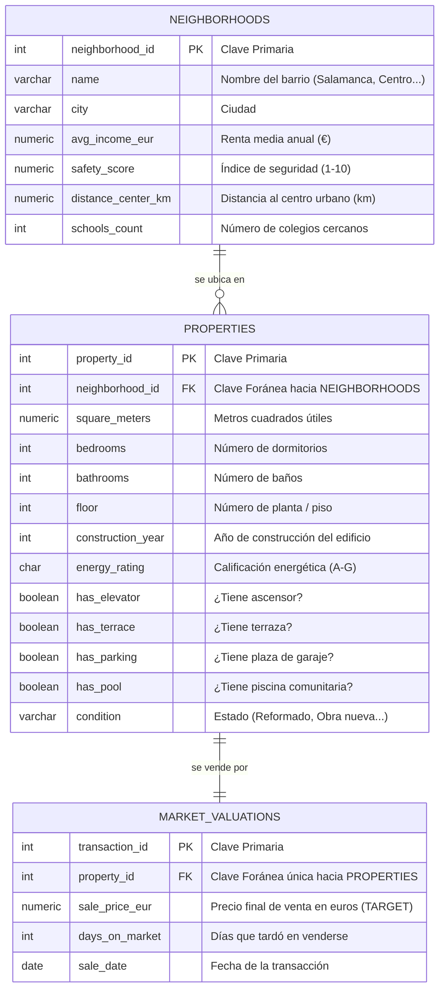

# 🧠 Práctica Avanzada: De PostgreSQL a Machine Learning con Python

> **Objetivo de la Práctica:**  
> Construir un flujo de ingeniería de datos y ciencia de datos de extremo a extremo: diseñar un modelo relacional de viviendas en **PostgreSQL**, consolidar los datos mediante un **SQL JOIN** multi-tabla, ingerirlos en **Python con Pandas**, aplicar técnicas profesionales de preprocesamiento (*Dummies*, *StandardScaler*, división *Train/Test*) y entrenar, evaluar y comparar **11 algoritmos fundamentales de Machine Learning** (10 de Regresión y 1 de Clasificación) detallando sus pros, contras y fundamentos matemáticos intuitivos.

---

## 🗺️ 1. El Puente entre Dos Mundos: Relacional vs Matricial

En la industria tecnológica existe una separación histórica entre:

```
┌──────────────────────────────────────────────┐       ┌──────────────────────────────────────────────┐
│       EL MUNDO RELACIONAL (PostgreSQL)       │       │       EL MUNDO MATRICIAL (Machine Learning)  │
├──────────────────────────────────────────────┤       ├──────────────────────────────────────────────┤
│ • Objetivo: Integridad transaccional (ACID). │       │ • Objetivo: Reconocimiento de patrones.      │
│ • Diseño: Normalizado (3FN, varias tablas).  │ ────> │ • Diseño: Desnormalizado (1 sola matriz 2D). │
│ • Ventaja: Cero duplicidad y rápida edición. │  SQL  │ • Formato: Matriz X (Features) e y (Target). │
│ • Herramienta: SQL, Claves Primarias/Foráneas│ JOIN  │ • Herramienta: Python, Pandas, Scikit-Learn. │
└──────────────────────────────────────────────┘       └──────────────────────────────────────────────┘
```

Para que un modelo de Machine Learning aprenda el precio de una vivienda, **no puede consultar tres tablas separadas**. Necesita una **única matriz plana** donde cada fila sea un piso y cada columna sea una variable descriptiva (*feature*). Ese puente lo construye una consulta **SQL `JOIN`**.

---

## 📐 2. Diagrama Entidad-Relación (ERD)

Nuestro modelo de datos inmobiliario está compuesto por 3 entidades interconectadas:



### Relaciones del Modelo:
1. **`neighborhoods` ➔ `properties` (1 a Muchos):** Un barrio contiene muchas viviendas; cada vivienda pertenece a un solo barrio.
2. **`properties` ➔ `market_valuations` (1 a 1):** Cada vivienda registrada tiene una única valoración o transacción de venta registrada en este histórico.

---

## 🗄️ 3. Creación y Poblado de la Base de Datos (`setup_housing_db.sql`)

El archivo [`setup_housing_db.sql`](./setup_housing_db.sql) crea las 3 tablas en PostgreSQL e inserta **350 propiedades realistas** en la ciudad de Madrid repartidas entre 6 barrios con características socioeconómicas contrastadas (*Salamanca*, *Centro Histórico*, *Chamberí*, *Arganzuela*, *Carabanchel*, *Vallecas*).

### ¿Cómo ejecutarlo?
Desde tu terminal en la carpeta `ML`:
```bash
PGPASSWORD=tu_contraseña /Library/PostgreSQL/15/bin/psql -U postgres -d world -f setup_housing_db.sql
```
*(Verás `INSERT 0 6`, `INSERT 0 350` e `INSERT 0 350`).*

---

## 🔗 4. El Gran Dilema de los JOINs en Machine Learning: ¿INNER JOIN o LEFT JOIN?

Una de las preguntas más profundas y habituales cuando se une el mundo de las bases de datos con el Machine Learning es:  
*¿Es `INNER JOIN` la mejor opción aquí, o sería más natural usar `LEFT JOIN` para ir "pegándole" características a los pisos desde otras tablas?*

Tu intuición es extraordinariamente acertada: **en la ingeniería de características (*Feature Engineering*) profesional, el `LEFT JOIN` es el patrón más natural y utilizado**. Sin embargo, cada opción de unión en SQL plantea un dilema arquitectónico fundamental entre **filtrado silencioso** e **inyección de valores nulos (`NULL`)**.

A continuación, analizamos a fondo la anatomía de los `JOIN`, por qué Scikit-Learn colapsa ante los `NULL`, cómo diseñar una estrategia de **imputación diferenciada por tipo de variable**, y evaluamos empíricamente cómo impacta cada decisión en el rendimiento de los 10 algoritmos de regresión.

---

### 4.1. Anatomía Visual y Didáctica de los Tipos de JOIN en SQL

Imagina dos tablas en nuestra base de datos inmobiliaria:
* **Tabla Izquierda ($A$: `properties`):** Contiene el catálogo de inmuebles físicos (identificador, metros cuadrados, habitaciones, etc.).
* **Tabla Derecha ($B$: `sales_transactions`):** Contiene las transacciones de compraventa registradas en notaría (precio final de venta y fecha).

```
          TABLA A: properties                         TABLA B: sales_transactions
    ┌─────────────┬──────────────────┐              ┌─────────────┬─────────────────┐
    │ property_id │ direccion        │              │ property_id │ sale_price_eur  │
    ├─────────────┼──────────────────┤              ├─────────────┼─────────────────┤
    │ 1           │ Gran Vía 12      │              │ 1           │ 450.000 €       │
    │ 2           │ Calle Alcalá 45  │              │ 2           │ 320.000 €       │
    │ 3           │ Paseo Habana 80  │              │ 999         │ 750.000 €       │  <-- Venta huérfana
    └─────────────┴──────────────────┘              └─────────────┴─────────────────┘
      (El piso 3 aún no se ha vendido)
```

Veamos qué ocurre al combinar estas dos tablas con cada operador relacional:

#### 1. `INNER JOIN` (Intersección Estricta)
* **Principio:** Exige correspondencia obligatoria en ambas tablas (`A.property_id = B.property_id`).
* **Comportamiento:** Si un piso no se ha vendido (Piso 3), **se elimina del resultado**. Si hay una venta huérfana (999), también se elimina.
* **Resultado:** Solo devuelve los pisos 1 y 2.

```
              Tabla A                               Tabla B
         ┌───────────────┐                     ┌───────────────┐
         │               │     █████████       │               │
         │   Solo en A   │     █  A ∩ B █      │   Solo en B   │
         │               │     █████████       │               │
         └───────────────┘                     └───────────────┘
                                ▲▲▲
                        Solo la intersección exacta
```

#### 2. `LEFT JOIN` (Enriquecimiento Conservador de la Entidad Principal)
* **Principio:** Preserva el 100% de las filas de la tabla izquierda (`properties`), independientemente de si existen coincidencias en la derecha.
* **Comportamiento:** Para el piso 1 y 2 une sus precios. Para el piso 3 (aún no vendido), las columnas de la derecha se rellenan automáticamente con **`NULL`**.
* **Resultado:** Devuelve los pisos 1, 2 y 3. El piso 3 tiene `sale_price_eur = NULL`.

```
              Tabla A (Base)                       Tabla B (Satélite)
         ┌───────────────┐                     ┌───────────────┐
         │███████████████│     █████████       │               │
         │█  Solo en A  █│     █  A ∩ B █      │   Solo en B   │
         │███████████████│     █████████       │               │
         └───────────────┘                     └───────────────┘
         ▲▲▲▲▲▲▲▲▲▲▲▲▲▲▲▲▲▲▲▲▲▲▲▲▲▲▲▲▲▲▲▲▲
         Todo A garantizado (con datos de B o con NULL)
```

#### 3. `RIGHT JOIN` (Espejo de la Derecha)
* **Principio:** Preserva todas las filas de la tabla derecha (`sales_transactions`). Si una venta hace referencia a un piso que no existe en el catálogo, los atributos del piso vendrán como `NULL`.
* **Uso en la industria:** En la práctica profesional suele evitarse invirtiendo el orden de las tablas en la consulta para escribir siempre `LEFT JOIN`. Esto facilita la lectura natural de izquierda a derecha del pipeline.

#### 4. `FULL OUTER JOIN` (Unión Total Inclusiva)
* **Principio:** Conserva absolutamente todas las filas de ambas tablas. Donde falten coincidencias en cualquier dirección, inyecta `NULL`.
* **Uso típico:** Auditorías de calidad de datos y detección de discrepancias contables entre sistemas que se han desincronizado.

#### 5. `CROSS JOIN` (Producto Cartesiano)
* **Principio:** Combina cada fila de A con todas y cada una de las filas de B ($N \times M$). No utiliza cláusula `ON`.
* **Uso típico:** Generación de cuadrículas combinatorias (por ejemplo, cruzar 5 distritos con 10 tipos de hipoteca para proyectar escenarios).

---

### 4.2. El Gran Dilema: El Filtro Invisible vs El Problema de los `NULL`s

Cuando unificamos datos para entrenar modelos de Inteligencia Artificial, nos encontramos ante dos caminos enfrentados:

```
                            ¿QUÉ TIPO DE JOIN ELEGIR?
                                       │
            ┌──────────────────────────┴──────────────────────────┐
            ▼                                                     ▼
    RUTA A: INNER JOIN                                    RUTA B: LEFT JOIN
  (Filtrado Silencioso)                                (Inyección de NULLs)
            │                                                     │
    • Fácil para Scikit-Learn                             • No pierde ningún piso
    • Elimina filas incompletas                           • Llena de NULLs la matriz
    • ⚠️ Sesgo de Selección                               • ⚠️ Rompe los algoritmos
      (Survivorship Bias)                                   si no se imputa
```

| Criterio | Enfoque A: `INNER JOIN` (Filtrado Completo) | Enfoque B: `LEFT JOIN` (Enriquecimiento + Imputación) |
| :--- | :--- | :--- |
| **Integridad Muestral ($N$)** | **Se reduce drásticamente.** Si una tabla satélite solo cubre el 70% de los inmuebles, pierdes el 30% del dataset. | **Se preserva el 100%** del catálogo. Cada inmueble disponible se aprovecha para el aprendizaje. |
| **Sesgo Estadístico** | **Alto riesgo de Sesgo de Supervivencia (*Survivorship Bias*):** Si los pisos con garaje o certificado energético registrado son mayoritariamente de barrios ricos, el modelo solo aprenderá patrones de zonas pudientes. | **Representatividad real:** Conserva pisos modestos y antiguos aunque sus registros municipales estén incompletos. |
| **Complejidad del Pipeline** | **Mínima:** El dataset extraído está limpio y puede enviarse casi directamente al modelo. | **Mayor:** Exige construir tuberías de imputación estadística (`ColumnTransformer`) adaptadas a cada variable. |
| **Riesgo de Ruido Sintético** | **Cero:** Todos los datos analizados son observaciones empíricas reales. | **Existente:** Rellenar datos faltantes introduce suposiciones que pueden atenuar ligeramente ciertas relaciones. |
| **Viabilidad en Producción** | **Muy limitada:** Si en la web un cliente no sabe el año de su finca, el modelo entrenado con casos completos no sabrá qué hacer. | **Total:** El pipeline en producción es robusto y puede cotizar cualquier inmueble aunque falten datos opcionales. |

---

### 4.3. ¿Por qué `NULL` (`NaN`) es Veneno para Scikit-Learn?

Cuando Pandas lee un `NULL` de PostgreSQL, lo almacena internamente como `np.nan` (*Not a Number*, estándar binario IEEE 754 de coma flotante).

Si pasas un DataFrame con `NaN` a un modelo clásico de Scikit-Learn:
```text
ValueError: Input X contains NaN, infinity or a value too large for dtype('float64').
```

#### ¿Por qué colapsan los modelos a nivel matemático?
1. **Modelos Lineales (`LinearRegression`, `Ridge`, `Lasso`, `LogisticRegression`):**  
   Calculan combinaciones lineales ponderadas:
   $$\hat{y} = \beta_0 + \beta_1 x_1 + \beta_2 x_2 + \dots + \beta_p x_p$$
   En la aritmética de punto flotante de los microprocesadores:
   $$\text{Cualquier número} \times \text{NaN} = \text{NaN} \quad \text{y} \quad \text{Cualquier número} + \text{NaN} = \text{NaN}$$
   Si una sola variable $x_j$ es `NaN`, la predicción $\hat{y}$ se convierte en `NaN`. El cálculo de la función de pérdida se vuelve `NaN`, las derivadas del gradiente $\nabla L$ colapsan a `NaN` y los pesos del modelo se destruyen.
2. **Modelos basados en Distancias (`K-Nearest Neighbors`, `Support Vector Machines`):**  
   Calculan la distancia euclídea entre el piso a tasar $x$ y un piso de entrenamiento $y$:
   $$d(x, y) = \sqrt{\sum_{k=1}^p (x_k - y_k)^2}$$
   Si falta una coordenada ($x_k = \text{NaN}$), la distancia geométrica es indefinida y no se puede determinar quiénes son los vecinos más cercanos.
3. **Excepciones de Última Generación:**  
   Implementaciones avanzadas de árboles como `HistGradientBoostingRegressor`, `LightGBM` y `XGBoost` disponen de soporte nativo para `NaN`: durante el entrenamiento, el algoritmo prueba bifurcar los `NaN` hacia la rama izquierda y hacia la rama derecha del árbol, eligiendo automáticamente la rama que minimice el error de predicción.

---

### 4.4. Estrategia Profesional: Imputación Diferenciada por Naturaleza Semántica

No todos los datos ausentes significan lo mismo. **Tratar todas las variables con la misma regla (por ejemplo, rellenar todo con la media) es un error metodológico grave.**

En un sistema inmobiliario bien diseñado se distinguen **tres naturalezas de variables**:

```
                       ESTRATEGIAS DE IMPUTACIÓN SEGÚN LA VARIABLE
 ┌──────────────────────────────┬───────────────────────────────┬───────────────────────────────┐
 │ 1. CONTINUAS / ESCALA        │ 2. COMODIDADES / CONTEOS      │ 3. CATEGÓRICAS                │
 │ (m2, año construcción,       │ (garaje, piscina, ascensor,   │ (calificación energética,     │
 │  renta del barrio, metros)   │  número de colegios cercanos) │  estado de conservación)      │
 ├──────────────────────────────┼───────────────────────────────┼───────────────────────────────┤
 │ 🎯 Tratamiento: MEDIANA      │ 🎯 Tratamiento: CONSTANTE 0   │ 🎯 Tratamiento: 'Desconocido' │
 │                              │                               │    o MODA                     │
 │ • La mediana es inmune a     │ • Si en la base de datos no   │ • Crear una categoría propia  │
 │   mansiones o áticos de lujo │   consta registro de piscina, │   ('Desconocido') permite al  │
 │   que deforman la media.     │   el piso físicamente NO la   │   algoritmo aprender el sesgo │
 │ • Mantiene el valor en un    │   tiene. Poner la media (0.3) │   de los inmuebles que no han │
 │   rango físicamente creíble. │   carece de sentido real.     │   obtenido el certificado.    │
 └──────────────────────────────┴───────────────────────────────┴───────────────────────────────┘
```

#### Implementación con `ColumnTransformer` y `Pipeline` en Scikit-Learn:
```python
from sklearn.compose import ColumnTransformer
from sklearn.pipeline import Pipeline
from sklearn.impute import SimpleImputer
from sklearn.preprocessing import StandardScaler, OneHotEncoder

# 1. Pipeline para variables continuas: Mediana + Escalado Estándar
cont_pipe = Pipeline([
    ('imputer', SimpleImputer(strategy='median')),
    ('scaler', StandardScaler())
])

# 2. Pipeline para comodidades y conteos: Relleno con 0 (ausencia) + Escalado
amenity_pipe = Pipeline([
    ('imputer', SimpleImputer(strategy='constant', fill_value=0.0)),
    ('scaler', StandardScaler(with_mean=False))
])

# 3. Pipeline para variables cualitativas: Imputar con 'Desconocido' + OneHot
cat_pipe = Pipeline([
    ('imputer', SimpleImputer(strategy='constant', fill_value='Desconocido')),
    ('encoder', OneHotEncoder(handle_unknown='ignore', sparse_output=False))
])

# Ensamblado unificado
preprocessor = ColumnTransformer(transformers=[
    ('continuas', cont_pipe, ['square_meters', 'construction_year', 'avg_income_eur']),
    ('comodidades', amenity_pipe, ['has_parking', 'has_pool', 'has_terrace']),
    ('categoricas', cat_pipe, ['energy_rating', 'condition', 'neighborhood_name'])
])
```

---

### 4.5. Evaluación Empírica: ¿Cómo Afecta el `JOIN` al Rendimiento de los Modelos?

Hemos implementado un experimento controlado en el script [`ml_pipeline_differentiated_imputation.py`](./ml_pipeline_differentiated_imputation.py).

Simulamos un escenario de mercado inmobiliario realista:
* Un 12% de valores ausentes en el año de construcción (fincas antiguas sin catastro digitalizado).
* Un 15% de valores ausentes en garaje (no rellenado por el propietario en el portal).
* Un 10% de valores ausentes en calificación energética (certificados pendientes de trámite).

Comparamos dos estrategias de modelado evaluadas exactamente sobre el **mismo conjunto de prueba (Test: 70 pisos)**:
* **Enfoque A (`INNER JOIN` estricto / Casos Completos):** Se descartan los pisos con datos incompletos. Tamaño de entrenamiento: **182 viviendas** (se pierde el 35% de la muestra).
* **Enfoque B (`LEFT JOIN` + Imputación Diferenciada):** Se conservan todos los pisos mediante imputación semántica. Tamaño de entrenamiento: **280 viviendas** (100% de la muestra conservada).

#### Resultados Comparativos Obtenidos:

| Algoritmo | $R^2$ (Enfoque A: `INNER JOIN`) | $R^2$ (Enfoque B: `LEFT JOIN` + Imputación) | MAE (Enfoque A) | MAE (Enfoque B) | Impacto / Diferencia |
| :--- | :---: | :---: | :---: | :---: | :---: |
| **Linear Regression (OLS)** | 0.8911 | 0.8901 | 81.154 € | 81.954 € | $\approx 0.00$ (Estable) |
| **Ridge Regression (L2)** | 0.8915 | 0.8924 | 80.687 € | 80.395 € | $+0.0009$ (Ligera mejora) |
| **Lasso Regression (L1)** | 0.8919 | 0.8904 | 80.690 € | 81.977 € | $\approx 0.00$ (Estable) |
| **ElasticNet** | 0.8244 | 0.8306 | 99.938 € | 96.542 € | $+0.0062$ (✅ Mejora) |
| **K-Nearest Neighbors (KNN)** | 0.7743 | **0.7970** | 109.865 € | **99.025 €** | $+0.0227$ (✅ **Error cae 10.840 €**) |
| **Decision Tree Regressor** | 0.8315 | **0.8870** | 85.831 € | **73.840 €** | $+0.0555$ (✅ **Salto enorme de +5.5% en $R^2$**) |
| **Random Forest Regressor** | 0.9279 | 0.9305 | 60.536 € | 58.279 € | $+0.0026$ (Mejora y menor error) |
| **Gradient Boosting (GBM)** | 0.9599 | **0.9734** | 44.106 € | **35.582 €** | $+0.0135$ (✅ **Error cae 8.524 €**) |
| **AdaBoost Regressor** | 0.8540 | 0.8670 | 98.706 € | 93.392 € | $+0.0130$ (✅ Mejora) |
| **Support Vector (SVR)** | 0.8661 | **0.9107** | 72.727 € | **55.910 €** | $+0.0446$ (✅ **Error medio cae 16.817 €**) |

#### Conclusiones Extraídas de la Comparativa:
1. **Los Modelos No Lineales y de Ensamble Adoran el Enfoque B:**  
   Algoritmos como **Árboles de Decisión**, **Gradient Boosting**, **KNN** y **SVR** requieren una alta densidad de puntos en el espacio multidimensional para trazar fronteras de decisión curvas e interacciones no lineales. Pasar de 182 a 280 ejemplos permite reducir el error absoluto medio (MAE) en más de **16.000 €** en SVR y ganar más de **5.5 puntos porcentuales de $R^2$** en el árbol.
2. **Los Modelos Lineales son Inmunes pero Estables:**  
   En OLS, Ridge y Lasso, los coeficientes representan pendientes globales en un hiperplano. Como la imputación se realizó con la mediana y el cero (valores semánticamente coherentes), la estimación de las pendientes no sufrió sesgo significativo, manteniendo un $R^2$ constante de $\sim 0.89$.
3. **El Veredicto de Producción:**  
   El Enfoque B (`LEFT JOIN` + Imputación Diferenciada) no solo es superior en precisión para los mejores modelos (Gradient Boosting alcanza un impresionante **$R^2 = 0.9734$**), sino que es el **único enfoque viable para un producto real de software**, ya que permite tasar cualquier vivienda aunque el usuario omita detalles en el formulario de la web.

---

### 4.6. Por qué se usó `INNER JOIN` en el Pipeline Base: El Matiz del Target $y$

Una vez demostrada la superioridad del `LEFT JOIN` para enriquecer variables ($X$), surge la pregunta:  
*¿Por qué en [`ml_pipeline.py`](./ml_pipeline.py) unimos con `INNER JOIN` la tabla `market_valuations`?*

La respuesta radica en la naturaleza matemática del **Aprendizaje Supervisado**:

$$D = \{(X_1, y_1), (X_2, y_2), \dots, (X_n, y_n)\}$$

* **Las variables independientes ($X$) se pueden imputar.** Si falta el año de construcción o si tiene piscina, la mediana o el cero son aproximaciones plausibles.
* **La variable objetivo ($y = \text{sale\_price\_eur}$) NUNCA se debe imputar en entrenamiento.** Si un piso nunca se ha vendido, inventar su precio mediante una media o una fórmula arbitraria significa entrenar al modelo sobre nuestras propias conjeturas sintéticas. Estaríamos enseñándole al modelo a predecir nuestras propias invenciones en lugar de la realidad del mercado.
* Por tanto, para construir el conjunto de entrenamiento de un modelo de tasación, la consulta hacia el historial de ventas debe ser obligatoriamente:
  ```sql
  -- Opción 1: Con INNER JOIN
  FROM properties p
  JOIN market_valuations m ON p.property_id = m.property_id;

  -- Opción 2: Con LEFT JOIN filtrando explícitamente las transacciones reales
  FROM properties p
  LEFT JOIN market_valuations m ON p.property_id = m.property_id
  WHERE m.sale_price_eur IS NOT NULL;
  ```

---

### 4.7. La Arquitectura Dual: Entrenamiento Offline vs Inferencia en Producción (*Serving*)

Para cerrar el diseño de la solución, en una empresa de tecnología inmobiliaria (*PropTech*) conviven dos flujos de datos complementarios:

```
                            EL CICLO DE VIDA COMPLETO DE ML
┌────────────────────────────────────────────────────────────────────────────────────────┐
│ 1. FASE DE ENTRENAMIENTO OFFLINE (Batch Training):                                     │
│    • SQL: INNER JOIN con ventas pasadas (o LEFT JOIN con WHERE sale_price IS NOT NULL).│
│    • SQL: LEFT JOIN con tablas satélite de características y barrios.                  │
│    • Python: Se ajusta el preprocesador (preprocessor.fit(X_train)).                    │
│    • Python: Se entrenan los modelos sobre datos confirmados históricamente.           │
├────────────────────────────────────────────────────────────────────────────────────────┤
│ 2. FASE DE INFERENCIA ONLINE (Serving / Producción en Tiempo Real):                    │
│    • Un usuario entra en la app web para valorar un piso que NO está vendido.          │
│    • SQL: Se consulta properties con LEFT JOIN hacia servicios y geolocalización.     │
│    • Python: Si el usuario no indicó el garaje o el año, el preprocesador entrenado    │
│      aplica preprocessor.transform(X_nuevo), rellenando medianas y ceros aprendidos.   │
│    • Python: El modelo entrenado predice: ŷ = 345.000 €.                               │
└────────────────────────────────────────────────────────────────────────────────────────┘
```

> 📂 **Código Práctico Disponible:** Puedes ejecutar el comparador empírico completo en cualquier momento con:
> ```bash
> python3 ML/ml_pipeline_differentiated_imputation.py
> ```


## 🧹 5. Preprocesamiento de Datos en Python (Pandas y Scikit-Learn)

En [`ml_pipeline.py`](./ml_pipeline.py) transformamos la tabla SQL en matrices matemáticas aptas para Machine Learning.

### 5.1. ¿Qué es una Variable Dummy (One-Hot Encoding)?
Los modelos matemáticos no saben multiplicar números por palabras como `"Reformado"` o `"Obra nueva"`.  
La técnica de **Variables Dummy** crea una columna binaria (0 o 1) para cada categoría:

| Piso | Estado Original | condition_Buen estado | condition_Obra nueva | condition_Reformado |
| :---: | :--- | :---: | :---: | :---: |
| **1** | Para reformar | `0` | `0` | `0` |
| **2** | Reformado | `0` | `0` | `1` |
| **3** | Obra nueva | `0` | `1` | `0` |

> ⚠️ **La Trampa de la Variable Dummy (`drop_first=True`):**  
> Si una variable tiene 4 opciones, solo necesitamos 3 columnas. Si las 3 columnas valen `0`, el modelo ya sabe matemáticamente que se trata de la cuarta opción (*"Para reformar"*). Mantener todas las columnas provocaría **multicolinealidad perfecta** (una columna se deduce como combinación lineal de las demás), lo que desestabiliza los algoritmos de regresión lineal.

En Python se aplica con:
```python
df_encoded = pd.get_dummies(df, columns=['energy_rating', 'condition', 'neighborhood_name'], drop_first=True)
```

---

### 5.2. Separación de Variables: Matriz $X$ y Vector $y$
* **$X$ (Matriz de Características o *Features*):** Todas las variables que usaremos para predecir (m2, habitaciones, renta del barrio, ascensor, dummies...). Tamaño: `(350, 27)`.
* **$y$ (Variable Objetivo o *Target*):** La columna que queremos adivinar: `sale_price_eur`. Tamaño: `(350,)`.

---

### 5.3. División en Conjunto de Entrenamiento (*Train*) y Prueba (*Test*)
* **Regla de Oro del Machine Learning:** **Nunca** evalúes un modelo con los mismos datos con los que aprendió. Si lo haces, estarás midiendo su capacidad de memorizar, no de generalizar (*Overfitting*).
* Dividimos el dataset al **80% para entrenar (280 pisos)** y el **20% para evaluar (70 pisos desconocidos)**:
```python
X_train, X_test, y_train, y_test = train_test_split(X, y, test_size=0.2, random_state=42)
```

---

### 5.4. Normalización con `StandardScaler` (Media = 0, Desviación Típica = 1)
* **El Problema:** La variable `square_meters` oscila entre 40 y 180, mientras que `bedrooms` oscila entre 1 y 5, y `avg_income_eur` entre 20.000 y 80.000. Algoritmos basados en distancias (como KNN o SVR) o regularización (Ridge, Lasso) creerían erróneamente que la renta es 10.000 veces más importante que el número de baños simplemente porque el número es más grande.
* **La Solución:** Restar la media y dividir entre la desviación típica:
  $$z = \frac{x - \mu}{\sigma}$$
* **Prevención de Fuga de Datos (*Data Leakage*):**  
  Calculamos $\mu$ y $\sigma$ **únicamente** con el conjunto de entrenamiento:
  ```python
  scaler = StandardScaler()
  X_train_scaled = scaler.fit_transform(X_train) # Aprende media/std de train y transforma
  X_test_scaled = scaler.transform(X_test)       # Solo transforma test con lo aprendido de train
  ```

---

## 🤖 6. Compendio Exhaustivo de los 11 Algoritmos de Machine Learning

---

### 1️⃣ Regresión Lineal Múltiple (Ordinary Least Squares - OLS)
* **¿Cómo piensa?:** Busca la mejor "línea recta" (un hiperplano en alta dimensión) que atraviese la nube de puntos minimizando la suma de los errores al cuadrado:
  $$\hat{y} = \beta_0 + \beta_1 x_1 + \beta_2 x_2 + \dots + \beta_p x_p$$
* **Pros:**  
  * Extremadamente rápida y ligera computacionalmente.
  * 100% interpretable: cada coeficiente $\beta_j$ indica cuántos euros sube el precio por cada metro cuadrado adicional.
* **Contras:**  
  * Asume que el mundo es perfectamente lineal (lo cual raramente ocurre).
  * Es hipersensible a valores atípicos (*outliers*) y a la multicolinealidad.
* **Cuándo usarlo:** Como modelo de referencia (*baseline*) inicial para comparar el resto de algoritmos.

---

### 2️⃣ Regresión Ridge (Regularización L2 / Tikhonov)
* **¿Cómo piensa?:** Es una regresión lineal con "freno de mano". Añade una penalización cuadrática al tamaño de los coeficientes:
  $$\text{Pérdida} = \text{OLS} + \lambda \sum_{j=1}^p \beta_j^2$$
* **Pros:**  
  * Resuelve los problemas de multicolinealidad (por ejemplo, cuando los m² y el número de dormitorios están fuertemente correlacionados).
  * Reduce la varianza del modelo evitando que los pesos se disparen a valores absurdos.
* **Contras:**  
  * Reduce los coeficientes pero **nunca los hace exactamente cero**; no elimina variables irrelevantes.
* **Cuándo usarlo:** Cuando tienes muchas variables correlacionadas entre sí y quieres estabilidad numérica.

---

### 3️⃣ Regresión Lasso (Regularización L1)
* **¿Cómo piensa?:** En lugar de penalizar al cuadrado, penaliza el valor absoluto de los coeficientes:
  $$\text{Pérdida} = \text{OLS} + \lambda \sum_{j=1}^p |\beta_j|$$
* **Pros:**  
  * **Selección automática de variables:** Tiene la propiedad matemática de obligar a los coeficientes menos importantes a ser **exactamente cero**, descartándolos del modelo.
* **Contras:**  
  * Si dos variables están muy correlacionadas, elegirá una de ellas al azar y descartará la otra.
* **Cuándo usarlo:** Cuando sospechas que tienes decenas de variables de las cuales solo unas pocas influyen de verdad en el precio.

---

### 4️⃣ ElasticNet (Híbrido L1 + L2)
* **¿Cómo piensa?:** Combina lo mejor de Ridge y Lasso ponderando ambas penalizaciones con un parámetro $\alpha$:
  $$\text{Pérdida} = \text{OLS} + r \lambda \|\beta\|_1 + \frac{1 - r}{2} \lambda \|\beta\|_2^2$$
* **Pros:**  
  * Capaz de seleccionar grupos de variables correlacionadas juntas (superando la debilidad de Lasso).
* **Contras:**  
  * Requiere calibrar dos hiperparámetros ($\alpha$ y `l1_ratio`).
* **Cuándo usarlo:** Datasets complejos con alta dimensionalidad y múltiples grupos de variables correladas.

---

### 5️⃣ K-Nearest Neighbors Regressor (KNN)
* **¿Cómo piensa?:** "Dime con quién andas y te diré cuánto vales". Para estimar el precio de un piso, busca los $k$ pisos más parecidos en metros, barrio y comodidades, y calcula la media de sus precios.
* **Pros:**  
  * No asume ninguna forma funcional previa (*modelo no paramétrico*).
  * Muy intuitivo y natural para tasaciones inmobiliarias comparativas.
* **Contras:**  
  * Sufre la "maldición de la dimensionalidad": con 27 variables, la noción de distancia euclídea pierde efectividad.
  * Extremadamente sensible al escalado de variables. Lento en predicción si el dataset es enorme.
* **Cuándo usarlo:** Datasets pequeños o medianos con pocas variables fuertemente locales.

---

### 6️⃣ Árbol de Decisión (Decision Tree Regressor)
* **¿Cómo piensa?:** Como un diagrama de flujo de preguntas binarias: *¿Tiene más de 90 m²? Sí ➔ ¿Está en Salamanca? Sí ➔ Precio estimado = 650.000€*. Realiza divisiones ortogonales sucesivas para minimizar el error cuadrático en cada hoja.
* **Pros:**  
  * Modela relaciones no lineales e interacciones complejas de forma visual y comprensible.
  * No requiere normalizar los datos ni le afectan los outliers.
* **Contras:**  
  * Tendencia extrema al sobreajuste (*overfitting*): si no se limita la profundidad (`max_depth`), memoriza cada piso individual del dataset.
* **Cuándo usarlo:** Cuando se requiere una explicación paso a paso comprensible por humanos no técnicos.

---

### 7️⃣ Random Forest Regressor (Ensemble Bagging)
* **¿Cómo piensa?:** "La sabiduría de las masas". En lugar de un solo árbol, entrena un bosque de cientos de árboles de decisión independientes. Cada árbol ve un subconjunto aleatorio de pisos (*Bootstrap*) y un subconjunto aleatorio de variables (*Feature Bagging*). La predicción final es el promedio de todos los árboles.
* **Pros:**  
  * Reduce drásticamente la varianza y el overfitting de los árboles individuales.
  * Es uno de los modelos más sólidos y eficaces de la industria sin necesidad de ajustar demasiados parámetros.
* **Contras:**  
  * Se pierde la interpretabilidad visual directa (caja negra relativa).
  * Ocupa más memoria y tarda más en entrenar que un modelo lineal.
* **Cuándo usarlo:** En casi cualquier problema tabular como primera opción potente y segura.

---

### 8️⃣ Gradient Boosting Regressor (GBM)
* **¿Cómo piensa?:** Aprendizaje secuencial constructivo. El primer árbol hace una predicción básica; el segundo árbol se entrena **específicamente para predecir los errores residuales del primero**; el tercero corrige los errores del segundo, y así sucesivamente a lo largo de un gradiente de descenso.
* **Pros:**  
  * **El rey de la precisión:** Es habitualmente el algoritmo ganador en competiciones de datos tabulares (Kaggle).
  * Capaz de detectar sutilezas y combinaciones de variables hipercomplejas.
* **Contras:**  
  * Sensible al sobreajuste si se eligen demasiados estimadores o una tasa de aprendizaje (`learning_rate`) demasiado alta.
  * Más lento de entrenar porque los árboles se construyen en serie (uno detrás de otro, no en paralelo).
* **Cuándo usarlo:** Cuando la máxima precisión predictiva en euros es el objetivo principal del negocio.

---

### 9️⃣ AdaBoost Regressor (Adaptive Boosting)
* **¿Cómo piensa?:** En cada iteración sucesiva, pone el foco en los pisos donde el modelo anterior cometió los mayores errores, aumentando el peso de esas observaciones difíciles para que el siguiente árbol les preste más atención.
* **Pros:**  
  * Sencillo y conceptualmente elegante; muy resistente al overfitting en datos limpios.
* **Contras:**  
  * Muy vulnerable al ruido y a datos atípicos, ya que el algoritmo puede obsesionarse intentando predecir correctamente una anomalía imposible.
* **Cuándo usarlo:** En conjuntos de datos con poco ruido y variables bien depuradas.

---

### 🔟 Support Vector Regressor (SVR)
* **¿Cómo piensa?:** Imagina un tubo de tolerancia de anchura $\epsilon$ trazado alrededor de la tendencia de precios. El SVR busca un hiperplano que contenga a la mayoría de los pisos dentro del tubo, penalizando únicamente los puntos que caen fuera de los márgenes (*vectores de soporte*). Mediante el *truco del kernel* (RBF), proyecta los datos a espacios de dimensión infinita para resolver problemas no lineales.
* **Pros:**  
  * Excelente capacidad de generalización matemática y gran robustez ante outliers cercanos a la media.
* **Contras:**  
  * Computacionalmente muy costoso con datasets de gran volumen ($O(N^3)$).
  * Requiere obligatoriamente un escalado de datos meticuloso y es difícil de interpretar.
* **Cuándo usarlo:** Problemas con muchas dimensiones donde otros algoritmos fallan por falta de datos suficientes.

---

### 1️⃣1️⃣ Regresión Logística (Logistic Regression - Clasificación Binaria)
* **¿Cómo piensa?:** Aunque lleva la palabra "Regresión" en su nombre, es un **algoritmo de clasificación**. En lugar de predecir cuántos euros vale el piso, responde a una pregunta binaria: **¿Es este piso de gama Premium (Sí/No)?**  
  Pasa la combinación lineal de variables a través de la **función Sigmoide**:
  $$\sigma(z) = \frac{1}{1 + e^{-z}}$$
  La salida es una probabilidad estrictamente acotada entre $0$ y $1$ ($0\%$ a $100\%$). Si la probabilidad supera el umbral ($0.5$), clasifica el piso como *"Premium"*.
* **Pros:**  
  * Rápido, interpretable probabilísticamente y estándar mundial para scoring crediticio y categorización.
* **Contras:**  
  * Solo traza fronteras de decisión lineales entre clases.
* **Cuándo usarlo:** Cuando el objetivo no es tasar la vivienda exacta, sino segmentar clientes o clasificar inmuebles en carteras comerciales.

---

## 📊 7. Métricas de Evaluación de Modelos

### 7.1. Para Modelos de Regresión (Predecir Euros Continuos)
* **$R^2$ (Coeficiente de Determinación):** Indica qué porcentaje de la variación del precio es explicada por el modelo. $1.0$ es perfecto; $0.0$ equivale a predecir siempre la media.
* **RMSE (Root Mean Squared Error):** Raíz cuadrada de la media de los errores al cuadrado. Penaliza con mucha dureza los grandes errores (desviaciones grandes). Expresado en euros.
* **MAE (Mean Absolute Error):** Media de las diferencias absolutas entre lo real y lo predicho. Muy fácil de interpretar para humanos: *"Nos equivocamos en promedio en $\pm X$ euros"*.
* **MAPE (Mean Absolute Percentage Error):** Porcentaje medio de error relativo respecto al precio real del piso.

---

### 7.2. Para Modelos de Clasificación (Predecir Categorías: Premium vs No Premium)
* **Matriz de Confusión:**
  * **Verdaderos Positivos (TP):** Pisos Premium que el modelo identificó como Premium.
  * **Verdaderos Negativos (TN):** Pisos normales que el modelo identificó como normales.
  * **Falsos Positivos (FP - Error Tipo I):** Pisos normales que el modelo clasificó erróneamente como Premium.
  * **Falsos Negativos (FN - Error Tipo II):** Pisos Premium reales que el modelo no fue capaz de detectar.
* **Accuracy:** Porcentaje global de aciertos: $\frac{TP + TN}{Total}$.
* **Precision:** De todos los pisos que dijimos que eran Premium, ¿cuántos lo eran de verdad? $\frac{TP}{TP + FP}$.
* **Recall (Sensibilidad):** De todos los pisos Premium reales que existían, ¿qué porcentaje fuimos capaces de cazar? $\frac{TP}{TP + FN}$.
* **F1-Score:** Media armónica entre Precision y Recall.
* **ROC-AUC:** Capacidad del modelo para distinguir entre clases para cualquier umbral de probabilidad (1.0 = discriminación perfecta; 0.5 = lanzar una moneda al aire).

---

## 🏆 8. Resultados Reales Obtenidos en el Laboratorio

Tras ejecutar [`python3 ml_pipeline.py`](./ml_pipeline.py) sobre el conjunto de prueba independiente de 70 viviendas, estos son los resultados empíricos ordenados de mejor a peor:

### Tabla Comparativa de Regresión:
| Puesto | Algoritmo | $R^2$ Score | Error Medio (RMSE €) | Error Típico (MAE €) | Error Porcentual (MAPE) |
| :---: | :--- | :---: | :---: | :---: | :---: |
| 🥇 **1** | **Gradient Boosting (GBM)** | **0.978** | **44.833 €** | **32.594 €** | **7.4 %** |
| 🥈 **2** | **Random Forest Regressor** | **0.937** | **75.410 €** | **57.151 €** | **12.7 %** |
| 🥉 **3** | **Decision Tree Regressor** | **0.910** | **90.197 €** | **68.744 €** | **15.2 %** |
| 4 | **Lasso Regression (L1)** | 0.893 | 98.110 € | 80.791 € | 25.6 % |
| 5 | **Linear Regression (OLS)** | 0.893 | 98.165 € | 80.793 € | 25.6 % |
| 6 | **Ridge Regression (L2)** | 0.892 | 98.585 € | 81.084 € | 24.6 % |
| 7 | **Support Vector Regressor (SVR)** | 0.888 | 100.300 € | 69.974 € | 14.2 % |
| 8 | **AdaBoost Regressor** | 0.872 | 107.225 € | 92.761 € | 28.6 % |
| 9 | **ElasticNet (L1 + L2)** | 0.849 | 116.826 € | 89.867 € | 21.0 % |
| 10 | **K-Nearest Neighbors (KNN)** | 0.665 | 173.649 € | 127.104 € | 30.0 % |

### Resultados del Modelo 11 de Clasificación (Regresión Logística):
* **Umbral de Corte:** Viviendas con precio $> 495.250 €$.
* **Accuracy:** **92.9%** (65 de 70 pisos clasificados correctamente).
* **Precision:** **90.9%** (Alta fiabilidad al declarar un piso como Premium).
* **Recall:** **93.8%** (Detectó casi todas las viviendas de lujo reales).
* **F1-Score:** **92.3%**.
* **ROC-AUC:** **0.984** (Casi perfecto discriminando la gama del piso).

---

## 🧪 9. Cómo Reproducir la Práctica Paso a Paso

1. **Abrir la terminal en la carpeta `ML`:**
   ```bash
   cd "/Users/fjbanezares/databases_flash_course/ML"
   ```

2. **Asegurar dependencias de Python:**
   ```bash
   pip3 install pandas scikit-learn psycopg2-binary python-dotenv
   ```

3. **Poblar la base de datos en PostgreSQL:**
   ```bash
   PGPASSWORD=XXXX /Library/PostgreSQL/15/bin/psql -U postgres -d world -f setup_housing_db.sql
   ```

4. **Verificar el archivo de credenciales locales (`.env`):**
   Asegúrate de que existe el archivo `.env` con:
   ```env
   DB_USER=postgres
   DB_PASSWORD=XXXX
   DB_HOST=localhost
   DB_PORT=5432
   DB_DATABASE=world
   ```

5. **Ejecutar el Pipeline completo de Machine Learning (11 Algoritmos):**
   ```bash
   python3 ml_pipeline.py
   ```

6. **Ejecutar el Comparador Empírico (INNER JOIN vs LEFT JOIN + Imputación Diferenciada):**
   ```bash
   python3 ml_pipeline_differentiated_imputation.py
   ```
   Verás en directo la comparación científica de los 10 algoritmos evaluados sobre el mismo conjunto de test.
