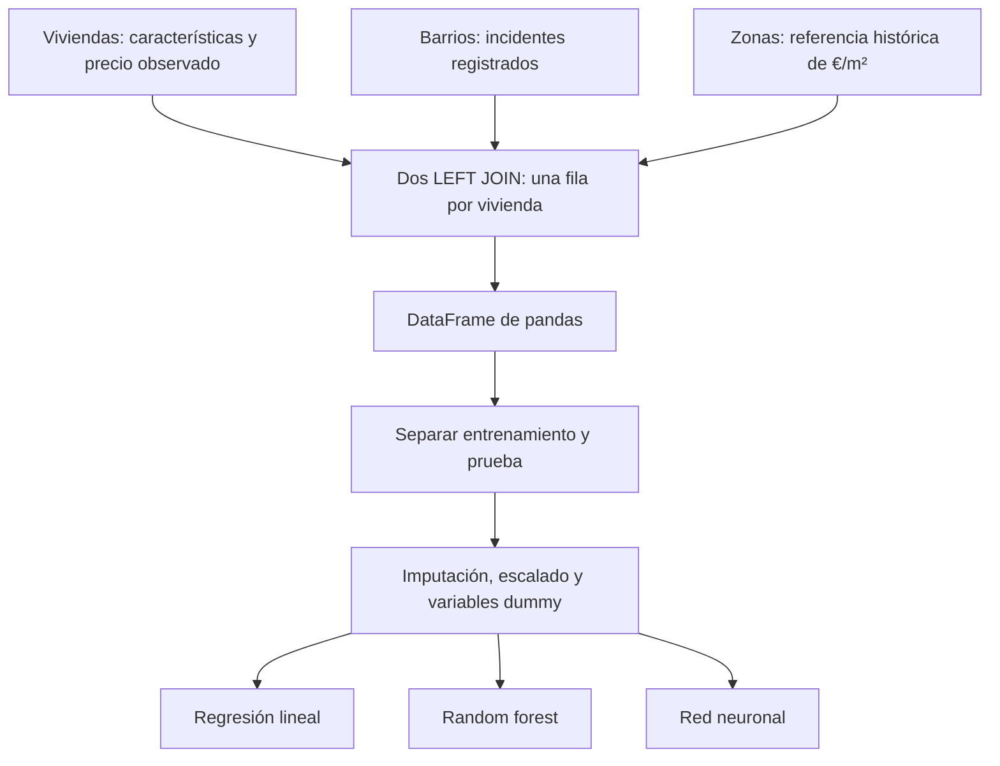
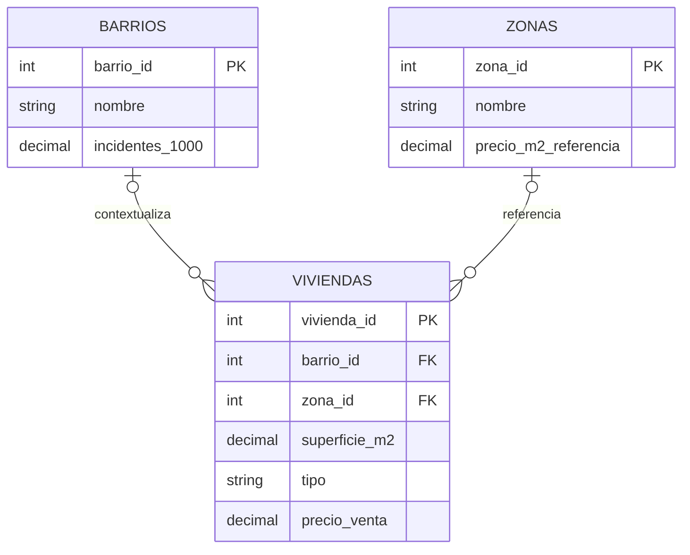
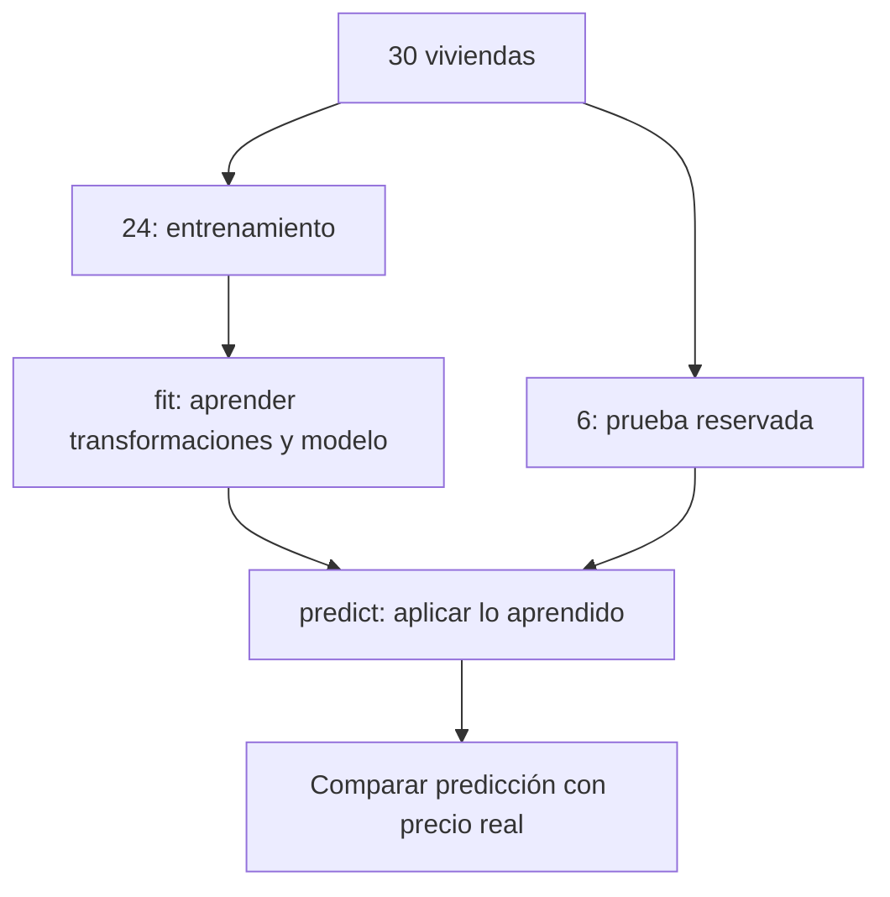

# De tres tablas MySQL a tres modelos de machine learning

## Una práctica de principio a fin: ¿cuánto podría valer una vivienda?

Vamos a crear **30 viviendas ficticias**, enriquecerlas con datos de su barrio y su zona usando **dos LEFT JOIN**, llevar el resultado a pandas y entrenar tres modelos: regresión lineal, random forest y una pequeña red neuronal.

**Lo que aprenderás:** una base relacional organiza hechos; una consulta reúne las variables; pandas permite revisarlas; un pipeline convierte esas variables en números y entrena un modelo. El modelo aprende de precios conocidos para intentar predecir precios desconocidos.

**Límite del ejercicio:** 30 ejemplos permiten ver funcionar el código, pero no validar un tasador. Las cifras de barrios, criminalidad y precios son inventadas. Ninguna conclusión describe una ciudad real ni demuestra que una característica cause un cambio de precio.

### El mapa de la práctica



## 1. Primero definimos qué significa cada fila

| Tabla | Una fila representa… | Clave |
|---|---|---|
| `barrios` | Un barrio y su tasa ficticia de incidentes por 1.000 habitantes durante 2024 | `barrio_id` |
| `zonas` | Una zona de mercado y su precio de referencia por m² al cierre de 2024 | `zona_id` |
| `viviendas` | Una vivienda vendida en 2025, con sus características y precio de venta | `vivienda_id` |

En este laboratorio **barrio y zona de mercado son clasificaciones independientes**. No suponemos que conocer el barrio permita deducir siempre una única zona. Así evitamos almacenar dos referencias redundantes por definición. Si en tu negocio cada barrio pertenece exactamente a una zona, convendría guardar `zona_id` en `barrios` y adaptar los JOIN.



Cada vivienda puede tener cero o un barrio y cero o una zona informados. Un barrio o una zona pueden aparecer en muchas viviendas. Los círculos expresan que la asociación puede faltar.

**La variable objetivo es `precio_venta`.** Queremos predecirla. El precio de referencia de zona es una entrada histórica, no el precio real de esa vivienda dividido por su superficie. Esa diferencia será fundamental para evitar trampas al entrenar.

## 2. Crear y poblar MySQL

Usa MySQL 8.0.16 o posterior para que las restricciones `CHECK` de este ejemplo se apliquen. Pega el siguiente bloque en MySQL Workbench o en un cliente MySQL y ejecútalo una vez. Si la base ya existe, `CREATE DATABASE` fallará deliberadamente: no borramos tus datos ni repetimos inserciones sin avisar.

No usamos procedimientos almacenados, bucles SQL ni PL/pgSQL. Son instrucciones SQL ordinarias para MySQL.

```sql
-- 01_viviendas.sql
-- Todos los datos son ficticios. Base independiente para la práctica.
CREATE DATABASE aula_viviendas_ml CHARACTER SET utf8mb4;
USE aula_viviendas_ml;

CREATE TABLE barrios (
    barrio_id INT PRIMARY KEY,
    nombre VARCHAR(60) NOT NULL,
    incidentes_1000 DECIMAL(6,2) NOT NULL,
    CHECK (incidentes_1000 >= 0)
) ENGINE=InnoDB;

CREATE TABLE zonas (
    zona_id INT PRIMARY KEY,
    nombre VARCHAR(60) NOT NULL,
    precio_m2_referencia DECIMAL(10,2) NOT NULL,
    CHECK (precio_m2_referencia > 0)
) ENGINE=InnoDB;

CREATE TABLE viviendas (
    vivienda_id INT PRIMARY KEY,
    barrio_id INT NULL,
    zona_id INT NULL,
    superficie_m2 DECIMAL(7,2) NOT NULL,
    habitaciones INT NOT NULL,
    antiguedad INT NULL,
    tiene_garaje TINYINT NOT NULL,
    tipo VARCHAR(20) NOT NULL,
    precio_venta DECIMAL(12,2) NOT NULL,
    FOREIGN KEY (barrio_id) REFERENCES barrios(barrio_id),
    FOREIGN KEY (zona_id) REFERENCES zonas(zona_id),
    CHECK (superficie_m2 > 0),
    CHECK (habitaciones > 0),
    CHECK (antiguedad >= 0),
    CHECK (tiene_garaje IN (0,1)),
    CHECK (tipo IN ('piso','casa','atico')),
    CHECK (precio_venta > 0)
) ENGINE=InnoDB;

-- Tasa de incidentes ficticia de 2024: no es una probabilidad individual.
INSERT INTO barrios VALUES
(1,'Olivos',8.0),
(2,'Estacion',21.0),
(3,'Parque',6.0),
(4,'Ribera',14.0),
(5,'Colinas',4.0);

-- Referencias externas conocidas ANTES de las ventas de 2025.
-- No se calculan a partir de las 30 etiquetas que vamos a predecir.
INSERT INTO zonas VALUES
(1,'Mercado A',1800.00),
(2,'Mercado B',2400.00),
(3,'Mercado C',3100.00),
(4,'Mercado D',3800.00);

-- ID, barrio, zona, m², habitaciones, antigüedad, garaje, tipo, venta (€).
-- Precios sintéticos escritos a mano: no son tasaciones ni ventas reales.
INSERT INTO viviendas VALUES
(1,1,1,55,2,35,0,'piso',102000),
(2,2,1,70,3,28,0,'piso',123000),
(3,3,2,80,3,15,1,'piso',208000),
(4,4,2,95,3,20,1,'piso',231000),
(5,5,3,110,4,8,1,'casa',365000),
(6,1,3,65,2,12,0,'atico',220000),
(7,2,2,60,2,40,0,'piso',132000),
(8,3,4,120,4,5,1,'casa',478000),
(9,4,1,85,3,32,1,'casa',163000),
(10,5,4,90,3,3,1,'atico',374000),
(11,1,2,75,3,18,0,'piso',180000),
(12,2,3,100,4,25,1,'piso',302000),
(13,3,1,68,2,10,1,'piso',140000),
(14,4,4,105,3,7,1,'atico',423000),
(15,5,2,140,5,12,1,'casa',362000),
(16,1,1,48,1,45,0,'piso',80000),
(17,2,4,78,3,22,0,'piso',281000),
(18,3,3,92,3,6,1,'atico',324000),
(19,4,2,115,4,30,1,'casa',277000),
(20,5,1,100,3,9,1,'casa',207000),
(21,1,4,88,3,14,1,'piso',341000),
(22,2,1,62,2,38,0,'piso',106000),
(23,3,2,105,4,4,1,'atico',286000),
(24,4,3,130,4,18,1,'casa',421000),
(25,5,3,72,2,2,1,'piso',244000),
(26,NULL,2,83,3,16,0,'piso',194000),
(27,2,NULL,90,3,27,1,'casa',212000),
(28,NULL,NULL,67,2,NULL,0,'piso',155000),
(29,3,4,150,5,11,1,'casa',594000),
(30,4,1,58,2,NULL,0,'atico',121000);

SELECT COUNT(*) AS numero_viviendas FROM viviendas; -- 30
```

`NULL` significa «dato no informado», no cero. Una antigüedad desconocida no significa obra nueva. Una FK nula es válida aquí; una FK con un ID inexistente no lo sería. No necesitamos romper la integridad referencial para enseñar valores ausentes.

### ¿Por qué separar las tablas?

La referencia de una zona se almacena una vez y puede reutilizarse en muchas viviendas. Eso evita repetir sus datos y facilita actualizarlos de manera coherente. El ahorro de espacio concreto depende de tipos, índices y volumen; no siempre será el beneficio principal.

La tabla que consume ML sí repetirá esos valores en distintas filas. Es una **vista analítica derivada**: repetimos contexto para construir ejemplos completos sin convertirla necesariamente en el modelo transaccional original.

## 3. Dos LEFT JOIN: construir una fila de entrenamiento

```sql
SELECT
    v.vivienda_id,
    v.superficie_m2,
    v.habitaciones,
    v.antiguedad,
    v.tiene_garaje,
    v.tipo,
    b.incidentes_1000,
    z.precio_m2_referencia,
    v.precio_venta
FROM viviendas AS v
LEFT JOIN barrios AS b ON b.barrio_id = v.barrio_id
LEFT JOIN zonas AS z ON z.zona_id = v.zona_id
ORDER BY v.vivienda_id;
```

1. Partimos de las 30 viviendas.
2. Buscamos el contexto de barrio; si no existe asociación, conservamos la vivienda con ese contexto a `NULL`.
3. Buscamos la referencia de zona; si falta, también conservamos la vivienda.
4. Seleccionamos solo las columnas necesarias: esto es **proyección**. `WHERE`, en cambio, filtra filas.

| Vivienda | Barrio | Zona | Incidentes/1.000 | €/m² referencia | ¿Se conserva? |
|---|---|---|---:|---:|---|
| 1 | Olivos | Mercado A | 8 | 1800 | Sí |
| 26 | Sin informar | Mercado B | NULL | 2400 | Sí |
| 27 | Estacion | Sin informar | 21 | NULL | Sí |
| 28 | Sin informar | Sin informar | NULL | NULL | Sí |

**Obtenemos 30 filas, no más.** Cada JOIN busca una PK única a la derecha. `LEFT JOIN` por sí solo no garantiza esa propiedad: si cada barrio tuviera diez registros históricos y uniéramos solo por `barrio_id`, podríamos multiplicar viviendas. Habría que escoger el registro temporal correcto antes del JOIN.

**Cuidado con `WHERE b.incidentes_1000 < 10`:** eliminaría también las viviendas cuyo dato de barrio sea `NULL`. Si deseas conservarlas, necesitas expresar esa intención, por ejemplo `WHERE b.incidentes_1000 < 10 OR b.incidentes_1000 IS NULL`.

Los alias `v`, `b` y `z` aclaran de dónde viene cada columna. El prefijo es obligatorio si un nombre resulta ambiguo y recomendable aquí por claridad.

### ¿Necesitamos CREATE INDEX?

Las PK ya tienen índices. InnoDB necesita índices para las FK y los crea si no existen adecuados. No hay que añadir índices duplicados por costumbre. Para una consulta frecuente por superficie podríamos crear:

```sql
CREATE INDEX idx_viviendas_superficie ON viviendas(superficie_m2);
-- Ejemplo de búsqueda que podría aprovecharlo:
SELECT vivienda_id, superficie_m2
FROM viviendas
WHERE superficie_m2 BETWEEN 70 AND 90;
```

El índice ocupa espacio y añade trabajo a las escrituras. No acelera el entrenamiento de ML ni garantiza mejorar una extracción de toda la tabla. Con 30 filas la diferencia práctica será insignificante.

## 4. De la consulta a pandas

Python se ejecuta fuera del editor SQL. Copia el bloque completo del apartado 6 a `02_entrenar.py`.

Instala las dependencias en tu entorno Python (3.10 o posterior):

```bash
python -m pip install "pandas>=2.0" "SQLAlchemy>=2.0" pymysql "scikit-learn>=1.3" matplotlib python-dotenv
```

Crea un archivo `.env` junto al script:

```dotenv
MYSQL_HOST=localhost
MYSQL_PORT=3306
MYSQL_DATABASE=aula_viviendas_ml
MYSQL_USER=tu_usuario
MYSQL_PASSWORD="tu_contraseña"
```

El usuario necesita `SELECT` sobre la base ya creada. Estos parámetros describen un laboratorio local; una conexión remota debe usar el TLS y las opciones que exija el servicio. No compartas `.env` ni lo subas a Git.

`pd.read_sql_query(...)` ejecutará la consulta a través de SQLAlchemy y construirá un DataFrame: filas de viviendas y columnas de variables. Un DataFrame no es todavía un modelo.

## 5. Preparar los datos sin hacer trampas

### X son las pistas; y es la respuesta que queremos aprender

- `X`: superficie, habitaciones, antigüedad, garaje, tipo, incidentes y referencia de zona.
- `y`: precio de venta observado.
- `vivienda_id`: se conserva para identificar resultados, pero no se entrega como predictor.

No incluir `precio_venta` dentro de `X`. Tampoco incluir `precio_venta / superficie_m2`: estaríamos entregando la respuesta disfrazada.

### Dummy: convertir categorías en indicadores

Una máquina no sabe qué significa «casa». Tampoco conviene asignar piso=1, casa=2 y ático=3: introduciríamos distancias y un orden que no existen.

| Tipo | tipo_casa | tipo_piso |
|---|---:|---:|
| atico | 0 | 0 |
| casa | 1 | 0 |
| piso | 0 | 1 |

En esta codificación omitimos una categoría de referencia (`atico`, por orden alfabético). Con intercepto, evita la dependencia lineal exacta entre todas las dummies. Una columna cero no significa «ausencia de vivienda»: identifica la categoría base.

Usaremos `OneHotEncoder(drop='first', handle_unknown='ignore')`. Aprende las categorías **solo con entrenamiento**. Si en producción aparece una categoría nueva, la codifica como ceros y puede emitir un aviso: queda indistinguible de la referencia. Es una tolerancia técnica, no una solución semántica perfecta; conviene vigilar nuevas categorías y reentrenar.

`pd.get_dummies()` sirve para explorar, pero generar columnas de forma independiente en entrenamiento y prueba puede desalinearlas. Un encoder dentro de un pipeline conserva la misma transformación.

### Imputar y escalar

- **Imputar:** sustituir valores numéricos ausentes por la mediana aprendida en entrenamiento.
- **Indicadores de ausencia:** informar al modelo de que faltaba un dato.
- **Escalar:** restar la media y dividir por la desviación típica de entrenamiento. La red neuronal lo agradece; el bosque no lo necesita. Lo mantenemos en un preprocesador común para simplificar.

Primero separamos 24 viviendas para entrenar y 6 para probar. Después ajustamos imputación, escalado y categorías usando únicamente las 24 primeras seleccionadas. No se trata de las primeras filas: la selección es aleatoria reproducible.



## 6. Script Python completo y comentado

```python
# 02_entrenar.py
# Ejecutar después del SQL. No escribe ni modifica datos en MySQL.
from pathlib import Path
import os

import numpy as np
import pandas as pd
import matplotlib
matplotlib.use("Agg")  # Permite guardar figuras sin ventana gráfica.
import matplotlib.pyplot as plt
from dotenv import load_dotenv
from sqlalchemy import URL, create_engine, text

from sklearn.base import clone
from sklearn.compose import ColumnTransformer, TransformedTargetRegressor
from sklearn.dummy import DummyRegressor
from sklearn.ensemble import RandomForestRegressor
from sklearn.impute import SimpleImputer
from sklearn.linear_model import LinearRegression
from sklearn.metrics import mean_absolute_error, mean_squared_error, r2_score
from sklearn.model_selection import train_test_split
from sklearn.neural_network import MLPRegressor
from sklearn.pipeline import Pipeline
from sklearn.preprocessing import OneHotEncoder, StandardScaler

SQL = """
SELECT v.vivienda_id, v.superficie_m2, v.habitaciones, v.antiguedad,
       v.tiene_garaje, v.tipo, b.incidentes_1000,
       z.precio_m2_referencia, v.precio_venta
FROM viviendas AS v
LEFT JOIN barrios AS b ON b.barrio_id = v.barrio_id
LEFT JOIN zonas AS z ON z.zona_id = v.zona_id
ORDER BY v.vivienda_id
"""

NUMERICAS = [
    "superficie_m2", "habitaciones", "antiguedad", "tiene_garaje",
    "incidentes_1000", "precio_m2_referencia",
]
CATEGORICAS = ["tipo"]


def leer_mysql():
    # Busca .env junto al script, independientemente del directorio de ejecución.
    load_dotenv(Path(__file__).with_name(".env"))
    for clave in ("MYSQL_USER", "MYSQL_PASSWORD"):
        if not os.getenv(clave):
            raise ValueError(f"Falta {clave} en .env")

    # URL.create evita concatenar contraseñas con caracteres especiales.
    url = URL.create(
        "mysql+pymysql",
        username=os.environ["MYSQL_USER"],
        password=os.environ["MYSQL_PASSWORD"],
        host=os.getenv("MYSQL_HOST", "localhost"),
        port=int(os.getenv("MYSQL_PORT", "3306")),
        database=os.getenv("MYSQL_DATABASE", "aula_viviendas_ml"),
    )
    engine = create_engine(url, pool_pre_ping=True)
    try:
        with engine.connect() as conexion:
            return pd.read_sql_query(text(SQL), conexion)
    finally:
        engine.dispose()


def entrenar(df):
    salida = Path("resultados_viviendas")
    salida.mkdir(exist_ok=True)

    # Un JOIN incorrecto puede multiplicar ejemplos y sesgar el aprendizaje.
    if len(df) != 30 or not df["vivienda_id"].is_unique:
        raise ValueError("Esta práctica espera exactamente 30 viviendas únicas")

    df = df.copy().set_index("vivienda_id")
    for columna in NUMERICAS + ["precio_venta"]:
        # Conversión explícita de los DECIMAL de SQL a números para ML.
        df[columna] = pd.to_numeric(df[columna], errors="raise")
    if df["precio_venta"].isna().any():
        raise ValueError("No imputamos el objetivo: faltan precios observados")

    print("\nVista inicial:")
    print(df.head().to_string())
    print("\nValores ausentes:")
    print(df.isna().sum().to_string())

    # Exportación para inspección humana, no una transformación del modelo.
    df.to_csv(salida / "dataset_unido.csv", index=True)
    df.round(2).to_html(salida / "dataset_unido.html", index=True)

    X = df[NUMERICAS + CATEGORICAS]
    y = df["precio_venta"]
    X_train, X_test, y_train, y_test = train_test_split(
        X, y, test_size=0.20, random_state=42
    )
    print(f"\nEntrenamiento: {len(X_train)}; prueba: {len(X_test)}")

    numerico = Pipeline([
        # keep_empty_features conserva incluso una columna completamente vacía
        # en entrenamiento; add_indicator señala ausencias vistas al ajustar.
        ("imputar", SimpleImputer(
            strategy="median", add_indicator=True, keep_empty_features=True
        )),
        ("escalar", StandardScaler()),
    ])
    categorico = Pipeline([
        ("imputar", SimpleImputer(strategy="most_frequent")),
        ("dummy", OneHotEncoder(
            drop="first", handle_unknown="ignore", sparse_output=False
        )),
    ])
    preprocesador = ColumnTransformer([
        ("num", numerico, NUMERICAS),
        ("cat", categorico, CATEGORICAS),
    ], remainder="drop")

    # Una referencia ingenua: predecir siempre la mediana de entrenamiento.
    # Los tres modelos deberían compararse también con esta regla sencilla.
    modelos = {
        "Base_mediana": DummyRegressor(strategy="median"),
        "Regresion_lineal": LinearRegression(),
        "Random_forest": RandomForestRegressor(
            n_estimators=200, max_depth=4, min_samples_leaf=2,
            random_state=42, n_jobs=-1,
        ),
        "Red_neuronal": TransformedTargetRegressor(
            # Red deliberadamente pequeña: no hay datos para una red profunda.
            regressor=MLPRegressor(
                hidden_layer_sizes=(8,), activation="relu", solver="lbfgs",
                alpha=0.1, max_iter=5000, random_state=42,
            ),
            # También escalamos y, solo con entrenamiento. predict invierte
            # automáticamente esa transformación y vuelve a devolver euros.
            transformer=StandardScaler(),
        ),
    }

    metricas = []
    predicciones = pd.DataFrame({"precio_real": y_test})
    ajustados = {}
    for nombre, estimador in modelos.items():
        # Cada modelo recibe SU copia independiente del preprocesador.
        pipeline = Pipeline([
            ("preparar", clone(preprocesador)),
            ("modelo", estimador),
        ])
        pipeline.fit(X_train, y_train)
        pred = pipeline.predict(X_test)
        ajustados[nombre] = pipeline
        predicciones[nombre] = pred
        metricas.append({
            "modelo": nombre,
            "MAE_euros": mean_absolute_error(y_test, pred),
            "RMSE_euros": np.sqrt(mean_squared_error(y_test, pred)),
            "R2": r2_score(y_test, pred),
        })

    resumen = pd.DataFrame(metricas).set_index("modelo")
    print("\nEvaluación sobre las mismas 6 viviendas:")
    print(resumen.round(2).to_string())
    resumen.to_csv(salida / "metricas.csv")
    predicciones.sort_index().round(2).to_csv(salida / "predicciones.csv")

    # Ver la matriz numérica realmente entregada a la regresión lineal.
    # transform NO vuelve a aprender estadísticas ni categorías.
    prep = ajustados["Regresion_lineal"].named_steps["preparar"]
    matriz = pd.DataFrame(
        prep.transform(X_train),
        columns=prep.get_feature_names_out(), index=X_train.index,
    )
    matriz.to_csv(salida / "matriz_entrenamiento.csv")
    print("\nMatriz de entrenamiento, incluidas las dummy:")
    print(matriz.head().round(2).to_string())

    # Figura 1: error medio. Menor es mejor; no representa un intervalo de confianza.
    fig, ax = plt.subplots(figsize=(9, 4))
    resumen["MAE_euros"].plot.bar(ax=ax, color=["gray", "#2673b8", "#239b75", "#ed9845"])
    ax.set(title="Error absoluto medio: solo 6 viviendas de prueba", ylabel="MAE (€)", xlabel="")
    ax.tick_params(axis="x", rotation=15)
    fig.tight_layout()
    fig.savefig(salida / "comparacion_mae.png", dpi=160)
    plt.close(fig)

    # Figura 2: cada punto compara precio observado y predicción.
    fig, ax = plt.subplots(figsize=(6, 6))
    for nombre in ("Regresion_lineal", "Random_forest", "Red_neuronal"):
        ax.scatter(y_test, predicciones[nombre], label=nombre, alpha=0.75)
    limites = [float(predicciones.min().min()), float(predicciones.max().max())]
    ax.plot(limites, limites, "k--", label="Predicción perfecta")
    ax.set(xlabel="Precio real (€)", ylabel="Precio predicho (€)", title="Real frente a predicho")
    ax.legend(fontsize=8)
    fig.tight_layout()
    fig.savefig(salida / "real_vs_predicho.png", dpi=160)
    plt.close(fig)

    # Una nueva vivienda: mismo contrato de columnas, sin precio real.
    nueva = pd.DataFrame([{
        "superficie_m2": 85, "habitaciones": 3, "antiguedad": 12,
        "tiene_garaje": 1, "tipo": "piso",
        "incidentes_1000": 8.0, "precio_m2_referencia": 2400.0,
    }])
    print("\nPredicciones didácticas para una nueva vivienda:")
    for nombre in ("Regresion_lineal", "Random_forest", "Red_neuronal"):
        valor = ajustados[nombre].predict(nueva)[0]
        print(f"{nombre}: {valor:,.0f} €")
    # No hacemos fit con la vivienda nueva: aplicamos lo que ya aprendimos.
    print(f"\nArchivos escritos en: {salida.resolve()}")


if __name__ == "__main__":
    entrenar(leer_mysql())
```

Ejecuta:

```bash
python 02_entrenar.py
```

La carpeta `resultados_viviendas` contendrá el dataset unido, una tabla HTML, la matriz numérica, métricas, predicciones y dos gráficos. Se sobrescriben estos archivos si vuelves a ejecutar el script en la misma carpeta; las tablas MySQL permanecen intactas.

## 7. Qué aprende cada modelo

| Modelo | Idea intuitiva | Ventaja didáctica | Límite relevante |
|---|---|---|---|
| Regresión lineal | Suma contribuciones: intercepto + coeficientes × variables | Hace visible cómo cada variable entra en una ecuación | Con estas entradas no representa directamente una multiplicación m² × €/m² |
| Random forest | Muchos árboles dividen ejemplos con preguntas y promedian predicciones | Captura interacciones y formas no lineales | Con pocos ejemplos puede memorizar peculiaridades; extrapola mal fuera de lo observado |
| Red neuronal | Combina entradas en neuronas, aplica una función no lineal y aprende pesos | Enseña el mismo contrato `fit`/`predict` con otra familia de modelos | Puede sobreajustar mucho y necesita escalado; más complejidad no garantiza mejora |
| Mediana | Devuelve siempre el precio mediano del entrenamiento | Proporciona un punto de comparación mínimo | Ignora las características de cada vivienda |

Una red neuronal de este ejemplo tiene una capa oculta de ocho neuronas y una salida de precio. Scikit-learn permite construirla sin TensorFlow ni PyTorch. La red puede emitir `ConvergenceWarning`: indica que el optimizador no alcanzó su criterio de convergencia, no debe ocultarse por comodidad.

No afirmamos que el bosque o la red vayan a ganar. Tampoco que los coeficientes representen efectos causales. Algunas variables están correlacionadas y el dataset es diminuto.

### Una mejora de variables muy instructiva

La combinación `superficie_m2 * precio_m2_referencia` tiene unidades de euros. A una regresión lineal le facilita expresar una relación que, con ambas columnas separadas, no puede representar exactamente como simple suma.

Para probarlo, añade la creación de esta columna justo después de `df = df.copy().set_index("vivienda_id")`, antes del bucle de conversión numérica, y agrega su nombre a `NUMERICAS`:

```python
# Solo es legítimo porque la referencia de zona era conocida de antemano.
df["valor_base_zona"] = df["superficie_m2"] * df["precio_m2_referencia"]
# En la lista NUMERICAS añade "valor_base_zona".
# Añade también esta columna en nueva antes de llamar a predict:
nueva["valor_base_zona"] = nueva["superficie_m2"] * nueva["precio_m2_referencia"]
```

Es una extensión del ejercicio, no una parte necesaria para ejecutar el script original. Si falta la referencia, el producto seguirá ausente y el pipeline lo imputará. En producción conviene encapsular esta transformación para no olvidarla al predecir.

## 8. Entender las métricas sin engañarnos

- **MAE:** media de `abs(precio_real - precio_predicho)`. Si fuese 20.000 €, significaría un error absoluto medio de 20.000 € en esa muestra; no que cada predicción quede dentro de ±20.000 €.
- **RMSE:** penaliza especialmente los errores grandes y también está expresado en euros.
- **R²:** compara el error cuadrático con predecir la media de los valores reales de evaluación. Puede ser negativo. No es un porcentaje de exactitud. Ese referente matemático no es idéntico a nuestro `DummyRegressor`, que usa la mediana de entrenamiento.

Seis viviendas son muy pocas: cambiar una puede alterar mucho las métricas. Un resultado vistoso no demuestra generalización. No presentamos tiempos ni resultados inventados: el script imprime lo que realmente obtenga tu ejecución.

La comparación de tres modelos con esta única partición es demostrativa. Si utilizas la prueba repetidamente para elegir variables o hiperparámetros, deja de ser una prueba independiente. Para un trabajo serio: entrenamiento, selección mediante validación o validación cruzada dentro del entrenamiento, y prueba final intacta.

## 9. Cuatro errores que esta práctica intenta evitar

### 1. Perder viviendas por un INNER JOIN

Con dos `INNER JOIN`, las viviendas 26, 27 y 28 desaparecerían: quedarían 27. La 30 se conserva porque el valor ausente está en una característica, no en sus referencias. Eliminar casos incompletos puede introducir un sesgo si la falta de información no es aleatoria.

### 2. Convertir «desconocido» en cero

No sustituimos incidentes desconocidos por cero: eso significaría ausencia de incidentes registrados. La mediana es una aproximación aprendida y el indicador de ausencia aporta contexto. No recupera mágicamente el dato real.

### 3. Usar información del futuro

La referencia de zona debe existir antes de predecir. Calcularla con ventas de prueba, incluyendo la misma vivienda que queremos estimar, filtra información. Lo mismo sucede con estadísticas del barrio publicadas después de la fecha de la predicción.

En datos reales, guarda fecha de referencia, fuente y fecha de disponibilidad. Si tienes varias fechas por barrio o zona, el modelo relacional necesitará más claves o tablas y la extracción deberá seleccionar exclusivamente lo disponible en ese momento.

### 4. Confundir correlación con explicación causal

Los incidentes registrados dependen también de denuncias, definición de categorías y cobertura de medición. Una asociación con precios no demuestra causalidad ni describe a los residentes. En clase puedes comparar resultados con y sin esa columna y discutir qué información representa realmente.

## 10. Del laboratorio a un proyecto real

| En esta práctica | En un proyecto real |
|---|---|
| 30 viviendas sintéticas | Muchas observaciones representativas y verificadas |
| Una venta por vivienda | Control de ventas repetidas y duplicados |
| Partición aleatoria | Partición temporal si predecimos ventas futuras; por grupos si evaluamos zonas nuevas |
| Estadísticas de 2024 fijas | Variables fechadas y disponibles al momento de predecir |
| Una prueba de 6 viviendas | Validación y prueba independientes con análisis de incertidumbre |
| Tres modelos con ajustes fijos | Selección e hiperparámetros dentro de la validación |
| Contexto manual para una vivienda nueva | Misma consulta de enriquecimiento y mismo pipeline que en entrenamiento |

El bosque y la red no corrigen un JOIN mal construido. Una fila duplicada, una referencia calculada con el futuro o una etiqueta incorrecta pueden importar más que el algoritmo elegido.

## 11. Actividades para los alumnos

1. Cambia ambos `LEFT JOIN` por `INNER JOIN`: explica por qué desaparecen tres viviendas.
2. Abre `matriz_entrenamiento.csv`: identifica las columnas dummy y las de ausencia.
3. Retira `vivienda_id` de la salida del SQL: ¿qué capacidad de auditoría pierdes? ¿Por qué no lo usamos para aprender?
4. Compara un modelo que solo usa superficie con el conjunto completo de variables, manteniendo la misma partición.
5. Añade `valor_base_zona` siguiendo las instrucciones y explica por qué puede ayudar a una regresión lineal.
6. Cambia la semilla de partición y observa la inestabilidad. No elijas la semilla que produzca mejores resultados para publicarlos.
7. Predice una vivienda de 900 m²: explica por qué está fuera del rango observado y por qué la cifra no resulta fiable.
8. Diseña cómo guardarías estadísticas anuales por barrio sin multiplicar viviendas accidentalmente en el JOIN.

## Referencias y alcance de la comprobación

- [pandas: read_sql_query](https://pandas.pydata.org/docs/reference/api/pandas.read_sql_query.html)
- [scikit-learn: ColumnTransformer con tipos mixtos](https://scikit-learn.org/stable/auto_examples/compose/plot_column_transformer_mixed_types.html)
- [scikit-learn: pipelines y prevención de filtraciones](https://scikit-learn.org/stable/modules/compose.html)
- [scikit-learn: MLPRegressor](https://scikit-learn.org/stable/modules/generated/sklearn.neural_network.MLPRegressor.html)
- [MySQL: claves foráneas](https://dev.mysql.com/doc/refman/8.4/en/create-table-foreign-keys.html)

Los ejemplos y las cifras son propios y sintéticos. Se ejecutaron localmente los INSERT y la lógica de los JOIN sobre tablas equivalentes en SQLite, y el bloque de entrenamiento con scikit-learn 1.8.0. Se comprobaron 30 filas únicas con LEFT JOIN, 27 con INNER JOIN, los valores ausentes, los cuatro estimadores y la generación de los gráficos. No se ejecutó la conexión SQLAlchemy/PyMySQL contra un servidor MySQL.

Como referencia reproducible de esa ejecución —no como evidencia de calidad inmobiliaria—, los MAE fueron aproximadamente 120.167 € para la mediana, 13.711 € para la regresión lineal, 35.411 € para el bosque y 11.687 € para la red. Los datos escritos a mano tienen patrones muy simples: esas cifras no se trasladan a viviendas reales. Versiones distintas pueden producir pequeñas variaciones.
