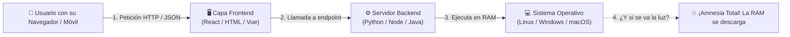
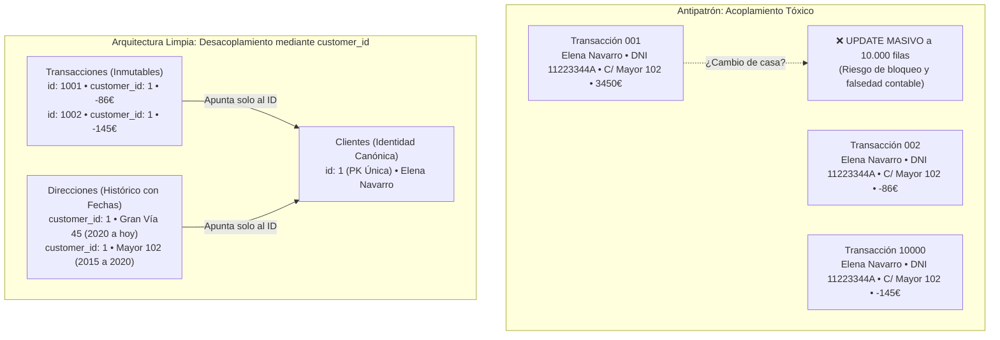
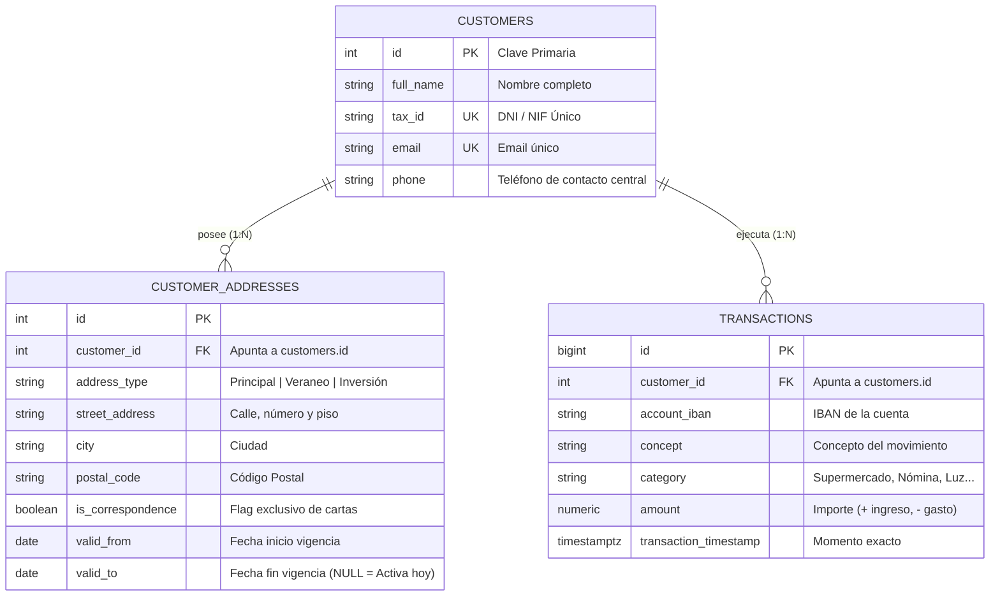
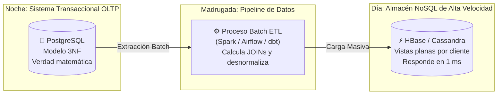

# 🏛️ CLASE MAESTRA 34: Persistencia, Arquitectura de Datos y el Ecosistema Relacional & NoSQL
### *Guía Didáctica para el Aula: De la Memoria de las Aplicaciones al Caso Bancario Real, la Selva de los JOINs y los Trade-Offs de Arquitectura*

> *"Enseñar bases de datos no es enseñar a teclear comandos SQL de memoria. Es enseñar a pensar, a anticipar cómo va a evolucionar el negocio y a entender que cada tabla que creas o dejas de crear tiene un impacto directo en la memoria del servidor, en la velocidad de la aplicación y en la integridad del dinero de los clientes."*

---

## 📌 Índice General de la Clase

1. [MÓDULO 1: De la Memoria Volátil a la Persistencia Universal](#módulo-1-de-la-memoria-volátil-a-la-persistencia-universal)
   - [1.1. De dónde venimos: SO, Servidor, Frontend y Git](#11-de-dónde-venimos-so-servidor-frontend-y-git)
   - [1.2. El problema físico de la RAM vs Almacenamiento no volátil](#12-el-problema-físico-de-la-ram-vs-almacenamiento-no-volátil)
   - [1.3. La memoria persistente: 'El acordarnos de algo'](#13-la-memoria-persistente-el-acordarnos-de-algo)
   - [1.4. Stateless vs Stateful: Aplicaciones con y sin estado](#14-stateless-vs-stateful-aplicaciones-con-y-sin-estado)
   - [1.5. El estado deslocalizado y el concepto universal de API](#15-el-estado-deslocalizado-y-el-concepto-universal-de-api)
   - [1.6. Por qué nacen las Bases de Datos (ACID, Concurrencia e Índices)](#16-por-qué-nacen-las-bases-de-datos-acid-concurrencia-e-índices)
   - [1.7. SQL como lenguaje declarativo y API estructurada](#17-sql-como-lenguaje-declarativo-y-api-estructurada)
   - [1.8. La mente flexible y la falacia del martillo de oro: Llega NoSQL](#18-la-mente-flexible-y-la-falacia-del-martillo-de-oro-llega-nosql)
   - [1.9. Object Storage: S3, Google Cloud Storage y Backups](#19-object-storage-s3-google-cloud-storage-y-backups)
2. [MÓDULO 2: Glosario Fundamental sin Dar Nada por Sabido](#módulo-2-glosario-fundamental-sin-dar-nada-por-sabido)
   - [2.1. ¿Qué es DDL (Data Definition Language)?](#21-qué-es-ddl-data-definition-language)
   - [2.2. ¿Qué es DML (Data Manipulation Language)?](#22-qué-es-dml-data-manipulation-language)
   - [2.3. Tipos de Datos Clave en PostgreSQL](#23-tipos-de-datos-clave-en-postgresql)
   - [2.4. Llaves y Restricciones: PRIMARY KEY, FOREIGN KEY, UNIQUE y CHECK](#24-llaves-y-restricciones-primary-key-foreign-key-unique-y-check)
   - [2.5. ¿Qué es un Índice y por qué no es magia gratis?](#25-qué-es-un-índice-y-por-qué-no-es-magia-gratis)
3. [MÓDULO 3: El Gran Experimento Bancario (Hacerlo Mal Primero)](#módulo-3-el-gran-experimento-bancario-hacerlo-mal-primero)
   - [3.1. La tentación del monolito plano para el frontend](#31-la-tentación-del-monolito-plano-para-el-frontend)
   - [3.2. Código SQL: Creación y población del Monolito Caótico](#32-código-sql-creación-y-población-del-monolito-caótico)
   - [3.3. El desastre del teléfono: Inconsistencia y pérdida de juego operativo](#33-el-desastre-del-teléfono-inconsistencia-y-pérdida-de-juego-operativo)
   - [3.4. El desastre del cambio de nombre y la destrucción de la verdad histórica](#34-el-desastre-del-cambio-de-nombre-y-la-destrucción-de-la-verdad-histórica)
4. [MÓDULO 4: El Modelo Relacional Robusto (Hacerlo Bien - 3NF)](#módulo-4-el-modelo-relacional-robusto-hacerlo-bien---3nf)
   - [4.1. Separación de entidades: Clientes, Viviendas y Transacciones](#41-separación-de-entidades-clientes-viviendas-y-transacciones)
   - [4.2. DDL Oficial: Creación de las tablas limpias](#42-ddl-oficial-creación-de-las-tablas-limpias)
   - [4.3. DML Oficial: Inserción de 3 clientes, 10 casas y 10 transacciones](#43-dml-oficial-inserción-de-3-clientes-10-casas-y-10-transacciones)
   - [4.4. Cómo 1NF, 2NF y 3NF crean orden progresivo](#44-cómo-1nf-2nf-y-3nf-crean-orden-progresivo)
5. [MÓDULO 5: El Laboratorio Extensivo de JOINs](#módulo-5-el-laboratorio-extensivo-de-joins)
   - [5.1. INNER JOIN básico: Cruzando clientes con sus movimientos](#51-inner-join-básico-cruzando-clientes-con-sus-movimientos)
   - [5.2. LEFT JOIN vs INNER JOIN: El caso del cliente sin movimientos](#52-left-join-vs-inner-join-el-caso-del-cliente-sin-movimientos)
   - [5.3. La trampa del doble JOIN incondicional: La explosión cartesiana](#53-la-trampa-del-doble-join-incondicional-la-explosión-cartesiana)
   - [5.4. Solución con regla de negocio: Filtrar la correspondencia vigente](#54-solución-con-regla-de-negocio-filtrar-la-correspondencia-vigente)
   - [5.5. El enigma de las facturas históricas: JOIN temporal (SCD Tipo 2)](#55-el-enigma-de-las-facturas-históricas-join-temporal-scd-tipo-2)
   - [5.6. Agrupaciones y balances contables con GROUP BY y SUM](#56-agrupaciones-y-balances-contables-con-group-by-y-sum)
   - [5.7. Control de categorías y gastos con CASE y COALESCE](#57-control-de-categorías-y-gastos-con-case-y-coalesce)
6. [MÓDULO 6: Del Modelo Relacional al Ecosistema NoSQL y Big Data](#módulo-6-del-modelo-relacional-al-ecosistema-nosql-y-big-data)
   - [6.1. ¿Por qué el modelo 3NF no puede responder en 2 ms a 10 millones de móviles?](#61-por-qué-el-modelo-3nf-no-puede-responder-en-2-ms-a-10-millones-de-móviles)
   - [6.2. Procesamiento Batch y Pipelines ETL: La noche desnormaliza para el día](#62-procesamiento-batch-y-pipelines-etl-la-noche-desnormaliza-para-el-día)
   - [6.3. La consulta SQL del ETL que precalcula la RowKey para HBase](#63-la-consulta-sql-del-etl-que-precalcula-la-rowkey-para-hbase)
   - [6.4. ¿Qué es HBase y qué es Apache Phoenix?](#64-qué-es-hbase-y-qué-es-apache-phoenix)
   - [6.5. ¿Qué es Apache Cassandra y por qué CQL prohíbe los JOINs?](#65-qué-es-apache-cassandra-y-por-qué-cql-prohíbe-los-joins)
   - [6.6. MongoDB y Mongoose: Embeber vs $lookup](#66-mongodb-y-mongoose-embeber-vs-lookup)
   - [6.7. Neo4J y Grafos: Detección automática de fraude en seguros de coche](#67-neo4j-y-grafos-detección-automática-de-fraude-en-seguros-de-coche)
7. [MÓDULO 7: El Gran Corolario de los Trade-Offs](#módulo-7-el-gran-corolario-de-los-trade-offs)
   - [7.1. La Metáfora del Armario: El cubo caótico vs el armario con perchas](#71-la-metáfora-del-armario-el-cubo-caótico-vs-el-armario-con-perchas)
   - [7.2. El Teorema CAP y el dilema del Write Concern en sistemas distribuidos](#72-el-teorema-cap-y-el-dilema-del-write-concern-en-sistemas-distribuidos)
   - [7.3. Matriz de Decisión para el Arquitecto de Datos](#73-matriz-de-decisión-para-el-arquitecto-de-datos)

---

# MÓDULO 1: De la Memoria Volátil a la Persistencia Universal

---

### 1.1. De dónde venimos: SO, Servidor, Frontend y Git

Para entender por qué existen las bases de datos, situémonos en el mapa de una aplicación informática real:



- **El Sistema Operativo:** Administra el procesador (CPU), asigna memoria RAM y controla las comunicaciones.
- **El Servidor Web / Backend:** El código que programamos para resolver la lógica del negocio (calcular impuestos, verificar contraseñas).
- **El Frontend:** La cara visible de la aplicación, lo que el usuario ve y toca.
- **Git:** La herramienta que audita el código fuente y permite a 50 programadores colaborar sin pisarse.

Pero todo esto tiene un talón de Aquiles: **si apagamos la máquina, todo lo que estaba en memoria desaparece**.

---

### 1.2. El problema físico de la RAM vs Almacenamiento no volátil

La memoria **RAM (Random Access Memory)** es un prodigio de la ingeniería física: puede leer y escribir datos en **nanosegundos**. Pero es **volátil**: necesita corriente eléctrica continua para mantener la carga microscópica de sus condensadores.

Si se reinicia el servidor, se cuelga el proceso de Node.js o se corta la electricidad en el centro de datos, **cada byte que residía en la RAM desaparece de forma instantánea e irrecuperable**.

El **Almacenamiento no volátil** (discos duros HDD, memorias sólidas SSD, unidades NVMe) utiliza magnetismo o puertas lógicas de estado sólido que conservan la información grabada físicamente, haya o no corriente eléctrica.

---

### 1.3. La memoria persistente: 'El acordarnos de algo'

> *"Persistir es el acto de fijar un dato en un soporte físico duradero para que podamos acordarnos de él mañana, el mes que viene o dentro de diez años."*

Es el equivalente a la invención de la escritura en la historia humana:
- Antes de la escritura, si el anciano de la tribu moría, todo lo que sabía se perdía.
- Con la escritura en piedra o papel, el conocimiento se volvió **persistente**.
- En software, una base de datos es la escritura en piedra de nuestra aplicación.

---

### 1.4. Stateless vs Stateful: Aplicaciones con y sin estado

| Tipo de Aplicación | ¿Recuerda peticiones pasadas? | ¿Qué ocurre si se reinicia? | Ejemplo Típico |
| :--- | :--- | :--- | :--- |
| **Stateless (Sin Estado)** | **No.** Cada petición es tratada como si fuera la primera del universo. | Le da igual. No pierde nada porque no guardaba nada en memoria propia. | Un microservicio que convierte un archivo PDF a imagen, o una función que calcula el IVA de un precio. |
| **Stateful (Con Estado)** | **Sí.** Guarda constancia de quién eres, qué compraste ayer y cuánto dinero tienes en la cuenta. | Si no tiene base de datos persistente, **sufre amnesia total**. Si tiene base de datos, recupera el estado exacto donde lo dejó. | El core bancario, un carrito de compras de Amazon, el historial de mensajes de WhatsApp. |

---

### 1.5. El estado deslocalizado y el concepto universal de API

En la ingeniería de software moderna, **el estado casi nunca se almacena en el disco duro local de la máquina donde corre el backend**. Si tu servidor web en la nube se quema o Docker lo destruye para crear otro, el disco efímero se destruye con él.

Por eso deslocalizamos los datos a servicios externos a través de **APIs**:
- **GitHub como API de persistencia:** Cuando ejecutas `git push origin main`, envías el estado de tu código a través de internet para que se persista en los centros de datos de Microsoft. Git mismo tiene una API de comandos (`commit`, `branch`, `merge`).
- **¿Qué es una API en su sentido más puro?**  
  Una *Application Programming Interface* (Interfaz de Programación de Aplicaciones) no es solo un endpoint web que devuelve JSON. Es **cualquier contrato estandarizado de interacción predecible**:
  - La **API estándar de Python** (`open()`, `len()`, `read()`) es el contrato entre tu script y el intérprete.
  - La **API de Java (JDK)** es la especificación de clases y métodos que asegura que un código compile y se comporte idénticamente en Linux, Windows o una cafetera inteligente.
  - Una **Base de Datos** expone una API estandarizada de acceso a los datos, y ese lenguaje universal es **SQL**.

---

### 1.6. Por qué nacen las Bases de Datos (ACID, Concurrencia e Índices)

Si guardar datos fuera simplemente volcar texto en un archivo plano con `f.write("Elena;3450.00\n")`, no harían falta bases de datos. El problema surge cuando nos enfrentamos al mundo real:

1. **Concurrencia masiva:** ¿Qué pasa si 1.000 clientes intentan retirar 50 € del mismo cajero al mismo milisegundo? Dos hilos intentarán abrir y reescribir el mismo archivo a la vez. Sin un motor de base de datos con control de bloqueos, el archivo se corrompe.
2. **Propiedades ACID (El escudo de las transacciones):**
   - **A (Atomicidad):** O la operación se completa al 100% o no ocurre nada. Si transfieres 500 € de tu cuenta a la de un amigo, no puede ocurrir que el dinero salga de tu cuenta pero se corte la luz antes de llegar a la suya.
   - **C (Consistencia):** Ninguna operación puede violar las reglas del banco (ej. el saldo no puede ser inferior al límite de crédito).
   - **I (Aislamiento):** Dos transacciones simultáneas se ejecutan sin interferir entre sí.
   - **D (Durabilidad):** Una vez que el banco te dice *"Transferencia confirmada"*, el dato está grabado en disco en el log transaccional (WAL). Aunque explote el transformador eléctrico un milisegundo después, el dinero no se pierde.
3. **Indexación:** Si un archivo de texto tiene 15 millones de líneas, buscar al cliente con DNI `11223344A` exige leer los 15 millones de líneas una a una (minutos de espera). Una base de datos indexada con un árbol B-Tree encuentra ese registro en **menos de 1 milisegundo**.

---

### 1.7. SQL como lenguaje declarativo y API estructurada

Nacido en IBM en la década de 1970 bajo el nombre de SEQUEL, **SQL (Structured Query Language)** es un lenguaje declarativo:
- **Lenguaje Imperativo (Python, C, Java):** Tienes que programar el **CÓMO** (*"Abre este archivo, pon un bucle for, compara cada línea con un if, acumula en una variable temporal"*).
- **Lenguaje Declarativo (SQL):** Solo describes el **QUÉ** (*"Dame los clientes de Madrid que hayan gastado más de 100 € en octubre"*).

El motor de la base de datos tiene una pieza interna llamada **Optimizador de Consultas (Query Planner)**, que calcula matemáticamente el camino más rápido para obtener el resultado en disco.

---

### 1.8. La mente flexible y la falacia del martillo de oro: Llega NoSQL

> *"Para quien solo tiene un martillo, todo problema que ve en la vida tiene forma de clavo."*

En la informática es un error gravísimo casarse con una sola herramienta. A principios de la década de 2000, con el estallido de la Web 2.0 y el Big Data, nacieron las bases de datos **NoSQL (Not Only SQL)**:
- **MongoDB** aportó la diversión y velocidad de los documentos JSON: puedes guardar estructuras flexibles sin tener que definir tablas estrictas antes de empezar a programar.
- Pero la madurez de un ingeniero consiste en saber cuándo conviene una base relacional y cuándo una NoSQL. Depende de:
  - ¿La prioridad es la consistencia matemática o la velocidad de escritura?
  - ¿El esquema cambia todos los días o son datos financieros rígidos?
  - ¿Qué volumen de peticiones por segundo debemos absorber?

---

### 1.9. Object Storage: S3, Google Cloud Storage y Backups

No toda la información encaja en tablas relacionales o documentos JSON.  
Servicios como **Amazon S3** o **Google Cloud Storage (GCS)** representan el paradigma del **Almacenamiento de Objetos**:
- Almacenan archivos enteros como bloques de bytes (blobs) identificados por una clave URI (`s3://mi-banco/escrituras/2026/contrato_elena.pdf`).
- Tienen un coste por gigabyte ridículamente bajo y una durabilidad garantizada del 99.999999999% (los famosos 11 nueves).
- En un banco, S3 es el hogar predilecto para:
  - Las fotos escaneadas del DNI del cliente.
  - Los recibos mensuales generados en PDF.
  - Los backups y copias de seguridad de PostgreSQL que se extraen cada noche.

---

# MÓDULO 2: Glosario Fundamental sin Dar Nada por Sabido

---

### 2.1. ¿Qué es DDL (Data Definition Language)?

> **DDL (Lenguaje de Definición de Datos):** Es el subconjunto de sentencias SQL que sirve para **crear, modificar o destruir la estructura** de la base de datos. No toca los datos de las personas; define el "plano de la casa".

Comandos DDL principales:
- `CREATE TABLE`: Crea una nueva tabla con sus columnas y reglas.
- `ALTER TABLE`: Añade columnas, renombra campos o cambia tipos de datos.
- `DROP TABLE`: Destruye la tabla entera y todo lo que contenía.
- `CREATE INDEX`: Construye una estructura de búsqueda rápida.

---

### 2.2. ¿Qué es DML (Data Manipulation Language)?

> **DML (Lenguaje de Manipulación de Datos):** Es el subconjunto de sentencias SQL que sirve para **operar con las filas y registros reales** que viven dentro de las tablas ya creadas.

Comandos DML principales:
- `INSERT INTO`: Introduce nuevas filas de información.
- `SELECT`: Consulta, proyecta y lee datos sin modificarlos.
- `UPDATE`: Modifica los valores de una o varias filas existentes.
- `DELETE`: Borra filas concretas que cumplan una condición.

---

### 2.3. Tipos de Datos Clave en PostgreSQL

Al crear una tabla en PostgreSQL debemos indicar qué clase de valor admitirá cada columna:

| Tipo de Dato | Significado | Para qué se usa en el banco | Ejemplo |
| :--- | :--- | :--- | :--- |
| `SERIAL` / `BIGSERIAL` | Entero autoincremental automático. Empieza en 1 y suma 1 en cada inserción. | Claves primarias de clientes o facturas. | `1, 2, 3...` |
| `VARCHAR(n)` | Cadena de texto de longitud variable con un máximo de $n$ caracteres. | Nombres, emails, DNIs, conceptos. | `'Elena Navarro'` |
| `NUMERIC(p, s)` | Número decimal exacto de alta precisión matemática sin errores de redondeo float. | **Saldos, dinero, transferencias.** | `NUMERIC(12, 2)` $\to$ `3450.50` |
| `BOOLEAN` | Valor lógico booleano: solo admite `TRUE` o `FALSE`. | Banderas de estado o si una casa es de correspondencia. | `TRUE` |
| `DATE` | Fecha de calendario sin hora (`AAAA-MM-DD`). | Fechas de nacimiento o vigencia de contratos. | `'2026-10-18'` |
| `TIMESTAMPTZ` | Marca de tiempo completa con fecha, hora, minutos, segundos y zona horaria. | **Momento exacto en que se ejecutó una transferencia.** | `'2026-10-18 10:30:00+02'` |

---

### 2.4. Llaves y Restricciones: PRIMARY KEY, FOREIGN KEY, UNIQUE y CHECK

Una base de datos seria no confía en que los usuarios o los programadores introduzcan datos perfectos: **impone restricciones de obligado cumplimiento** a nivel de motor:

1. **`PRIMARY KEY` (Clave Primaria - PK):**  
   Es el DNI de la fila. Identifica de forma exclusiva e irrepetible cada registro. **Jamás admite valores repetidos y jamás admite valores nulos (`NULL`)**.
2. **`FOREIGN KEY` (Clave Foránea - FK):**  
   Es el cable que conecta dos tablas. Exige que el valor almacenado en una tabla hija **exista obligatoriamente en la tabla padre referenciada**. Si intentas registrar una transferencia para el cliente con `customer_id = 99` y en la tabla de clientes solo existen el 1, el 2 y el 3, PostgreSQL rechaza la operación con un error de integridad referencial.
3. **`UNIQUE`:**  
   Impide que dos filas tengan el mismo valor en una columna (por ejemplo, el `tax_id` / DNI o el `email` de un cliente).
4. **`CHECK`:**  
   Una condición lógica que cada dato debe verificar antes de ser guardado (por ejemplo, `CHECK (importe != 0)` o `CHECK (saldo >= -500)`).

---

### 2.5. ¿Qué es un Índice y por qué no es magia gratis?

> **Un índice es exactamente igual al índice alfabético que hay al final de un libro de medicina:**  
> Si buscas la palabra *"Ibuprofeno"* en un libro de 1.000 páginas sin índice, tienes que leer las 1.000 páginas de principio a fin (**Sequential Scan**). Si el libro tiene un índice alfabético al final, vas directamente a la letra "I", ves que está en la página 342 y saltas directamente a ella (**Index Scan**).

- **La ventaja:** Las consultas de búsqueda con `WHERE` y los cruces con `JOIN` pasan de tardar segundos a tardar milisegundos.
- **El precio que se paga (Trade-off):** Cada vez que haces un `INSERT`, un `UPDATE` o un `DELETE`, el motor no solo tiene que escribir la fila en la tabla; **tiene que reordenar y reescribir todos los índices asociados**. Si pones 15 índices en una tabla, las consultas vuelan, pero las inserciones se vuelven lentas.

---

# MÓDULO 3: El Gran Experimento Bancario (Hacerlo Mal Primero)

---

### 3.1. La tentación del monolito plano para el frontend

Vamos a empezar en el aula haciendo las cosas **deliberadamente mal**.

Imaginemos que un programador tiene que construir la pantalla de inicio de la aplicación web o móvil del banco. En esa pantalla el cliente ve:
- Su nombre y su DNI.
- Su teléfono móvil para avisos de seguridad.
- Su dirección de residencia habitual.
- Sus compras y movimientos recientes.

El programador piensa: *"Para qué voy a complicarme creando tres tablas distintas si puedo meterlo todo en una sola tabla de transacciones; así cuando la web haga un `SELECT`, me llega todo masticado en una sola fila lista para pintar"*.

> [!NOTE]
> **Aclaración previa para el aula:**  
> En este punto **NO existe ninguna combinación cartesiana**. Cada fila es una transacción real y legítima que guarda la dirección, el teléfono y el nombre del cliente en el momento de la operación. La combinación cartesiana ocurrirá más adelante, en el Módulo 5, si hacemos un `JOIN` descuidado entre transacciones y múltiples viviendas.  
> El problema aquí es de **diseño, arquitectura y legalidad**.

---

### 3.2. Código SQL: Creación y población del Monolito Caótico

Copiad y ejecutad en vuestros motores este código que implementa el antipatrón de la tabla plana:

```sql
-- ============================================================================
-- EXPERIMENTO: EL MONOLITO PLANO (HACERLO MAL PRIMERO)
-- ============================================================================
DROP TABLE IF EXISTS transacciones_monolito CASCADE;

CREATE TABLE transacciones_monolito (
    id SERIAL PRIMARY KEY,
    nombre_cliente VARCHAR(100),
    dni VARCHAR(15),
    telefono_movil VARCHAR(20),
    email_contacto VARCHAR(100),
    direccion_cliente VARCHAR(150),
    concepto_transaccion VARCHAR(120),
    importe NUMERIC(10, 2),
    fecha_transaccion DATE
);

-- Insertamos 4 transacciones legítimas de Elena Navarro a lo largo del año:
INSERT INTO transacciones_monolito 
(nombre_cliente, dni, telefono_movil, email_contacto, direccion_cliente, concepto_transaccion, importe, fecha_transaccion) 
VALUES
('Elena Navarro Soler', '11223344A', '+34 611 111 222', 'elena@email.com', 'Calle Mayor 102, 2ºC (Madrid)', 'Abono Nómina Tech Corp', 3450.00, '2026-01-15'),
('Elena Navarro Soler', '11223344A', '+34 611 111 222', 'elena@email.com', 'Calle Mayor 102, 2ºC (Madrid)', 'Compra Mercadona Gran Vía', -86.45, '2026-02-02'),
('Elena Navarro Soler', '11223344A', '+34 611 111 222', 'elena@email.com', 'Calle Mayor 102, 2ºC (Madrid)', 'Recibo Electricidad Iberdrola', -112.30, '2026-03-05'),
('Elena Navarro Soler', '11223344A', '+34 611 111 222', 'elena@email.com', 'Calle Mayor 102, 2ºC (Madrid)', 'Cena Restaurante El Cenador', -145.00, '2026-10-10');
```

A primera vista, la tabla parece cómoda: cada fila es una compra real de Elena con todos sus datos listos para el frontend. ¿Dónde está el veneno oculto de este diseño?

---

### 3.3. El desastre de la dirección y el teléfono: Modificar 10.000 transacciones y las implicaciones legales

Imaginemos que Elena se muda en noviembre a **Calle Gran Vía 45** o cambia su teléfono móvil al `+34 699 999 999`.

Si la tabla está diseñada como un monolito plano para mostrar la información del cliente en la web:
- Para que la web muestre la nueva dirección de Elena en su extracto, **¡tendrías que ejecutar un `UPDATE` masivo sobre sus 10.000 transacciones históricas en disco!**

```sql
-- El intento desesperado en el monolito: Modificar todas las transacciones pasadas
UPDATE transacciones_monolito 
SET direccion_cliente = 'Calle Gran Vía 45, 4ºB (Madrid)',
    telefono_movil = '+34 699 999 999'
WHERE dni = '11223344A';
```

#### ¿Por qué esto es una catástrofe técnica y legal?

1. **Catástrofe Técnica (Bloqueos e Inconsistencia):**  
   Ejecutar un `UPDATE` sobre 10.000 o 500.000 filas bloquea registros en disco (`Row Locking`), satura el log de transacciones (WAL) y ralentiza el motor. Si la conexión se interrumpe a la mitad, unas transacciones tendrán la dirección nueva y otras la vieja, destruyendo la *Single Source of Truth*.
2. **Graves Implicaciones Legales y Regulatorias:**  
   En la banca y en la normativa contable (auditorías fiscales de Hacienda, Sarbanes-Oxley, Banco Central Europeo, PBC/FT):  
   > ⛔ **Las transacciones financieras son INMUTABLES.**  
   > Una transacción contable es un hecho histórico certificado. Modificar retrospectivamente el contenido de transacciones de hace 2 o 3 años para cambiar la dirección o el nombre puede considerarse **falsedad contable o manipulación de registros históricos**. En una inspección tributaria, la factura de 2024 debe reflejar la realidad del momento en que ocurrió.
3. **Pérdida de Juego Operativo:**  
   Si Elena tiene dos teléfonos (personal y empresa) o dos viviendas (habitual y veraneo), en el monolito no tienes juego: tendrías que añadir columnas monstruosas como `telefono_1`, `telefono_2`, `casa_1`, `casa_2`.

---

### 3.4. La solución elegante: La superioridad del customer_id único

> *"La realidad es que es infinitamente más limpio tener un `customer_id` único en la transacción, y a partir de ese ID sacar toda la información de la persona, sus teléfonos y sus viviendas."*



#### Ventajas del `customer_id`:
- **Garantía de Unicidad:** El `customer_id` es único, compacto (un simple entero de 4 u 8 bytes) e inmutable.
- **Transacciones Intactas:** Cuando Elena cambia de casa, **no se toca ni un solo byte de sus 10.000 transacciones históricas**. Las transacciones siguen inalteradas y conformes a la ley.
- **Trazabilidad Temporal:** En la tabla de direcciones o contactos registramos una nueva fila con sus fechas de vigencia (`valid_from` y `valid_to`), permitiendo al banco saber con exactitud matemática dónde residía el cliente en cualquier fecha del pasado.

---

# MÓDULO 4: El Modelo Relacional Robusto (Hacerlo Bien - 3NF)

---

### 4.1. Separación de entidades: Clientes, Viviendas y Transacciones

Para que una base de datos sea escalable, segura y veraz, separamos los conceptos en **entidades independientes** vinculadas mediante relaciones de **Uno a Muchos (1:N)**:



---

### 4.2. DDL Oficial: Creación de las tablas limpias

Copiad y ejecutad en vuestras mesas el esquema relacional limpio:

```sql
-- ============================================================================
-- DDL OFICIAL: MODELO NORMALIZADO BANCO HORIZONTE
-- ============================================================================

-- 1. Limpieza de tablas previas (en orden inverso a sus dependencias)
DROP TABLE IF EXISTS transactions CASCADE;
DROP TABLE IF EXISTS customer_addresses CASCADE;
DROP TABLE IF EXISTS customers CASCADE;

-- 2. Tabla de Clientes (La identidad de la persona)
CREATE TABLE customers (
    id SERIAL PRIMARY KEY,
    full_name VARCHAR(100) NOT NULL,
    tax_id VARCHAR(15) NOT NULL UNIQUE,       -- DNI/NIF irrepetible
    email VARCHAR(100) NOT NULL UNIQUE,
    phone VARCHAR(20) NOT NULL
);

-- 3. Tabla de Direcciones y Viviendas (1:N con Clientes)
CREATE TABLE customer_addresses (
    id SERIAL PRIMARY KEY,
    customer_id INT NOT NULL REFERENCES customers(id) ON DELETE CASCADE,
    address_type VARCHAR(30) NOT NULL,        -- 'Principal', 'Veraneo', 'Inversión', 'Histórica'
    street_address VARCHAR(150) NOT NULL,
    city VARCHAR(50) NOT NULL,
    postal_code VARCHAR(10) NOT NULL,
    is_correspondence BOOLEAN NOT NULL DEFAULT FALSE,
    valid_from DATE NOT NULL,
    valid_to DATE                             -- NULL indica que es la casa activa hoy
);

-- 4. Tabla de Transacciones y Movimientos (1:N con Clientes)
CREATE TABLE transactions (
    id BIGSERIAL PRIMARY KEY,
    customer_id INT NOT NULL REFERENCES customers(id) ON DELETE RESTRICT,
    account_iban VARCHAR(34) NOT NULL,
    concept VARCHAR(120) NOT NULL,
    category VARCHAR(40) NOT NULL,
    amount NUMERIC(12, 2) NOT NULL,           -- Positivo = ingreso, Negativo = gasto
    transaction_timestamp TIMESTAMPTZ NOT NULL
);

-- 5. Creación de índices en las Claves Foráneas para acelerar los JOINs
CREATE INDEX idx_addresses_cust ON customer_addresses(customer_id);
CREATE INDEX idx_tx_cust ON transactions(customer_id);
CREATE INDEX idx_tx_time ON transactions(transaction_timestamp DESC);
```

> [!NOTE]
> Fijaos en las políticas de borrado:
> - `ON DELETE CASCADE` en direcciones: Si damos de baja a un cliente, se borran sus domicilios.
> - `ON DELETE RESTRICT` en transacciones: **El motor prohíbe taxativamente borrar a un cliente si tiene movimientos de dinero registrados.**

---

### 4.3. DML Oficial: Inserción de 3 clientes, 10 casas y 10 transacciones

Copiad y ejecutad el set completo de datos de prueba:

```sql
BEGIN;

-- 1. Insertamos 3 Clientes reales
INSERT INTO customers (id, full_name, tax_id, email, phone) VALUES
(1, 'Elena Navarro Soler', '11223344A', 'elena.navarro@email.com', '+34 611 111 222'),
(2, 'Carlos Benítez Vega', '22334455B', 'carlos.benitez@email.com', '+34 622 333 444'),
(3, 'Lucía Morales Prado', '33445566C', 'lucia.morales@email.com', '+34 633 555 666');

SELECT setval('customers_id_seq', (SELECT MAX(id) FROM customers));

-- 2. Insertamos 10 Viviendas distribuidas (con histórico temporal)
INSERT INTO customer_addresses 
(customer_id, address_type, street_address, city, postal_code, is_correspondence, valid_from, valid_to) 
VALUES
-- Elena (4 casas): Nótese que hasta el 14 de enero de 2020 residió en Calle Mayor 102
(1, 'Principal', 'Calle Gran Vía 45, 4ºB', 'Madrid', '28013', TRUE, '2020-01-15', NULL),
(1, 'Veraneo', 'Paseo Marítimo 12', 'Alicante', '03001', FALSE, '2022-06-01', NULL),
(1, 'Inversión', 'Calle Sierpes 8', 'Sevilla', '41004', FALSE, '2023-09-10', NULL),
(1, 'Histórica Anterior', 'Calle Mayor 102, 2ºC', 'Madrid', '28005', TRUE, '2015-02-01', '2020-01-14'),

-- Carlos (3 casas)
(2, 'Principal', 'Avinguda Diagonal 500', 'Barcelona', '08006', TRUE, '2018-04-10', NULL),
(2, 'Veraneo', 'Camí de Ronda 22', 'Cadaqués', '17488', FALSE, '2021-07-15', NULL),
(2, 'Despacho', 'Rambla Catalunya 40', 'Barcelona', '08007', FALSE, '2019-11-01', NULL),

-- Lucía (3 casas)
(3, 'Principal', 'Calle Colón 15', 'Valencia', '46004', TRUE, '2021-03-01', NULL),
(3, 'Veraneo', 'Avenida del Faro 5', 'Dénia', '03700', FALSE, '2023-05-20', NULL),
(3, 'Inversión', 'Calle Uría 30', 'Oviedo', '33003', FALSE, '2024-01-15', NULL);

-- 3. Insertamos 10 Transacciones con importes y fechas estratégicas
INSERT INTO transactions 
(customer_id, account_iban, concept, category, amount, transaction_timestamp) 
VALUES
-- Elena (Transacción histórica en 2018 y transacciones recientes en 2026)
(1, 'ES91 2100 0418 4502 0005 1111', 'Factura Antigua Préstamo', 'Comisiones', -120.00, '2018-06-15 10:00:00+02'),
(1, 'ES91 2100 0418 4502 0005 1111', 'Abono Nómina Tech Corp', 'Nómina', 3450.00, '2026-10-01 08:30:00+02'),
(1, 'ES91 2100 0418 4502 0005 1111', 'Compra Mercadona Gran Vía', 'Supermercado', -86.45, '2026-10-02 18:15:00+02'),
(1, 'ES91 2100 0418 4502 0005 1111', 'Cena Restaurante El Cenador', 'Ocio', -145.00, '2026-10-10 21:45:00+02'),

-- Carlos
(2, 'ES91 2100 0418 4502 0005 2222', 'Factura Cliente Consultoría', 'Nómina', 5200.00, '2026-10-01 11:00:00+02'),
(2, 'ES91 2100 0418 4502 0005 2222', 'Gasolinera Repsol Diagonal', 'Transporte', -75.50, '2026-10-03 09:20:00+02'),
(2, 'ES91 2100 0418 4502 0005 2222', 'Seguro Médico Sanitas', 'Salud', -85.00, '2026-10-07 07:45:00+02'),

-- Lucía
(3, 'ES91 2100 0418 4502 0005 3333', 'Transferencia Nómina Empresa', 'Nómina', 2850.00, '2026-10-01 09:00:00+02'),
(3, 'ES91 2100 0418 4502 0005 3333', 'Farmacia Central Valencia', 'Salud', -34.20, '2026-10-04 12:10:00+02'),
(3, 'ES91 2100 0418 4502 0005 3333', 'Compra Online Fnac Libros', 'Ocio', -62.80, '2026-10-08 16:30:00+02');

COMMIT;
```

---

### 4.4. Cómo 1NF, 2NF y 3NF crean orden progresivo

Observemos el impacto pedagógico de las tres formas normales:

1. **1NF (Primera Forma Normal - Atomicidad):**  
   - *Regla:* Cada celda contiene un único valor escalar. Cero arrays y cero listas separadas por comas.  
   - *En el banco:* En vez de guardar `direcciones = 'Gran Vía 45, Paseo Marítimo 12'`, cada casa es una fila independiente.
2. **2NF (Segunda Forma Normal - Dependencia Completa):**  
   - *Regla:* Todo atributo que no es clave debe depender por completo de la clave primaria.  
   - *En el banco:* El importe y el concepto dependen del `id` de la transacción. El nombre y el DNI dependen del cliente. Por tanto, separamos `customers` de `transactions`.
3. **3NF (Tercera Forma Normal - Cero Transitividad):**  
   - *Regla:* Ningún atributo no clave debe depender de otro atributo no clave.  
   - *En el banco:* La ciudad y la provincia dependen del código postal, no del ID de la persona. Si creamos una tabla de códigos postales, eliminamos cualquier redundancia geográfica.

---

# MÓDULO 5: El Laboratorio Extensivo de JOINs

---

### 5.1. INNER JOIN básico: Cruzando clientes con sus movimientos

Un **`JOIN`** (o `INNER JOIN`) reúne temporalmente filas de dos tablas basándose en una columna común:

```sql
-- CONSULTA 1: Listar cada movimiento con el nombre del titular
SELECT 
    c.id AS cliente_id,
    c.full_name AS titular,
    t.concept AS movimiento,
    t.amount AS importe,
    t.transaction_timestamp::DATE AS fecha
FROM customers c
INNER JOIN transactions t ON c.id = t.customer_id
ORDER BY t.transaction_timestamp DESC;
```

#### Lo que veréis en vuestra pantalla (Fragmento):

| cliente_id | titular | movimiento | importe | fecha |
| :---: | :--- | :--- | :---: | :---: |
| 1 | Elena Navarro Soler | Cena Restaurante El Cenador | -145.00 | 2026-10-10 |
| 3 | Lucía Morales Prado | Compra Online Fnac Libros | -62.80 | 2026-10-08 |
| 2 | Carlos Benítez Vega | Seguro Médico Sanitas | -85.00 | 2026-10-07 |

---

### 5.2. LEFT JOIN vs INNER JOIN: El caso del cliente sin movimientos

> [!IMPORTANT]
> **Diferencia de Oro para el Examen:**
> - `INNER JOIN` exige que la fila exista en **ambas tablas**. Si un cliente nunca ha hecho transacciones, desaparece del informe.
> - `LEFT JOIN` conserva **todas las filas de la tabla izquierda**, rellenando con `NULL` si no hay coincidencias a la derecha.

Hagamos la prueba insertando un cuarto cliente en el banco que acaba de abrir su cuenta y aún no ha operado:

```sql
-- Insertamos al Cliente 4 (David, sin movimientos)
INSERT INTO customers (id, full_name, tax_id, email, phone) 
VALUES (4, 'David Ruiz Gómez', '44556677D', 'david@email.com', '+34 644 777 888')
ON CONFLICT (id) DO NOTHING;

-- PRUEBA A: Con INNER JOIN (David desaparece: devuelve 10 filas)
SELECT c.full_name, t.concept, t.amount
FROM customers c
INNER JOIN transactions t ON c.id = t.customer_id;

-- PRUEBA B: Con LEFT JOIN (David SÍ aparece con NULL: devuelve 11 filas)
SELECT 
    c.full_name, 
    COALESCE(t.concept, 'Sin movimientos todavía') AS concepto, 
    COALESCE(t.amount, 0.00) AS importe
FROM customers c
LEFT JOIN transactions t ON c.id = t.customer_id;
```

#### Resultado de la Prueba B con LEFT JOIN:

| full_name | concepto | importe |
| :--- | :--- | :---: |
| Elena Navarro Soler | Cena Restaurante El Cenador | -145.00 |
| ... | ... | ... |
| **David Ruiz Gómez** | **Sin movimientos todavía** | **0.00** |

---

### 5.3. La trampa del doble JOIN incondicional: La explosión cartesiana

¿Qué ocurre si un analista intenta unir en una sola consulta las transacciones y las casas de Elena?

```sql
-- CONSULTA PELIGROSA: Doble JOIN incondicional
SELECT 
    c.full_name,
    t.concept,
    t.amount,
    a.street_address,
    a.address_type
FROM customers c
JOIN transactions t ON c.id = t.customer_id
JOIN customer_addresses a ON c.id = a.customer_id
WHERE c.id = 1;
```

> ⚠️ **Resultado en vuestra pantalla:**  
> Como Elena tiene **4 transacciones** y **4 casas**, la consulta devuelve **16 filas**.  
> ¡La cena del restaurante de -145.00 € aparece listada 4 veces: una por cada casa que tiene Elena!

---

### 5.4. Solución con regla de negocio: Filtrar la correspondencia vigente

Para eliminar los duplicados, debemos trasladar la regla del negocio al SQL: *solo queremos la residencia postal oficial activa hoy*:

```sql
SELECT 
    c.full_name,
    c.tax_id,
    a.street_address AS direccion_oficial_envio,
    a.city,
    a.postal_code,
    t.concept AS movimiento,
    t.amount AS importe
FROM customers c
JOIN customer_addresses a 
    ON c.id = a.customer_id 
   AND a.is_correspondence = TRUE 
   AND a.valid_to IS NULL
JOIN transactions t 
    ON c.id = t.customer_id
WHERE c.id = 1
ORDER BY t.transaction_timestamp DESC;
```

#### Resultado: Exactamente 4 filas limpias

| full_name | tax_id | direccion_oficial_envio | city | postal_code | movimiento | importe |
| :--- | :--- | :--- | :--- | :--- | :--- | :---: |
| Elena Navarro Soler | 11223344A | Calle Gran Vía 45, 4ºB | Madrid | 28013 | Cena Restaurante El Cenador | -145.00 |
| Elena Navarro Soler | 11223344A | Calle Gran Vía 45, 4ºB | Madrid | 28013 | Compra Mercadona Gran Vía | -86.45 |
| Elena Navarro Soler | 11223344A | Calle Gran Vía 45, 4ºB | Madrid | 28013 | Abono Nómina Tech Corp | +3450.00 |
| Elena Navarro Soler | 11223344A | Calle Gran Vía 45, 4ºB | Madrid | 28013 | Factura Antigua Préstamo | -120.00 |

---

### 5.5. El enigma de las facturas históricas: JOIN temporal (SCD Tipo 2)

Llegamos a un desafío de nivel senior para la clase:

> *"El Banco Central nos audita un cobro de comisión de préstamo emitido el **15 de junio de 2018**. Nos exige emitir el duplicado exacto del recibo con la dirección fiscal a la que se envió en 2018."*

- En **2018**, Elena vivía en la **Calle Mayor 102** (su residencia de 2015 a 2020).
- En **2020** se mudó a **Gran Vía 45**.
- Si ejecutamos la consulta anterior con `valid_to IS NULL`, ¡el recibo de 2018 saldrá impreso con la dirección de Gran Vía, cometiendo un error legal!

#### La Solución con Condición Temporal de Vigencia:

```sql
SELECT 
    c.full_name,
    t.concept AS movimiento,
    t.amount,
    t.transaction_timestamp::DATE AS fecha_factura,
    a.street_address AS direccion_historica_real,
    a.valid_from AS habitada_desde,
    COALESCE(a.valid_to::TEXT, 'Vigente hoy') AS habitada_hasta
FROM customers c
JOIN transactions t ON c.id = t.customer_id
JOIN customer_addresses a 
    ON c.id = a.customer_id 
   AND a.is_correspondence = TRUE
   -- LA CONDICIÓN TEMPORAL MAESTRA:
   AND t.transaction_timestamp::DATE >= a.valid_from 
   AND (a.valid_to IS NULL OR t.transaction_timestamp::DATE <= a.valid_to)
WHERE c.id = 1
ORDER BY t.transaction_timestamp ASC;
```

#### Lo que veréis en la pantalla de vuestro motor:

| fecha_factura | movimiento | importe | direccion_historica_real | habitada_desde | habitada_hasta |
| :---: | :--- | :---: | :--- | :---: | :---: |
| **2018-06-15** | Factura Antigua Préstamo | -120.00 | **Calle Mayor 102, 2ºC** | 2015-02-01 | **2020-01-14** |
| 2026-10-01 | Abono Nómina Tech Corp | +3450.00 | Calle Gran Vía 45, 4ºB | 2020-01-15 | Vigente hoy |
| 2026-10-02 | Compra Mercadona Gran Vía | -86.45 | Calle Gran Vía 45, 4ºB | 2020-01-15 | Vigente hoy |
| 2026-10-10 | Cena Restaurante El Cenador | -145.00 | Calle Gran Vía 45, 4ºB | 2020-01-15 | Vigente hoy |

> [!TIP]
> **Fijaos en la magia del diseño:** La base de datos es una máquina del tiempo. Sabe automáticamente que en 2018 el recibo fue a Mayor 102 y en 2026 fue a Gran Vía 45.

---

### 5.6. Agrupaciones y balances contables con GROUP BY y SUM

Para saber la situación financiera de cada cliente sin duplicar importes:

```sql
SELECT 
    c.id,
    c.full_name AS titular,
    COUNT(t.id) AS total_movimientos,
    COALESCE(SUM(CASE WHEN t.amount > 0 THEN t.amount ELSE 0 END), 0) AS total_ingresos,
    COALESCE(SUM(CASE WHEN t.amount < 0 THEN ABS(t.amount) ELSE 0 END), 0) AS total_gastos,
    COALESCE(SUM(t.amount), 0) AS balance_neto
FROM customers c
LEFT JOIN transactions t ON c.id = t.customer_id
GROUP BY c.id, c.full_name
ORDER BY balance_neto DESC;
```

#### Resultado contable perfecto:

| id | titular | total_movimientos | total_ingresos | total_gastos | balance_neto |
| :---: | :--- | :---: | :---: | :---: | :---: |
| 2 | Carlos Benítez Vega | 3 | 5200.00 | 160.50 | **+5039.50 €** |
| 1 | Elena Navarro Soler | 4 | 3450.00 | 351.75 | **+3098.25 €** |
| 3 | Lucía Morales Prado | 3 | 2850.00 | 97.00 | **+2753.00 €** |
| 4 | David Ruiz Gómez | 0 | 0.00 | 0.00 | **0.00 €** |

---

### 5.7. Control de categorías y gastos con CASE y COALESCE

Para categorizar si una transacción es un gasto fijo o variable:

```sql
SELECT 
    t.concept,
    t.category,
    t.amount,
    CASE 
        WHEN t.category IN ('Supermercado', 'Suministros', 'Salud') THEN 'Gasto de Primera Necesidad'
        WHEN t.category = 'Ocio' THEN 'Gasto Prescindible / Discrecional'
        WHEN t.amount > 0 THEN 'Ingreso Neto'
        ELSE 'Otros'
    END AS tipo_de_gasto
FROM transactions t
WHERE t.customer_id = 1;
```

---

# MÓDULO 6: Del Modelo Relacional al Ecosistema NoSQL y Big Data

---

### 6.1. ¿Por qué el modelo 3NF no puede responder en 2 ms a 10 millones de móviles?

El modelo relacional que acabamos de construir es perfecto para la contabilidad central: nada se desincroniza y cada céntimo está seguro.

Pero imaginemos el día 1 de cada mes: **10 millones de personas abren a la vez la app del banco en su teléfono móvil**.
- Si cada teléfono lanza una consulta con 3 `JOIN`s, sumas y ordenaciones temporales, la CPU de PostgreSQL alcanzará el 100% en segundos.
- Los clientes sufrirán esperas de 4 a 8 segundos en la app.

---

### 6.2. Procesamiento Batch y Pipelines ETL: La noche desnormaliza para el día

La solución de la ingeniería moderna no es tirar PostgreSQL a la basura. Es crear una **arquitectura políglota (*Polyglot Persistence*)**:



El pipeline de **ETL (Extract, Transform, Load)** corre durante la noche: extrae los datos de PostgreSQL, resuelve los JOINs, precalcula los saldos y carga una tabla desnormalizada en un motor NoSQL.

---

### 6.3. La consulta SQL del ETL que precalcula la RowKey para HBase

¿Cómo es exactamente la consulta SQL que ejecuta el proceso nocturno para alimentar a HBase?

Copiad y ejecutad en vuestras mesas este pipeline SQL:

```sql
-- ============================================================================
-- PIPELINE ETL EN SQL: GENERAR LA TABLA PLANA PARA INGESTA EN HBASE
-- ============================================================================
DROP TABLE IF EXISTS etl_hbase_feed CASCADE;

CREATE TABLE etl_hbase_feed AS
SELECT 
    -- FÓRMULA DE ROWKEY CON TIMESTAMP INVERTIDO:
    'CUST#' || LPAD(c.id::TEXT, 5, '0') || '_' || 
    (922337036854775807 - EXTRACT(EPOCH FROM t.transaction_timestamp)::BIGINT)::TEXT AS hbase_rowkey,
    
    -- Familia personal_data:
    c.full_name AS personal_name,
    c.tax_id AS personal_dni,
    a.street_address AS personal_address,
    
    -- Familia financial:
    t.concept AS tx_concept,
    t.category AS tx_category,
    t.amount AS tx_amount,
    t.transaction_timestamp AS tx_timestamp
FROM customers c
JOIN transactions t ON c.id = t.customer_id
JOIN customer_addresses a 
    ON c.id = a.customer_id 
   AND a.is_correspondence = TRUE 
   AND a.valid_to IS NULL;

-- Consultamos cómo quedó la tabla precalculada:
SELECT hbase_rowkey, personal_name, tx_concept, tx_amount 
FROM etl_hbase_feed 
ORDER BY hbase_rowkey ASC;
```

#### Resultado de la tabla de ETL lista para HBase:

| hbase_rowkey | personal_name | tx_concept | tx_amount |
| :--- | :--- | :--- | :---: |
| `CUST#00001_922337035061611007` | Elena Navarro Soler | Cena Restaurante El Cenador (10 Oct) | -145.00 |
| `CUST#00001_922337035062301007` | Elena Navarro Soler | Compra Mercadona Gran Vía (02 Oct) | -86.45 |
| `CUST#00001_922337035062335807` | Elena Navarro Soler | Abono Nómina Tech Corp (01 Oct) | +3450.00 |

> [!TIP]
> **Fijaos en la RowKey invertida:** Gracias a restar el timestamp al valor máximo de un entero de 64 bits (`922337036854775807`), la compra más reciente de Elena queda **físicamente en la primera posición del disco**.

---

### 6.4. ¿Qué es HBase y qué es Apache Phoenix?

- **Apache HBase:** Es una base de datos distribuida columnar que vive sobre Hadoop (HDFS), inspirada en Bigtable de Google.  
  No tiene tipos complejos ni JOINs: almacena bytes ordenados lexicográficamente por la RowKey. Cuando el móvil pide los 10 últimos movimientos de Elena, HBase lee los primeros bloques continuos de disco en **1 a 2 milisegundos**.
- **Apache Phoenix:** Proporciona un motor SQL relacional con sintaxis ANSI sobre HBase:
  ```sql
  -- Consulta en Apache Phoenix sobre HBase:
  SELECT * FROM bank_statements 
  WHERE rowkey LIKE 'CUST#00001_%' 
  LIMIT 10;
  ```

---

### 6.5. ¿Qué es Apache Cassandra y por qué CQL prohíbe los JOINs?

Creada originalmente por Facebook para gestionar miles de millones de mensajes, **Cassandra** es la reina de las escrituras masivas distribuidas en cientos de nodos peer-to-peer sin nodo maestro.

Utiliza **CQL (Cassandra Query Language)**:
```cql
-- En Cassandra se diseña la tabla pensando en la pantalla del móvil:
CREATE TABLE customer_tx_by_date (
    customer_id int,
    transaction_time timestamp,
    transaction_id uuid,
    customer_name text static,
    concept text,
    amount decimal,
    PRIMARY KEY ((customer_id), transaction_time, transaction_id)
) WITH CLUSTERING ORDER BY (transaction_time DESC);

-- La lectura es directa a disco en 2 ms sin JOINs:
SELECT customer_name, transaction_time, concept, amount 
FROM customer_tx_by_date 
WHERE customer_id = 1 
LIMIT 10;
```
> ⛔ **¿Por qué prohíbe los JOINs?** Porque hacer un JOIN en un clúster distribuido de 50 servidores repartidos por el mundo obligaría a enviar gigabytes de datos cruzados por cables de red, destrozando la latencia.

---

### 6.6. MongoDB y Mongoose: Embeber vs $lookup

En **MongoDB** almacenamos documentos JSON (BSON):
- **Embeber (`Embedding`):** Guardamos las 4 casas de Elena dentro del propio documento de cliente:
  ```json
  {
    "_id": "cust_11223344A",
    "nombre": "Elena Navarro",
    "viviendas": [
      { "calle": "Gran Vía 45", "tipo": "Principal" },
      { "calle": "Paseo Marítimo 12", "tipo": "Veraneo" }
    ]
  }
  ```
- **El dilema de `$lookup`:** Si un cliente tiene 50.000 transacciones, no caben en el documento (límite de 16 MB). Debemos usar `$lookup` (el equivalente al JOIN de Mongo), pero es costoso y consume mucha memoria.
- **Mongoose:** La librería de Node.js que devuelve el orden y los esquemas tipados estrictos a MongoDB en proyectos reales.

---

### 6.7. Neo4J y Grafos: Detección automática de fraude en seguros de coche

**Neo4J** almacena Nodos (personas, coches, pólizas) y Relaciones dirigidas.

#### El Caso del Fraude en Seguros:
- **Elena (Persona A):** Tiene 0 multas. Contrata un seguro barato para un Audi A4.
- **Marcos (Persona B):** Tiene 14 multas y carnet retirado. Las aseguradoras no le aseguran ningún coche.
- Elena y Marcos conviven en el mismo domicilio (Gran Vía 45).
- Marcos estrella el coche y afirman que conducía Elena para cobrar la indemnización.

```cypher
// Consulta Cypher en Neo4J para detectar la red de fraude:
MATCH (elena:Person)-[:HOLDS_POLICY]->(pol:Policy)-[:COVERS]->(car:Vehicle)
MATCH (marcos:Person)-[:REPORTED_ACCIDENT]->(car)
MATCH (elena)-[:LIVES_AT]->(dir:Address)<-[:LIVES_AT]-(marcos)
WHERE elena.fines = 0 AND marcos.license_revoked = TRUE
RETURN "🚨 ALERTA: Conductor suspendido convive con tomador limpio" AS alerta,
       elena.name AS Tomador, 
       marcos.name AS Conductor_Riesgo,
       dir.street AS Domicilio_Compartido;
```

---

# MÓDULO 7: El Gran Corolario de los Trade-Offs

---

### 7.1. La Metáfora del Armario: El cubo caótico vs el armario con perchas

Para cerrar la clase con una imagen mental imborrable:

```mermaid
graph TD
    subgraph "Opción A: El Cubo Caótico (NoSQL / Monolito sin normalizar)"
        A1["👕 Llegas a casa del trabajo"] --> A2["🗑️ Tiras toda la ropa al cubo de golpe"]
        A2 --> A3["⚡ Tiempo de guardado: 0.1 segundos (Escritura ultra veloz)"]
        A3 --> A4["🔍 A la mañana siguiente: Buscar el calcetín azul"]
        A4 --> A5["⏳ Tardas 40 minutos revolviendo todo el montón (Lectura / Seq Scan agónico)"]
    end

    subgraph "Opción B: El Armario Estructurado (SQL Relacional 3NF)"
        B1["👕 Llegas a casa del trabajo"] --> B2["👔 Doblas la ropa, clasificas por color y cuelgas en perchas"]
        B2 --> B3["⏳ Tiempo de guardado: 3 minutos (Escritura estructurada)"]
        B3 --> B4["🔍 A la mañana siguiente: Necesitas el calcetín azul"]
        B4 --> B5["⚡ Abres el cajón de calcetines: 1 segundo (Lectura / Index Scan directo)"]
    end
```



---

### 7.2. El Teorema CAP y el dilema del Write Concern en sistemas distribuidos

En bases de datos con servidores distribuidos por el mundo, el **Teorema CAP** demuestra que ante un corte de red inevitable (**P**artition Tolerance), debemos elegir entre:
- **Consistencia (C):** Todos los clientes leen exactamente el mismo dato al mismo milisegundo.
- **Disponibilidad (A):** El sistema siempre responde, aunque un nodo secundario tenga datos desfasados.

#### El Dilema en MongoDB:
- Si configuras `w: 1`: El nodo primario escribe en RAM y responde a la app en 1 ms. Pero si se corta la luz antes de replicar a los demás servidores, **el dinero transferido desaparece**.
- Si configuras `w: 'majority'`: El sistema espera a que la mayoría de servidores confirmen en disco. El dinero es sagrado e incorruptible, pero la latencia sube a 25 ms.

---

### 7.3. Matriz de Decisión para el Arquitecto de Datos

| Motor | Modelo de Datos | Lo que Ganas | El Precio que Pagas | Caso de Uso Ideal |
| :--- | :--- | :--- | :--- | :--- |
| **PostgreSQL** | Relacional 3NF | Integridad ACID, cero inconsistencias, consultas analíticas con JOIN. | Coste de CPU y memoria en cruces masivos. | Libro mayor contable, banca central, comercio electrónico. |
| **MongoDB** | Documental BSON | Flexibilidad de esquema, documentos anidados completos sin JOIN. | Consultas complejas entre colecciones (`$lookup`) muy costosas. | Catálogos de productos, carritos web, perfiles de usuario. |
| **Apache Cassandra** | Wide-Column P2P | Escrituras brutales (1M writes/seg), tolerancia a fallos 100% sin máster. | Cero soporte para JOINs; duplicación deliberada de datos. | Sensores IoT, telemetría, timelines de redes sociales. |
| **Apache HBase** | Columnar sobre HDFS | Escaneo de petabytes en 1 ms gracias a la RowKey invertida. | Complejidad operativa de Hadoop; sin índices secundarios ad-hoc. | Extractos bancarios históricos servidos a millones de móviles. |
| **Neo4J** | Grafo de Propiedades | Recorrido ultrarrápido de relaciones multinivel profundas en milisegundos. | Ineficiente para almacenamiento contable tabular masivo. | Detección de fraude, blanqueo de capitales, motores de recomendación. |

---

> 🚀 **Conclusión para el docente y los alumnos:**  
> La arquitectura de datos es un arte de equilibrios. Un banco moderno no elige una sola herramienta: utiliza **PostgreSQL** para la verdad del dinero, **pipelines ETL** nocturnos para desnormalizar, **HBase o Cassandra** para servir extractos a la app móvil en 1 milisegundo y **Neo4J** para abortar fraudes en segundo plano.
